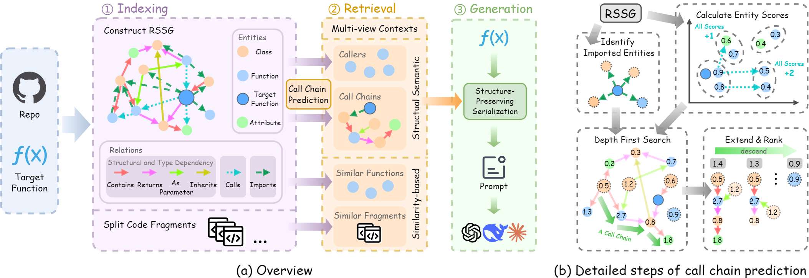
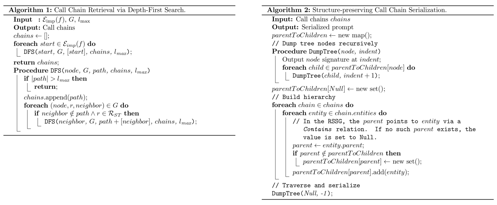

# RepoScope: Leveraging Call Chain-Aware Multi-View Contexts for Repository-Level Code Generation

This repository contains the implementation of **RepoScope**, a call chain-aware, multi-view context framework for repository-level code generation.



---

## 📝 Abstract

> Repository-level code generation aims to generate code within the context of a specified repository. Existing approaches typically employ retrieval-augmented generation (RAG) techniques to provide LLMs with relevant contextual information extracted from the repository. However, these approaches often struggle with effectively identifying truly relevant contexts that capture the rich semantics of the repository, and their contextual perspectives remains narrow. Moreover, most approaches fail to account for the structural relationships in the retrieved code during prompt construction, hindering the LLM’s ability to accurately interpret the context. To address these issues, we propose RepoScope, which leverages call chain-aware multi-view context for repository-level code generation. RepoScope constructs a Repository Structural Semantic Graph (RSSG) and retrieves a comprehensive four-view context, integrating both structural and similarity-based contexts. We propose a novel call chain prediction method that utilizes the repository’s structural semantics to improve the identification of relevant callees. Additionally, we present a structure-preserving serialization algorithm for prompt construction, ensuring the coherence of the context for the LLM. Notably, RepoScope relies solely on static analysis, eliminating the need for additional training or multiple LLM queries, thus improving both efficiency and generalizability. Evaluation on widely-used repository-level code generation benchmarks (CoderEval and DevEval) demonstrates that RepoScope outperforms state-of-the-art methods, achieving up to a 36.35% relative improvement in pass@1 scores. Further experiments emphasize RepoScope’s potential to improve code generation across different tasks and its ability to integrate effectively with existing approaches.
 
---

## 🔧 Features

- 🌐 **RSSG Construction**: Builds a Repository Structural Semantic Graph capturing fine-grained structural semantics of repository.
- 🧠 **Call Chain Prediction**: Heuristic method leveraging repository structure to identify likely callees.
- 🔍 **Multi-View Context**: Four contextual views — Callers, Callees (Call Chains), Similar Functions, and Similar Code Fragments.
- 📐 **Structure-based Serialization**: Serializes retrieved entities into token sequences while preserving repository hierarchy.
- ⚙️ **Dynamic Prompt Assembly**: Context-aware prompt construction under token budget constraints.

---

## 📄 Algorithm Supplement (Pseudocode)



## 📁 Project Structure

```text
.
├── config/                   # Directory for experiment configurations.
│   ├── config_rq1.yaml       # Config for RQ1: Overall performance evaluation.
│   ├── config_rq2_*.yaml     # Configs for RQ2: Ablation studies, disabling different components or strategies.
│   ├── config_rq3.yaml       # Config for RQ3: Generalization capability evaluation.
│   └── config_rq4_*.yaml     # Configs for RQ4: Integration with other existing methods.
├── datasets/                 # Contains the benchmark datasets used for evaluation.
│   ├── codereval.jsonl       # CoderEval benchmark data (Python subset).
│   ├── deveval.jsonl         # DevEval benchmark data.
│   ├── repoeval.jsonl        # RepoEval benchmark data (API-level subset).
│   └── ...                   # Other auxiliary or intermediate dataset files.
├── .gitignore                # Standard git ignore file.
├── README.md                 # This file.
├── requirements.txt          # Lists all Python dependencies for the project.
├── scripts/                  # Contains execution scripts.
│   └── run_pipeline.sh       # Main shell script to run the entire RepoScope pipeline for an experiment.
├── src/                      # Main source code for the RepoScope framework.
│   ├── code_graph/           # Core module for building and operating on the Repository Structural Semantic Graph (RSSG).
│   │   ├── call_chain.py     # Implements the novel **call chain prediction** method, a key contribution.
│   │   ├── node/             # Defines the different types of entities in the RSSG.
│   │   │   ├── attr_node.py  # Represents attribute definitions.
│   │   │   ├── base_node.py  # Abstract base class for all nodes.
│   │   │   ├── class_node.py # Represents class definitions.
│   │   │   └── func_node.py  # Represents function/method definitions.
│   │   ├── parser.py         # Parses the source code of a repository into an Abstract Syntax Tree (AST), constructs the initial RSSG, and implement partial call chain prediction logic.
│   │   ├── relationship/     # Defines the relations in the RSSG.
│   │   │   ├── contains_relationship.py    # e.g., Class contains Method.
│   │   │   ├── inherit_relationship.py     # e.g., Class inherits from another Class.
│   │   │   └── ...           # Other relationship types like 'as parameter', 'returns', etc.
│   │   └── similarity/       # Handles similarity-based computations for context retrieval.
│   │   │   ├── embedder.py   # Manages the creation of code embeddings for similarity search.
│   │       └── kmeans_cluster.py  # Cluster entities using the k-means algorithm.
│   ├── config/               # Application-level configuration.
│   │   ├── config.py         # Loads and manages configuration settings for the pipeline.
│   │   └── constants.py      # Defines global constants used throughout the project.
│   ├── evaluate/             # Module for evaluating the generated code.
│   │   ├── evaluator.py      # Runs the generated code against test cases and computes metrics (e.g., pass@1).
│   │   └── extractor.py      # Extracts the code block from the LLM's raw output.
│   ├── generate/             # Module responsible for prompt construction and LLM interaction.
│   │   ├── build_prompt.py   # Assembles the final prompt from the retrieved **four-view context**.
│   │   ├── llm_client.py     # Handles API calls to the Large Language Models (LLMs).
│   │   ├── prompt_template.py# Defines the templates for prompts sent to the LLM.
│   │   └── tokenizer.py      # Class for token counting to manage context window limits.
│   ├── pipeline.py           # The main orchestrator that connects all components of the RepoScope workflow.
│   ├── retrieve/             # Implements the code fragments retrieval logic.
│   │   ├── retriever.py      # Main retriever class, developed from RepoEval.
│   │   ├── search_code.py    # Search similar code fragments from all fragments.
│   │   ├── build_vector.py   # Builds and saves the vector for similarity search.
│   │   ├── make_fragment.py  # Convert task query and repository source code into fragments using the sliding window algorithm.
│   │   └── vectorizer.py     # Class for vectorizing code fragments.
│   └── utils/                # Utility functions and helper classes.
│       ├── dataset_loader.py # Helper to load and preprocess datasets.
│       ├── filepath_builder.py     # Construct storage paths for intermediate and final results.
│       └── tools.py          # General-purpose helper functions.
└── supplementary/            # Supplementary materials for the pseudocode of algorithms in the main text.
    ├── algo1.pdf             # Pseudocode of Call Chain Retrieval via Depth-First Search.
    └── algo2.pdf             # Pseudocode of Structure-based Call Chain Serialization.
```

---

## ⚙️ Environment

* 🐧 Linux system (Ubuntu 20.04 or later recommended)
* 🐍 Python 3.9
* 🐳 Docker

---

## 🚀 Getting Started

### 1. Install Dependencies

```bash
pip install -r requirements.txt
```

### 2. Prepare Data and Model

- Download [repositories](https://drive.google.com/drive/folders/13auMYYZJvcWbnLEsSyVRjiPhUs58NM_6?usp=sharing) and extract all zip files to the `./repos` directory.
- Download the [bge-small-en-v1.5](https://huggingface.co/BAAI/bge-small-en-v1.5) model to the `./models/bge-small-en-v1.5/` directory.

### 3. Prepare Code Evaluation Environment 

- Pull the CoderEval evaluation environment [image](https://hub.docker.com/r/3usi9/codereval) and rename it to `codereval`
- Following the instructions in `./repos/deveval_for_evaluate/README.md`, create a conda virtual environment named `deveval`.

### 4. Set the API key for LLMs

- Create a file named `_key.yaml` under the `./config` directory and add the following content:

    ```yaml
    deepseek_api_key: "<YOUR_DEEPSEEK_API_KEY>"
    ```

---

## 📊 Evaluation

### RQ1: Overall Performance

```shell
./scripts/run_pipeline.sh --config=config_rq1
```

You can modify the configuration in the corresponding YAML file under the `./config` directory to use other backbone models or evaluate other datasets.

### RQ2: Ablation Study

```shell
# w/o Ca
./scripts/run_pipeline.sh --config=config_rq2_without_Ca

# w/o CC
./scripts/run_pipeline.sh --config=config_rq2_without_CC

# w/o SF
./scripts/run_pipeline.sh --config=config_rq2_without_SF

# w/o SCF
./scripts/run_pipeline.sh --config=config_rq2_without_SCF

# w/o WES
./scripts/run_pipeline.sh --config=config_rq2_without_WES

# w/o DFS
./scripts/run_pipeline.sh --config=config_rq2_without_DFS

# w/o CCE
./scripts/run_pipeline.sh --config=config_rq2_without_CCE

# w/o SS
./scripts/run_pipeline.sh --config=config_rq2_without_SS
```

### RQ3: Generalization Capability

```shell
./scripts/run_pipeline.sh --config=config_rq3
```

### RQ4: Integration with Existing Approaches

```shell
# Baseline (RepoScope*)
./scripts/run_pipeline.sh --config=config_rq4_baseline

# +RepoCoder
./scripts/run_pipeline.sh --config=config_rq4_baseline+repocoder

# +RLCoder
./scripts/run_pipeline.sh --config=config_rq4_baseline+rlcoder
```


