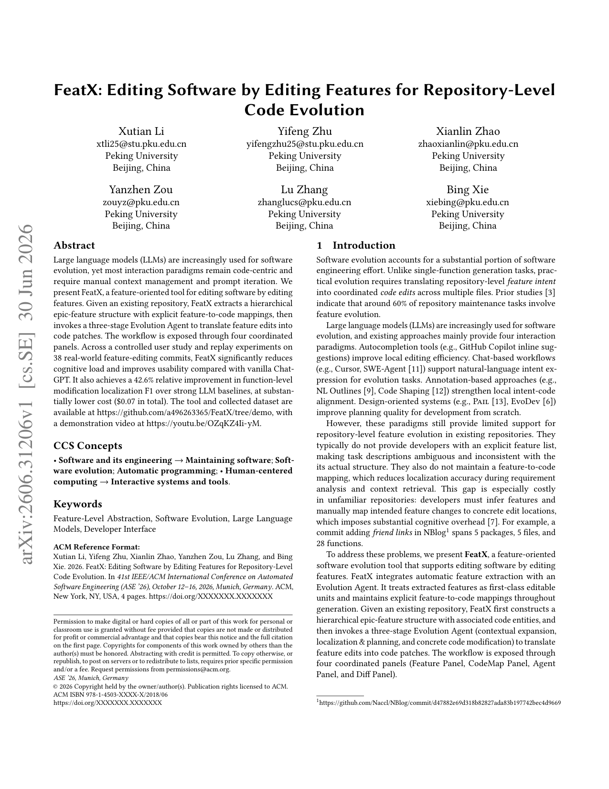
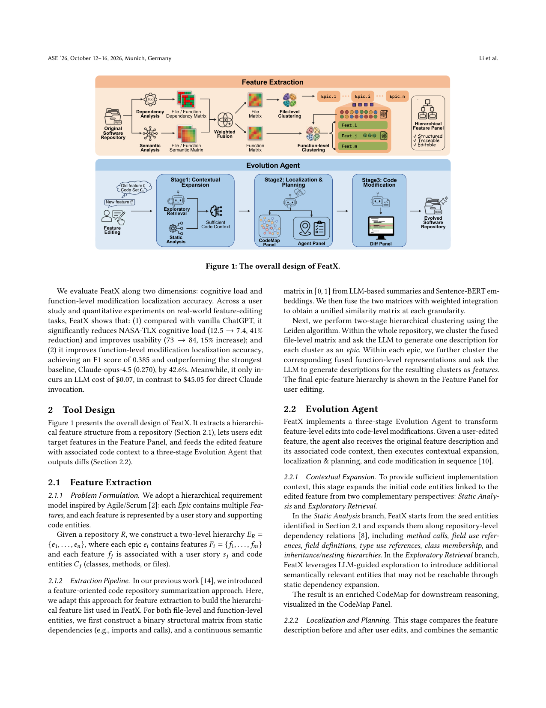
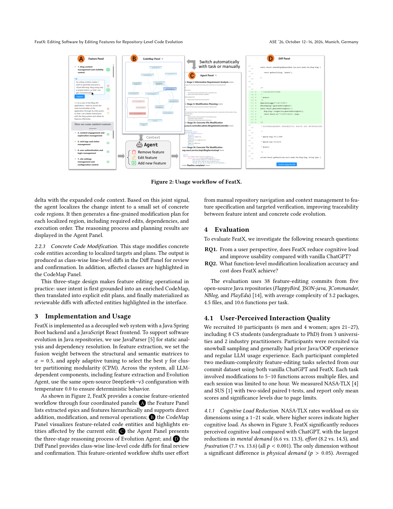
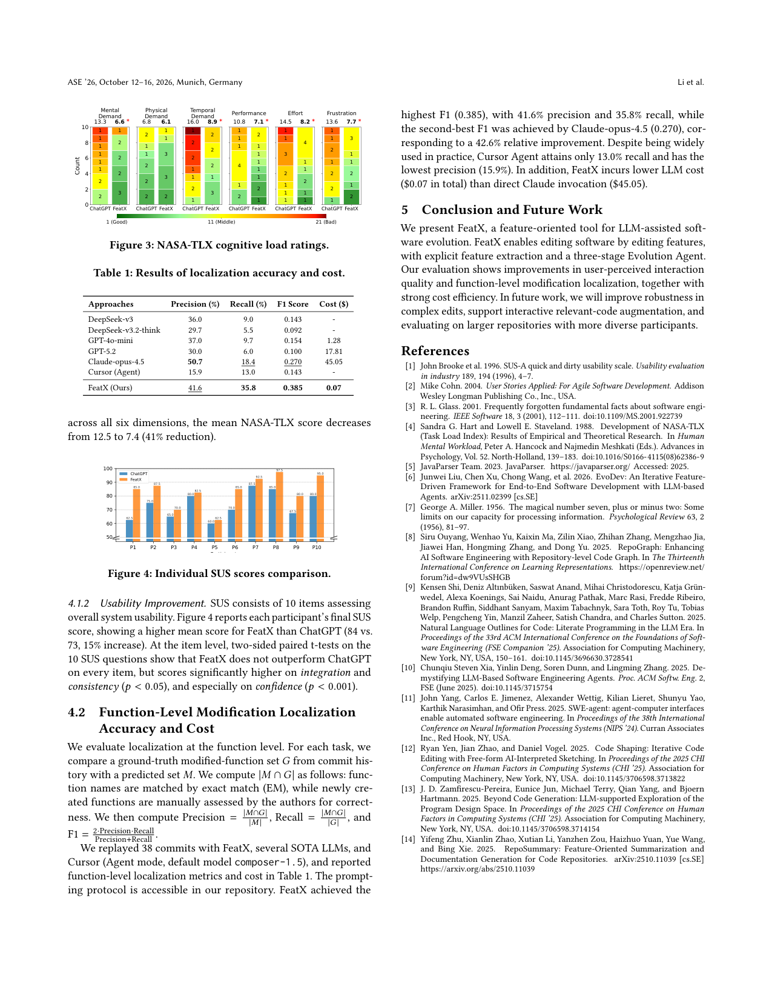

# FeatX: Editing Software by Editing Features for Repository-Level Code Evolution

- source_pdf: ../../../../../pdf/Documentation-Code/fourth/FeatX.pdf
- extraction_tool: PyMuPDF
- extraction_date: 2026-11-24
- status: automatic-text-extraction; not manually verified
- pagination: physical PDF pages, starting at 1

> Copia de trabajo para búsqueda y citas. Verifica tablas, fórmulas, figuras y orden visual en el PDF original o en el PNG de la página.

<!-- PDF page 1 -->

## Página PDF 1

FeatX: Editing Software by Editing Features for Repository-Level
Code Evolution
Xutian Li
xtli25@stu.pku.edu.cn
Peking University
Beijing, China
Yifeng Zhu
yifengzhu25@stu.pku.edu.cn
Peking University
Beijing, China
Xianlin Zhao
zhaoxianlin@pku.edu.cn
Peking University
Beijing, China
Yanzhen Zou
zouyz@pku.edu.cn
Peking University
Beijing, China
Lu Zhang
zhanglucs@pku.edu.cn
Peking University
Beijing, China
Bing Xie
xiebing@pku.edu.cn
Peking University
Beijing, China
Abstract
Large language models (LLMs) are increasingly used for software
evolution, yet most interaction paradigms remain code-centric and
require manual context management and prompt iteration. We
present FeatX, a feature-oriented tool for editing software by editing
features. Given an existing repository, FeatX extracts a hierarchical
epic-feature structure with explicit feature-to-code mappings, then
invokes a three-stage Evolution Agent to translate feature edits into
code patches. The workflow is exposed through four coordinated
panels. Across a controlled user study and replay experiments on
38 real-world feature-editing commits, FeatX significantly reduces
cognitive load and improves usability compared with vanilla Chat-
GPT. It also achieves a 42.6% relative improvement in function-level
modification localization F1 over strong LLM baselines, at substan-
tially lower cost ($0.07 in total). The tool and collected dataset are
available at https://github.com/a496263365/FeatX/tree/demo, with
a demonstration video at https://youtu.be/OZqKZ4Ii-yM.
CCS Concepts
• Software and its engineering →Maintaining software; Soft-
ware evolution; Automatic programming; • Human-centered
computing →Interactive systems and tools.
Keywords
Feature-Level Abstraction, Software Evolution, Large Language
Models, Developer Interface
ACM Reference Format:
Xutian Li, Yifeng Zhu, Xianlin Zhao, Yanzhen Zou, Lu Zhang, and Bing
Xie. 2026. FeatX: Editing Software by Editing Features for Repository-Level
Code Evolution. In 41st IEEE/ACM International Conference on Automated
Software Engineering (ASE ’26), October 12–16, 2026, Munich, Germany. ACM,
New York, NY, USA, 4 pages. https://doi.org/XXXXXXX.XXXXXXX
Permission to make digital or hard copies of all or part of this work for personal or
classroom use is granted without fee provided that copies are not made or distributed
for profit or commercial advantage and that copies bear this notice and the full citation
on the first page. Copyrights for components of this work owned by others than the
author(s) must be honored. Abstracting with credit is permitted. To copy otherwise, or
republish, to post on servers or to redistribute to lists, requires prior specific permission
and/or a fee. Request permissions from permissions@acm.org.
ASE ’26, Munich, Germany
© 2026 Copyright held by the owner/author(s). Publication rights licensed to ACM.
ACM ISBN 978-1-4503-XXXX-X/2018/06
https://doi.org/XXXXXXX.XXXXXXX
1
Introduction
Software evolution accounts for a substantial portion of software
engineering effort. Unlike single-function generation tasks, prac-
tical evolution requires translating repository-level feature intent
into coordinated code edits across multiple files. Prior studies [3]
indicate that around 60% of repository maintenance tasks involve
feature evolution.
Large language models (LLMs) are increasingly used for software
evolution, and existing approaches mainly provide four interaction
paradigms. Autocompletion tools (e.g., GitHub Copilot inline sug-
gestions) improve local editing efficiency. Chat-based workflows
(e.g., Cursor, SWE-Agent [11]) support natural-language intent ex-
pression for evolution tasks. Annotation-based approaches (e.g.,
NL Outlines [9], Code Shaping [12]) strengthen local intent-code
alignment. Design-oriented systems (e.g., Pail [13], EvoDev [6])
improve planning quality for development from scratch.
However, these paradigms still provide limited support for
repository-level feature evolution in existing repositories. They
typically do not provide developers with an explicit feature list,
making task descriptions ambiguous and inconsistent with the
its actual structure. They also do not maintain a feature-to-code
mapping, which reduces localization accuracy during requirement
analysis and context retrieval. This gap is especially costly
in unfamiliar repositories: developers must infer features and
manually map intended feature changes to concrete edit locations,
which imposes substantial cognitive overhead [7]. For example, a
commit adding friend links in NBlog1 spans 5 packages, 5 files, and
28 functions.
To address these problems, we present FeatX, a feature-oriented
software evolution tool that supports editing software by editing
features. FeatX integrates automatic feature extraction with an
Evolution Agent. It treats extracted features as first-class editable
units and maintains explicit feature-to-code mappings throughout
generation. Given an existing repository, FeatX first constructs a
hierarchical epic-feature structure with associated code entities, and
then invokes a three-stage Evolution Agent (contextual expansion,
localization & planning, and concrete code modification) to translate
feature edits into code patches. The workflow is exposed through
four coordinated panels (Feature Panel, CodeMap Panel, Agent
Panel, and Diff Panel).
1https://github.com/Naccl/NBlog/commit/d47882e69d318b82827ada83b197742bec4d9669
arXiv:2606.31206v1  [cs.SE]  30 Jun 2026

[Vista original de la página 1](../../../../../images/v5/estructura_colecciones/Documentation-Code/fourth/FeatX/page-01.png)

<!-- PDF page 2 -->

## Página PDF 2

ASE ’26, October 12–16, 2026, Munich, Germany
Li et al.
Feature Extraction
Evolution Agent
File / Function 
Dependency Matrix
File / Function 
Semantic Matrix
Dependency 
Analysis
Semantic 
Analysis
Weighted
Fusion
Function 
Matrix
File 
Matrix
Function-level
Clustering
Epic.1
Epic.i
Epic.n
Feat.1
Feat.j
Feat.m
File-level
Clustering
c1 c2 c3
Original
Software
Repository
Feature
Editing
Stage3: Code 
Modification
Diff Panel
Stage2: Localization & 
Planning
CodeMap 
Panel
Agent Panel
Stage1: Contextual 
Expansion
Static 
Analysis
Exploratory
Retrieval
Sufficient 
Code Context
Hierarchical
Feature Panel
√Structured
√Traceable
√ Editable
Evolved
Software
Repository
New feature fj
′ 
Old feature fj
Code Set 𝐂𝐂𝐣𝐣
Figure 1: The overall design of FeatX.
We evaluate FeatX along two dimensions: cognitive load and
function-level modification localization accuracy. Across a user
study and quantitative experiments on real-world feature-editing
tasks, FeatX shows that: (1) compared with vanilla ChatGPT, it
significantly reduces NASA-TLX cognitive load (12.5 →7.4, 41%
reduction) and improves usability (73 →84, 15% increase); and
(2) it improves function-level modification localization accuracy,
achieving an F1 score of 0.385 and outperforming the strongest
baseline, Claude-opus-4.5 (0.270), by 42.6%. Meanwhile, it only in-
curs an LLM cost of $0.07, in contrast to $45.05 for direct Claude
invocation.
2
Tool Design
Figure 1 presents the overall design of FeatX. It extracts a hierarchi-
cal feature structure from a repository (Section 2.1), lets users edit
target features in the Feature Panel, and feeds the edited feature
with associated code context to a three-stage Evolution Agent that
outputs diffs (Section 2.2).
2.1
Feature Extraction
2.1.1
Problem Formulation. We adopt a hierarchical requirement
model inspired by Agile/Scrum [2]: each Epic contains multiple Fea-
tures, and each feature is represented by a user story and supporting
code entities.
Given a repository 𝑅, we construct a two-level hierarchy 𝐸𝑅=
{𝑒1, . . . ,𝑒𝑛}, where each epic 𝑒𝑖contains features 𝐹𝑖= {𝑓1, . . . , 𝑓𝑚}
and each feature 𝑓𝑗is associated with a user story 𝑠𝑗and code
entities 𝐶𝑗(classes, methods, or files).
2.1.2
Extraction Pipeline. In our previous work [14], we introduced
a feature-oriented code repository summarization approach. Here,
we adapt this approach for feature extraction to build the hierarchi-
cal feature list used in FeatX. For both file-level and function-level
entities, we first construct a binary structural matrix from static
dependencies (e.g., imports and calls), and a continuous semantic
matrix in [0, 1] from LLM-based summaries and Sentence-BERT em-
beddings. We then fuse the two matrices with weighted integration
to obtain a unified similarity matrix at each granularity.
Next, we perform two-stage hierarchical clustering using the
Leiden algorithm. Within the whole repository, we cluster the fused
file-level matrix and ask the LLM to generate one description for
each cluster as an epic. Within each epic, we further cluster the
corresponding fused function-level representations and ask the
LLM to generate descriptions for the resulting clusters as features.
The final epic-feature hierarchy is shown in the Feature Panel for
user editing.
2.2
Evolution Agent
FeatX implements a three-stage Evolution Agent to transform
feature-level edits into code-level modifications. Given a user-edited
feature, the agent also receives the original feature description and
its associated code context, then executes contextual expansion,
localization & planning, and code modification in sequence [10].
2.2.1
Contextual Expansion. To provide sufficient implementation
context, this stage expands the initial code entities linked to the
edited feature from two complementary perspectives: Static Analy-
sis and Exploratory Retrieval.
In the Static Analysis branch, FeatX starts from the seed entities
identified in Section 2.1 and expands them along repository-level
dependency relations [8], including method calls, field use refer-
ences, field definitions, type use references, class membership, and
inheritance/nesting hierarchies. In the Exploratory Retrieval branch,
FeatX leverages LLM-guided exploration to introduce additional
semantically relevant entities that may not be reachable through
static dependency expansion.
The result is an enriched CodeMap for downstream reasoning,
visualized in the CodeMap Panel.
2.2.2
Localization and Planning. This stage compares the feature
description before and after user edits, and combines the semantic

[Vista original de la página 2](../../../../../images/v5/estructura_colecciones/Documentation-Code/fourth/FeatX/page-02.png)

<!-- PDF page 3 -->

## Página PDF 3

FeatX: Editing Software by Editing Features for Repository-Level Code Evolution
ASE ’26, October 12–16, 2026, Munich, Germany
Remove feature 
Edit feature
Add new Feature
Agent
Context
Switch automatically 
with task or manually 
C
A
B
D
Figure 2: Usage workflow of FeatX.
delta with the expanded code context. Based on this joint signal,
the agent localizes the change intent to a small set of concrete
code regions. It then generates a fine-grained modification plan for
each localized region, including required edits, dependencies, and
execution order. The reasoning process and planning results are
displayed in the Agent Panel.
2.2.3
Concrete Code Modification. This stage modifies concrete
code entities according to localized targets and plans. The output is
produced as class-wise line-level diffs in the Diff Panel for review
and confirmation. In addition, affected classes are highlighted in
the CodeMap Panel.
This three-stage design makes feature editing operational in
practice: user intent is first grounded into an enriched CodeMap,
then translated into explicit edit plans, and finally materialized as
reviewable diffs with affected entities highlighted in the interface.
3
Implementation and Usage
FeatX is implemented as a decoupled web system with a Java Spring
Boot backend and a JavaScript React frontend. To support software
evolution in Java repositories, we use JavaParser [5] for static anal-
ysis and dependency resolution. In feature extraction, we set the
fusion weight between the structural and semantic matrices to
𝛼= 0.5, and apply adaptive tuning to select the best 𝛾for clus-
ter partitioning modularity (CPM). Across the system, all LLM-
dependent components, including feature extraction and Evolution
Agent, use the same open-source DeepSeek-v3 configuration with
temperature 0.0 to ensure deterministic behavior.
As shown in Figure 2, FeatX provides a concise feature-oriented
workflow through four coordinated panels: A the Feature Panel
lists extracted epics and features hierarchically and supports direct
addition, modification, and removal operations; B the CodeMap
Panel visualizes feature-related code entities and highlights en-
tities affected by the current edit; C the Agent Panel presents
the three-stage reasoning process of Evolution Agent; and D the
Diff Panel provides class-wise line-level code diffs for final review
and confirmation. This feature-oriented workflow shifts user effort
from manual repository navigation and context management to fea-
ture specification and targeted verification, improving traceability
between feature intent and concrete code evolution.
4
Evaluation
To evaluate FeatX, we investigate the following research questions:
RQ1. From a user perspective, does FeatX reduce cognitive load
and improve usability compared with vanilla ChatGPT?
RQ2. What function-level modification localization accuracy and
cost does FeatX achieve?
The evaluation uses 38 feature-editing commits from five
open-source Java repositories (FlappyBird, JSON-java, JCommander,
NBlog, and PlayEdu) [14], with average complexity of 3.2 packages,
4.5 files, and 10.6 functions per task.
4.1
User-Perceived Interaction Quality
We recruited 10 participants (6 men and 4 women; ages 21–27),
including 8 CS students (undergraduate to PhD) from 3 universi-
ties and 2 industry practitioners. Participants were recruited via
snowball sampling and generally had prior Java/OOP experience
and regular LLM usage experience. Each participant completed
two medium-complexity feature-editing tasks selected from our
commit dataset using both vanilla ChatGPT and FeatX. Each task
involved modifications to 5–10 functions across multiple files, and
each session was limited to one hour. We measured NASA-TLX [4]
and SUS [1] with two-sided paired t-tests, and report only mean
scores and significance levels due to page limits.
4.1.1
Cognitive Load Reduction. NASA-TLX rates workload on six
dimensions using a 1–21 scale, where higher scores indicate higher
cognitive load. As shown in Figure 3, FeatX significantly reduces
perceived cognitive load compared with ChatGPT, with the largest
reductions in mental demand (6.6 vs. 13.3), effort (8.2 vs. 14.5), and
frustration (7.7 vs. 13.6) (all 𝑝< 0.001). The only dimension without
a significant difference is physical demand (𝑝> 0.05). Averaged

[Vista original de la página 3](../../../../../images/v5/estructura_colecciones/Documentation-Code/fourth/FeatX/page-03.png)

<!-- PDF page 4 -->

## Página PDF 4

ASE ’26, October 12–16, 2026, Munich, Germany
Li et al.
ChatGPT FeatX
0
2
4
6
8
10
Count
3
2
2
2
2
2
1
1
1
1
1
1
1
13.3
6.6 *
Mental
Demand
ChatGPT FeatX
2
2
2
3
2
3
1
1
1
2
1
6.8
6.1
Physical
Demand
ChatGPT FeatX
3
1
1
2
2
2
1
2
1
2
2
1
16.0
8.9 *
Temporal
Demand
ChatGPT FeatX
1
2
1
2
1
1
1
1
1
4
2
1
1
1
10.8
7.1 *
Performance
ChatGPT FeatX
1
1
2
1
1
1
1
4
1
2
3
1
1
14.5
8.2 *
Effort
ChatGPT FeatX
2
1
1
2
1
1
2
3
2
1
2
1
1
13.6
7.7 *
Frustration
1 (Good)
11 (Middle)
21 (Bad)
Figure 3: NASA-TLX cognitive load ratings.
Table 1: Results of localization accuracy and cost.
Approaches
Precision (%)
Recall (%)
F1 Score
Cost ($)
DeepSeek-v3
36.0
9.0
0.143
-
DeepSeek-v3.2-think
29.7
5.5
0.092
-
GPT-4o-mini
37.0
9.7
0.154
1.28
GPT-5.2
30.0
6.0
0.100
17.81
Claude-opus-4.5
50.7
18.4
0.270
45.05
Cursor (Agent)
15.9
13.0
0.143
-
FeatX (Ours)
41.6
35.8
0.385
0.07
across all six dimensions, the mean NASA-TLX score decreases
from 12.5 to 7.4 (41% reduction).
50
60
70
80
90
100
62.5
75.0
65.0
80.0
60.0
70.0
87.5
85.0
67.5
80.0
85.0
87.5
70.0
82.5
62.5
85.0
92.5
97.5
80.0
95.0
ChatGPT
FeatX
P1
P2
P3
P4
P5
P6
P7
P8
P9
P10
P
ti i
t
Figure 4: Individual SUS scores comparison.
4.1.2
Usability Improvement. SUS consists of 10 items assessing
overall system usability. Figure 4 reports each participant’s final SUS
score, showing a higher mean score for FeatX than ChatGPT (84 vs.
73, 15% increase). At the item level, two-sided paired t-tests on the
10 SUS questions show that FeatX does not outperform ChatGPT
on every item, but scores significantly higher on integration and
consistency (𝑝< 0.05), and especially on confidence (𝑝< 0.001).
4.2
Function-Level Modification Localization
Accuracy and Cost
We evaluate localization at the function level. For each task, we
compare a ground-truth modified-function set 𝐺from commit his-
tory with a predicted set 𝑀. We compute |𝑀∩𝐺| as follows: func-
tion names are matched by exact match (EM), while newly cre-
ated functions are manually assessed by the authors for correct-
ness. We then compute Precision = |𝑀∩𝐺|
|𝑀| , Recall = |𝑀∩𝐺|
|𝐺| , and
F1 = 2·Precision·Recall
Precision+Recall .
We replayed 38 commits with FeatX, several SOTA LLMs, and
Cursor (Agent mode, default model composer-1.5), and reported
function-level localization metrics and cost in Table 1. The prompt-
ing protocol is accessible in our repository. FeatX achieved the
highest F1 (0.385), with 41.6% precision and 35.8% recall, while
the second-best F1 was achieved by Claude-opus-4.5 (0.270), cor-
responding to a 42.6% relative improvement. Despite being widely
used in practice, Cursor Agent attains only 13.0% recall and has the
lowest precision (15.9%). In addition, FeatX incurs lower LLM cost
($0.07 in total) than direct Claude invocation ($45.05).
5
Conclusion and Future Work
We present FeatX, a feature-oriented tool for LLM-assisted soft-
ware evolution. FeatX enables editing software by editing features,
with explicit feature extraction and a three-stage Evolution Agent.
Our evaluation shows improvements in user-perceived interaction
quality and function-level modification localization, together with
strong cost efficiency. In future work, we will improve robustness in
complex edits, support interactive relevant-code augmentation, and
evaluating on larger repositories with more diverse participants.
References
[1] John Brooke et al. 1996. SUS-A quick and dirty usability scale. Usability evaluation
in industry 189, 194 (1996), 4–7.
[2] Mike Cohn. 2004. User Stories Applied: For Agile Software Development. Addison
Wesley Longman Publishing Co., Inc., USA.
[3] R. L. Glass. 2001. Frequently forgotten fundamental facts about software engi-
neering. IEEE Software 18, 3 (2001), 112–111. doi:10.1109/MS.2001.922739
[4] Sandra G. Hart and Lowell E. Staveland. 1988. Development of NASA-TLX
(Task Load Index): Results of Empirical and Theoretical Research. In Human
Mental Workload, Peter A. Hancock and Najmedin Meshkati (Eds.). Advances in
Psychology, Vol. 52. North-Holland, 139–183. doi:10.1016/S0166-4115(08)62386-9
[5] JavaParser Team. 2023. JavaParser. https://javaparser.org/ Accessed: 2025.
[6] Junwei Liu, Chen Xu, Chong Wang, et al. 2026. EvoDev: An Iterative Feature-
Driven Framework for End-to-End Software Development with LLM-based
Agents. arXiv:2511.02399 [cs.SE]
[7] George A. Miller. 1956. The magical number seven, plus or minus two: Some
limits on our capacity for processing information. Psychological Review 63, 2
(1956), 81–97.
[8] Siru Ouyang, Wenhao Yu, Kaixin Ma, Zilin Xiao, Zhihan Zhang, Mengzhao Jia,
Jiawei Han, Hongming Zhang, and Dong Yu. 2025. RepoGraph: Enhancing
AI Software Engineering with Repository-level Code Graph. In The Thirteenth
International Conference on Learning Representations. https://openreview.net/
forum?id=dw9VUsSHGB
[9] Kensen Shi, Deniz Altınbüken, Saswat Anand, Mihai Christodorescu, Katja Grün-
wedel, Alexa Koenings, Sai Naidu, Anurag Pathak, Marc Rasi, Fredde Ribeiro,
Brandon Ruffin, Siddhant Sanyam, Maxim Tabachnyk, Sara Toth, Roy Tu, Tobias
Welp, Pengcheng Yin, Manzil Zaheer, Satish Chandra, and Charles Sutton. 2025.
Natural Language Outlines for Code: Literate Programming in the LLM Era. In
Proceedings of the 33rd ACM International Conference on the Foundations of Soft-
ware Engineering (FSE Companion ’25). Association for Computing Machinery,
New York, NY, USA, 150–161. doi:10.1145/3696630.3728541
[10] Chunqiu Steven Xia, Yinlin Deng, Soren Dunn, and Lingming Zhang. 2025. De-
mystifying LLM-Based Software Engineering Agents. Proc. ACM Softw. Eng. 2,
FSE (June 2025). doi:10.1145/3715754
[11] John Yang, Carlos E. Jimenez, Alexander Wettig, Kilian Lieret, Shunyu Yao,
Karthik Narasimhan, and Ofir Press. 2025. SWE-agent: agent-computer interfaces
enable automated software engineering. In Proceedings of the 38th International
Conference on Neural Information Processing Systems (NIPS ’24). Curran Associates
Inc., Red Hook, NY, USA.
[12] Ryan Yen, Jian Zhao, and Daniel Vogel. 2025. Code Shaping: Iterative Code
Editing with Free-form AI-Interpreted Sketching. In Proceedings of the 2025 CHI
Conference on Human Factors in Computing Systems (CHI ’25). Association for
Computing Machinery, New York, NY, USA. doi:10.1145/3706598.3713822
[13] J. D. Zamfirescu-Pereira, Eunice Jun, Michael Terry, Qian Yang, and Bjoern
Hartmann. 2025. Beyond Code Generation: LLM-supported Exploration of the
Program Design Space. In Proceedings of the 2025 CHI Conference on Human
Factors in Computing Systems (CHI ’25). Association for Computing Machinery,
New York, NY, USA. doi:10.1145/3706598.3714154
[14] Yifeng Zhu, Xianlin Zhao, Xutian Li, Yanzhen Zou, Haizhuo Yuan, Yue Wang,
and Bing Xie. 2025.
RepoSummary: Feature-Oriented Summarization and
Documentation Generation for Code Repositories. arXiv:2510.11039 [cs.SE]
https://arxiv.org/abs/2510.11039

[Vista original de la página 4](../../../../../images/v5/estructura_colecciones/Documentation-Code/fourth/FeatX/page-04.png)

