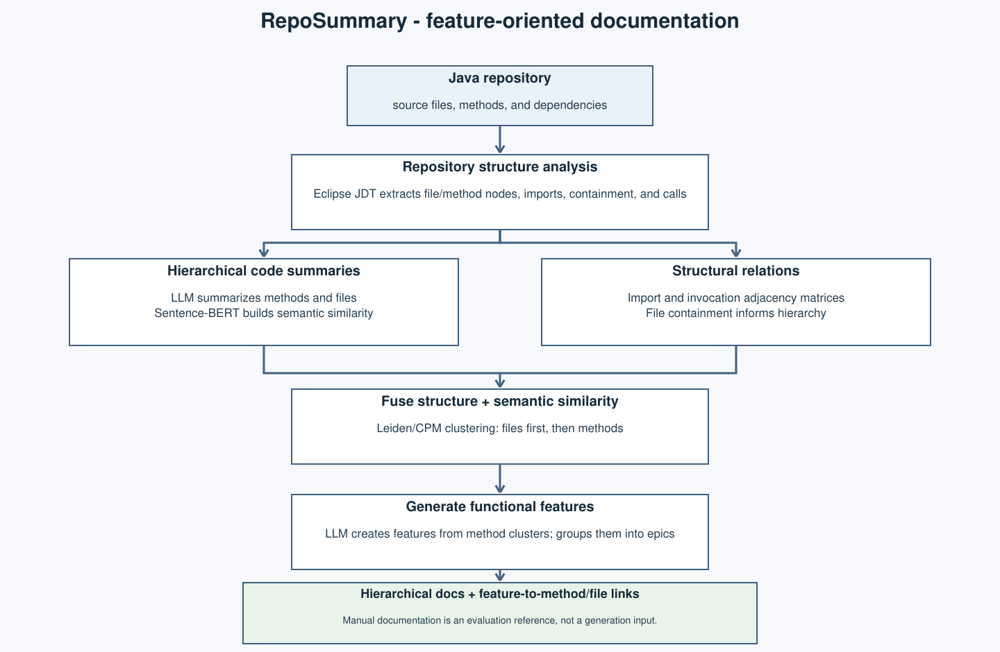

# RepoSummary: Feature-Oriented Summarization and Documentation Generation for Code Repositories

## Identity
- **paper_id:** arXiv:2510.11039v1.
- **Title:** *RepoSummary: Feature-Oriented Summarization and Documentation Generation for Code Repositories*.
- **Authors:** Yifeng Zhu, Xianlin Zhao, Xutian Li, Yanzhen Zou, Haizhuo Yuan, Yue Wang, and Bing Xie.
- **Year/version:** 2025; arXiv version 1, submitted 13 October 2025 (arXiv record).
- **Venue:** Not verified. The local PDF retains conference and DOI placeholders.
- **DOI:** 10.48550/arXiv.2510.11039 (arXiv-issued DOI).
- **Source:** [arXiv record](https://arxiv.org/abs/2510.11039v1); local PDF [`repoSummary.pdf`](../../../../../pdf/Documentation-Code/fourth/repoSummary.pdf).
- **Group/tags:** `Documentation-Code/fourth` (existing placement; not reclassified).
- **Coverage:** Analytical reading of the introduction, approach, evaluation, results, discussion, and conclusion; related work and references were not exhaustively reviewed. The PDF has 22 physical pages. Text extraction was used for analysis; figures were not all visually checked.
- **Rights note:** The arXiv record links to its [non-exclusive distribution license](https://arxiv.org/licenses/nonexclusive-distrib/1.0/). This file is an original research note, not a full-text transcription.

## Question and contribution
RepoSummary targets repository comprehension and maintenance. It generates hierarchical, feature-oriented documentation from repository code and links generated features to the methods and files that implement them. Its central distinction from directory- or module-oriented summaries is organizing documentation around inferred functionality while retaining fine-grained code links (RepoSummary, local PDF, pp. 1–3).

## Method
1. **Repository structure analysis:** Eclipse JDT Core extracts Java file and method entities and relations such as imports, file containment, and method invocations; these relations form structural adjacency matrices (RepoSummary, local PDF, §3.1, p. 6).
2. **Hierarchical code summaries:** An LLM summarizes methods using source code, fully qualified names, and related methods. Method summaries include functionality, workflow, and quality aspects. File summaries use source when it fits the context window and method summaries otherwise (RepoSummary, local PDF, §3.2, pp. 6–7).
3. **Semantic representation and clustering:** Sentence-BERT embeddings of summaries form semantic-similarity matrices. RepoSummary combines structural adjacency and semantic similarity, clusters files with Leiden/CPM, then clusters methods within file clusters. The CPM resolution parameter is tuned using stability, separation, and small-cluster fraction (RepoSummary, local PDF, §3.3, pp. 7–8).
4. **Documentation generation:** An LLM turns method clusters into functional features and aggregates features from each file cluster into epics. The resulting hierarchy links features to methods and files. The described feature prompt requests a description, workflow, and non-functional constraints (RepoSummary, local PDF, §3.4, p. 8).

[Vector version](../../../../../images/v5/estructura_colecciones/Documentation-Code/fourth/repoSummary/pipeline.svg).

## Documents and architecture
- **Generated artifact:** feature-oriented repository documentation organized as epics and features, with code trace links (RepoSummary, local PDF, §3.4, pp. 8–9).
- **Source of generated content:** repository code, static relations, and LLM-generated code summaries; manual documentation is used as evaluation reference, not described as an input to generation (RepoSummary, local PDF, §§3.2–3.4, 4, pp. 6–9).
- **Granularity:** method-level feature links and file-level epic grouping (RepoSummary, local PDF, §3.4, p. 9).
- **Not established by this paper:** API-document retrieval or selection for a generation requirement; architecture models/diagrams; documentation provenance at claim level; or temporal documentation across repository versions.

## Evaluation
- **Research questions:** feature coverage, traceability-link quality, usefulness for task navigation, and component ablation (RepoSummary, local PDF, §4, p. 9).
- **Repository dataset:** Dronology, eTour, and iTrust (Java), with manual feature documentation and trace links (RepoSummary, local PDF, §4.2, pp. 9–10).
- **Commit dataset:** 26 real-world commits from three GitHub projects, used to evaluate navigation/localization (RepoSummary, local PDF, §5.3, p. 16).
- **Baselines:** HMCS and HGEN. The reported generation backbones are GPT-4o mini and Claude 3 (RepoSummary, local PDF, §§4.1, 5.1–5.2, pp. 9, 13, 15–16).
- **Coverage evaluation:** Covered (C), Covered by (CB), and Completely Covered (CC). The paper uses LLM judges for relevance and completeness, with human comparison; human coverage ratings were limited to eTour and iTrust (RepoSummary, local PDF, §§4.3–4.4, pp. 10–13).
- **Traceability and task navigation:** precision, recall, and F1; task navigation also reports Link@k (RepoSummary, local PDF, §§4.3.2, 5.2–5.3, pp. 11, 15–16).
- **Ablations:** remove structural adjacency, semantic similarity, file-level clustering, or method-level clustering (RepoSummary, local PDF, §5.4, p. 17).

## Results reported by the paper
| Measure | RepoSummary result | Comparison/context |
|---|---:|---|
| Complete feature coverage (CC) | 0.711 average | GPT-4o mini; HGEN 0.612 average (RepoSummary, local PDF, pp. 13–14) |
| Trace-link recall | 0.530 average | GPT-4o mini; HGEN 0.299 average (RepoSummary, local PDF, pp. 15–16) |
| Trace-link F1 | 0.327 average | GPT-4o mini; HGEN 0.302 average (RepoSummary, local PDF, p. 16) |
| Link@3 recall / F1 | 0.622 / 0.406 | 26-commit navigation evaluation (RepoSummary, local PDF, p. 16) |
| Ablation without method-level clustering: CC / F1 | 0.385 / 0.184 | Full approach: 0.711 / 0.327 (RepoSummary, local PDF, p. 17) |

These are results reported in the paper, not independently reproduced here. The paper also reports human/LLM-judge coverage-score correlations from 0.590 to 0.839; the human comparison did not cover Dronology (RepoSummary, local PDF, pp. 12–13).

## Artifacts
The [official arXiv record](https://arxiv.org/abs/2510.11039v1) provides the preprint and TeX source. No code/data release link, pinned implementation version, or execution command was verified in the reviewed paper. Availability and reproducibility of implementation artifacts remain unverified.

## Relation to our thesis
RepoSummary is directly relevant to **generated repository documentation** and to connecting feature descriptions with implementing code (RepoSummary, local PDF, §§3–5, pp. 6–17). Its feature-oriented summaries may inform a documentation-generation component, but it does not demonstrate selecting documentation for a requirement over APIs retrieved by another system, nor that such documentation improves code generation. Any adaptation would need to distinguish generated from human-authored documents and evaluate the requirement-to-document/API links separately (interpretation based on RepoSummary, local PDF, §§3–5, pp. 6–17).

## Risks and limitations
- The implementation's static analysis supports Java; language transfer is proposed as future work, not evaluated (RepoSummary, local PDF, pp. 18–19).
- Main repository-level evaluation covers three repositories. The commit-based usefulness proxy covers 26 commits, not a controlled study of developers using generated docs (RepoSummary, local PDF, pp. 9–10, 16).
- Feature coverage depends on LLM judging and prompt choices. Human agreement checks cover only two repositories, and the reported judge correlations vary (RepoSummary, local PDF, §§4.4, 6.2, pp. 12–13, 18–19).
- The paper notes time overhead from LLM-based summarization and feature generation (RepoSummary, local PDF, §6.1, p. 18).
- Commit data is used for task-localization evaluation; this is not evidence of version-aware documentation generation (interpretation based on RepoSummary, local PDF, §§4.2, 5.3, pp. 9–10, 16).

## Evidence
| Claim | Source | PDF page(s) | Type |
|---|---|---:|---|
| Bibliographic identity, abstract claims, and page count | Local PDF; arXiv record | 1; arXiv record | Source metadata / reported claim |
| Problem framing and contribution | Local PDF | 2–3 | Paper claim |
| Parsing, summaries, matrices, clustering, and generated hierarchy | Local PDF | 6–8 | Method |
| Repository datasets, baselines, models, and research questions | Local PDF | 9–10 | Evaluation design |
| Metric definitions and LLM-as-judge procedure | Local PDF | 10–13 | Evaluation method |
| Coverage, traceability, navigation, and ablation results | Local PDF | 13–17 | Reported results |
| Language limitations and threats to validity | Local PDF | 18–19 | Authors' discussion |
| DOI and distribution-license link | arXiv record | n/a | External metadata |

## Pending
- Verify whether an official implementation or dataset is released and identify its version/license.
- Visually inspect tables and figures in the PDF before relying on fine-grained layout-dependent details.
- Assess whether the generated feature hierarchy can be adapted to API-linked, requirement-conditioned documents without treating RepoSummary as an evaluated code-generation method.
