# TLR_Recovering-Trace-Links-Between-Software-Documentation-And-Code

- source_pdf: ../../../../../pdf/Documentation-Code/primary/TLR_Recovering%20Trace%20Links%20Between%20Software%20Documentation%20And%20Code.pdf
- extraction_tool: pdfplumber
- extraction_date: 2026-11-24
- status: automatic-text-extraction; not manually verified
- pagination: physical PDF pages, starting at 1

> Copia de trabajo para búsqueda y citas. Verifica tablas, fórmulas, figuras y orden visual en el PDF original o en el PNG de la página.

<!-- PDF page 1 -->

## Página PDF 1

Recovering Trace Links Between
Software Documentation And Code
Jan Keim Sophie Corallo Dominik Fuchß
jan.keim@kit.edu sophie.corallo@kit.edu dominik.fuchss@kit.edu
Karlsruhe Institute of Technology Karlsruhe Institute of Technology Karlsruhe Institute of Technology
Karlsruhe, Germany Karlsruhe, Germany Karlsruhe, Germany
Tobias Hey Tobias Telge Anne Koziolek
hey@kit.edu tobias.telge@alumni.kit.edu koziolek@kit.edu
Karlsruhe Institute of Technology Karlsruhe Institute of Technology Karlsruhe Institute of Technology
Karlsruhe, Germany Karlsruhe, Germany Karlsruhe, Germany
ABSTRACT KEYWORDS
Introduction Software development involves creating various arti- software traceability, software architecture, documentation, transi-
facts at different levels of abstraction and establishing relationships tive links, intermediate artifacts, information retrieval
between them is essential. Traceability link recovery (TLR) auto-
ACMReferenceFormat:
mates this process, enhancing software quality by aiding tasks like
JanKeim,SophieCorallo,DominikFuchß,TobiasHey,TobiasTelge,andAnne
maintenance and evolution. However, automating TLR is challeng-
Koziolek. 2024.Recovering TraceLinks Between SoftwareDocumentation
ing due to semantic gaps resulting from different levels of abstrac- AndCode.In2024IEEE/ACM46thInternationalConferenceonSoftwareEn-
tion. While automated TLR approaches exist for requirements and gineering (ICSE ’24), April 14–20, 2024, Lisbon, Portugal. ACM, New York,
code,architecturedocumentationlackstailoredsolutions,hindering NY,USA,13pages.https://doi.org/10.1145/3597503.3639130
the preservation of architecture knowledge and design decisions.
Methods This paper presents our approach TransArC for TLR be- 1 INTRODUCTION
tween architecture documentation and code, using component-
During software development, various artifacts are created. These
based architecture models as intermediate artifacts to bridge the
artifacts are at different levels of abstraction and cover (partially)
semantic gap. We create transitive trace links by combining the
different aspects of a system. The problem is that the relationships
existing approach ArDoCo for linking architecture documentation
between the artifacts are not always apparent and, thus, cannot be
tomodelswithournovelapproachArCoTLforlinkingarchitecture
used.Makingtheserelationshipsexplicitimprovessoftwarequality
models to code.
and simplifies processes. As such, software traceability is an impor-
Results We evaluate our approaches with five open-source projects,
tant factor in successful software development. With traceability
comparing our results to baseline approaches. The model-to-code
link recovery (TLR), software engineers can connect any uniquely
TLR approach achieves an average F1-score of 0.98, while the
identifiable software engineering artifacts by creating explicit trace
documentation-to-code TLR approach achieves a promising av-
links, maintain these trace links, and use the resulting network to
erage F1-score of 0.82, significantly outperforming baselines.
gainknowledgeaboutthesoftwareproductanditsdevelopment[8].
Conclusion Combiningtwospecializedapproacheswithaninterme-
Therefore, software quality can be improved by creating and
diateartifactshowspromiseforbridgingthesemanticgap.Infuture
maintaining trace links [55]. For example, in collaborative devel-
research, we will explore further possibilities for such transitive
opment, TLR can help engineers to keep all artifacts synchronized
approaches.
and consistent [51]. Furthermore, traceability supports numerous
critical software engineering tasks (cf. [7]). For example, trace links
CCS CONCEPTS can improve the efficiency of software maintenance [33, 39], bug
• Software and its engineering → Software design engineering; localization [53], change impact analysis [10], and system secu-
Documentation; Maintaining software; Software evolution; Soft- rity [44, 46]. Trace links are also used to demonstrate the safety of
ware architectures; • Computing methodologies → Natural systems [38, 40, 45]. Some standards, such as ISO 26262 about the
language processing; Information extraction. functional safety of road vehicles, even mandate traceability.
Despite all the benefits, the main drawback of traceability is
the time-consuming and error-prone process of manually creating
and maintaining trace links [9, 52]. This is mainly due to the se-
mantic gap between artifacts of different abstraction levels [3], e.g.,
requirements and code. Some (semi-)automated approaches have
been designed to assist users but face the same challenge.
This work is licensed under a Creative Commons Attribution International 4.0 License. Likewise, automated TLR approaches often only look at require-
ICSE’24,April14–20,2024,Lisbon,Portugal ments and code. However, other types of artifacts, such as the
©2024Copyrightheldbytheowner/author(s).
documentation of the system’s software architecture, are just as
ACMISBN979-8-4007-0217-4/24/04.
https://doi.org/10.1145/3597503.3639130 relevant.Asoftware’sarchitectureiskeytosuccessfullydeveloping,

[Vista original de la página 1](../../../../../images/v5/estructura_colecciones/Documentation-Code/primary/TLR_Recovering-Trace-Links-Between-Software-Documentation-And-Code/page-01.png)

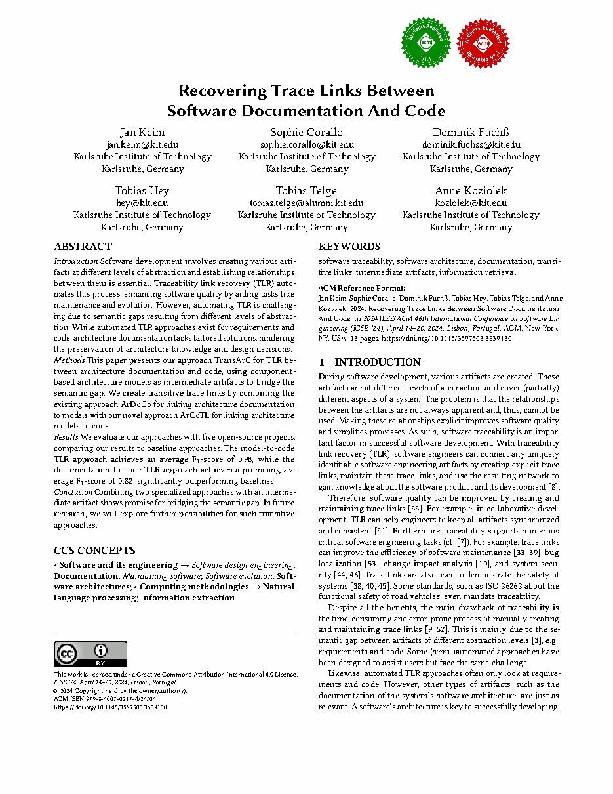

<!-- PDF page 2 -->

## Página PDF 2

ICSE’24,April14–20,2024,Lisbon,Portugal Keimetal.
Software
Figure1depictsanexampleofSADtoSAMtocode1.Weobserve
The controller receives incoming requests and verifies them.
Architecture two key components: the Controller on the left and the DataPersis-
Then, it answers requests querying the persistence component.
Documentation
tence on the right. The SAD details their respective responsibilities
and their structural relationship is visualized in the SAM. The code
Software implementation introduces two essential packages, namely ser-
Architecture Controller DataPersistence vice and dataaccess, each of which includes sub-packages such
Model
as auth and preferences. The Controller class effectively em-
ploys the Authenticator to verify incoming requests. The classes
Code com.example Products and Users serve as repositories, leveraging information
from hidden classes within the preferences package to establish
service dataaccess
connections with a database.
Controller Products Users In the example, elements that should be linked with trace links
are marked with the same color. Consequently, both sentences, due
auth preferences to the references to the terms “controller” and “it”, are associated
with the Controller component and the classes within the service
Authenticator package. Similarly, the second sentence is linked to the DataPersis-
tence component and the classes in the dataaccess package.
The example highlights several challenges encountered during
the creation of trace links. For instance, the description of the
Figure 1: Running example: System with software architec-
controller component is necessary to properly link it to the whole
ture documentation,software architecturemodel, and code1.
service package instead of only the Controller class. Another
challenge is the changed naming of the “persistence” component
in the SAD to dataaccess in the code. In such cases, using the
DataPersistence component in the SAM can help to bridge the gap.
This paper presents our novel approach using transitive links to
maintaining, and evolving the system [41]. Software architecture recover trace links between SADs and code. To bridge the semantic
documentation (SAD) preserves the knowledge about the archi- gapbetweendocumentationandcode,weuseintermediateartifacts
tecture, such as the underlying design decisions. Documentation in the form of component-based SAMs that describe the structure
prevents rapid deterioration [50, 65] and enhances the benefits of of the system, such as UML component diagrams. The idea is to
a good software architecture. Using trace links to find relevant combine two specialized approaches to improve the results for the
knowledge in SADs further enhances the utility of software archi- widersemanticgapbetweentheoriginalartifacts.Morespecifically,
tecture while improving the usability for developers and architects. we concatenate an approach for linking SADs and SAMs with an
Therefore, linking SADs to other software artifacts, such as other approachforlinkingSAMstocode.TolinkSADsandSAMs,weuse
design artifacts or code, is beneficial on several levels. the existing Architecture Documentation Consistency (ArDoCo)
Because different types of artifacts cover different aspects and approach by Keim et al. [25] as it is the state of the art for this
have different views on the system, these artifacts have different problem. For linking SAMs and code, we present a new approach
levels of abstraction, and, as such, there is a semantic gap between called ARchitecture-to-COde Trace Linking (ArCoTL). The ArCoTL
them [3]. Automated approaches have been developed to bridge approach uses several heuristics and aggregation methods that are
this gap by capturing the underlying semantics. However, this task concatenated in a graph to recover trace links. To be independent
is inherently challenging, and such approaches are prone to mis- of input languages and to support different component-based ar-
interpretation, leading to potential imprecision. To overcome the chitecture description languages and programming languages, the
semantic gap between source and target artifacts, some other ap- approachusesabstractionsforcodeandarchitecture.Theapproach
proaches suggest using intermediate artifacts (cf. [2, 44, 47, 64]). that transitively combines ArDoCo and ArCoTL to recover trace
Theideaisthatthoseintermediateartifactshaveasmallersemantic links between SADs and code is called Transitive links for Architec-
gap to the artifacts, allowing for easier pairing. For example, design ture and Code (TransArC) (see Figure 2).
documentation is semantically closer to design artifacts like soft- A drawback of our approach is the need for an additional type
ware architecture models (SAMs) than to code. At the same time, of artifact, the component-based SAMs. We argue that SAMs as
SAMs are also closer to code and serve as an intermediate artifact artifacts serve additional purposes besides our TLR approach. Sur-
between SADs and SAMs. For those smaller semantic gaps, more veys with practitioners also indicate that a considerable fraction of
specialized approaches show promising results (cf. [20, 25, 59]). practitioners already have SAMs: 86% of practitioners used UML
Thus, our main idea is to chain trace links from multiple special- as architecture description language in a study by Malavolta et al.
ized approaches to recover trace links for intermediate artifacts [35] and 26.3% of practitioners used architecture modeling or visu-
and transitively combine the resulting links. For example, we can alization with UML in a study by Tian et al. [63]. In addition, there
use one approach to recover links between SADs and SAMs, and are approaches that (semi-) automatically recover SAMs from code
another one to recover trace links between SAMs and code. We can
then transitively combine the links to obtain trace links between 1Forreadabilityreasons,weuseanabstractrepresentationofthecodeinthisexample
SADs and code, bridging the semantic gap. insteadoftheactualsourcecodeourtooluses.

[Vista original de la página 2](../../../../../images/v5/estructura_colecciones/Documentation-Code/primary/TLR_Recovering-Trace-Links-Between-Software-Documentation-And-Code/page-02.png)

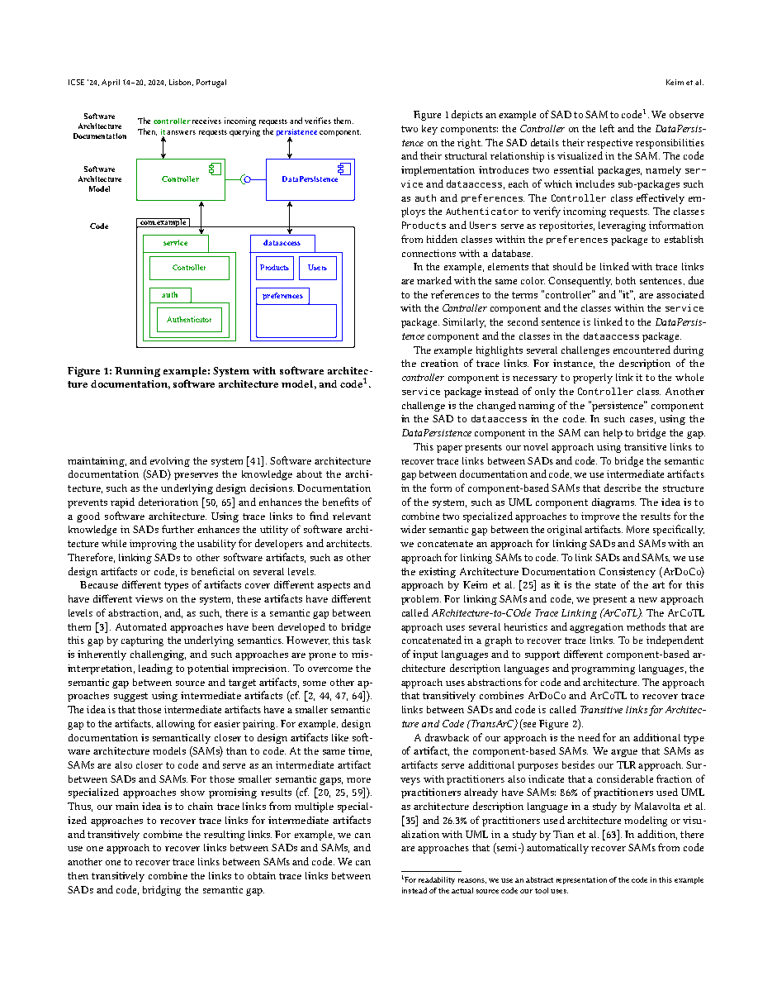

<!-- PDF page 3 -->

## Página PDF 3

RecoveringTraceLinksBetweenSoftwareDocumentationAndCode ICSE’24,April14–20,2024,Lisbon,Portugal
2.1 Information Retrieval-based TLR
Early breakthroughs of TLR were primarily based on IR techniques.
ArDoCo ArCoTL Initial approaches utilized general preprocessing and combinations
of probabilistic models and vector space models (VSM) to iden-
Software Code
Architecture Software tify candidates for trace links. An example of such an approach is
Architecture
Documentation presented by Antoniol et al. [1], who create trace links between
Models
code and source code documentation. However, a common chal-
lenge in this context is handling semantically similar expressions
Figure 2: High-level view of the TransArC approach for link-
like synonyms. Various methods have been proposed to address
ingSADsandcodeusingArDoCo[25]andournovelArCoTL.
this problem, including the use of word embeddings [6, 23, 67], la-
tent semantic indexing [36], incorporation of synonym coefficients
for similarity calculations [19], and the construction of semantic-
and deployment artifacts (cf. [5, 11, 27, 30, 61]), reducing the over- relationship graphs [60], among others.
head to create SAMs. In summary, the required SAMs potentially VSM remains a popular technique for TLR [16, 34]. However,
improve results because they reduce the semantic gap, can likely since VSM are primarily designed for text-based data, several ap-
be created in a lightweight manner, and enable additional tasks. proaches try to reuse structural information to capture contexts
Overall, this paper presents our transitive approach to linking in source code [29, 49]. These approaches have shown promise in
architecture documentation and code, including an approach for improving TLR between requirements and source code [29].
linking models and code. Consequently, we have the following Lohar et al. [32] compare various combinations of IR techniques
research questions: to create trace links between different artifact types, including re-
RQ1 How well can our approach ArCoTL recover trace links quirementsandcode.Intheirevaluationcoveringdifferentprojects
betweencomponent-basedsoftwarearchitecturemodels and domains, their approach achieved high mean average preci-
and code? sions (MAPs) of 0.80 and 0.86 for recovering trace links between
RQ2 How accurate can our approach TransArC using inter- use or test cases and code. However, the authors observed a strong
mediate artifacts recover trace links between software dependency between configurations, projects, and artifacts, as the
architecture documentation and code? best results for projects were attained with different configurations.
RQ3 How do the results for linking software architecture Toaddressthesechallenges,theapproachTAROTintroducesthe
documentation and code compare to state-of-the-art use of so-called biterms to improve TLR between requirements and
requirements-to-code approaches? code [15]. Biterms, in the textual context, refer to two terms within
a sentence that have a grammatical relationship. Similarly, biterms
The main contributions of this paper are:
in the code side represent any combinations of two terms within
C1 We present an approach for linking component-based identifiers, with code comments treated analogously to text. The
software architecture models and code. intersectionofbothbitermsetsresultsinconsensualbiterms,which
C2 We combine two specialized TLR approaches to tran- are subsequently weighted based on their frequency and location.
sitively link software architecture documentation and Different IR models, including VSM, latent semantic indexing (LSI),
code using architecture models as intermediate artifacts. and probabilistic Jensen Shannon model divergence (JSD), are em-
C3 We provide code, baselines, evaluation data, and results ployed to create candidate trace links between requirements and
in a replication package [26]. code. In their evaluation, TAROT achieves a MAP of 0.62 for the
iTrust project when using VSM. When TAROT is combined with
Theremainderofthepaperisstructuredasfollows:Relatedwork
the CLUSTER enhancing strategy (cf. [14]), the MAP is improved
is examinedin Section2. In Section3, weprovidebasic information
to 0.73 using LSI.
about the approach ArDoCo by Keim et al. [25] that we use for
Hey et al. [23] leverage IR-based metrics to retrieve trace links
linking SADs and SAMs. Our detailed approach is presented in
between requirements and source code classes. However, their ap-
Section4.WeevaluateourapproachinSection5anddiscussthreats
proach FTLR stands out from other works as it employs a more
to validity in Section 6. Lastly, we conclude this paper in Section 7.
fine-grained technique. In FTLR, both artifact types are split into
smallerunits,withrequirementsdividedintosentencesandcodeel-
2 RELATED WORK
ements represented by their public method signatures, extended by
Automated software and system traceability encompasses different the name of the containing class and their documenting comments.
domains, use cases, and techniques [2, 62]. Most of the success- Theelementsofbothartifacttypesarepreprocessed.Theprepro-
ful techniques are based on information retrieval (IR) and machine cessing steps include stop word removal, lemmatization, and word
learning (ML) that we look into in Section 2.1 and Section 2.2, re- lengthfiltering.Theresultingartifactelementtypesarerepresented
spectively.Asweemploytransitivetracing techniques,wealsolook as Bag-of-Embeddings, using the pre-trained word embedding rep-
intoitinSection2.3.Overall,wefocusonrelatedworkthatinvolves resentations of fastText [42].
similar source and target models to texts and source code. In these Finally, trace links are generated in two steps. First, the fine-
sections, we also provide details for the approaches by Gao et al. grained elements are mapped based on the Word Mover’s Distance
[15] and by Hey et al. [23] as well as CodeBERT [12] that we use (WMD) of the Bag-of-Embeddings. Second, the resulting element
as baselines in our evaluation (cf. Section 5.3).

[Vista original de la página 3](../../../../../images/v5/estructura_colecciones/Documentation-Code/primary/TLR_Recovering-Trace-Links-Between-Software-Documentation-And-Code/page-03.png)

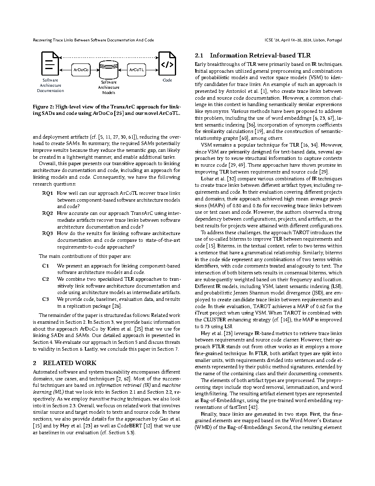

<!-- PDF page 4 -->

## Página PDF 4

ICSE’24,April14–20,2024,Lisbon,Portugal Keimetal.
trace links are filtered using a threshold. FTLR then creates trace
Trace
links for a class based on a majority vote, linking it to the most Text Extraction Element Element Links
Identification Connection
frequently mapped requirements among its methods. With the best
Architecture
configuration, the authors report an average F1-score of 0.327 for Documentation
this approach in their evaluation.
Model Extraction
Overall, IR-based TLR approaches can achieve accurate results
when the semantic gap is small, but can struggle with larger ones. Architecture Traceability Link Recovery
Model
In this study, we explore how intermediate artifacts can help to
bridge such larger semantic gaps. Figure 3: Overview of the ArDoCo approach [25]
2.2 Machine learning-based TLR
As for most areas, the progress made by ML and language models combine the results of direct and transitive trace links. The eval-
has significantly advanced TLR approaches. ML is applied in vari- uation demonstrates that, in most cases, the best transitive tech-
ous ways, including combining recurrent neural networks (RNNs) niques significantly outperform the direct techniques (𝛼 ≤ 0.001).
and word embeddings [17], combining feedforward neural net- Although hybrid approaches often slightly outperform transitive
works and cluster-pair rank models [66], ranking embeddings [68], approaches, this difference was not statistically significant. This
using pre-trained language models, such as CodeBERT [31], and shows that transitive approaches for TLR are helpful for improving
using pre-trained classifiers based on textual features [54]. Other the performance, supporting our idea.
researchers employ active learning [43] to tackle the challenge of As such, we use some ideas from these approaches and apply
the availability of training data. However, these approaches use them to our TLR scenario. Moreover, we adapt them using differ-
initial trace links of the projects to train their models and therefore ent approaches for the specific intermediate steps to benefit from
tackle a different kind of TLR problem than our approach. Their specialized approaches.
out-of-the-box performance for recovering trace links of unseen
projects without initial trace links is unclear. As large language 3 BACKGROUND: ARDOCO
models can be used for transfer learning across tasks and projects,
As this work uses ArDoCo [25], we introduce their approach in
theyarepromisingcandidatesfortheTLRtasktackledinthispaper.
this section. ArDoCo is a tool for TLR and inconsistency detection
Therefore, we use CodeBERT [12] as a baseline besides the two
between natural language SADs and SAMs like UML.
previously mentioned IR-based techniques.
The tool is designed as an extendable pipeline that incorporates
agent-basedheuristics.Thepipeline,depictedinFigure3,comprises
2.3 Utilizing intermediate artifact types
various steps for TLR. The first two pipeline steps process the
Instead of attempting to bridge large semantic gaps, some ap- artifacts individually and independently.
proachessuggestusingtransitivetracelinks.TheConnectingLinks Initially, the approach processes the input SAD text using tra-
Method (CLM) focuses on establishing transitive trace links be- ditional natural language processing (NLP) techniques, including
tween two artifacts using a third artifact [47, 64]. In this process, part-of-speech tagging, sentence splitting, lemmatization, and de-
CLM generates trace links to the intermediate artifact by employ- pendency parsing. These techniques aid in extracting structural
ing a VSM. When two trace links share the same element in the information from the text.
intermediate artifact, they are connected. Next, the text extraction step identifies name- and type-like men-
A similar strategy is adopted by COMET, which leverages a tions from the processed text. For instance, in the running example
hierarchicalprobabilisticmodeltoinfertracelinks[44].Theprocess in Figure 1, words like “controller”, “persistence”, or “component”
involves several steps: (1) initial trace links are generated using IR are extracted. Similar mentions, i.e., identical or very similar words
and ML techniques; (2) these links are reviewed by developers in areclustered,similartocoreferenceresolution.Eachclusterisanno-
a second stage; (3) the final phase operates on an approximation tated with confidence values that indicate whether the underlying
of the previous steps. Transitive links between two artifacts are element is considered a name or a type. To achieve this, ArDoCo
established when two links from one artifact refer to the same leverages phrase structures (cf. [37]). In the running example, the
element in another artifact. The similarity for the intermediate approach would confidently annotate “component” as a type, while
element is derived either from textual similarity (for requirements) the other two highlighted words are likely names.
or from execution traces (for test cases). The model extraction step analyzes the SAM and its meta-model,
In a different approach, Rodriguez et al. [57] utilize existing ar- extracting elements like types and architecture components.
tifacts as intermediates. For instance, design artifacts are used to Following this, the element identification identifies potential
map requirements to subsystem requirements. Unlike COMET, the modelelementsbasedonthementionsinthetextandtheextracted
transitive trace links in this approach can connect different arti- information from the meta-model. This process creates so-called
facts. In their evaluation, Rodriguez et al. compare LSI and VSM recommended instances, which can be seen as special named enti-
as techniques for direct trace links with transitive trace links. The ties representing potential model elements.
transitive trace links are retrieved by applying different methods to Finally,theelementconnectionestablishestracelinksbetweenthe
generate the required trace links to the intermediate artifacts. Ad- SAD and the SAM by mapping recommended instances to similar
ditionally, they compare these results to hybrid approaches, which elementsoftheinstantiatedmodel.Tocalculatesimilarity,ArDoCo

[Vista original de la página 4](../../../../../images/v5/estructura_colecciones/Documentation-Code/primary/TLR_Recovering-Trace-Links-Between-Software-Documentation-And-Code/page-04.png)

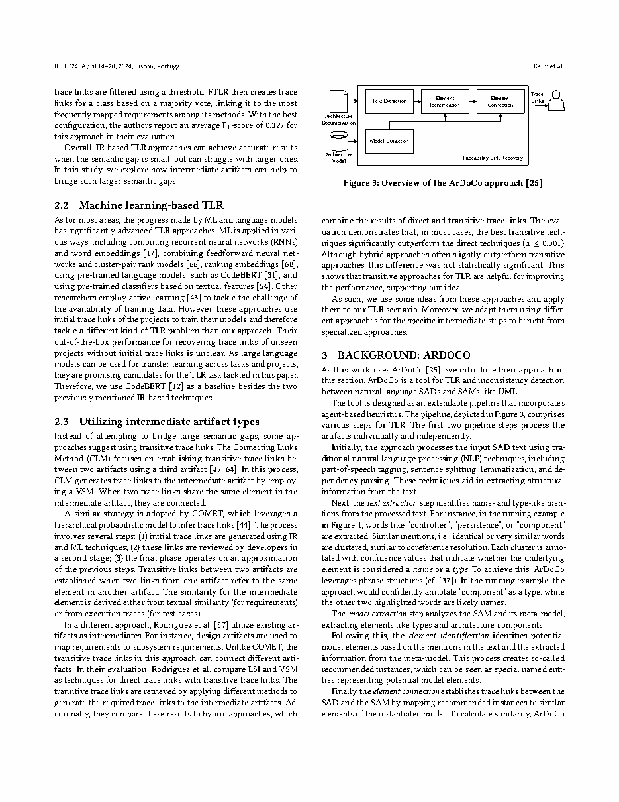

<!-- PDF page 5 -->

## Página PDF 5

RecoveringTraceLinksBetweenSoftwareDocumentationAndCode ICSE’24,April14–20,2024,Lisbon,Portugal
Entity ArchitectureItem Entity
subcomponents codeElements * * codeElements
* provided CodeItem * codeElements
* Component * required * Interface signature * s Signature
* *
0..1 extendedTypes implementedTypes
* *
Figure 4: Intermediate model for architecture models Computational
Module Datatype
Object * *
Control
Package ClassUnit InterfaceUnit
provides different metrics, including string-based, vector-based, Element
and other approaches. 0..1 0..1
For their evaluation, Keim et al. use five open-source projects to CompilationUnit
assess the performance of their approach. The overall evaluation
results show an average precision of 0.87, an average recall of 0.82, CodeAssembly
and an average F1-score of 0.82.
Figure 5: Intermediate model for code
4 APPROACH
Our approach TransArC to recover trace links between SAD and
code involves three steps, incorporating two distinct approaches
(see Figure 2). In the initial step, we utilize the ArDoCo approach, The code model in Figure 5 is similarly straightforward. We base
as presented by Keim et al. [25] (see Section 3), to establish links the model on the Knowledge Discovery Metamodel (KDM) by the
between SAD and SAM. Moving on to the second step, we intro- OMG [48] and are using an excerpt of the KDM for our code model.
duce our novel ArCoTL approach for linking SAM to code. The Code items fall into three categories: modules, computational
approachtransformstheartifactsintogeneralizedintermediaterep- objects, and datatypes. Modules encompass packages, compilation
resentations and computes trace links using a computational graph. units, or code assemblies, representing the structural elements of
Detailed insights into this approach are provided in Section 4.1. In code. Computational objects represent functional parts of the code,
the final step, we combine the outcomes of both approaches in a such as methods. Lastly, the code model includes datatypes, specifi-
transitive manner to create the desired trace links between SAD cally classes and interfaces that can exist within the code.
and code. The procedure for this step is elaborated in Section 4.2. We designed our models to maintain simplicity and general-
ity, enabling easy integration of additional architecture descrip-
4.1 ArCoTL: Linking SAM to Code tion languages or programming languages through adapters. These
Our strategy for establishing links between SAM and code involves adapters transform the input into our intermediate representations,
a two-step approach, namely ArCoTL. representing either the architecture or code model. The advantage
In the first step, we transform both types of artifacts into gener- of this approach is that an adapter only has to be defined once
alized intermediate representations. In the second step, we employ for each language, eliminating the need for adaptations in other
various heuristics and aggregations to examine potential hints that parts of our methodology, such as the computational graph with its
signify a link between an architecture element and a code element. associated heuristics. Currently, our implementation supports UML
To combine the different heuristics, we use a computational graph. componentsdiagramsandPCM[56]asarchitecturedescriptionlan-
guages, along with Java and Bash as programming languages. The
4.1.1 IntermediateRepresentations. Theprimaryobjectiveofinter- rationale behind selecting these languages is to demonstrate our
mediate representations for both artifacts is to provide an abstrac- approach’s versatility and applicability with different languages.
tion from the concrete languages used for architecture description Leveraging these intermediate representations, we are also able
and programming: First, they capture the essential commonalities to define trace links formally: A trace link comprises an architec-
present in each respective part, enabling us to simplify complex ture item paired with a corresponding code item. To facilitate our
inputs and focus solely on the aspects that are required for fur- calculations,weconstructarepositoryrepresentingthetraceability
ther processing. Second, these representations allow us to define matrix, encompassing all combinations of architecture and code
heuristics at a more abstract level, free from the intricacies of indi- items. This matrix is the foundation for our traceability analysis.
vidual languages. As a result, our heuristics become independent
of the particular input languages used, offering greater flexibility 4.1.2 Computational Graph. Our approach employs a variety of
and applicability. heuristics and aggregators for conducting its calculations. The
Our representation for architecture models, as depicted in Fig- heuristics evaluate each pair of entities, i.e., architecture and code
ure 4, is characterized by its simplicity. The architecture model items. We categorize our heuristics into two distinct types: stan-
consists of architecture items subdivided into components, inter- dalone and dependent heuristics. The outputs of each heuristic are
faces, and signatures. Components may contain sub-components mappings thatcontaineachentitypairtogetherwiththeheuristic’s
and can provide or require interfaces that have signatures. confidence for this pair. The aggregators combine the mappings

[Vista original de la página 5](../../../../../images/v5/estructura_colecciones/Documentation-Code/primary/TLR_Recovering-Trace-Links-Between-Software-Documentation-And-Code/page-05.png)

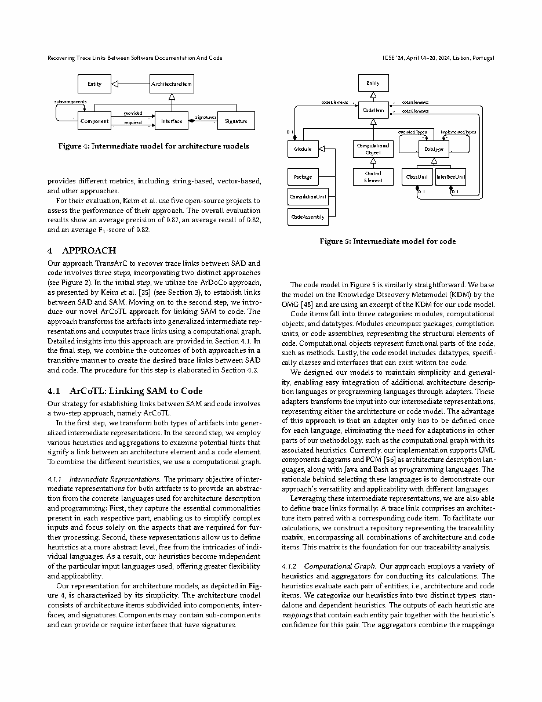

<!-- PDF page 6 -->

## Página PDF 6

ICSE’24,April14–20,2024,Lisbon,Portugal Keimetal.
and filter out unlikely pairs. We organize the calculations in a com- Algorithm 2 DependentHeuristic𝐻(mappings)
putational graph. The outputs of the computational graph are the for all𝑚 ← mappings do
identified trace links, i.e., pairs of architecture and code entities. for all𝑚 𝑎 ← affectedMappings𝐻(𝑚) do
𝑚 𝑎 .confidence ← getUpdatedConfidence𝐻(𝑚 𝑎 ,𝑚)
Algorithm 1 StandaloneHeuristic𝐻(archItems, codeItems)
return mappings
mappings ← ∅
for all archItem ← archItems, codeItem ← codeItems do
confidence ← similarity𝐻(archItem,codeItem)
mappings ← mappings∪ (archItem, codeItem, confidence) Common Words Checks if names differ only in common words
return mappings or prefixes/suffixes (e.g., Test, Impl, I).
Amb. Sub-pkg. Detects ambiguously mapped sub-packages.
Component rel. Looks at relations between components to re-
Standaloneheuristics operateindependently,notrelyingonother solve ambiguity.
heuristics for their execution. Thus, they get the input artifacts, i.e., Interface prov. Checksifaprovide-relationofthearchitecture
pairsofarchitectureandcodeitems,andcalculatetheirsimilarityto exists in the source code.
create mappings, as is shown in Algorithm 1. We use the following
The Hint Inheritance heuristic uses the assumption that there is
standalone heuristics:
astrongcouplingbetweenaclassanditsparent.Consequently,this
Package Compares package name with name of components
heuristic inherits mappings that regard a class and applies them to
Path Compares the path of a compilation unit with the
the extending or implementing class.
names of components
The Common Words heuristic adapts the results of the Names
Method Compares method names with names of signatures
heuristic. When two entities’ names only differ in common words,
Names Compares names of architecture elements with names
prefixes, or suffixes, the approach increases the confidence score.
of compilation units and datatypes
For example, common words include “Test”, “Exception”, and “Fac-
When comparing entity names, we determine if one entity’s tory”.Weregardwell-knownprefixesandsuffixes,e.g.,“Impl”,used
namecontainspartsoftheotherentity’sname.Weidentifypartsof to indicate implementations of abstract classes.
anentitybasedonwordboundariesandcamelcasing,hyphenations, When dealing with packages, it is possible for a component and
underscores,periods,andsimilarseparators.However,wedisregard its packages to be included in the packages of another component,
capitalization during the equality checks. The approach derives creating an ambiguous mapping. For instance, the package dataac-
confidence in this comparison from the ratio of the contained parts. cess.preferences can be mapped to both the DataPersistence and
Consequently, this comparison is asymmetric. For instance, the thePreferences component.TheAmbiguousSub-package heuristicis
name “DatabaseAdapter” contains the name “database”, resulting employedtoaddressthisambiguityintwopossiblecases:Inthefirst
in a similarity score of 50%. Conversely, no containment in the case, when the heuristic finds another location where the compo-
opposite direction leads to no similarity. nent(e.g.,Preferences)isimplemented,itisassumedthatthereisno
This asymmetric comparison is vital for controlling which en- actual relation between the package (dataaccess.preferences)
tity can be contained within another and for increasing precision, andsaidcomponent.Wereasonthattheimplementationofacompo-
especially for heuristics like Package or Path, where containment nentshouldnotbescatteredinthecode.Consequently,theheuristic
plays a crucial role. revokes the mapping to the (Preferences) component. In the second
Many programming languages encode package names in the case, if the approach finds no other location, the sub-package likely
path structure. However, slight differences can exist, so we em- is a component (here: Preferences), and the heuristic removes the
ploy both heuristics and incorporate this relationship. To avoid mapping to the DataPersistence component.
redundant consideration of the package name via both the name The Component relation and the Interface provision heuristics are
and the path, we exclude the package from the path. For exam- used to check for relations between components and/or interfaces
ple, given the package mediastore.persistence and the path that can be detected in the code. These heuristics adapt previous
ms-database/src/main/java/mediastore/persistence, we only utilize results based on the existence and absence of such relations. They
the beginning of the path, i.e., ms-database/src/main/java. In this play a significant role if multiple mappings exist between an ar-
example, a difference between both heuristics becomes apparent: chitecture element and code elements. In these cases, they can
The beginning of the path represents the folder that can indicate help remove mappings with source code elements that cannot be
the component name and provide additional information compared associated with the relations in the architecture.
to only the package name. This situation can arise if the project Aggregators. To combine mappings, we adopt two types of ag-
utilizes multiple modules. gregators: combiners and selectors. The first category, combiners,
Dependent heuristics use the resulting mappings of previous consists of aggregators that, as the name suggests, combine the
heuristics as their input. As shown in Algorithm 2, dependent mappings generated by one or more heuristics about the same en-
heuristics check for affected mappings and calculate the updated tity pair. The Max combiner utilizes a maximum function, which
confidence. There are the following dependent heuristics: sets the confidence score of an entity pair to the highest confidence
Hint Inheritance Inherits results from other heuristics (map- of mappings for this pair. We use the maximum function to in-
pings)alongextends-andimplements-relations. dicate that one result of competing heuristics covering different

[Vista original de la página 6](../../../../../images/v5/estructura_colecciones/Documentation-Code/primary/TLR_Recovering-Trace-Links-Between-Software-Documentation-And-Code/page-06.png)

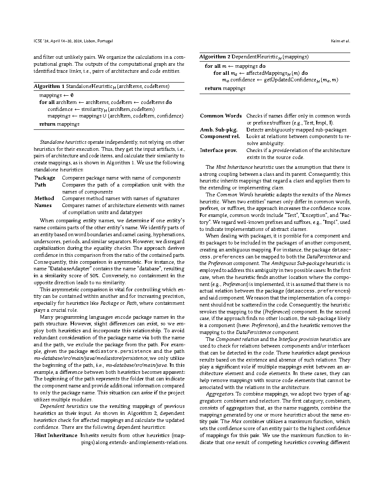

<!-- PDF page 7 -->

## Página PDF 7

RecoveringTraceLinksBetweenSoftwareDocumentationAndCode ICSE’24,April14–20,2024,Lisbon,Portugal
Input: SAM, Code package structures and component structures might exhibit simi-
larities. Additionally, some names can also be part of the package.
Name Comp Package Name Interf Methods Path
Therefore, we first select the results of the Package heuristic and
Best C Best A+C Best A+C Best A+C resort to the Names heuristic otherwise.
Inherit. AmbigPkg. We use various dependent heuristics to adjust confidence values
Legend:
andfilteroutimprobablemappingsaspartofthecalculationprocess.
Max Filter Standalone
Aggregator Towardtheend,theapproachmergesthecomputationresultsusing
Heuristic
First A Dependent Information the maximum combiner to select only mappings with the highest
Heuristic Flow confidenceforeachentitypair.Theresultsarefurtherfilteredusing
CommonW. Max
A Architecture C Code the Interface provision heuristic. This refinement step enhances the
Comp.Rel.
Max precision of the final results.
Filter
Finally, we generate trace links for each remaining mapping, i.e.,
Interf.Prov. Filter
pair of architecture item and code item with confidence > 0.
Output: Trace Links
4.2 TransArC: Transitively Link SAD and Code
Figure 6: The computational graph of ArCoTL
To finally establish trace links between documentation and code,
we combine two distinct approaches for our approach TransArC:
aspects is sufficient and to avoid negative influence from single low ArDoCo[25],whichfacilitatestracelinksbetweenSADsandSAMs,
confidence mappings. and our approach ArCoTL for linking SAMs to code.
The second category of aggregators, selectors, facilitates the Thecombinationofthesetwoapproachesisachievedbycreating
selection of mappings based on specific criteria. The Best criterion transitive links. This process involves linking SADs to code by
focuses on the mappings of multiple heuristics concerning one aggregating the trace links from the other two approaches that
certain fixed entity and selects only the highest confidence hint. share the same model elements from the SAM. This integration
Consequently, we have two variants of this criterion, one focussing of specialized approaches allows us to bridge the semantic gap
on code items and one on architecture items. The First criterion more effectively, particularly when linking SAMs and code. We
operates by examining the order of the heuristics and selecting, can improve the results by leveraging the structural information in
for one entity, the first mapping from an ordered list of heuristics. SAMs, which may not be as explicitly represented in SADs.
Consequently, the mappings are assessed sequentially for each While transitive links provide comprehensive traceability, there
entity, and a mapping is chosen over others if its confidence is might be instances where code entities are mentioned in the doc-
greater than 0. We base this approach on the idea that heuristics umentation but cannot be directly linked to the design artifact.
and, thus, the mappings are not equally important and need to be We could utilize existing IR approaches to establish the missing
weighted. We do this weighting according to their order, which links in such cases. However, based on our experience, architecture
proves particularly relevant for specific combinations. documentation seldom refers directly to code entities (e.g., classes),
Lastly, we employ filters to remove mappings that contain nega- as they are typically not represented in design artifacts. Architec-
tive evidence from dependent heuristics such as Ambiguous Sub- ture documentation typically emphasizes architecture components
package, Component relation, and Interface provision. These filters over implementation details. To avoid introducing imprecision, we
play a crucial role in refining the final results of our approach. currently refrain from applying such approaches.
Computational graph. The computational graph in Figure 6 con-
stitutes the backbone of ArCoTL. It comprises our five standalone
5 EVALUATION
heuristics as the entry points into the computation process. Map-
pings from these heuristics are then filtered with the Best criterion. ThissectionevaluatesourapproachesforTLRbetweencode,SAMs,
Initially, our approach selects the best code items for each ar- and documentation to answer our research questions. Overall, we
chitecture item, i.e., the set of code items that share the highest want to demonstrate the performance of our approach ArCoTL for
confidence for each corresponding architecture item. Subsequently, TLR between SAM and code and the performance of our approach
the computation proceeds with the inverse procedure, selecting the TransArC for TLR between SAD and code, including a comparison
best architecture item for the previously selected code items. to state-of-the-art approaches.
For the Names heuristic for components, filtering is based solely We first provide a detailed description of the evaluation dataset
on the best architecture items for each code item. We intention- in Section 5.1. We introduce and explain the metrics to quantify
ally skip the other direction, as architecture elements are generally the performance of our approaches employed in the evaluation
implemented with one or more code elements, and limiting archi- in Section 5.2. In Section 5.3, we describe the baseline approaches
tecture items to only the best code items could hinder the recall utilized for comparative analyses. Finally, we present the detailed
of the results. In general, we apply both directions to have precise results of our evaluation in Section 5.4, including the comparative
result pairs and only one direction for exploration. assessmentofourapproachtothebaselines.Tobenefittheresearch
We make use of one First matcher when combining the Package- community and ensure our findings’ reproducibility, we make our
and Names-parts, prioritizing package names. Here, we first look approach, the baselines, all our results, and the experimental data
at the package name to leverage our underlying assumption that available in a dedicated replication package [26].

[Vista original de la página 7](../../../../../images/v5/estructura_colecciones/Documentation-Code/primary/TLR_Recovering-Trace-Links-Between-Software-Documentation-And-Code/page-07.png)

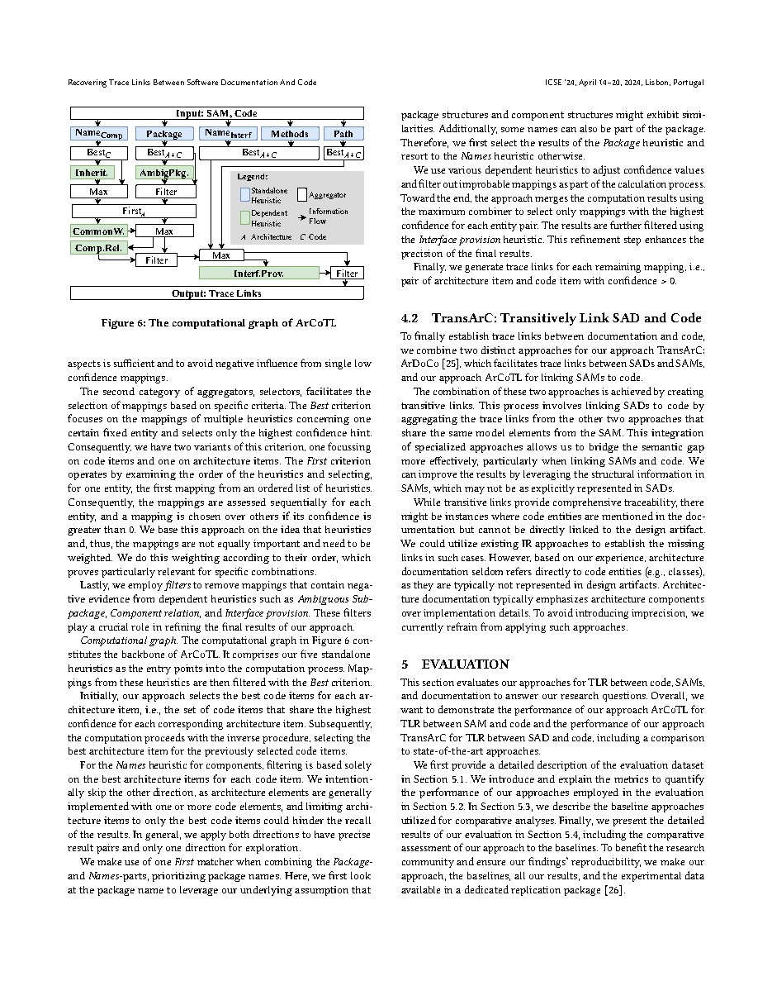

<!-- PDF page 8 -->

## Página PDF 8

ICSE’24,April14–20,2024,Lisbon,Portugal Keimetal.
Table 1: Number of artifacts per artifact type and number of 5.2 Metrics
trace links in the gold standard for each project
For our evaluation, we use the metrics Precision (P), Recall (R), and
F1-score (F1), their harmonic mean. These metrics are commonly
Artifact Type MS TS TM BBB JR used in TLR and comparable research areas (cf. [7, 19]).
SAD # Sentences 37 43 198 85 13 Generally, we define the true positives (TP), false positives (FP),
SAM # Model elements 23 19 16 24 6 and false negatives (FN) as follows: TPs are found trace links be-
Code # Files 97 205 832 547 1,979 tween one artifact and another artifact that are also contained in
the gold standard. FPs are found trace links between one artifact
SAM-Code # Trace links 60 164 1,616 730 1,956
and another artifact that are not contained in the gold standard.
SAD-Code # Trace links 50 707 7,610 1,295 8,240
FNs are trace links between one artifact and another artifact that
are contained in the gold standard but not found by the approach.
In addition to these metrics, we present two distinct average
values. First, we provide the overall average across all projects,
regardless of size. This average offers valuable insight into the
expected performance per project. Second, we offer a weighted
5.1 Dataset
average considering the number of expected trace links for each
Toassesstheeffectivenessofourapproaches,weutilizedthebench- project. This weighting enables more profound insights into the
mark dataset provided by Fuchß et al. [13]. This dataset comprises anticipated efficacy of an approach per trace link.
five open-source projects, each differing in size and domain. The
projects are MediaStore (MS), TeaStore (TS), TEAMMATES (TM), 5.3 Baseline Approaches
BigBlueButton (BBB), and JabRef (JR). The benchmark contains the
This section outlines the baseline approaches utilized for compar-
documentation of the projects created by the respective developers.
ison in our study. Specifically, we have chosen to include the ap-
Additionally, the benchmark contains the development view (cf.
proaches TAROT [15], FTLR [23], and CodeBERT [12]. We further
[28]) in the form of structural architecture models that originate
adapt ArDoCo [25] to create trace links between SAD and code.
from other researchers (MS, TS, TM) or are reverse-engineered
TAROT [15] and FTLR [23] both represent recent and state-of-
(BBB, JR) (cf. [13, 25]). The benchmark contains gold standards for
the-art IR-based solutions for linking requirements and code, and
thetracelinksbetweentheseprojects’SADsandSAMs.Thesegold
CodeBERT [12] is a large language model trained on finding the
standards were created in small user studies.
most semantically related source code for a given natural language
Since the benchmark projects are open-source, we have access
description. Therefore, all three demonstrate promising results for
to their source code. Through a rigorous process, we established
similar TLR problems (cf. Section 2). Since these approaches can
corresponding gold standards for both scenarios, SAD to code and
handle natural language input and code, they are well-suited for
SAM to code. At least two researchers independently generated the
addressing our specific TLR problem. Moreover, their replication
gold standards. We resolved discrepancies through discussions and
packages2 allowustouseandadapttheseapproaches.Despitetheir
merged the resulting gold standards. Table 1 gives an overview of
ability to handle natural language texts, they are targeted towards
the dataset and gold standards.
different artifact types (method documentation and requirements)
GoldStandardforTLRbetweenSAMsandCode.Thegoldstandard
thanSADs.AsSADs,methoddocumentation,andrequirementsare
for TLR between code and SAMs consists of a mapping between
on different levels of abstraction, the results of these approaches
the model elements of the SAMs and their corresponding relative
can be negatively influenced and might perform worse if applied to
paths to the source code files. We carefully map model elements,
SADs. Still, these are suitable approaches that can be used for com-
such as components, to the best-fitting code elements. Due to the
parison in our scenario. As an additional baseline suited towards
difference in abstraction levels between code and SAMs, one model
SADs, we adapt ArDoCo to directly operate with our code models
element may be mapped to multiple code elements. For example,
(cf. Section 4.1.1).
an interface IDownload can be mapped to multiple interfaces in
TAROT. To be able to apply TAROT as-is to our scenario, we
the code, such as IDownload and IDownloadCache. Sometimes, the
interpret each sentence of the SAD as a requirement. We use a
best mapping is not at the file level but at the folder/package level.
threshold to filter TAROT’s similarity matrix to generate trace
For instance, in the running example illustrated in Figure 1, we
links. We evaluate TAROT’s different IR methods, i.e., JSD, LSI,
map the component DataPersistence to the package dataaccess. In
and VSM. For our comparison, we optimize the threshold for each
such situations, all contained elements are considered part of the
component, and we trace them accordingly.
project and method based on the resulting F1-score, thus obtaining
the most favorable results from TAROT.
GoldStandardforTLRbetweenSADsandCode.Thegoldstandard
FTLR. To be able to use FTLR as a baseline, we utilize the most
for trace links recovery between SADs and code encompasses a
recent version of FTLR [21, 22]. We treat FTLR similarly to TAROT
mappingbetweenthesentencesoftheSADsandthecorresponding
andinterpretthesentencesoftheSADasrequirements.FTLRoffers
source code files. Once again, we map the relative path to a file
different modes of operation. We apply the different modes and
or the contents within a folder of the source code to the corre-
select the best-suited mode (WMD as similarity measure, taking
sponding sentence in the SAD. For example, the first sentence in
the running example depicted in Figure 1 is mapped to the files 2https://github.com/huiAlex/TAROT,
Controller.java and Authenticator.java. https://github.com/tobhey/finegrained-traceability

[Vista original de la página 8](../../../../../images/v5/estructura_colecciones/Documentation-Code/primary/TLR_Recovering-Trace-Links-Between-Software-Documentation-And-Code/page-08.png)

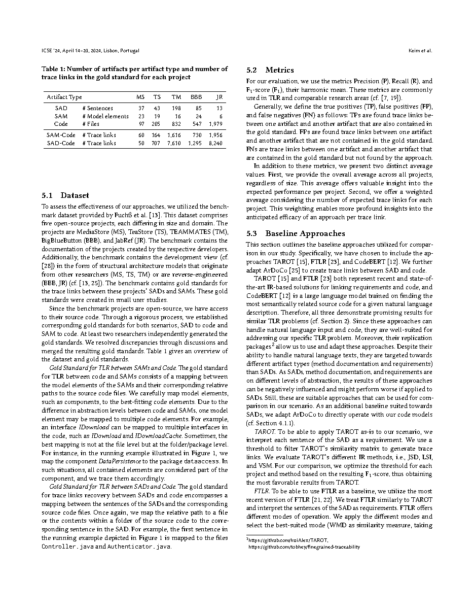

<!-- PDF page 9 -->

## Página PDF 9

RecoveringTraceLinksBetweenSoftwareDocumentationAndCode ICSE’24,April14–20,2024,Lisbon,Portugal
Table 2: Results for TLR between models and code is also one of our intentions for the overall approach to link SAD
and code transitively via SAMs.
Project Precision Recall F1-score However, we still observe some naming-related issues, which
can impact the results. As such, false positives occur due to the
MediaStore (MS) 0.98 1.00 0.99
similar naming of different elements. For example, in BBB, classes
TeaStore (TS) 0.98 0.98 0.98
in the folder bbb-graphql-middleware/demo/client are erroneously
TEAMMATES (TM) 1.00 1.00 1.00
mapped to the HTML5 Client interface of BBB because of the sim-
BigBlueButton (BBB) 0.94 0.96 0.95
ilarity of the folder name. Likewise, the class DbException in the
JabRef (JR) 1.00 1.00 1.00
MediaStore project is incorrectly mapped to the IDB interface in-
Average 0.98 0.99 0.98 stead of the intended DB component. Regarding TS and BBB, our
weighted Average 0.99 0.99 0.99 approach produces some false negatives. Here, the challenge lies in
mapping elements with significantly different naming conventions,
especially when dealing with abbreviations. For instance, due to
method comments into account) for comparison. The generation of too dissimilar naming, the component BBB web of BigBlueButton
tracelinksinFTLRalsoreliesonthresholds.Forourcomparison,we could not be mapped to the folder bigbluebutton-web. Automated
use the results obtained using the best possible threshold for each expansion of abbreviations might improve this (cf. [4, 18]).
project.Inourreplicationpackage[26],weadditionallyprovidethe Concluding RQ1, our approach achieves an average F1-score
resultsforFTLR’sdefaultthresholdsandfurthermodesofoperation of 0.98 (weighted 0.99) for the trace links between SAMs and
for comprehensive comparison and analysis. code. According to the classification scheme of Hayes et al. [19],
CodeBERT. We fine-tune the CodeBERT language model [12] ourTLRapproachachievesexcellent results.Moreover,theseresults
for the Java code search task of the CodeSearchNet dataset [24] to represent a solid foundation for our transitive approach.
apply CodeBERT in our scenario. This dataset consists of pairs of Traceability Link Recovery between SADs and Code. In the second
Java methods and their corresponding method documentation, and partoftheevaluation,wefocusontheTLRbetweenSADsandcode.
the task requires the language model to predict whether certain Thus, we aim to address our second research question, evaluating
method documentation belongs to a method implementation. This the effectiveness of our approach in recovering trace links between
task can be interpreted as similar to linking sentences in SADs to software architecture documentation and code using transitive
their corresponding source code classes. To fine-tune the model, trace links. Additionally, we compare the results obtained by our
we adapted the code provided in the replication package of Trace- approach with those of the baseline approaches to answer our RQ3.
BERT(T-BERT)3,asitincludessupportforapplyingandevaluating To measure the quality of the recovery and facilitate comparison
CodeBERT models to the TLR task. In particular, we make use of with the baselines, we calculate the precision, recall, and F1-score
the SINGLE architecture with online negative sampling, which per- for each project. The baseline approaches are initially designed for
formed best on the CodeSearchNet dataset [31]. After training on different tasks, so we optimize their thresholds to maximize the
the CodeSearchNet dataset, we use the fine-tuned model to predict F1-score. We then select the results of the mode of operation with
links between SAD and code. the best average F1-score.
Adapting ArDoCo: ArDoCode. To add a baseline that is more In our evaluation, we find that TAROT’s best mode of operation
geared towards SADs, we adapt ArDoCo to create trace links be- utilizes IR in combination with JSD. For FTLR, the best mode of
tween SADs and code, calling it ArDoCode. For this, we interpret operationusesWMDalongwithmethodcomments(cf.Section5.3).
the intermediate code model as a kind of SAM, again resolving The results of all approaches are shown in Table 3. We highlight
packages to create trace links to the contained elements. the best results for each metric and project.
More details on the baselines can be found in our replication The baseline approaches perform worse, achieving an average
package [26]. F1-score of 0.22 for TAROT, 0.21 for FTLR, 0.28 for CodeBERT, and
0.37forArDoCode.TAROThasaweightedaverageF1-scoreof0.29,
5.4 Results FTLR of 0.28, and CodeBERT of 0.36. ArDoCode has a weighted
In this section, we present the results of our evaluation.
average F1-score of 0.62 due to its good performance on the larger
projects TM and JR. All baselines achieve better recall than preci-
Traceability Link Recovery between SAMs and Code. First, we
sion. Comparing the results with the reported results of FTLR [23]
address our first research question (cf. Section 1), which focuses on
for its original task, linking requirements and code, we observe
the performance of our approach in recovering trace links between
similar outcomes. This suggests a certain degree of similarity in
softwarearchitecturemodelsandcode.Wepresentprecision,recall,
the underlying problem to the extent that the performance of the
and F1-score for each project, along with the average and weighted
approaches in both scenarios is comparable to some extent.
average over all projects in Table 2.
Comparing our approach to the baselines, our transitive ap-
The results of our approach are exceptional, indicating a near-
proach combining two specialized approaches outperforms the
perfect linkage of artifacts. This is expected as SAMs and code
are closely related. The approach can utilize many of the similar
baselines with an average F1-score of 0.82 (weighted 0.87). For MS
and TS, we achieve perfect precision, while for JR, we achieve per-
structures that can be found in both types of artifacts. Ultimately,
fectrecall.Thisresulthighlightstheprojectdependency,influenced
the semantic gap is relatively small between these artifacts, which
by the project’s characteristics. These characteristics include the
3https://github.com/jinfenglin/TraceBERT

[Vista original de la página 9](../../../../../images/v5/estructura_colecciones/Documentation-Code/primary/TLR_Recovering-Trace-Links-Between-Software-Documentation-And-Code/page-09.png)

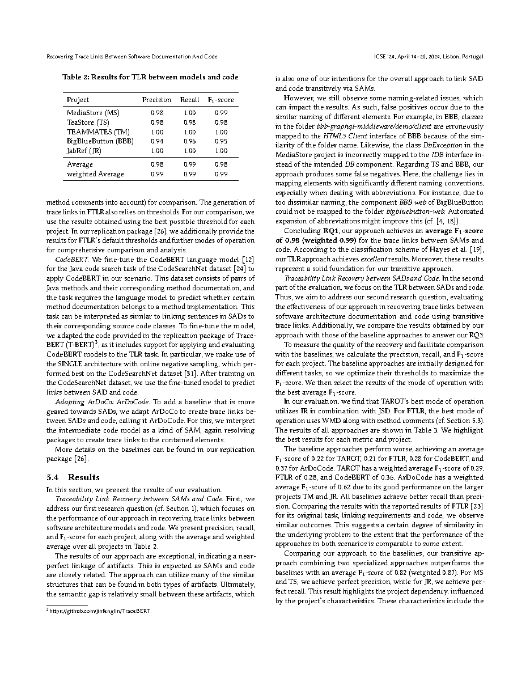

<!-- PDF page 10 -->

## Página PDF 10

ICSE’24,April14–20,2024,Lisbon,Portugal Keimetal.
Table 3: Results for TLR between documentation and code
MS TS TM BBB JR Avg. w. Avg.
Approach P R F1 P R F1 P R F1 P R F1 P R F1 P R F1 P R F1
TAROT .09 .24 .13 .19 .44 .27 .06 .32 .11 .07 .18 .10 .32 1.0 .49 .15 .44 .22 .19 .63 .29
FTLR .15 .26 .19 .19 .25 .21 .06 .30 .10 .04 .42 .07 .32 .93 .48 .15 .43 .21 .19 .59 .28
CodeBERT .29 .12 .17 .26 .57 .36 .09 .22 .12 .07 .49 .12 .49 .83 .61 .24 .45 .28 .28 .53 .36
ArDoCode .05 .66 .09 .20 .74 .31 .37 .92 .53 .07 .57 .13 .66 1.0 .80 .27 .78 .37 .47 .92 .62
TransArC 1.0 .52 .68 1.0 .71 .83 .71 .91 .80 .77 .91 .84 .89 1.0 .94 .87 .81 .82 .81 .94 .87
similarity and consistency of the names in the two artifacts. More- can vary significantly in code quality, documentation, and consis-
over, projects may use similar terms corresponding to different tency. Consequently, noise and errors in the data can potentially
entities, making it hard to link them correctly. impacttheevaluationprocess,leadingtoinflatedordeflatedperfor-
We use Wilcoxon’s signed rank test to calculate the significance mance metrics. Lastly, we might have misjudged the influence of
of our approach’s F1-scores compared to the baselines. TransArC the semantic gap. To mitigate this and to determine the influence,
is significantly outperforming the baseline approaches (at the 0.05 we adapted ArDoCo to work directly with the code model.
level). This outcome can likely be attributed to the larger semantic Our research design is subject to certain threats to External
gap the baseline approaches try to bridge. Moreover, TAROT, FTLR, Validity. First, we focus solely on (structural) component-based
and CodeBERT are fine-tuned for similar but different scenarios. architecture models, potentially limiting the generalizability of our
Nevertheless,thecombinationofourtwospecializedapproaches findings w.r.t. other architectural paradigms or views. According to
proves highly effective. Accordingly, this methodology facilitates Tian et al. [63], this view is commonly used for architecture. The
the practical use of TLR (cf. [19]). Comparing the results of Ar- results still may vary if, e.g., more logical descriptions and views
DoCode and TransArC, intermediate artifacts seem to play a vital of the architecture are used, or if the abstraction levels are more
roleinbridgingthesemanticgap.Wearguethatcreatingintermedi- different. Second, among the evaluated projects, there are academic
ate artifacts is worthwhile, especially given their other applications projects designed to mimic real applications, but they may exhibit
and the possibility to reverse engineer them (cf. Section 1). certain differences, making clear statements about generalizability
Insummary,ourtransitiveapproachTransArCperformspromis- challenging. While our projects encompass different domains and
ingly with an average F1-score of 0.82 (weighted 0.87). Thus, sizes, they do not fully represent all possible application variants.
we can confidently answer RQ2: According to the classification Certain types of projects or specific project characteristics may be
scheme of Hayes et al. [19], our approach excellently recovers trace overrepresented or underrepresented in our dataset, potentially
links between SADs and code. Additionally, we can briefly answer skewing the evaluation results and restricting the applicability of
RQ3: Our approach significantly outperforms the baselines in our findings to different projects and real-world scenarios.
all projects concerning precision, recall, and F1-score. To address threats to validity regarding Reliability, we utilize
benchmark datasets previously employed in published research.
However, we still need to create a gold standard for TLR between
SAM and code, as well as SAD and code. For this, we adopt a rigor-
6 THREATS TO VALIDITY
ous approach where at least two researchers independently gener-
Inthissection,wediscussthreatstovaliditybasedontheguidelines ated the gold standards, to reduce a potentially biased influence by
by Runeson and Höst [58]. a single person. These gold standards are merged through compari-
To ensure Construct Validity, we employ commonly used metrics son and discussion to decide any differences. Still, it is important to
and select projects that have been previously studied in research. acknowledgepossiblebias,suchasresearchersinterpretingartifacts
Additionally, we deliberately choose projects with diverse char- differently, which impacts reliability to some extent.
acteristics, such as different domains, sizes, and relative sizes of
documentation to lines of code. By doing so, we aim to mitigate
7 CONCLUSION AND FUTURE WORK
potential confounding factors that could hinder us from effectively
addressing our research questions. In conclusion, this scientific study investigated the use of trace-
Regarding Internal Validity, there is the threat that we examine ability link recovery (TLR) for linking software architecture doc-
TLR in a way that there are other influencing factors that affect our umentation (SAD) to code. The approach achieves this utilizing a
evaluation. Moreover, we might misinterpret the cause of certain transitive method that combines the results from two specialized
results, leading to wrong conclusions. To address internal valid- approaches, namely TLR for SAD to component-based software
ity concerns, we follow established practices to minimize threats. architecture model (SAM) using the ArDoCo approach by Keim et
Specifically, we define and evaluate trace links on a sentence level al. [25] and a novel approach for TLR between SAM and code.
and map them to code files, akin to requirements-to-code traceabil- The proposed approach for model-to-code-TLR utilizes heuris-
ity. We use the same selection of open-source projects as Keim et al. tics and aggregators, seamlessly integrated within a computational
[25]. This methodology helps mitigate the risk of selection bias. graph. The efficacy of this method was evaluated on a dataset com-
However, it is essential to acknowledge that open-source projects prising five diverse projects. To answer RQ1 (performance for TLR

[Vista original de la página 10](../../../../../images/v5/estructura_colecciones/Documentation-Code/primary/TLR_Recovering-Trace-Links-Between-Software-Documentation-And-Code/page-10.png)

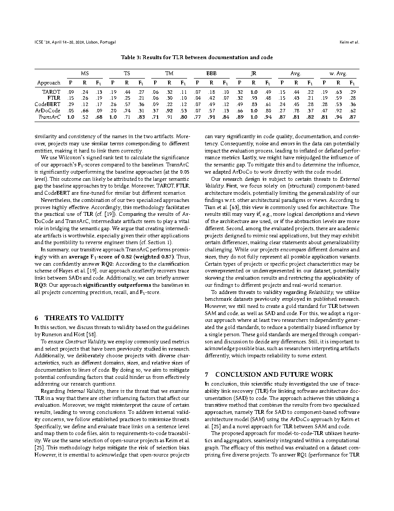

<!-- PDF page 11 -->

## Página PDF 11

RecoveringTraceLinksBetweenSoftwareDocumentationAndCode ICSE’24,April14–20,2024,Lisbon,Portugal
betweenSAMandcode),theevaluationresultsfortheSAMtocode ACKNOWLEDGMENTS
TLR exhibit outstanding performance. Thanks to using both name This work was supported by funding from the pilot program Core
similarity and structural information, the approach achieved an InformaticsatKIT(KiKIT)oftheHelmholtzAssociation(HGF).This
average F1-score of 0.98. Answering RQ2 (performance for TLR work was also supported by funding from the topic Engineering
between SAD and code) and RQ3 (comparison to baselines), the re- SecureSystemsoftheHGFandbyKASTELSecurityResearchLabs.
sults fortransitive links between SAD and code displayexceptional
results with an average F1-score of 0.82 (weighted 0.87), surpassing REFERENCES
the baseline approaches, including the LLM-based approach Code-
[1] G.Antoniol,G.Canfora,G.Casazza,A.DeLucia,andE.Merlo.2002. Recovering
BERT, significantly. These results further validate the effectiveness Traceability Links between Code and Documentation. IEEE Transactions on
of our approach to bridge the semantic gap. The results also show SoftwareEngineering 28,10(Oct.2002),970–983. https://doi.org/10.1109/TSE.
2002.1041053
that LLMs are not always the best solution.
[2] ThazinWinWinAung,HuanHuo,andYuleiSui.2020. ALiteratureReviewof
In summary, this research contributes a promising methodology AutomaticTraceabilityLinksRecoveryforSoftwareChangeImpactAnalysis.In
for documentation-to-code linkage, and the remarkable achieved Proceedingsofthe28thInternationalConferenceonProgramComprehension(Seoul,
RepublicofKorea)(ICPC’20).AssociationforComputingMachinery,NewYork,
performance demonstrates its potential applicability in real-world NY,USA,14–24. https://doi.org/10.1145/3387904.3389251
scenarios. These findings open up exciting possibilities for improv- [3] T.J.Biggerstaff,B.G.Mitbander,andD.Webster.1993. Theconceptassignment
probleminprogramunderstanding.In[1993]ProceedingsWorkingConferenceon
ing traceability linkage. To ensure replicability and transparency,
ReverseEngineering.27–43. https://doi.org/10.1109/WCRE.1993.287781
we have made available a comprehensive replication package [26], [4] ShanqingCai,SubhashiniVenugopalan,KatrinTomanek,AjitNarayanan,Mered-
encompassing the implemented approach, baseline models, evalu- ithRingelMorris,andMichaelP.Brenner.2022. Context-AwareAbbreviation
ExpansionUsingLargeLanguageModels. arXiv:2205.03767[cs.CL]
ation data, and the obtained results. By sharing this package, we
[5] YuanfangCai,HanfeiWang,SunnyWong,andLinzhangWang.2013. Leveraging
aim to facilitate the reproduction of our study and enable fellow DesignRulestoImproveSoftwareArchitectureRecovery.InProceedingsofthe
researchers to validate and build upon our findings. 9th International ACM Sigsoft Conference on Quality of Software Architectures
(Vancouver,BritishColumbia,Canada)(QoSA’13).AssociationforComputing
In our evaluation, we used projects from different domains with Machinery,133–142. https://doi.org/10.1145/2465478.2465480
SADs in different styles and slightly different levels of abstrac- [6] LeiChen,DandanWang,JunjieWang,andQingWang.2019. EnhancingUn-
supervisedRequirementsTraceabilitywithSequentialSemantics.In201926th
tion. Therefore, we believe that our results are to a certain degree
Asia-PacificSoftwareEngineeringConference(APSEC).23–30. https://doi.org/10.
generalizable. The results can vary with vastly diverging SADs. Ad- 1109/APSEC48747.2019.00013
ditionally,SAMsthatdonotencapsulatethestructuralcomponents [7] Jane Cleland-Huang, Orlena Gotel, Andrea Zisman, et al. 2012. Software and
systemstraceability.Vol.2. Springer.
or focus on a too different abstraction can cause a degradation of
[8] CoEST.2023. CenterofExcellenceforSoftware&SystemsTraceability. https:
our approach’s performance. However, the general idea to bridge //web.archive.org/web/20230518011309/http://www.coest.org/. Accessed:2023-
the semantic gap by using multiple specialized approaches should 05-18.
[9] AlexanderEgyed,FlorianGraf,andPaulGrünbacher.2010. EffortandQuality
holdforotherartifactsthataresemanticallyinbetweentheoriginal of Recovering Requirements-to-Code Traces: Two Exploratory Experiments.
gap. Still, we need to explore this theory further in future work. In201018thIEEEInternationalRequirementsEngineeringConference.221–230.
https://doi.org/10.1109/RE.2010.34
Consequently,ourplanincludesextendingthegeneralizabilityof
[10] DavideFalessi,JustinRoll,JinL.C.Guo,andJaneCleland-Huang.2020. Leverag-
ourapproachinfuturework.First,weaimtoevaluatetheapproach ingHistoricalAssociationsbetweenRequirementsandSourceCodetoIdentify
withadditionalprojectstoassessitscapabilitiesindifferentsettings, ImpactedClasses.IEEETransactionsonSoftwareEngineering46,4(2020),420–441.
https://doi.org/10.1109/TSE.2018.2861735
domains,andscenarios.Second,wewillinvestigatetheadaptability
[11] Jean-MarieFavre.2005. Foundationsofmodel(Driven)(Reverse)engineering.In
ofourtransitiveapproachforotherinstancesofTLR,suchaslinking DagstuhlSeminarProceedings.SchlossDagstuhl-Leibniz-ZentrumfürInformatik.
requirements to code. This will entail exploring and identifying [12] ZhangyinFeng,DayaGuo,DuyuTang,NanDuan,XiaochengFeng,MingGong,
LinjunShou,BingQin,TingLiu,DaxinJiang,andMingZhou.2020. CodeBERT:
various reasonable and efficient intermediate artifacts. APre-TrainedModelforProgrammingandNaturalLanguages.InFindingsofthe
To improve upon the promising results, we plan to make various AssociationforComputationalLinguistics:EMNLP2020.AssociationforComputa-
tionalLinguistics,Online,1536–1547. https://doi.org/10.18653/v1/2020.findings-
improvements in future work to further refine the approach.
emnlp.139
For our transitive approach, we prioritize precision by disregard- [13] Dominik Fuchß, Sophie Corallo, Jan Keim, Janek Speit, and Anne Koziolek.
ing direct mentions of classes in SADs that cannot be linked to 2023. Establishing a Benchmark Dataset for Traceability Link Recovery be-
tween Software Architecture Documentation and Models. In Software Archi-
SAMs. In future research, we intend to explore opportunities to
tecture.ECSA2022TracksandWorkshops,ThaisBatista,TomášBureš,Claudia
combine our approach with other (IR) approaches, to address cases Raibulet,andHenryMuccini(Eds.).SpringerInternationalPublishing,Cham,
where documentation mentions code entities not explicitly repre- 455–464. https://doi.org/10.1007/978-3-031-36889-9_30
[14] Hui Gao, Hongyu Kuang, Xiaoxing Ma, Hao Hu, Jian Lü, Patrick Mäder, and
sentedinthedesignartifact.Thiswillfurtherstrengthentheoverall AlexanderEgyed.2022. PropagatingFrugalUserFeedbackthroughClosenessof
efficacy and completeness of our approach. Moreover, we plan to CodeDependenciestoImproveIR-basedTraceabilityRecovery. EmpirSoftware
Eng 27,2(Jan.2022),41. https://doi.org/10.1007/s10664-021-10091-5
extend the inconsistency detection capabilities of ArDoCo [25] to
[15] Hui Gao, Hongyu Kuang, Kexin Sun, Xiaoxing Ma, Alexander Egyed, Patrick
SAD and code using TransArC for establishing the required links. Mäder, Guoping Rong, Dong Shao, and He Zhang. 2023. Using Consensual
By focusing on these avenues of enhancement, we aim to create BitermsfromTextStructuresofRequirementsandCodetoImproveIR-Based
TraceabilityRecovery.InProceedingsofthe37thIEEE/ACMInternationalConfer-
a more robust and versatile TLR framework that can further TLR
enceonAutomatedSoftwareEngineering (ASE’22).AssociationforComputing
and aid various software engineering tasks in an array of contexts. Machinery,NewYork,NY,USA,1. https://doi.org/10.1145/3551349.3556948
[16] M.Gethers,R.Oliveto,D.Poshyvanyk,andA.D.Lucia.2011. OnIntegrating
OrthogonalInformationRetrievalMethodstoImproveTraceabilityRecovery.In
201127thIEEEInternationalConferenceonSoftwareMaintenance(ICSM).133–142.
https://doi.org/10.1109/ICSM.2011.6080780
[17] JinGuo,JinghuiCheng,andJaneCleland-Huang.2017. SemanticallyEnhanced
Software Traceability Using Deep Learning Techniques. In Proceedings of the
39th International Conference on Software Engineering (ICSE ’17). IEEE Press,

[Vista original de la página 11](../../../../../images/v5/estructura_colecciones/Documentation-Code/primary/TLR_Recovering-Trace-Links-Between-Software-Documentation-And-Code/page-11.png)

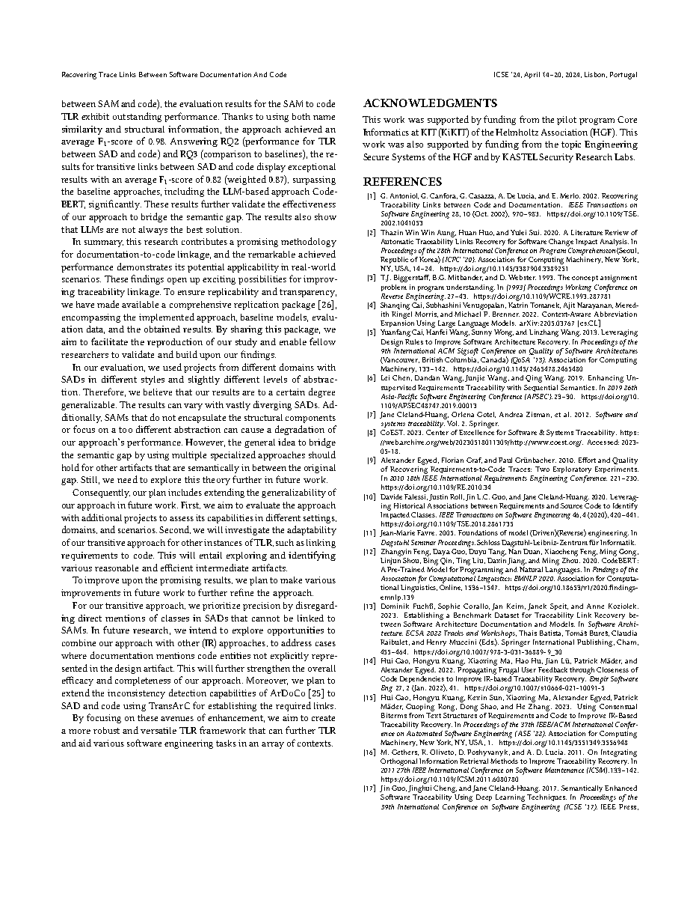

<!-- PDF page 12 -->

## Página PDF 12

ICSE’24,April14–20,2024,Lisbon,Portugal Keimetal.
Piscataway,NJ,USA,3–14. https://doi.org/10.1109/ICSE.2017.9 [39] PatrickMäderandAlexanderEgyed.2012. Assessingtheeffectofrequirements
[18] HusseinHasso,KatharinaGroßer,IliassAymaz,HannaGeppert,andJanJürjens. traceabilityforsoftwaremaintenance.In201228thIEEEInternationalConference
2022. Abbreviation-ExpansionPairDetectionforGlossaryTermExtraction.In onSoftwareMaintenance. https://doi.org/10.1109/ICSM.2012.6405269
RequirementsEngineering:FoundationforSoftwareQuality,VincenzoGervasiand [40] PatrickMäder,PaulL.Jones,YiZhang,andJaneCleland-Huang.2013. Strategic
AndreasVogelsang(Eds.).SpringerInternationalPublishing,Cham,63–78. TraceabilityforSafety-CriticalProjects. IEEESoftware30,3(2013),58–66. https:
[19] JaneHuffmanHayes,AlexDekhtyar,andSenthilKarthikeyanSundaram.2006. //doi.org/10.1109/MS.2013.60
AdvancingCandidateLinkGenerationforRequirementsTracing:TheStudyof [41] NenadMedvidovicandRichardN.Taylor.2010. Softwarearchitecture:founda-
Methods. IEEETSE32,1(Jan.2006),4–19. https://doi.org/10.1109/TSE.2006.3 tions,theory,andpractice.In2010ACM/IEEE32ndInternationalConferenceon
[20] JaneHuffmanHayes,AlexDekhtyar,SenthilKarthikeyanSundaram,EAshlee SoftwareEngineering,Vol.2.471–472. https://doi.org/10.1145/1810295.1810435
Holbrook,SravanthiVadlamudi,andAlainApril.2007.REquirementsTRacingOn [42] TomasMikolov,EdouardGrave,PiotrBojanowski,ChristianPuhrsch,andAr-
target(RETRO):improvingsoftwaremaintenancethroughtraceabilityrecovery. mandJoulin.2018. AdvancesinPre-TrainingDistributedWordRepresentations.
InnovationsinSystemsandSoftwareEngineering 3(2007),193–202. In Proceedings of the Eleventh International Conference on Language Resources
[21] Tobias Hey. 2023. Automatische Wiederherstellung von Nachverfolgbarkeit andEvaluation(LREC2018).EuropeanLanguageResourcesAssociation(ELRA),
zwischenAnforderungenundQuelltext. https://doi.org/10.5445/IR/1000162446 Miyazaki,Japan. https://aclanthology.org/L18-1008
[22] Tobias Hey. 2023. Fine-Grained Traceability Link Recovery (FTLR). Zenodo. [43] Chris Mills, Javier Escobar-Avila, Aditya Bhattacharya, Grigoriy Kondyukov,
https://doi.org/10.5281/zenodo.8367392 ShayokChakraborty,andSoniaHaiduc.2019. TracingwithLessData:Active
[23] TobiasHey,FeiChen,SebastianWeigelt,andWalterF.Tichy.2021. Improving LearningforClassification-BasedTraceabilityLinkRecovery.In2019IEEEIn-
TraceabilityLinkRecoveryUsingFine-grainedRequirements-to-CodeRelations. ternationalConferenceonSoftwareMaintenanceandEvolution(ICSME).103–113.
In 2021 IEEE International Conference on Software Maintenance and Evolution https://doi.org/10.1109/ICSME.2019.00020
(ICSME)(2021-09).12–22. https://doi.org/10.1109/ICSME52107.2021.00008 [44] KevinMoran,DavidN.Palacio,CarlosBernal-Cárdenas,DanielMcCrystal,Denys
[24] Hamel Husain, Ho-Hsiang Wu, Tiferet Gazit, Miltiadis Allamanis, and Marc Poshyvanyk,ChrisShenefiel,andJeffJohnson.2020. ImprovingtheEffectiveness
Brockschmidt.2020. CodeSearchNetChallenge:EvaluatingtheStateofSemantic of Traceability Link Recovery Using Hierarchical Bayesian Networks. In Pro-
CodeSearch. arXiv:1909.09436(June2020). https://doi.org/10.48550/arXiv.1909. ceedingsoftheACM/IEEE42ndInternationalConferenceonSoftwareEngineering
09436arXiv:1909.09436[cs,stat] (ICSE’20).AssociationforComputingMachinery,NewYork,NY,USA,873–885.
[25] JanKeim,SophieCorallo,DominikFuchß,andAnneKoziolek.2023. Detecting https://doi.org/10.1145/3377811.3380418
InconsistenciesinSoftwareArchitectureDocumentationUsingTraceabilityLink [45] ShivaNejati,MehrdadSabetzadeh,DavideFalessi,LionelBriand,andThierry
Recovery. In 2023 IEEE 20th International Conference on Software Architecture Coq. 2012. A SysML-based approach to traceability management and design
(ICSA).141–152. https://doi.org/10.1109/ICSA56044.2023.00021 slicing in support of safety certification: Framework, tool support, and case
[26] JanKeim,SophieCorallo,DominikFuchß,TobiasHey,TobiasTelge,andAnne studies. Information and Software Technology 54, 6 (2012), 569–590. https:
Koziolek.2023. ReplicationPackagefor"RecoveringTraceLinksBetweenSoft- //doi.org/10.1016/j.infsof.2012.01.005
ware Documentation And Code". Zenodo. https://doi.org/10.5281/zenodo. [46] ArmstrongNhlabatsi,YijunYu,AndreaZisman,TheinTun,NiamulKhan,Arosha
10411853 Bandara,KhaledM.Khan,andBasharNuseibeh.2015.ManagingSecurityControl
[27] YvesR.Kirschner,JanKeim,NicoPeter,andAnneKoziolek.2023. Automated Assumptions Using Causal Traceability. In IEEE/ACM 8th SST. 43–49. https:
ReverseEngineeringoftheTechnology-InducedSoftwareSystemStructure.In //doi.org/10.1109/SST.2015.14
SoftwareArchitecture,BedirTekinerdogan,CatiaTrubiani,ChoukiTibermacine, [47] KazukiNishikawa,HironoriWashizaki,YoshiakiFukazawa,KeishiOshima,and
Patrizia Scandurra, and Carlos E. Cuesta (Eds.). Springer Nature Switzerland, RyotaMibe.2015. Recoveringtransitivetraceabilitylinksamongsoftwarearti-
Cham,283–291. facts.In2015IEEEInternationalConferenceonSoftwareMaintenanceandEvolution
[28] P.B.Kruchten.1995. The4+1ViewModelofarchitecture. IEEESoftware12,6 (ICSME).576–580. https://doi.org/10.1109/ICSM.2015.7332517
(1995),42–50. https://doi.org/10.1109/52.469759 [48] Object Management Group (OMG). 2006. Knowledge Discovery Metamodel
[29] HongyuKuang,PatrickMäder,HaoHu,AchrafGhabi,LiGuoHuang,JianLü,and (KDM) Specification, Version 1.4. OMG Document Number formal/2016-12
AlexanderEgyed.2015. CanMethodDataDependenciesSupporttheAssessment (https://www.omg.org/spec/KDM/1.4/About-KDM/).
ofTraceabilityBetweenRequirementsandSourceCode? J.Softw.Evol.Process [49] A.Panichella,C.McMillan,E.Moritz,D.Palmieri,R.Oliveto,D.Poshyvanyk,
27,11(Nov.2015),838–866. https://doi.org/10.1002/smr.1736 andA.DeLucia.2013. WhenandHowUsingStructuralInformationtoImprove
[30] MichaelLanghammer,ArmanShahbazian,NenadMedvidovic,andRalfHReuss- IR-BasedTraceabilityRecovery.In201317thEuropeanConferenceonSoftware
ner.2016. Automatedextractionofrichsoftwaremodelsfromlimitedsystem MaintenanceandReengineering.199–208. https://doi.org/10.1109/CSMR.2013.29
information.In201613thWorkingIEEE/IFIPConferenceonSoftwareArchitecture [50] D.L.Parnas.1994. Softwareaging.InProceedingsof16thInternationalConference
(WICSA).IEEE,99–108. onSoftwareEngineering.279–287. https://doi.org/10.1109/ICSE.1994.296790
[31] JinfengLin,YalinLiu,QingkaiZeng,MengJiang,andJaneCleland-Huang.2021. [51] Cosmina Cristina Raţiu, Wesley K. G. Assunção, Rainer Haas, and Alexander
TraceabilityTransformed:GeneratingMoreAccurateLinkswithPre-Trained Egyed.2022.ReactiveLinksacrossMulti-DomainEngineeringModels.InProceed-
BERTModels.In2021IEEE/ACM43rdInternationalConferenceonSoftwareEngi- ingsofthe25thInternationalConferenceonModelDrivenEngineeringLanguages
neering(ICSE).324–335. https://doi.org/10.1109/ICSE43902.2021.00040 andSystems (Montreal,Quebec,Canada)(MODELS’22).ACM,NewYork,NY,
[32] SugandhaLohar,SorawitAmornborvornwong,AndreaZisman,andJaneCleland- USA,76–86. https://doi.org/10.1145/3550355.3552446
Huang.2013. ImprovingTraceAccuracyThroughData-drivenConfiguration [52] B. Ramesh and M. Jarke. 2001. Toward reference models for requirements
andCompositionofTracingFeatures.InProceedingsofthe20139thJointMeeting traceability. IEEE Transactions on Software Engineering 27, 1 (2001), 58–93.
onFoundationsofSoftwareEngineering (ESEC/FSE2013).ACM,NewYork,NY, https://doi.org/10.1109/32.895989
USA,378–388. https://doi.org/10.1145/2491411.2491432 [53] MichaelRath,DavidLo,andPatrickMäder.2018. AnalyzingRequirementsand
[33] PatrickMäderandAlexanderEgyed.2015. Dodevelopersbenefitfromrequire- TraceabilityInformationtoImproveBugLocalization.InProceedingsofthe15th
mentstraceabilitywhenevolvingandmaintainingasoftwaresystem? Empirical InternationalConferenceonMiningSoftwareRepositories(Gothenburg,Sweden)
Software Engineering 20 (2015), 413–441. https://doi.org/10.1007/s10664-014- (MSR’18).AssociationforComputingMachinery,NewYork,NY,USA,442–453.
9314-z https://doi.org/10.1145/3196398.3196415
[34] Anas Mahmoud and Nan Niu. 2015. On the Role of Semantics in Automated [54] MichaelRath,JacobRendall,JinL.C.Guo,JaneCleland-Huang,andPatrickMäder.
Requirements Tracing. Requirements Eng 20, 3 (Sept. 2015), 281–300. https: 2018.TraceabilityintheWild:AutomaticallyAugmentingIncompleteTraceLinks.
//doi.org/10.1007/s00766-013-0199-y InProceedingsofthe40thInternationalConferenceonSoftwareEngineering (ICSE
[35] IvanoMalavolta,PatriciaLago,HenryMuccini,PatrizioPelliccione,andAntony ’18).ACM,NewYork,NY,USA,834–845. https://doi.org/10.1145/3180155.3180207
Tang.2012. Whatindustryneedsfromarchitecturallanguages:Asurvey. IEEE [55] Patrick Rempel and Parick Mäder. 2017. Preventing Defects: The Impact of
TransactionsonSoftwareEngineering 39,6(2012),869–891. RequirementsTraceabilityCompletenessonSoftwareQuality. IEEETransactions
[36] AndrianMarcusandJonathanI.Maletic.2003. RecoveringDocumentation-to- onSoftwareEngineering 43,8(2017). https://doi.org/10.1109/TSE.2016.2622264
source-codeTraceabilityLinksUsingLatentSemanticIndexing.InProceedings [56] RalfHReussner,SteffenBecker,JensHappe,RobertHeinrich,AnneKoziolek,
of the 25th International Conference on Software Engineering (ICSE ’03). IEEE HeikoKoziolek,MaxKramer,andKlausKrogmann.2016.Modelingandsimulating
ComputerSociety,Washington,DC,USA,125–135. https://dl.acm.org/doi/10. softwarearchitectures:ThePalladioapproach. MITPress.
5555/776816.776832 [57] AlbertoD.Rodriguez,JaneCleland-Huang,andDavideFalessi.2021. Leveraging
[37] PeterHugoeMatthewsetal.1981. Syntax. CambridgeUniversityPress. IntermediateArtifactstoImproveAutomatedTraceLinkRetrieval.In2021IEEE
[38] ChristophMayr-Dorn,MichaelVierhauser,StefanBichler,FelixKeplinger,Jane InternationalConferenceonSoftwareMaintenanceandEvolution(ICSME).81–92.
Cleland-Huang,AlexanderEgyed,andThomasMehofer.2021.SupportingQuality https://doi.org/10.1109/ICSME52107.2021.00014
AssurancewithAutomatedProcess-CentricQualityConstraintsChecking.In [58] PerRunesonandMartinHöst.2008. Guidelinesforconductingandreporting
2021 IEEE/ACM 43rd International Conference on Software Engineering (ICSE). casestudyresearchinsoftwareengineering. 14,2(2008),131. https://doi.org/
1298–1310. https://doi.org/10.1109/ICSE43902.2021.00118 10.1007/s10664-008-9102-8

[Vista original de la página 12](../../../../../images/v5/estructura_colecciones/Documentation-Code/primary/TLR_Recovering-Trace-Links-Between-Software-Documentation-And-Code/page-12.png)

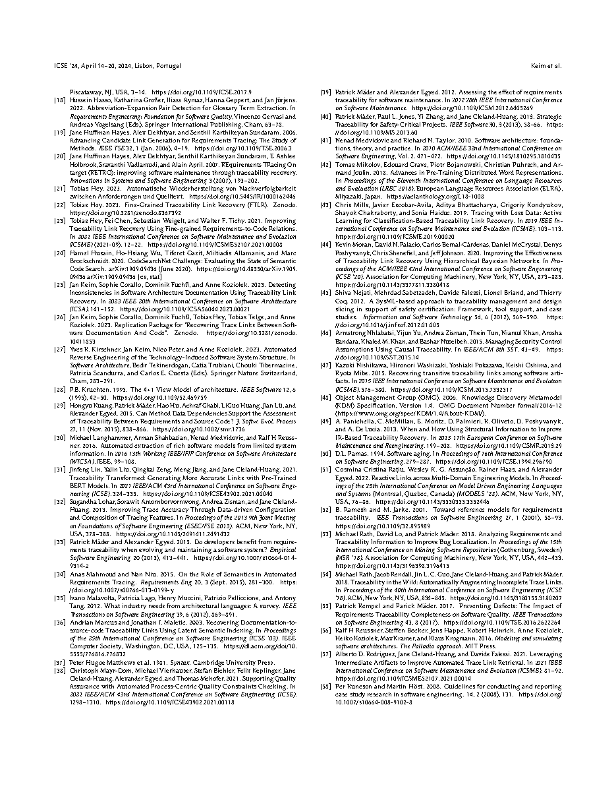

<!-- PDF page 13 -->

## Página PDF 13

RecoveringTraceLinksBetweenSoftwareDocumentationAndCode ICSE’24,April14–20,2024,Lisbon,Portugal
[59] AaronSchlutterandAndreasVogelsang.2021. ImprovingTraceLinkRecovery andinterview. InformationandSoftwareTechnology 141(2022),106705.
Using Semantic Relation Graphs and Spreading Activation. In Requirements [64] RyosukeTsuchiya,KazukiNishikawa,HironoriWashizaki,YoshiakiFukazawa,
Engineering:FoundationforSoftwareQuality,FabianoDalpiazandPaolaSpoletini Yuya Shinohara, Keishi Oshima, and Ryota Mibe. 2019. Recovering transi-
(Eds.).SpringerInternationalPublishing,Cham,37–53. tive traceability links among various software artifacts for developers. IE-
[60] AaronSchlutterandAndreasVogelsang.2021. ImprovingTraceLinkRecovery ICE TRANSACTIONS on Information and Systems 102, 9 (2019), 1750–1760.
Using Semantic Relation Graphs and Spreading Activation. In Requirements https://search.ieice.org/bin/summary.php?id=e102-d_9_1750
Engineering:FoundationforSoftwareQuality,FabianoDalpiazandPaolaSpoletini [65] ZhiyuanWan,YunZhang,XinXia,YiJiang,andDavidLo.2023. SoftwareArchi-
(Eds.).SpringerInternationalPublishing,Cham,37–53. https://doi.org/10.1007/ tectureinPractice:ChallengesandOpportunities.arXivpreprintarXiv:2308.09978
978-3-030-73128-1_3 (2023). acceptedforESEC/FSE2023.
[61] Marcelo Schmitt Laser, Nenad Medvidovic, Duc Minh Le, and Joshua Garcia. [66] W.Wang,N.Niu,H.Liu,andZ.Niu.2018. EnhancingAutomatedRequirements
2020. ARCADE: an extensible workbench for architecture recovery, change, TraceabilitybyResolvingPolysemy.In2018IEEE26thInternationalRequirements
anddecayevaluation.InProceedingsofthe28thACMJointMeetingonEuropean EngineeringConference(RE).40–51. https://doi.org/10.1109/RE.2018.00-53
SoftwareEngineeringConferenceandSymposiumontheFoundationsofSoftware [67] Meng Zhang, Chuanqi Tao, Hongjing Guo, and Zhiqiu Huang. 2021. Re-
Engineering.1546–1550. covering Semantic Traceability between Requirements and Source Code Us-
[62] KamalSouali,OthmaneRahmaoui,andMohammedOuzzif.2016. Anoverviewof ing Feature Representation Techniques. In 2021 IEEE 21st International Con-
traceability:Definitionsandtechniques.In20164thIEEEInternationalColloquium ference on Software Quality, Reliability and Security (QRS). 873–882. https:
onInformationScienceandTechnology(CiSt).789–793. https://doi.org/10.1109/ //doi.org/10.1109/QRS54544.2021.00096
CIST.2016.7804995 [68] T.Zhao,Q.Cao,andQ.Sun.2017. AnImprovedApproachtoTraceabilityRecov-
[63] Fangchao Tian, Peng Liang, and Muhammad Ali Babar. 2022. Relationships eryBasedonWordEmbeddings.In201724thAsia-PacificSoftwareEngineering
betweensoftwarearchitectureandsourcecodeinpractice:Anexploratorysurvey Conference(APSEC).81–89. https://doi.org/10.1109/APSEC.2017.14

[Vista original de la página 13](../../../../../images/v5/estructura_colecciones/Documentation-Code/primary/TLR_Recovering-Trace-Links-Between-Software-Documentation-And-Code/page-13.png)

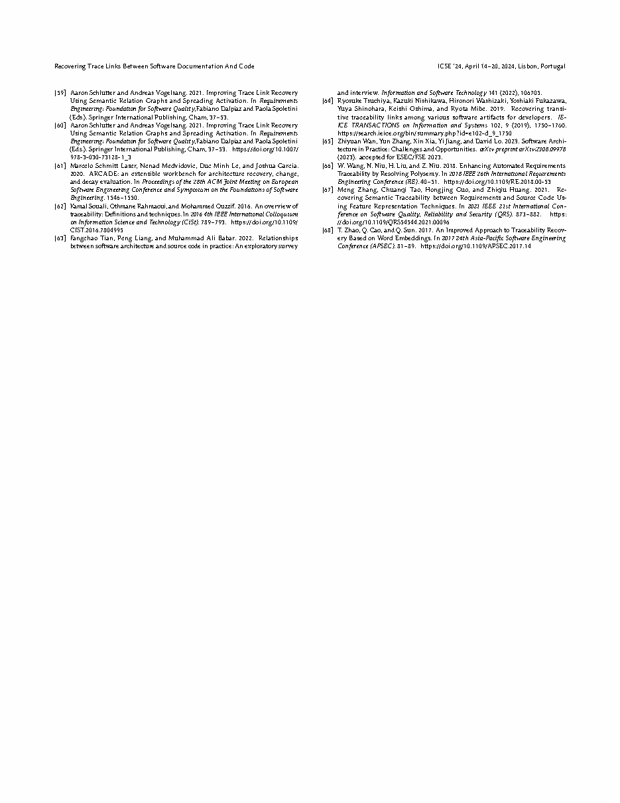
