# TRIAD: Automated Traceability Recovery based on Biterm-enhanced Deduction of Transitive Links among Artifacts

- source_pdf: ../../../../../pdf/Documentation-Code/secondary/TRAID.pdf
- extraction_tool: PyMuPDF
- extraction_date: 2026-11-24
- status: automatic-text-extraction; not manually verified
- pagination: physical PDF pages, starting at 1

> Copia de trabajo para búsqueda y citas. Verifica tablas, fórmulas, figuras y orden visual en el PDF original o en el PNG de la página.

<!-- PDF page 1 -->

## Página PDF 1

TRIAD: Automated Traceability Recovery based on
Biterm-enhanced Deduction of Transitive Links among Artifacts
Hui Gao
State Key Lab of Novel Software
Technology, Nanjing University
Nanjing, China
ghalexcs@gmail.com
Hongyu Kuang∗
State Key Lab of Novel Software
Technology, Nanjing University
Nanjing, China
khy@nju.edu.cn
Wesley K. G. Assunção
CSC, North Carolina State University
Raleigh, USA
wguezas@ncsu.edu
Christoph Mayr-Dorn
ISSE, Johannes Kepler University
Linz, Austria
christoph.mayrdorn@jku.at
Guoping Rong
State Key Lab of Novel Software
Technology, Nanjing University
Nanjing, China
ronggp@nju.edu.cn
He Zhang
State Key Lab of Novel Software
Technology, Nanjing University
Nanjing, China
hezhang@nju.edu.cn
Xiaoxing Ma
State Key Lab of Novel Software
Technology, Nanjing University
Nanjing, China
xxm@nju.edu.cn
Alexander Egyed
ISSE, Johannes Kepler University
Linz, Austria
alexander.egyed@jku.at
ABSTRACT
Traceability allows stakeholders to extract and comprehend the
trace links among software artifacts introduced across the software
life cycle, to provide significant support for software engineering
tasks. Despite its proven benefits, software traceability is challeng-
ing to recover and maintain manually. Hence, plenty of approaches
for automated traceability have been proposed. Most rely on textual
similarities among software artifacts, such as those based on Infor-
mation Retrieval (IR). However, artifacts in different abstraction
levels usually have different textual descriptions, which can greatly
hinder the performance of IR-based approaches (e.g., a requirement
in natural language may have a small textual similarity to a Java
class). In this work, we leverage the consensual biterms and transi-
tive relationships (i.e., inner- and outer-transitive links) based on
intermediate artifacts to improve IR-based traceability recovery.
We first extract and filter biterms from all source, intermediate,
and target artifacts. We then use the consensual biterms from the
intermediate artifacts to enrich the texts of both source and tar-
get artifacts, and finally deduce outer and inner-transitive links
to adjust text similarities between source and target artifacts. We
conducted a comprehensive empirical evaluation based on five sys-
tems widely used in other literature to show that our approach can
∗Corresponding author
ACM ISBN 979-8-4007-0217-4/24/04...$15.00
https://doi.org/3597503.3639164
outperform four state-of-the-art approaches in Average Precision
over 15% and Mean Average Precision over 10% on average.
CCS CONCEPTS
• Software and its engineering →Traceability; Requirements
analysis; • Information systems →Information retrieval.
KEYWORDS
Software Traceability, Information Retrieval, Transitive Links
ACM Reference Format:
Hui Gao, Hongyu Kuang, Wesley K. G. Assunção, Christoph Mayr-Dorn,
Guoping Rong, He Zhang, Xiaoxing Ma, and Alexander Egyed. 2024. TRIAD:
Automated Traceability Recovery based on Biterm-enhanced Deduction
of Transitive Links among Artifacts. In Proceedings of 46th International
Conference on Software Engineering (ICSE 2024). ACM, New York, NY, USA,
13 pages. https://doi.org/3597503.3639164
1
INTRODUCTION & MOTIVATION
Multiple software artifacts in different levels of abstraction are in-
troduced during the development process, including (1) high-level
requirements, use cases, and specifications; and (2) low-level arti-
facts such as source code and tests [30, 37]. Accordingly, software
traceability is defined as “the ability to interrelate any uniquely
identifiable software engineering artifact to any other, maintain
required links over time, and use the resulting network to answer
questions of both the software product and its development pro-
cess” [1]. It allows stakeholders to comprehend the system func-
tionalities behind introduced software artifacts. Recent work has
shown that traceability is paramount in the context of collaborative
development, helping developers to keep all artifacts synchronized
and consistent across a myriad of tools and domains [64]. When
correctly recovered and maintained, these trace links can not only
help improve the software quality[68] and the efficiency of software
Permission to make digital or hard copies of all or part of this work for personal or
classroom use is granted without fee provided that copies are not made or distributed
for profit or commercial advantage and that copies bear this notice and the full citation
on the first page. Copyrights for components of this work owned by others than the
author(s) must be honored. Abstracting with credit is permitted. To copy otherwise, or
republish, to post on servers or to redistribute to lists, requires prior specific permission
and/or a fee. Request permissions from permissions@acm.org.
ICSE ’24, April 14–20, 2024, Lisbon, Portugal
© 2024 Copyright held by the owner/author(s). Publication rights licensed to ACM.

[Vista original de la página 1](../../../../../images/v5/estructura_colecciones/Documentation-Code/secondary/TRAID/page-01.png)

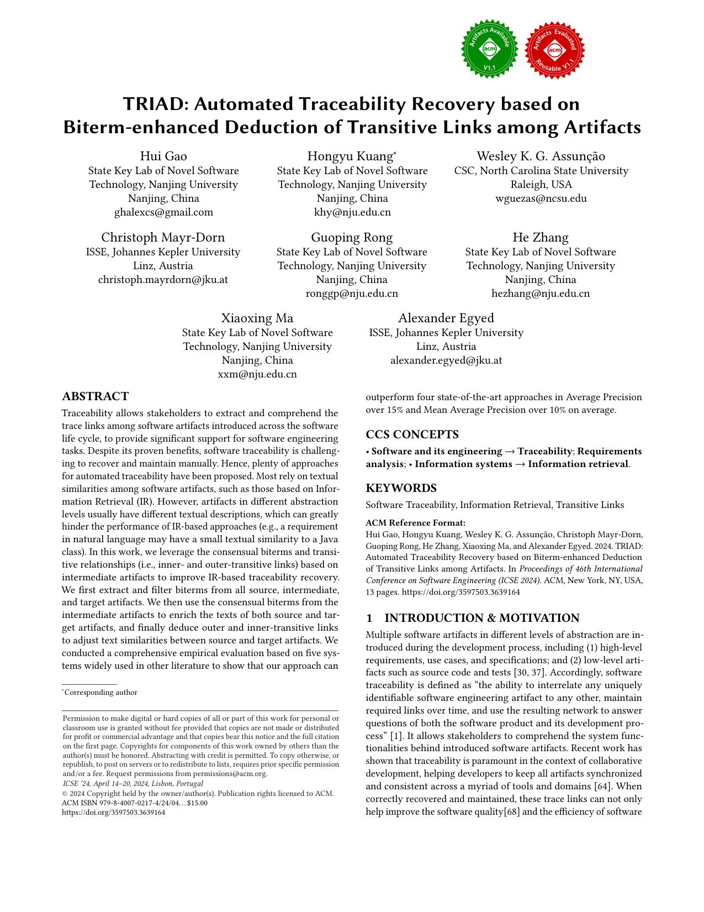

<!-- PDF page 2 -->

## Página PDF 2

ICSE 2024, April 2024, Lisbon, Portugal
Hui Gao, Hongyu Kuang, Wesley K. G. Assunção, Christoph Mayr-Dorn, Guoping Rong, He Zhang, Xiaoxing Ma, and Alexander Egyed
maintenance[45], but also provide support for many critical soft-
ware engineering tasks such as safety-assurance[50], change impact
analysis[26], and bug localization[66]. In practice, traceability is
also widely used to demonstrate the safe running of systems[46, 55],
and to help ensure system security[54, 57]. Unfortunately, despite
its importance, manually creating and maintaining trace links is
time-consuming and error-prone [25, 65] due to the semantic gap
between different artifacts [13] (such as requirements written in
natural language and code written in programming language).
Therefore, researchers have investigated the use of automated
tracing techniques based on information retrieval (IR)[27, 38], ma-
chine learning (ML)[52, 53], and deep learning techniques (DL)[31,
41]. These automated approaches generally rely on analyzing the
textual similarities or relationships from different artifact texts
to derive the likelihood of the actual traces. Unfortunately, differ-
ent types of software artifacts typically have different abstraction
levels due to being produced in different stages of the software life-
cycle [43]. Specifically, the early stages deal with more user-and-
problem-centric concepts (e.g., system specifications and require-
ments), while later stages emphasize solution and implementation
details (e.g., code and test)[15]. Spanning life-cycle phases involves
a detailed transition from higher abstraction levels in early stages to
lower abstraction levels in later stages, thus causing the abstraction
gap problem among different artifacts at different abstraction levels,
i.e., one software concept is often described in summarized form in
high-level abstracted artifacts, while the description of the same
concept is available in more detailed text in low-level abstracted
artifacts. Furthermore, different kinds of software artifacts usually
use different terms to express the same concept[13], which is also
known as the vocabulary mismatch problem. These two situations
greatly hinder the performance of automated tracing techniques.
To address this issue, researchers proposed diverse enhancing
strategies from different perspectives for automated traceability,
including text enrichment[17, 22], advanced lexical analysis[29,
59], incorporating execution tracing by running systems[23, 63],
analyzing code structural information[39, 51], advanced data pre-
processing and models for ML and DL[24, 41], and utilizing user
verification on candidate links[20, 27, 33, 60, 61]. However, the
effectiveness of these approaches still depends on the quantity and
quality of artifact texts. Furthermore, these approaches focused
on establishing trace links by solely considering the two trace
endpoint artifacts (usually requirements and code that have perhaps
the largest abstraction gap), ignoring other available intermediate
artifacts that are simultaneously created and maintained during
development, such as various design artifacts and test cases.
A different body of work focused on introducing other types
of artifacts in automated traceability to bridge the abstraction gap.
Moran et al.[54] proposed to recover requirements-to-code traces
by incorporating user feedback with transitive links that are addi-
tionally extracted between requirements and test cases. Rodriguez
et al.[69] explored 84 kinds of combinations for eliciting transitive
links from intermediate artifacts to recover source-to-target traces.
However, it is also reported that the optimized technique across all
datasets is hard to locate. The users have to fine-tune the combina-
tion strategies for their systems to reach satisfying performance.
Meanwhile, Gao et al.[28] proposed to extract consensual biterms
from both requirements and code to improve IR-based traceability
recovery. They argue that the extracted biterms indicate part of
the same system functionalities shared between requirements and
code, thus helping to bridge their semantic gaps. However, their
biterm extraction does not involve available intermediate artifacts
that can be vital to further solve the abstraction gap problem.
To break through the previously discussed limitations, in this
paper, we propose to improve automated traceability recovery by
eliciting transitive links from source, intermediate, and target ar-
tifacts with the help of consensual biterm extraction on artifact
texts. Specifically, we deduce the following two kinds of transi-
tive links from different artifacts: (1) outer-transitive links, and (2)
inner-transitive links. We deduce the former links from source to
intermediate artifacts, and from intermediate to target artifacts
while deducing the latter links within source artifacts and interme-
diate artifacts only. We propose to use these two kinds of transitive
links to concatenate relevant system functionalities across mul-
tiple artifacts and also to cluster the same system functionalities
within each kind of non-target artifacts, respectively. We do not
deduce inner-transitive links from target artifacts because their sys-
tem functionalities are too fine-grained and diluted with too many
implementation details. We argue that our deduced inner- and outer-
transitive links actually form implicit "networks" to comprehensively
aggregate system functionalities across different software artifacts,
thus better bridging the semantic gap for automated tracing.
To deduce the inner- and outer-transitive links, we solely rely on
textual similarities calculated by IR techniques because the artifact
texts, though of which the quality and quantity are not satisfying,
are still the prevailing perspective to analyze different software
artifacts with heterogeneous structures. This characteristic, along
with the wide availability of artifact texts, is very beneficial for
deducing transitive links across different kinds of source, intermedi-
ate, and target artifacts. However, the performance of IR techniques
on artifact texts is still vital for our approach. Therefore, we intro-
duce consensual biterm extraction [28] into our approach to enrich
artifact texts and thus enhance the calculated IR values. Specifically,
we first extract an initial set of biterms for source, intermediate,
and target artifacts separately. Then, for biterms in source and tar-
get artifacts, we only retain those biterms that also appear in the
intermediate artifacts. We name the retained consensual biterms
as intermediate-centric consensual biterms because we argue that
intermediate artifacts are naturally middle-level abstracted, and
thus important to bridge the abstraction gap between source and
target artifacts. Based on the enriched texts of source and target
artifacts with the retained biterms, we proposed to deduce inner-
transitive links within each kind of artifact and outer-transitive
links from source (or target) artifacts to intermediate artifacts when
a given pair of artifacts has top-ranked textual similarities. Finally,
to improve automated traceability recovery based on IR techniques,
we traverse the two deduced types of transitive links to form valid
link paths and use these paths to adjust IR scores and improve the
ranking of candidate trace links. We will use the following example
(adapted from the Dronology system [4]) for further demonstration.
Figure 1 shows five artifacts in different abstraction levels from
an open-source Unmanned Aerial System called Dronology [18],
including two high-level requirements (RE-691 and RE-695), two de-
sign definitions (DD-647 and DD-694), and the code snippets from
class AFInfoBox and AFEmergencyComponent. RE-691 describes

[Vista original de la página 2](../../../../../images/v5/estructura_colecciones/Documentation-Code/secondary/TRAID/page-02.png)

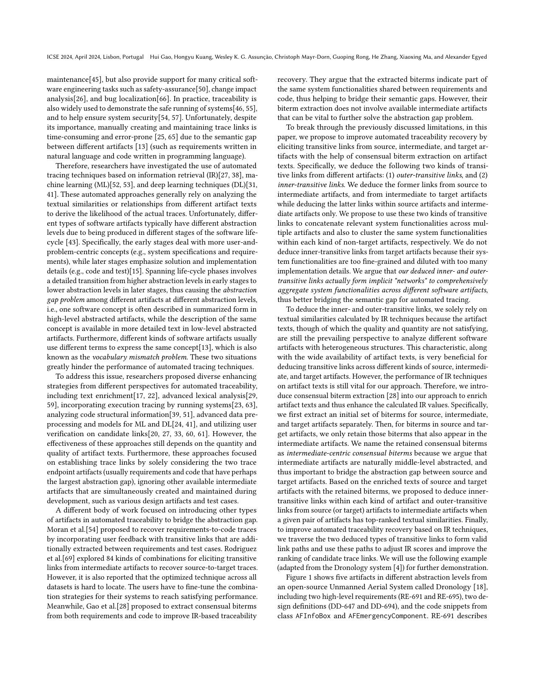

<!-- PDF page 3 -->

## Página PDF 3

TRIAD: Automated Traceability Recovery based on Biterm-enhanced Deduction of Transitive Links among Artifacts
ICSE 2024, April 2024, Lisbon, Portugal
SUMMARY: Applying emergency operations
DESCRIPTION: 
When requested by the user  the UI shall apply the requested emergency action to all 
selected UAVs; if no UAV is selected  the UI shall apply the emergency action to all 
UAVs by default.
DD-694
SUMMARY: Assign routes to UAV
DESCRIPTION:
The user shall select a UAV and then assign routes to it from an available route list.
DD-647
high-level
middle-level
low-level
SUMMARY: UAV Operations
DESCRIPTION:
The RealTimeFlightUI shall allow users to apply flight operations to one or more UAVs.
RE-691
public class AFInfoBox extends CustomComponent {
       private Resource assignRouteIcon = ImageProvider.getAssignRouteResource();
       private Button assignNewRoute = new Button("");
}
AFInfoBox  
/**
 * This is the set of emergency buttons in the AFInfoPanel 
 */
public class AFEmergencyComponent extends CustomComponent{
       public AFEmergencyComponent(){}
       public NativeButton getHome(){}
       public NativeButton getHover(){}
}
AFEmergencyComponent 
SUMMARY: Following UAVs
DESCRIPTION:
The RealTimeFlightUI shall allow users to follow one or multiple UAVs on the map.
RE-695
Figure 1: Motivating example adapted from the Dronology
system with the following three consensual biterms: (apply,
operation), (assign, route), and (select, UAV)
the system functionality of “UAV operations”, i.e., allowing users
to apply flight operations to selected UAVs (Unmanned Aerial Ve-
hicle). Accordingly, the class AFInfoBox is implemented to show
UAV’s information for flight operations, thus traced to RE-691. Un-
fortunately, a significant abstraction gap can be observed through
the texts of RE-691 and AFInfoBox where the two artifacts share
few terms because RE-691 tends to describe the summarized con-
cepts of “UAV operations”, while AFInfoBox focuses more on the
implementation details, such as showing the assigned routes for
UAVs. This situation hinders the automated recovery of the trace
between RE-691 and AFInfoBox based on textual similarities, and
we propose to deduce transitive links with the help of available
intermediate artifacts and consensual biterm extraction. Through
the artifact texts with the additionally extracted consensual biterm
(apply, operation), we can deduce an outer-transitive link between
RE-691 and DD-694. Furthermore, with the help of extracted con-
sensual biterm (select, UAV), we deduce an inner-transitive link
between DD-694 and DD-647. Meanwhile, we can deduce another
outer-transitive path between DD-647 and AFInfoBox mainly due
to the extracted consensual biterm (assign, route). Finally, we find
a path from RE-691 to AFInfoBox based on the deduced two outer-
transitive and one inner-transitive links. We argue that this path can
effectively bridge the previously observed abstraction gap between
RE-691 and AFInfoBox, thus important for automated tracing the
two artifacts. Our proposed approach is discussed in Section 3.
We use five real-world systems to evaluate our approach, involv-
ing the three mainstream IR models (i.e., VSM, LSI, and JS). The
results showed that our approach outperforms four state-of-the-
art traceability recovery approaches, namely a naive IR approach
without any enhancing strategies involved IR-ONLY, two IR-based
approaches TAROT [28] (using consensual biterms between require-
ments and code) and LIA [69] (leveraging intermediate artifacts),
and a probabilistic-model-based approach COMET [54]. We im-
plemented our approach called TRIAD (Traceability Recovery by
bIterm-enhAnced Deduction of transitive links). In summary, the
main contributions of this work are: (i) a novel approach called
TRIAD using intermediate-centric consensual biterms and outer-
inner combined transitive links for automated traceability recovery;
(ii) an empirical evaluation of TRIAD on five open-source systems;
and (iii) availability of source code and data of TRIAD online [6, 7].
2
BACKGROUND AND RELATED WORK
This section discusses the background and related work on trace-
ability recovery approaches, enhancing strategies for IR-based ap-
proaches, using biterms in lexical analyses, and leveraging multiple
types of artifacts in traceability recovery.
IR-based traceability recovery: IR techniques are widely used
for automated traceability recovery [16] because they can compute
textual similarities between various software artifacts (e.g., require-
ments and code) based on the occurrence of terms from artifact
texts, and suggest IR values as the probability whether a pair of
source-target artifacts is a relevant trace. Typically, IR-based ap-
proaches follow three steps to compute textual similarities [19]: (i)
constructing a corpus with terms extracted from different software
artifacts; (ii) representing the corpus using a term-by-document
matrix, where each artifact is organized as a document and cell
values are weighted using the tf-idf weighting scheme [11] to em-
phasize the importance of each term in the document based on
its frequency of occurrence; (iii) calculating the similarity among
artifacts (represented as entries in the term-by-document matrix)
using different IR models. Current mainstream IR models include
two vector-space-based VSM (Vector Space Model [10]) and LSI
(Latent Semantic Indexing [49]), and one probability-based JS (The
Jensen-Shannon model [8]). LSI is a variant of VSM and applies
Singular Value Decomposition (SVD) [11] to the term-by-document
matrix. To comprehensively evaluate TRIAD compared to IR-based
approaches, our evaluation includes all three discussed IR models.
Enhancement for IR-based approaches: To address the vo-
cabulary mismatch problem that greatly hinders the performance of
IR-based traceability recovery, researchers have proposed various
enhancing strategies from different perspectives, such as introduc-
ing enhanced lexical analyses on the text of artifacts [17, 21, 29],
incorporating with execution tracing [23, 63], or combining with
the analyses on different kinds of code dependencies [39, 51]. Fur-
thermore, due to the semi-automatic nature of IR-based traceability
recovery which requires user verifications on the generated candi-
date links, a different body of work [20, 33, 60] uses user feedback
(candidate links verified as either relevant links or false positives)
to adjust the calculation of IR values. Panichella et al. [61] further
combined the user feedback with code dependency analysis, while

[Vista original de la página 3](../../../../../images/v5/estructura_colecciones/Documentation-Code/secondary/TRAID/page-03.png)

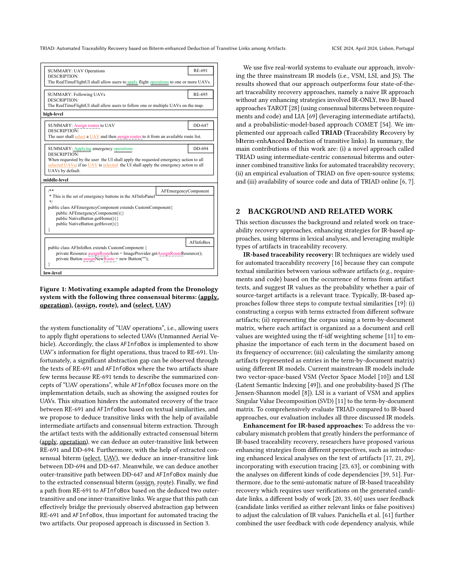

<!-- PDF page 4 -->

## Página PDF 4

ICSE 2024, April 2024, Lisbon, Portugal
Hui Gao, Hongyu Kuang, Wesley K. G. Assunção, Christoph Mayr-Dorn, Guoping Rong, He Zhang, Xiaoxing Ma, and Alexander Egyed
Gao et al. [27] proposed CLUSTER’ that uses the closeness analy-
sis on code dependencies [39] to improve IR-based approaches by
propagating only a small amount of user feedback. Unfortunately,
although the discussed approaches achieved great progress, their
improvements are still highly relevant to the quantity and quality
of artifact texts, i.e., the initially calculated IR values.
ML-based traceability recovery: An increasing number of
works proposed take advantage of Machine Learning (ML) tech-
niques for traceability recovery and reported promising results,
especially when some trace links have been previously identified,
such as completing the missing links between issues and code
commits in software repository [40, 67, 71], or maintaining recov-
ered traces through machine learning classification [53]. Mills et
al. [52] further introduced active learning to significantly reduce
the amount of required training data for classification when re-
covering traces. However, these approaches still largely rely on
calculated IR values as the features of their classification tasks,
while our approach is expected to improve the quality of IR values,
thus being likely to improve these approaches as well. Additionally,
deep-learning-based approaches have been proposed, such as Guo
et al. [31] that uses the RNN network to generate links between
subsystem requirements and design definitions, and T-BERT [42]
that uses various BERT architectures to recover missing links be-
tween issues and commits. The deep learning (DL) network can
capture the implicit connections from term sequences in artifact
texts, whereas TRIAD explicitly deduces transitive links across
source, intermediate, and target artifacts to bridge the abstraction
gap without the demand of previously labeled traces as the training
sets.
Leveraging multiple types of software artifacts: Moran et
al.[54] modeled the existence of traceability links based on probabil-
ity, which incorporates user feedback, transitive links across groups
of diverse development artifacts, and execution traces by running
test cases (for only one evaluated system). However, they only ex-
tracted transitive relationships within requirements. Rodriguez et
al.[69] explored 84 kinds of different techniques combinations for
leveraging intermediate artifacts to improve the accuracy of source-
to-target trace recovery. However, they observed that it is hard
to find a single technique that performed best across all datasets,
while TRIAD achieves good performance by default settings, and
also allows users to further fine-tune it (see Section 6).
Using biterms in lexical analyses: Biterms were originally
proposed for document retrieval [70] to address the issue of data
sparsity. For the same reason, Cheng et al. [14] use biterms to better
establish topic models over short texts. In the field of software engi-
neering (SE) research, Hadi et al. [32] proposed an adaptive online
biterm topic model to analyze version-sensitive short texts. Instead
of using the biterm topic modeling directly, Gao et al. [28] extracted
consensual biterms from requirements and code to improve re-
quirement traceability recovery. However, they only considered
the two specific types of artifacts, i.e., requirements and code. In
contrast, our approach leverages multiple types of artifacts to ex-
tract intermediate-centric biterms for better deducing inner- and
outer-transitive links, thus leading to a more versatile traceability
recovery process by comprehensively bridging the abstraction gap.
3
THE TRIAD APPROACH
Figure 2 illustrates the overview of TRIAD. First, we extract consen-
sual biterms from source, intermediate, and target artifacts. Second,
we enrich source and target artifact texts with consensual biterms
from intermediate artifacts and generate candidate trace lists. Fi-
nally, we further use inner- and outer-transitive links to adjust the
candidate traces’ IR scores. All steps are described in detail next.
3.1
Extracting Intermediate-centric Biterms
Artifacts in our dataset are generally classified into two categories:
natural language written artifacts (e.g., requirements, use cases,
design definitions, etc.) and programming language artifacts (e.g.,
source code and test code). We then introduce two separate biterm-
extraction strategies for the two categories of artifacts according to
Gao et al.’s work [28].
3.1.1
Extracting Biterms from Natural Language Artifacts: For natu-
ral language artifacts, we leverage Stanford CoreNLP [48] to parse
the texts with steps as follows: (i) split a text into independent sen-
tences; (ii) use Part-Of-Speech (POS, e.g., nouns, verbs, adjectives,
adverbs, pronouns, etc.) Tagger1 to assign POS to each term in a
sentence; (iii) use Stanford-typed dependencies parser2 on each sen-
tence to get term pairs (biterms) having grammatical relationship in
the sentence; and (iv) filter biterms that are not composed of nouns,
verbs, or adjectives. For example, Figure 3 shows the parse result of
the given sentence in the design definition DD-647. The POS tag of
each term is provided in the brackets, including NNP (proper noun),
MD (modal auxiliary), VB (verb), NN (noun), NNS (noun, plural), IN
(preposition), CC (coordinating conjunction), and JJ (adjective). In
this example, we obtain five biterms with grammatical relationships,
i.e., select, user (nusbj, nominal subject), select, UAV (obj, object),
assign, and (cc, coordination), assign, routes (obj, object), and
availiable, list (amod, adjective modifier). Then we discard assign,
and since it does not satisfy the POS combination criterion. The
remaining four biterms are considered as candidate biterms after
preprocessing and saved as (user, select), (select, uav), (assign,
rout), and (avail, list).
3.1.2
Extracting Biterms From Programming Language Artifacts:
For programming language artifacts, we extract biterms from code
identifier names (e.g., class name, method name, invoked method
name, field type and name, parameter type and name, etc.) and com-
ments (i.e., comments for class or method). To identify these code
elements, we use srcML [5, 47] to translate Java and C source code
to the srcML format, which wraps the text of the source code in
XML elements. Hence, it allows us to identify and extract these code
elements precisely. Then, the extraction steps are: (i) extract code
identifiers and comment data from the source code; (ii) extract con-
sensual biterms from preprocessed code identifiers and comments.
Currently, existing POS taggers cannot achieve 100% accuracy in
tagging code identifiers due to a lack of sentence context and gram-
mar structures [56]. We apply the same extraction strategies for
identifier names by combining any two split terms sequentially
proposed in TAROT [28]. For example, for class AFInfoBox in the
motivation case, we can get (af, info), (af, box), and (info, box)
1https://nlp.stanford.edu/software/tagger.html
2https://nlp.stanford.edu/software/stanford-dependencies.html

[Vista original de la página 4](../../../../../images/v5/estructura_colecciones/Documentation-Code/secondary/TRAID/page-04.png)

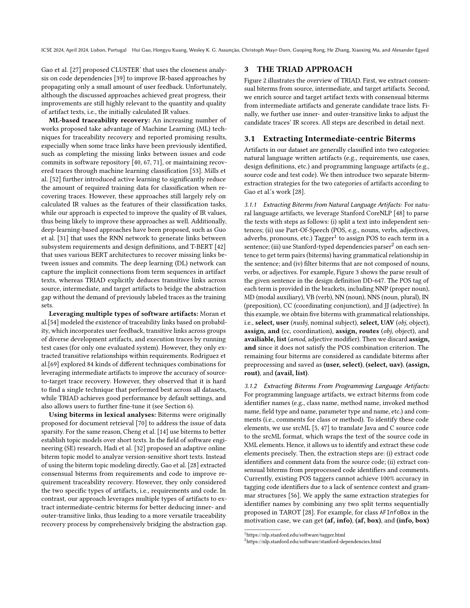

<!-- PDF page 5 -->

## Página PDF 5

TRIAD: Automated Traceability Recovery based on Biterm-enhanced Deduction of Transitive Links among Artifacts
ICSE 2024, April 2024, Lisbon, Portugal
2.1.Extend with Consensual Biterms
1. Extract Consensual Biterms
intermediate-centric
biterms set
source
intermediate
target
Artifacts
2.2. Generate Candidate Trace List
preprocess
IR models
candidate 
trace list
3. Adjust with Transitive Links
•
outer-transitive:
•
outer &Inner  transitive:
updated
trace list 
Figure 2: Overview of the TRIAD framework
to
The user shall select a UAV
assign routes
nusbj
(DT)
(MD)
(VB)
(NNP)
(RB)
(VB)
(NNS) (IN)(PRP) (IN)
(JJ)
and then
obj
it from an available list.
(NN)
(DT)
(CC)
(DT)
(NN)
obj
amod
cc
Figure 3: Stanford CoreNLP parse result for the sentence in
DD-647.
from its class name. As for its field name assignRouteIcon, we can
get (assign, rout), (assign, icon), and (rout, icon). Furthermore,
we can also get additional two occurrences of (assign, rout) from
its invoked method name getAssignRouteResource and another
field name assignNewRoute respectively.
3.1.3
Retaining Intermediate-centric Consensual Biterms: Once we
have extracted biterms from the source, intermediate, and target
artifacts, we filter them to obtain intermediate-centric consensual
biterms. Specifically, biterms extracted from the source and target
artifacts must also appear in any of the intermediate artifacts. Fur-
thermore, we discard biterms that appear only in the intermediate
artifacts. We argue that these biterms would introduce noise during
textual similarity calculation since they do not appear in either the
source or the target artifacts. For example, for class AFInfoBox in
the motivation example, we extract (af, info), (af, box), (info, box),
(assign, route), (assign, icon), and (rout, icon). After the filter pro-
cess, only (assign, rout) will be retained because other biterms do
not appear in intermediate artifacts (i.e., DD-647 and DD-694).
3.2
Enriching Artifacts with Biterms and
Calculating IR Candidate List
3.2.1
Enriching Source, Intermediate, and Target artifacts with
Biterms: After extracting biterms from source, intermediate, and
target artifacts, we subsequently determine their occurrence fre-
quency as an indicator of importance. For natural language artifacts,
the importance of a biterm is determined directly by how often
that biterm occurs in the entire text of the underlying artifact. For
programming language artifacts, we follow the rules proposed in
TAROT [28], which consider different parts of code of different
importance and are defined as follows. For a biterm that appears
in class names or method names, its importance count is increased
by two, since the names of classes and methods are particularly
important [36]. A biterm that appears in comments (i.e., comments
of classes and methods) has its count increased by one for each
occurrence. For invoked method names, field types and names, and
parameter types and names, if the biterm only appears in these parts,
its importance count is assigned to one and remains unchanged
regardless of how many times it appears. Finally, for each biterm
we accumulate all importance counts from the various code parts.
For example, a biterm that appears once in the class name, twice in
the comments, and three times in the parameter types obtains an
importance count of 1 × 2 + 2 × 1 + 1 = 5.
3.2.2
Creating Corpus and Computing Textual Similarities: Each
programming written artifact is extracted into one document con-
taining its comments and identifiers, including class names, method
names, field types and names, and parameter types and names. Then
we use the CamelCase and snake_case naming conventions to split
identifiers into terms. For natural language written artifacts, we
extract a document that includes all content. The documents are
normalized by standard pre-processing techniques for IR, by: re-
moving special tokens, converting upper case letters into lower
case, removing stop words, and performing the Porter stemming
algorithm [62]. Finally, we calculate textual similarities based on
three mainstream IR models: Vector Space Model (VSM) [10], La-
tent Semantic Indexing (LSI) [49], and the probabilistic Jensen and
Shannon (JS) model [8].
3.2.3
Enriching Source and Target artifacts with Intermediate-centric
Biterms. First, we identify highly related intermediate artifacts for
each source and target artifact based on their textual similarities.
Using the similarity scores calculated in Step 2 we only consider
at most 𝑡intermediate artifacts, where 𝑡= 3 and for each artifact
the similarity score must be equal to or greater than threshold 𝑚
= 0.5 of the maximum similarity (thresholds calibration discussed
in Section 3.3.3). In other words, a requirement with the top most
similar design definition having a similarity score of 0.8, results in
considering two further design definitions as long as their similarity
score is higher than 0.4 (= 0.8 × 0.5). Then we use the consensual
biterms extracted from the highly related intermediate artifacts to
enrich the source and target artifacts, whereby each consensual
biterm is added only once. For example, requirement RE-691 can
be extended with (appl, oper)and (select, uav) from DD-694. Class
AFInfoBox can be extended with (select, uav) and (assign, rout)
from DD-647.
3.2.4
Generating Candidate Links: We pairwise calculate the tex-
tual similarities between enriched source, target, and intermediate
artifacts. For each source artifact, we obtain a list of ranked IR target
candidates. The list is sorted in descending order determined by the
textual similarity using three mainstream IR models (see Sec.3.2.2).
3.3
Adjusting IR Scores by Transitive Links
Intermediate artifacts provide not only intermediate-centric con-
sensual biterms, but also transitive semantics from source to target
artifacts. We deduce two types of transitive links based on textual

[Vista original de la página 5](../../../../../images/v5/estructura_colecciones/Documentation-Code/secondary/TRAID/page-05.png)

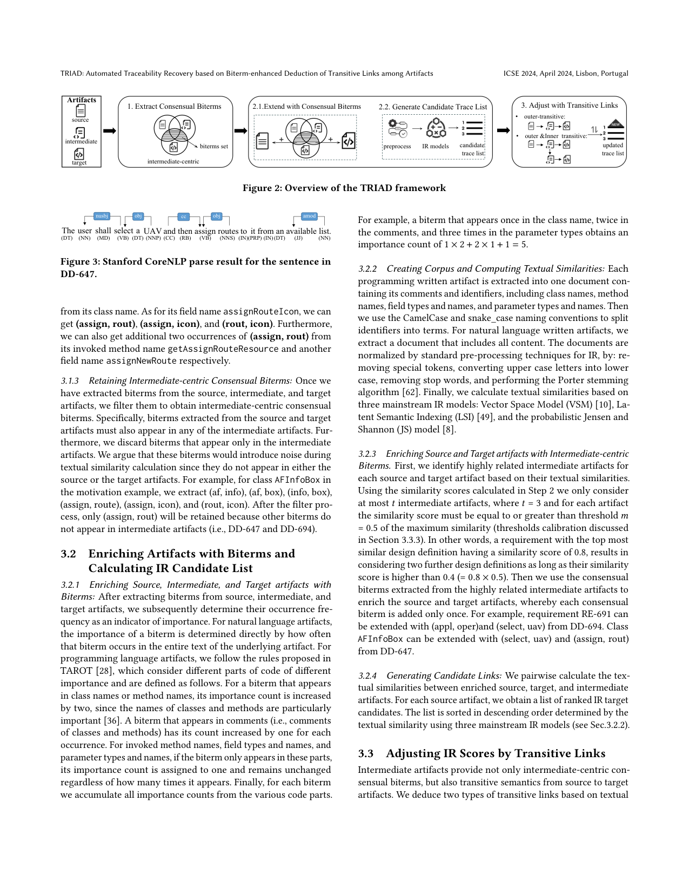

<!-- PDF page 6 -->

## Página PDF 6

ICSE 2024, April 2024, Lisbon, Portugal
Hui Gao, Hongyu Kuang, Wesley K. G. Assunção, Christoph Mayr-Dorn, Guoping Rong, He Zhang, Xiaoxing Ma, and Alexander Egyed
similarities: between the same kind (inner-transitive) and between
different kinds of artifacts (outer-transitive), as described next.
3.3.1
Outer-transitive Links: We deduce an outer-transitive link
between a pair of different kinds of artifacts (at different abstrac-
tion levels) that exhibit high textual similarities, thus likely to be
semantically correlated. That is to say, if a source artifact S has a
high similarity with an intermediate artifact I, and I also has a high
similarity with a target artifact T, then we assume that S is closely
related to T, and the outer-transitive link is S→I→T. Note that we
do not rely on any explicit trace links that might exist between
source to intermediary artifact or target to intermediary artifact as
such traces might not always be available. For example, as shown
in Figure 4 there exists an outer-transitive link, i.e., RE-691→DD-
694→AFEmergencyComponent. The outer transitive links are con-
nected with a solid black arrow. Through this transitive link, we can
bridge the abstraction gap between high-level abstracted artifact
RE-691 and low-level abstracted code file AFEmergencyComponent.
3.3.2
Inner-transitive Links: We deduce an inner-transitive link
between any two artifacts with high textual similarity that are of
the same type as they reside at the same level of abstraction. We
assume that if a source artifact S1 has a high similarity with an-
other source artifact S2, there is an inner-transitive link S1→S2.
For example, as shown in Figure 4 there are two inner-transitive
links connected with dashed black arrows, i.e., RE-691→RE-695
and DD-694→DD-647. As we discussed in Section 1, we do not
deduce inner-transitive links from target artifacts due to their too
fine-grained system functionalities diluted by implementation de-
tails. Certain target artifacts such as code are highly structured and
contain inherent dependencies such as calling relationships. How-
ever, we do not consider these inner dependencies in our approach
either, even when they are available and have high quality. The
reason is that introducing target-level inner-transitive links will
lead to too many possible paths when traversing all transitive links,
even though these links are rigorously chosen based on textual
similarities. This situation will over-aggregate the system func-
tionalities and eventually decrease the performance of automated
tracing, which is also confirmed during our trials and experiments.
3.3.3
Filtering Inner- and Outer-transitive Links: We now discuss
how to choose outer- and inner-transitive links based on textual
similarities. We apply the same two thresholds introduced above:
RE-691
  DD-647
   DD-694
AFInfoBox
AFEmergency
Component
RE-695
1
3
2
4
5
6
7
t = 2
m= 0.6
t = 3
m= 0.5
t = 2
m= 0.6
t = 3
m= 0.5
t = 1
m= 0.7
t = 2
m= 0.6
t = 1
m= 0.7
Figure 4: Applying TRIAD in the motivating scenario de-
picted in Figure 1
(i) 𝑚(=0.5) ensures that the selected transitive links’ IR values are
equal to or greater than 50% of the maximum similarity, which
is determined by the most related intermediate artifact. By con-
sidering this threshold, we aim to prioritize transitive links with
higher similarity scores and disregard those with lower ranks that
potentially indicate lower similarity or non-relevance. (ii) 𝑡(=3)
represents the maximum number of outer- and inner-transitive
links to be selected, respectively. We adopt a conservative approach
by considering only the top 𝑡transitive links to avoid introducing
too many intermediate artifacts, due to enriching artifacts with
overmuch biterms that may dilute their unique semantics. Further-
more, we consider the decreasing reliability of textual similarity as
we include more artifacts in the transitive links. To mitigate this
risk, we adopt a specific strategy. For 𝑚, we increase the threshold
by 0.1 for every hop from the source artifact (𝑚′ = 0.1 × 𝑛+ 𝑚,
where 𝑛is the number of hops). Conversely, for the threshold 𝑡we
reduce 𝑡by 1 for each hop. This approach aims to avoid introducing
potentially noisy transitive links. For practical recommendations
of threshold calibration, please refer to our further discussions in
Section 6 (the "Implications for Practitioners" paragraph).
3.3.4
Forming Paths from Transitive Links to Adjust IR Scores: Now
we can further combine inner-transitive links with outer-transitive
links to find the potential relationship between artifacts. That is
to say, in Figure 4, if S2 has a high similarity with an interme-
diate artifact I, there is likely a relation between S1 and I. We
can find the inner-outer-transitive link is S1→S2→I. For example,
RE-691→RE-695→DD-694→AFEmergencyComponent is an inner-
outer-transitive link in Figure 4. Again, we do not rely on explicit,
existing trace links between artifacts of the same type as such traces
might not be available in every environment and for every artifact
type. Figure 4 further illustrates the adjustment process for the mo-
tivating scenario. Starting with the source artifact RE-691, we calcu-
late the candidate list of intermediate artifacts (i.e., outer-transitive
links). We find that DD-694 has the highest similarity 1○, and the
other intermediate artifacts do not satisfy the 𝑚(=0.5). Therefore,
we select DD-694 as the intermediate artifact and compute simi-
larities between DD-694 and the target artifacts. Considering the
existing path RE-691→DD-694 labeled with 1○(i.e., constituting
one hop), we reduce 𝑡by 1 and add 0.1 to 𝑚. Among the target
artifacts, AFEmergencyComponent has the highest similarity, while
the others fall below the adjusted 𝑚(0.5 + 0.1). Thus, we identify an
outer-transitive link RE-691→DD-694→AFEmergencyComponent,
and label the related paths as 1○and 2○. Next, we calculate the
similarities between DD-694 and other intermediate artifacts to
find the inner-transitive links. Given the current 𝑡(=2) and adjusted
𝑚(=0.6), which resulted from including the path RE-691→DD-
694 in the transitive link, we discover that DD-647 satisfies both
threshold constraints. As a result, we can further use the outer-
transitive relation of DD-647 to identify the target artifacts. At
this stage, the 𝑡is 1, and 𝑚is 0.7 due to two hops included in the
transitive link (RE-691→DD-694 1○and DD-694→DD-647 3○). Fi-
nally, only AFInfoBox exceeds thresholds and we can find an outer-
inner-transitive link RE-691→DD-694→DD-647→AFInfoBox la-
beled with numbers 1○3○4○.
It is worthwhile noting that for each inner-outer-transitive link,
our approach only allows the link to contain one inner-transitive

[Vista original de la página 6](../../../../../images/v5/estructura_colecciones/Documentation-Code/secondary/TRAID/page-06.png)

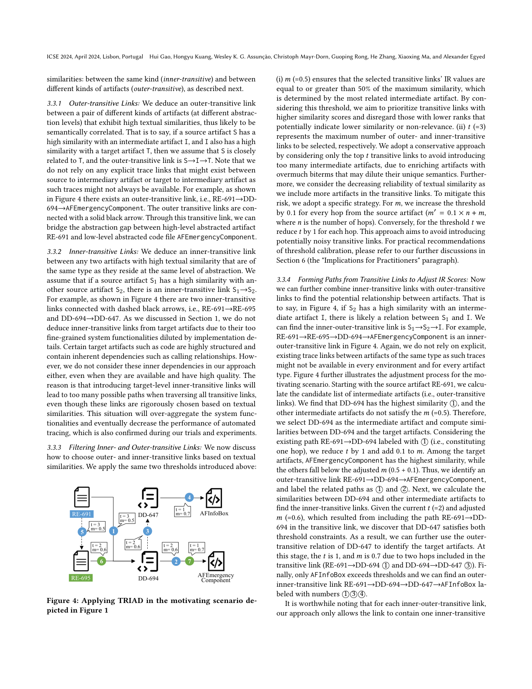

<!-- PDF page 7 -->

## Página PDF 7

TRIAD: Automated Traceability Recovery based on Biterm-enhanced Deduction of Transitive Links among Artifacts
ICSE 2024, April 2024, Lisbon, Portugal
link. The reason is that we found that two different artifacts from
the same abstraction level tend to represent different parts of the
system functionalities, i.e., the two sets of their traced, different
abstraction-level artifacts are more likely to have a small over-
lap only. Hence, introducing more than one inner-transitive links
may lead to the inclusion of more potentially unrelated artifacts in
the deduction phase, especially when the influence of each inner-
transitive link is further amplified by the correlated outer-transitive
links from each inner-outer-transitive link, thus decreasing the
precision of TRIAD. For instance, because there is already an inner-
transitive link RE-691→RE-695 5○, the transitive link RE-691→RE-
695→DD-694 5○6○will not include another inner-transitive link
DD-694→DD-647 3○but only a direct hop to the destination ar-
tifact 7○. Consequently, all transitive links are of hop count two
when comprising only outer-transitive links or of hop count three
when containing one inner-transitive link. In Figure 4, all the tran-
sitive links are sequentially labeled with numbers based on their
execution order. Links originating from RE-691 and RE-695 are
distinguished with blue and green colors, respectively.
After identifying the transitive links, we proceed to calculate the
𝑏𝑜𝑛𝑢𝑠by multiplying the IR score of each link:𝑏𝑜𝑛𝑢𝑠= Î𝑛
𝑖=1 𝐼𝑅𝑙𝑖𝑛𝑘𝑖.
Next, we utilize the𝑏𝑜𝑛𝑢𝑠value to enhance the initial IR score 𝐼𝑅be-
tween the source and target artifact along this transitive path. The
updated IR score 𝐼𝑅
′ is determined as follows: 𝐼𝑅
′ = 𝐼𝑅×(1+𝑏𝑜𝑛𝑢𝑠).
4
EXPERIMENT SETUP
To evaluate TRAID, we perform an empirical evaluation with two
major goals: (i) assess whether biterm-enhanced deduction of tran-
sitive links can improve IR-based traceability recovery, and (ii)
investigate the individual impacts of biterms, outer-, and inner-
transitive links on TRIAD. We formulate the following two RQs:
RQ1: To what extent does TRIAD exceed the performance of
baseline approaches?
RQ2: What is the individual impact of biterms, outer- and
inner-transitive on performance?
To answer our two research questions, we conducted several exper-
iments with four baseline approaches and five evaluated systems.
4.1
Evaluation Procedures
4.1.1
RQ1: Comparing TRIAD Against Four Baselines. To answer
RQ1, we compare the performance of TRIAD with four baseline ap-
proaches. We first choose IR-ONLY, the naive IR approach without
any enhancing strategies involved. Then considering that TRIAD
is based on biterm-enhanced deduction of transitive links among
multiple artifacts, we select a biterm-based approach TAROT [28]
and two approaches using multiple types of artifacts, i.e, LIA [69]
and COMET [54] as follow: (1) TAROT enriches texts of artifacts
with consensual biterms extracted from two types of structured
artifacts, i.e., requirement and code. Note that we do not use the
local weight 𝜃proposed in TAROT, which considers that biterms
extracted from different structure parts of artifacts should be given
different weights. However, evaluated systems in our experiment
have various types of artifacts, with different structures or even
without apparent structures. (2) LIA is a approach that Leverages
Intermediate Artifacts to improve IR-based traceability recovery.
LIA involves 84 strategy combinations, however, its authors ac-
knowledged that there is no single technique that performs the best
across all datasets. Then, we used two variants of this approach: (i)
LIA𝑟𝑠𝑐with recommended strategy combination, with a global scal-
ing for link score normalization, sum of link aggregation, and sum
for aggregating direct and transitive results, which tries to reach
good performance on all datasets; and (ii) LIA𝑏𝑒𝑠𝑡, which performs
best across all the variants using the same IR model. Notice that
LIA only supports VSM and LSI. (3) COMET models traceability
problems from the probability perspective, incorporating user feed-
back and transitive relationships. Note that COMET uses a unified
textual similarity computed by a set of IR/ML techniques, so we
cannot compare TRIAD with COMET based on a single IR model.
To remain fair and comprehensively compared with COMET, we
choose TRIAD with the lowest and highest average precision (AP)
performances across the three IR models, since the authors that
proposed COMET only report AP in their work. Furthermore, we
compare our results to two versions of holistic COMET (including
developer feedback and transitive links), COMET𝑚𝑎𝑝using Maxi-
mum a Posteriori (MAP) estimation [12] and COMET𝑛𝑢𝑡𝑠using a
Markov Chain Monte Carlo (MCMC) technique via the No-U-Turn
sampling (NUTS) process [35].
To compare our approach with baseline approaches, we use the
F-measure at each recall point as the single dependent variable of
our significant test. Then, to check the statistical difference between
the results, we applied the Wilcoxon Rank Sum test [72], following
null hypothesis: 𝐻0: There is no difference between the performance
of TRIAD and baseline approaches. We use the customary 𝛼= 0.05
of significance level (i.e., 95% of confidence) to accept or refute 𝐻0.
Additionally, to quantify the difference between TRIAD and the
baseline approaches, we applied the Cliff’s delta (𝛿) effect size [44],
as follows:
𝛿=

# (𝑥1 > 𝑥2) −# (𝑥1 < 𝑥2)
𝑛1𝑛2

(1)
where 𝑥1 and 𝑥2 represent F-measures of TRIAD and a chosen
baseline approach, and 𝑛1 and 𝑛2 are the sizes of the sample groups.
The effect size is considered negligible for 𝛿< 0.15, small for
0.15 ≤𝛿< 0.33, medium for 0.33 ≤𝛿< 0.47, large for 𝛿> 0.47.
4.1.2
RQ2: Ablation Study. To answer RQ2, we conduct an abla-
tion study to evaluate the performance of different parts of TRIAD.
We started with the IR-ONLY approach and incrementally added
each part of TRIAD to evaluate its impact. By comparing the per-
formance before and after adding each part, we measured the in-
fluence of individual parts of TRIAD. Initially, we utilized only
the intermediate-centric consensual biterms (denoted as “b”) to
enhance the input quality for IR techniques. Subsequently, we in-
troduced the outer-transitive links to adjust the IR scores through
the biterms (denoted as “b+o”), and later incorporated the inner-
transitive links as well (denoted as “b+o+i”). Moreover, we want to
explore the performance of using transitive links independently,
without combining them with biterms. Therefore, we conducted
TRIAD runs exclusively with the outer-transitive links (denoted
as “o”) and with both outer- and inner-transitive links (denoted as
“o+i”).

[Vista original de la página 7](../../../../../images/v5/estructura_colecciones/Documentation-Code/secondary/TRAID/page-07.png)

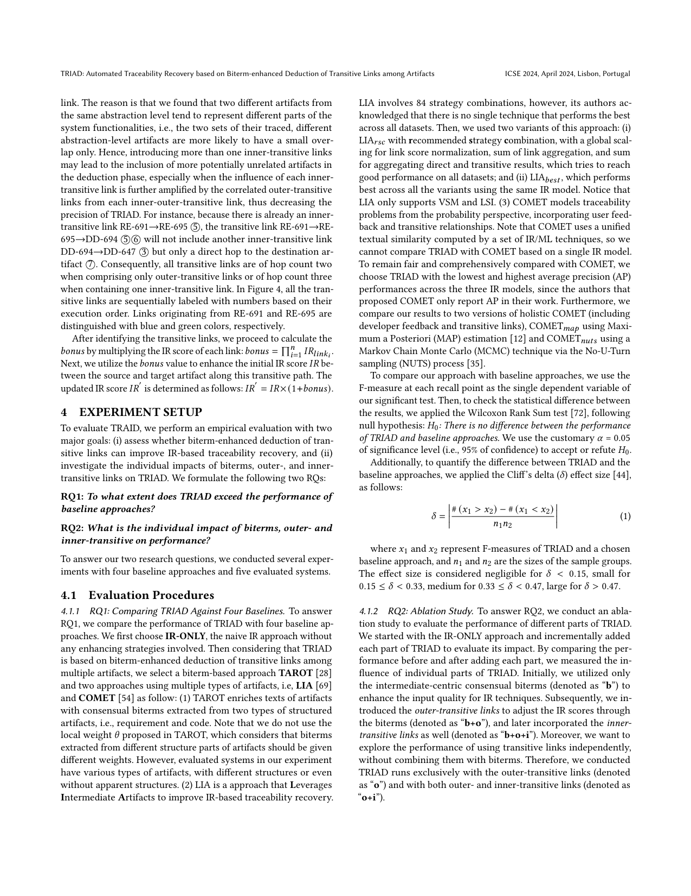

<!-- PDF page 8 -->

## Página PDF 8

ICSE 2024, April 2024, Lisbon, Portugal
Hui Gao, Hongyu Kuang, Wesley K. G. Assunção, Christoph Mayr-Dorn, Guoping Rong, He Zhang, Xiaoxing Ma, and Alexander Egyed
Table 1: Overview of the Five Evaluated Systems (S = Source, I = Intermediate, T = Target)
Dataset
Artifacts
Traces
Source
Intermediate
Target
S→I
I→T
S→T
Dronology
Requirement:58
Design Definitions:144
Source code:184
Req→DD:132
DD→Src:563
Req→Src:393
WARC
Non-Func. Reqs:21
Specifications:89
Func. Reqs:42
NFR→SRS:58
SRS→FRS:78
NFR→FRS:45
EasyClinic
Use Case:30
Interaction Description.:20
Code Descr.:47
UC→ID:132
ID→CD:563
UC→CD:393
EBT
Requirement:44
Test Case Description.:25
Source code:50
Req→TC:51
TC→Src:93
Req→Src:98
LibEST
Requirement:52
Test Code:21
Source code:14
Req→Test:352
Test→Code:108
Req→Code:204
4.2
Evaluation Metrics
To evaluate the performance of our approach, we rely on five well-
known metrics, namely Precision, Recall, F-measure, Average Preci-
sion, and Mean Average Precision.
Precision represents the proportion of correct links among re-
trieved trace links, calculated as follows:
𝑃𝑟𝑒𝑐𝑖𝑠𝑖𝑜𝑛= |𝑟𝑒𝑙𝑒𝑣𝑎𝑛𝑡∩𝑟𝑒𝑡𝑟𝑖𝑒𝑣𝑒𝑑|
|𝑟𝑒𝑡𝑟𝑖𝑒𝑣𝑒𝑑|
%
(2)
Recall represents the proportion of retrieved correct links among
all correct links, calculated as follows:
𝑅𝑒𝑐𝑎𝑙𝑙= |𝑟𝑒𝑙𝑒𝑣𝑎𝑛𝑡∩𝑟𝑒𝑡𝑟𝑖𝑒𝑣𝑒𝑑|
|𝑟𝑒𝑙𝑒𝑣𝑎𝑛𝑡|
%
(3)
where 𝑟𝑒𝑙𝑒𝑣𝑎𝑛𝑡is the set of relevant links and 𝑟𝑒𝑡𝑟𝑖𝑒𝑣𝑒𝑑is the set
of links retrieved by traceability recovery approaches.
F-measure (F) represents the harmonic mean of precision and
recall values, calculated as follows:
𝐹= 2𝑃𝑟𝑒𝑐𝑖𝑠𝑖𝑜𝑛× 𝑅𝑒𝑐𝑎𝑙𝑙
𝑃𝑟𝑒𝑐𝑖𝑠𝑖𝑜𝑛+ 𝑅𝑒𝑐𝑎𝑙𝑙
(4)
where P represents precision, R represents recall, and F is the har-
monic mean of P and R. A higher F-measure means that both preci-
sion and recall are high and balanced.
Average Precision (AP) measures how well relevant documents
of all queries (requirements) are ranked to the top of the retrieved
links, calculated as follows:
𝐴𝑃=
Í𝑁
𝑟=1(𝑃𝑟𝑒𝑐𝑖𝑠𝑖𝑜𝑛(𝑟) × 𝑖𝑠𝑅𝑒𝑙𝑒𝑣𝑎𝑛𝑡(𝑟))
|𝑅𝑒𝑙𝑒𝑣𝑎𝑛𝑡𝐷𝑜𝑐𝑢𝑚𝑒𝑛𝑡𝑠|
(5)
where 𝑟is the rank of the target artifact in an ordered list of links,
𝑃𝑟𝑒𝑐𝑖𝑠𝑖𝑜𝑛(𝑟) represents its precision value, 𝑖𝑠𝑅𝑒𝑙𝑒𝑣𝑎𝑛𝑡() is a binary
function assigned 1 if the link is relevant or 0 otherwise, 𝑁is the
number of all documents.
Mean Average Precision (MAP) is the average of the AP scores of
all queries to measure how well relevant documents for each query
are ranked to the top of the retrieved links, calculated as follows:
𝑀𝐴𝑃=
Í𝑄
𝑞=1 𝐴𝑃(𝑞)
𝑄
(6)
where 𝑞is a single query, and 𝑄is the number of all queries.
4.3
Evaluated Systems
Our evaluation is based on five real-world software systems: Dronol-
ogy, WARC, EasyClinic, EBT, and Libest. Table 1 presents a sum-
mary of five evaluated systems. Dronology is an open-source Un-
manned Aerial System. We collect its dataset from their website [4],
retaining only requirements and design definitions in closed status
and traced code files. EasyClinic, WARC, and EBT are from the
open source datasets from the CoEST community [2]. LibEST from
Cisco is an open-source EST stack written in C and used for secure
certificate enrollment [3]. It should be noted that to compare with
the baseline approach COMET [54] on EBT and LibEST without
bias, we use their processed data and result lists published in their
dataset. In the work that presents the baseline LIA [69] (Leverage
intermediate artifacts), the authors built their ground truth by using
the Connecting Links Method (CML) proposed by Nishikawa et
al. [58]. However, we noted that the results shown in CLM indicate
it can only gain a slight improvement and cannot apply to all data,
thus we only use the ground truth defined in the dataset to avoid
introducing unpredictable factors.
5
EVALUATION RESULTS
5.1
RQ1: Performance of TRIAD
Table 2 presents the experiment results of five evaluated systems
(rows). For each system and each IR model (columns), we compared
the performance of IR-ONLY, TAROT, LIA𝑟𝑠𝑐, and TRIAD. We also
list the best result of LIA, denoted as LIA𝑏𝑒𝑠𝑡based on VSM and LSI
models for all datasets. Sub-column 1 displays the average precision
(AP), sub-column 2 shows the mean average precision (MAP), sub-
column 3 shows the 𝑝-value of the F-measure significance test for
TRIAD, and sub-column 4 shows Cliff’s 𝛿. The best result of AP,
MAP, and 𝑝-value ≤0.05 are in bold text for each approach. When
compared with IR-ONLY, TRIAD performs better in AP for 13 out
of 15 cases3 (from 0.9% to 21%, on average 10%) and in MAP for
14 out of 15 cases (from 3% to 35%, on average 13%). The results
show that TRIAD outperforms TAROT in AP for 13 out of 15 cases
(from 4% to 43%, 18% on average) and in MAP (from 6% to 23%,
13% on average) for all 30 cases. Compared with LIA𝑟𝑐𝑠, TRIAD
performs better in AP for all 10 cases (from 5% to 48%, on average
26%) and in MAP for 7 cases (from 6% to 38%, on average 14%), and
only performs worse in 3 cases (on average -6%), specifically in
WARC-VSM, LibEST-VSM, and LibEST-LSI. Moreover, TRIAD even
outperforms LIA𝑏𝑒𝑠𝑡in AP for 8 out of 10 cases (from 0.8% to 55%,
on average 18%) and 4 out of 10 cases in MAP (from 2% to 18%, on
average 8%).
Notably, in 26 out of 40 cases (82.5%), the F-measure for the result
of TRIAD is significantly higher than three baseline approaches
(p-value ≤0.05) at each level of recall, indicating that TRIAD out-
performs baseline approaches in the majority of cases. Figure 5
illustrates precision-recall curves for the four approaches grouped
by each system and IR model. We now use the adapted excerpt from
the Dronology system to demonstrate why TRIAD outperforms the
baseline approaches. For requirement RE-691 and two traces class
3A “case” denotes a tuple of data set and IR model (i.e., VSM, LSI, and JS).

[Vista original de la página 8](../../../../../images/v5/estructura_colecciones/Documentation-Code/secondary/TRAID/page-08.png)

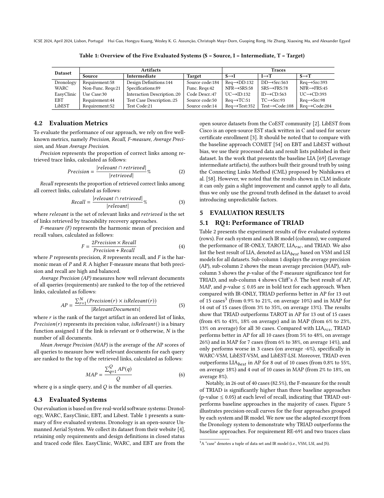

<!-- PDF page 9 -->

## Página PDF 9

TRIAD: Automated Traceability Recovery based on Biterm-enhanced Deduction of Transitive Links among Artifacts
ICSE 2024, April 2024, Lisbon, Portugal
Table 2: The number of computed AP, MAP, p-value, and Cliff’s 𝛿evaluating each approach (RQ1)
VSM
LSI
JS
AP
MAP
𝑝-value
C’𝛿
AP
MAP
𝑝-value
C’𝛿
AP
MAP
𝑝-value
C’𝛿
Dronology
IR-ONLY
18.93
35.88
<0.01
0.11
22.74
40.75
0.01
0.10
17.63
34.38
<0.01
0.14
TAROT
18.70
38.97
0.03
0.09
19.28
42.19
0.04
0.08
17.19
39.05
<0.01
0.12
LIA𝑟𝑠𝑐
14.64
35.49
<0.01
0.13
15.76
35.59
<0.01
0.25
-
-
-
-
TRIAD
20.07
43.25
-
-
21.13
49.07
-
-
20.55
46.39
-
-
LIA𝑏𝑒𝑠𝑡
16.83
41.46
0.25
0.05
20.23
41.68
0.13
0.06
-
-
-
-
WARC
IR-ONLY
41.41
65.01
0.23
0.15
44.20
61.24
0.03
0.27
43.61
66.63
0.20
0.16
TAROT
43.62
66.58
0.25
0.14
35.73
51.77
<0.01
0.45
44.30
66.54
0.15
0.18
LIA𝑟𝑠𝑐
43.64
72.98
0.76
0.04
34.54
59.96
<0.01
0.49
-
-
-
-
TRIAD
45.74
70.49
-
-
51.26
63.77
-
-
46.21
71.21
-
-
LIA𝑏𝑒𝑠𝑡
45.38
74.55
0.44
0.10
47.07
71.41
0.18
0.16
-
-
-
-
EasyClinic
IR-ONLY
65.39
76.51
0.22
0.10
53.51
69.47
0.01
0.21
46.75
62.67
0.01
0.21
TAROT
60.19
69.24
<0.01
0.24
52.24
67.15
<0.01
0.30
46.90
57.69
<0.01
0.36
LIA𝑟𝑠𝑐
55.75
74.02
0.01
0.21
52.29
71.25
<0.01
0.31
-
-
-
-
TRIAD
68.32
79.05
-
-
64.55
78.01
-
-
56.35
69.10
-
-
LIA𝑏𝑒𝑠𝑡
71.91
82.05
0.93
0.01
70.37
79.81
0.77
0.02
-
-
-
-
EBT
IR-ONLY
23.25
33.03
0.02
0.20
20.33
39.44
<0.01
0.31
20.81
33.39
<0.01
0.26
TAROT
20.42
33.66
0.83
0.02
17.00
37.52
<0.01
0.33
16.74
34.73
0.03
0.18
LIA𝑟𝑠𝑐
17.32
35.87
0.41
0.07
15.54
37.61
<0.01
0.31
-
-
-
-
TRIAD
23.04
38.10
-
-
22.30
40.55
-
-
21.00
39.68
-
-
LIA𝑏𝑒𝑠𝑡
14.86
37.27
0.25
0.10
16.61
38.01
<0.01
0.38
-
-
-
-
LibEST
IR-ONLY
55.25
73.30
0.21
0.07
50.94
62.54
0.07
0.10
57.69
66.63
<0.01
0.17
TAROT
57.01
73.52
0.85
0.01
47.67
64.83
0.50
0.04
61.31
73.43
<0.01
0.15
LIA𝑟𝑠𝑐
52.06
77.36
0.60
0.03
51.70
76.16
0.69
0.02
-
-
-
-
TRIAD
56.86
72.40
-
-
55.62
69.81
-
-
59.13
75.26
-
-
LIA𝑏𝑒𝑠𝑡
50.35
77.67
0.03
0.13
51.70
76.16
0.70
0.02
-
-
-
-
Table 3: Comparing COMET and TRIAD with metrics AP and
MAP on systems EBT and LibEST
EBT
LibEST
AP
MAP
AP
MAP
COMET𝑚𝑎𝑝
15.82
33.70
63.13
74.31
COMET𝑛𝑢𝑡𝑠
16.60
33.43
63.45
74.10
TRIAD𝑙𝑜𝑤
21.00
39.68
55.62
69.81
TRIADℎ𝑖𝑔ℎ
23.04
38.10
59.13
75.26
AFEmergencyComponent, and AFInfoBox as shown in Figure 4, the
IR values calculated based on the VSM model between RE-691 and
AFInfoBox and AFEmergencyComponent are 0.002 and 0, and ranks
in RE-691’s candidate trace list are 95/184 and 184/184, respec-
tively. This indicates that there is a vast abstraction gap between
RE-691 and these two classes, which causes them to share almost
no semantic information. Therefore, in this situation, IR-ONLY
does not work anymore, and TAROT cannot extract any consensual
biterms from these three artifacts. For LIA𝑟𝑐𝑠, it uses direct links (i.e.,
from source to target directly) and transitive links in its combined
strategies. Hence, it is limited to only using transitive links to over-
come this abstraction gap, which can promote their ranks to 59/184
and 120/184. For TRIAD, it first extends RE-691 with intermediate-
centric biterms from itself, including (select, uav) and (uav, oper).
Then it extends RE-691 with biterms from two highly related in-
termediate artifacts, such as (emerg, oper) and (appli, oper) from
DD-694. Furthermore, AFEmergencyComponent can be extended
with biterms (select, uav) and (emerg, oper) from DD-694. Therefore,
TRIAD can overcome this abstraction gap with intermediate-centric
biterms, which promote ranks to 10/184 and 3/184. Furthermore,
TRIAD can further use outer- and inner-transitive links, e.g., RE-
691→DD-694→AFEmergencyComponent and RE-691→DD-694→
DD-647→AFInfoBox to overcome this abstraction gap.
When compared with COMET on EBT, TRIAD on EBT-JS and
EBT-VSM had the lowest and highest APs, denoted as TRIAD𝑙𝑜𝑤
and TRIADℎ𝑖𝑔ℎin Table 2, respectively. TRIAD𝑙𝑜𝑤significantly out-
performs all four cases on EBT, with improvements of 28% in AP and
5% in MAP compared to COMET𝑚𝑎𝑝, and 22% in AP and 6% in MAP
compared to COMET𝑛𝑢𝑡𝑠. Compared to COMET on LibEST, LibEST-
LSI, and LibEST-JS are selected as TRIAD𝑙𝑜𝑤and TRIADℎ𝑖𝑔ℎ, re-
spectively. For LibEST, COMET𝑛𝑢𝑡𝑠and COMET𝑚𝑎𝑝can both out-
perform TRIAD𝑙𝑜𝑤in AP and MAP. However, TRIADℎ𝑖𝑔ℎcan still
outperform both COMET𝑛𝑢𝑡𝑠and COMET𝑚𝑎𝑝in MAP by 1.6% and
1.3%, respectively. It is worth noting that COMET draws strength
from multiple perspectives including tuned textual similarity, devel-
oper feedback, and transitive links, whereas TRIAD solely relies on
textual similarities (where transitive links are deduced). But TRIAD
can still outperform COMET in 3 out of 4 cases in both APs and
MAPs on the EBT and LibEST datasets.
Furthermore, we noted that TRIAD performed worse in MAPs
on two cases, i.e., LibEST-VSM and LibEST-LSI with a decrease of
4.96 (6.41%) and 6.35 (8.34%) compared to the performance of LIA𝑟𝑐𝑠,
respectively. Accordingly, we first found that the source and target
artifacts of LibEST were enriched with an excessive number of
biterms due to the numerous functions contained in both test code
and source code files (all written in C). Particularly, the average
number of biterms for each source artifact increased from 29 to
383 (with the largest number of 505), and for each target artifact,
it increased from 190 to 551 (with the largest number of 1,517).
Another possible reason is that unlike other evaluated systems, the
intermediate artifacts of LibEST are also code for testing that are

[Vista original de la página 9](../../../../../images/v5/estructura_colecciones/Documentation-Code/secondary/TRAID/page-09.png)

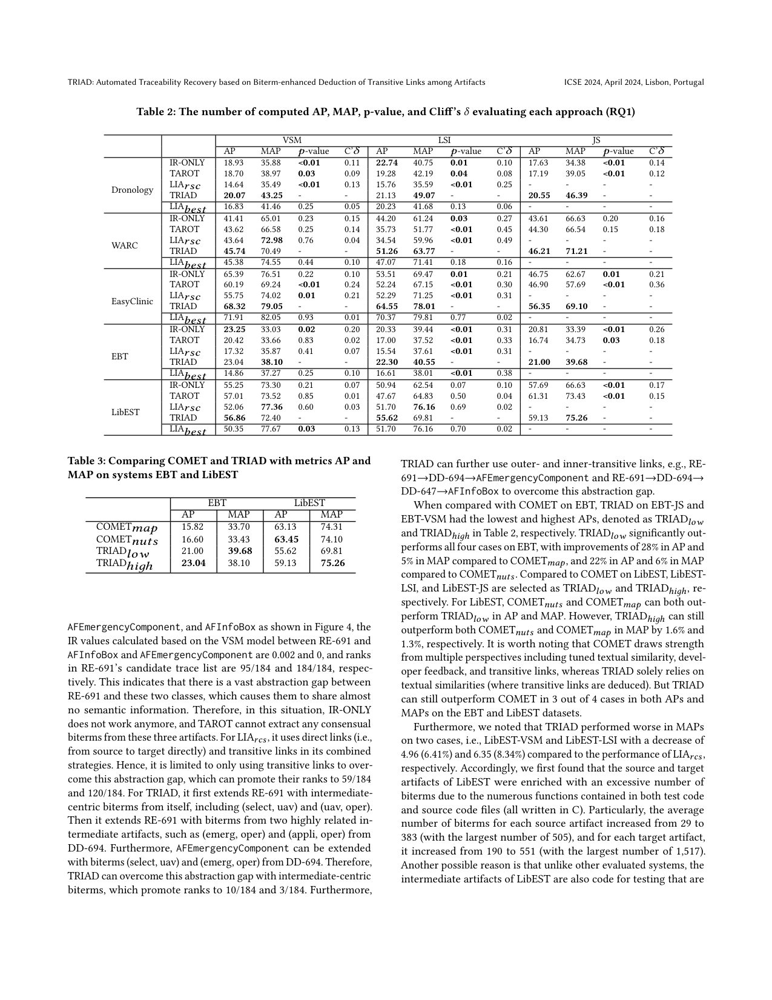

<!-- PDF page 10 -->

## Página PDF 10

ICSE 2024, April 2024, Lisbon, Portugal
Hui Gao, Hongyu Kuang, Wesley K. G. Assunção, Christoph Mayr-Dorn, Guoping Rong, He Zhang, Xiaoxing Ma, and Alexander Egyed
semantically too far away from source targets (requirements) while
too close to target artifact (source code), thus weakening TRIAD’s
performance. Further discussions are in Section 6.
5.2
RQ2: Ablation Study on TRIAD
Table 4 shows the experiment results of five evaluated systems
(rows), where “b” denotes TRIAD using extended artifacts with
intermediate-centric biterms only; “o” denotes TRIAD using outer-
transitive links only, and “i” denotes TRIAD using inter-transitive
links only. For each system and each IR model (columns), sub-
column 1 and sub-column 2 show the average precision (AP) and
0
0.2
0.4
0.6
0
0.2
0.4
0.6
0.8
1
Precision
Recall
(a) Dronology-VSM
0
0.2
0.4
0.6
0
0.2
0.4
0.6
0.8
1
Precision
Recall
(b) Dronology-LSI
0
0.2
0.4
0.6
0
0.2
0.4
0.6
0.8
1
Precision
Recall
(c) Dronology-JSD
0
0.2
0.4
0.6
0.8
1
0
0.2
0.4
0.6
0.8
1
Precision
Recall
(d) WARC-VSM
0
0.2
0.4
0.6
0.8
1
0
0.2
0.4
0.6
0.8
1
Precision
Recall
(e) WARC-LSI
0
0.2
0.4
0.6
0.8
1
0
0.2
0.4
0.6
0.8
1
Precision
Recall
(f) WARC-JSD
0
0.2
0.4
0.6
0.8
1
0
0.2
0.4
0.6
0.8
1
Precision
Recall
(g) EasyClinic-VSM
0
0.2
0.4
0.6
0.8
1
0
0.2
0.4
0.6
0.8
1
Precision
Recall
(h) EasyClinic-LSI
0
0.2
0.4
0.6
0.8
0
0.2
0.4
0.6
0.8
1
Precision
Recall
(i) EasyClinic-JSD
0
0.2
0.4
0.6
0.8
0
0.2
0.4
0.6
0.8
1
Precision
Recall
(j) EBT-VSM
0
0.2
0.4
0.6
0.8
0
0.2
0.4
0.6
0.8
1
Precision
Recall
(k) EBT-LSI
0
0.1
0.2
0.3
0.4
0
0.2
0.4
0.6
0.8
1
Precision
Recall
(l) EBT-JSD
0
0.2
0.4
0.6
0.8
1
0
0.2
0.4
0.6
0.8
1
Precision
Recall
(m) LibEST-VSM
0
0.2
0.4
0.6
0.8
0
0.2
0.4
0.6
0.8
1
Precision
Recall
(n) LibEST-LSI
0
0.2
0.4
0.6
0.8
1
0
0.2
0.4
0.6
0.8
1
Precision
Recall
(o) LibEST-JSD
IR-ONLY
TAROT
LIArsc
TRIAD
Figure 5: Precision/Recall curves grouped by evaluated sys-
tems and IR models (VSM, LSI, and JS).
mean average precision (MAP), respectively. For each evaluated
system, the best results of AP and MAP on each IR model are in bold
text. We first compared the performance of each individual part of
TRIAD (i.e., “b”, “i”, and “o”). From the table, we can observe that
“b” outperforms IR-ONLY in 10 out of 15 cases on AP (improvement
varies from 0.37% to 23.39%, 10.28% on average) and in 13 out of
15 cases on MAP (from 1.02% to 13.82%, 6.72% on average), which
indicates that TRIAD can make improvement by extending artifacts
with intermediate-centric consensual biterms. Then we compared
TRIAD’s performance with those using transitive links only. We
can observe that “o” outperforms IR-ONLY in 14 out of 15 cases on
AP (improvement varies from 0.38% to 13.48%, 5.66% on average)
and in 13 out of 15 cases on MAP (from 0.61% to 14.53%, 6.38%
on average), which indicates that leveraging outer-transitive links
achieve better performance. Meanwhile, the results show that “o+i”
outperform “o” in 10 out of 15 cases on AP (from 0.96% to 6.62%,
3.08% on average), and 13 out of 15 cases on MAP (from 0.43% to
5.73%, 2.66% on average), respectively. This result indicates that
using outer-inner combined transitive links can further improve
the performance.
In addition, the results show that “b+o” outperforms “b” in 10
out of 15 cases on AP (from 1.3% to 10.41%, 6.01% on average), and
12 out of 15 cases on MAP (from 0.13% to 11.06%, 5.68% on average)
respectively, which means incorporating outer-transitive links can
improve the performance compared to the situation when only
intermediate-centric biterms are used. Moreover, the results show
that “b+o+i” outperform “b+o” in 9 out of 15 cases on AP (from
0.13% to 3.53%, 1.69% on average), and 11 out of 15 cases on MAP
(from 0.11% to 7.09%, 2.55% on average), respectively. This result
indicates that combining outer- and inner-transitive links with
intermediate-centric biterms can further improve the performance.
In conclusion, including all parts of TRIAD achieves the overall
best performance. Moreover, consensual biterms can complement
transitive links to improve automated traceability recovery.
6
DISCUSSION AND THREATS TO VALIDITY
Implications for Researchers. As we discussed at the end of
Section 5.1, TRIAD performed worse in MAPs on two experiment
cases: LibEST-VSM and LibEST-LSI. This result is caused by two
situations: (1) the source and target artifacts of LibEST were en-
riched with an excessive number of biterms due to the large size
code files written in C; (2) the intermediate artifact of LibEST is test
code and it is not sufficient to bridge the abstraction gap between
source (requirements) and target (source code) artifacts. The former
situation implies that when tracing a large-size code file, it is likely
to implement multiple requirements, and requires fine-granular
analysis on methods instead of code files (or classes in Java). The
latter situation implies that when introducing intermediate artifacts
to improve source-to-target tracing, relatively “middle-level” arti-
facts are more suitable to bridge the abstraction gap, e.g., the design
definitions in Dronology, rather than the test code in LibEST.
Implications for Practitioners. While the results are promising
and performance keeps improving, so far the practitioners can
still not fully rely on automated tracing approaches, but we obtain
insights into why that is and hence motivate further investigation

[Vista original de la página 10](../../../../../images/v5/estructura_colecciones/Documentation-Code/secondary/TRAID/page-10.png)

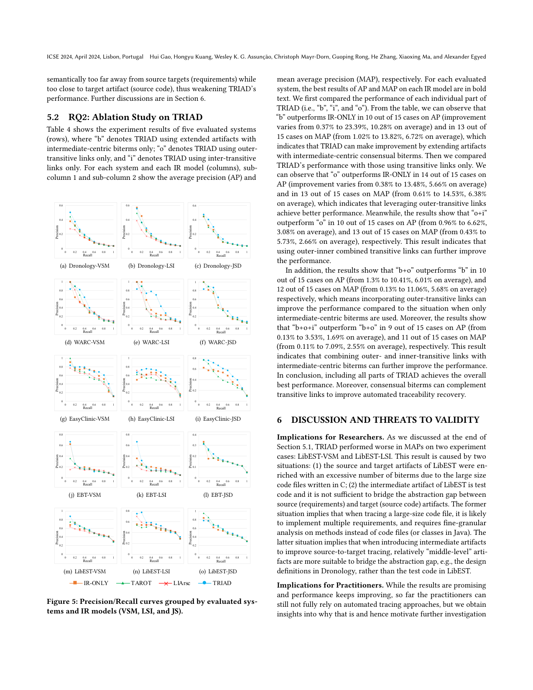

<!-- PDF page 11 -->

## Página PDF 11

TRIAD: Automated Traceability Recovery based on Biterm-enhanced Deduction of Transitive Links among Artifacts
ICSE 2024, April 2024, Lisbon, Portugal
Table 4: Performance of each part of TRIAD (RQ2)
VSM
LSI
JS
AP
MAP
AP
MAP
AP
MAP
dronology
IR-ONLY
18.93
35.88
22.74
40.75
17.63
34.38
b
18.67
37.44
19.21
44.80
18.29
39.50
o
19.70
38.05
22.39
41.00
19.72
38.54
b+o
19.59
41.40
20.63
47.73
19.85
43.32
o+i
20.08
39.85
22.04
41.74
19.91
40.75
b+o+i
20.07
43.25
21.13
49.07
20.55
46.39
warc
IR-ONLY
41.41
65.01
44.20
61.24
43.61
66.63
b
48.36
70.49
54.54
63.22
47.45
70.82
o
42.84
66.05
47.64
69.65
46.13
67.64
b+o
46.12
70.49
51.45
63.30
45.75
71.13
o+i
45.12
67.74
48.94
72.35
45.45
68.10
b+o+i
45.74
70.49
51.26
63.77
46.21
71.21
easyclinic
IR-ONLY
65.39
76.51
53.51
69.47
46.75
62.67
b
70.21
78.10
65.87
74.32
54.56
65.01
o
65.64
76.17
55.65
71.11
53.05
67.04
b+o
69.80
80.04
65.20
78.06
55.95
68.37
o+i
64.37
75.31
58.47
71.79
53.77
66.81
b+o+i
68.32
79.05
64.55
78.01
56.35
69.10
ebt
IR-ONLY
23.25
33.03
20.33
39.44
20.81
33.39
b
21.67
35.60
19.88
41.33
20.85
33.73
o
24.22
37.83
22.51
41.28
21.85
35.51
b+o
23.01
37.96
21.95
40.65
22.73
37.46
o+i
24.78
38.27
24.00
42.10
20.08
37.36
b+o+i
23.04
38.10
22.30
40.55
21.00
39.68
libest
IR-ONLY
55.25
73.30
50.94
62.54
57.69
66.63
b
54.41
71.41
51.13
61.83
59.03
75.84
o
56.56
73.27
53.37
68.06
58.54
69.05
b+o
56.18
72.08
54.46
67.67
59.80
73.89
o+i
57.33
74.04
55.06
71.01
57.72
69.35
b+o+i
56.86
72.40
55.62
69.81
59.13
75.26
into better bridging the abstraction gap. Furthermore, to fine-tune
TRIAD for optimized performance in practice when necessary, users
can first modestly tune up threshold 𝑚(0.5 by default) when the
quantity and quality of artifact texts are better, and vice versa.
Second, if users can effectively estimate the number of relevant
traces, we suggest users tune up threshold 𝑡(3 by default) when
the system tends to have a larger number of relevant traces.
Special Circumstances. Our approach is likely to encounter the
following two special cases when applied to a system: (1) the system
only contains source and target artifacts with no available interme-
diate artifacts; (2) the system already contains existing traces that
are either source-to-intermediate or intermediate-to-target links.
For the first case, TRIAD can still leverage inner-transitive relation-
ships within source artifacts to adjust trace scores between source
and target artifacts. However, in this case we think that the perfor-
mance of TRIAD is likely to decrease because it cannot leverage the
implicit semantics from the missing intermediate artifacts. For the
other case, when the system has existing high-quality (i.e., correct
and complete), source-to-intermediate or intermediate-to-target
traces, TRIAD can directly leverage these existing traces and we
expect TRIAD to achieve better performance because the originally
deduced transitive links may be erroneous and incomplete. Further-
more, when the quality of existing traces cannot be guaranteed,
it would be interesting to consider both the existing traces and
the deduced traces in TRIAD and try to achieve the overall best
performance. The exploration of how TRIAD can enhance its ef-
fectiveness under the discussed specific circumstances is in future
work.
Threats to validity. To avoid any bias or fine-tuning, we used the
same threshold 𝑚and 𝑡in all five evaluated systems on each of the
three IR models. We use the officially published code that is online
available [69] to replicate LIA as our baseline approach. For COMET,
to avoid any bias by consulting existing research [34], we directly
use the result lists that are provided in its replication package [54]
to compute the final experiment metrics. Meanwhile, we also use
the same pre-processed data of COMET, which is also available
in the replication package, as the input for TRIAD to ensure a
fair comparison in our evaluation. Furthermore, we choose TRIAD
with the lowest and highest AP performances across the three IR
models to compare with COMET because the authors that proposed
COMET only use AP in their work. Another possible internal threat
to our approach is that we cannot guarantee 100% accuracy in
segmenting texts, tagging POSs, and parsing dependencies based
on Stanford CoreNLP. However, existing work has reported that the
accuracy of off-the-shelf NLP tools is acceptable when analyzing
texts in the context of proper sentences and grammatical structures
[9], and we found no obvious errors in the output of Stanford
CoreNLP as well.
7
CONCLUSION
In this work, we addressed the abstraction gap problem between
artifacts to be traced. We proposed the use of consensual biterms ex-
traction to further deduce transitive links between both the source
and intermediate artifacts, and the intermediate and target artifacts.
The goal is to bridge the abstraction gap better to improve auto-
mated tracing. This novel use of transitive links and consensual
biterms was implemented in our approach TRIAD (Traceability
Recovery by bIterm-enhAnced Deduction of transitive links).
To assess how TRIAD tackles the traceability problem of filling
the abstraction gap, we conduct an empirical evaluation based on
five systems widely used in literature. TRIAD was compared with
four state-of-the-art approaches based on metrics of average preci-
sion and mean average Precision, along with significance tests on
F-Measure. Results show that TRIAD outperforms the four base-
lines in most of the cases. We also observed that using outer-inner
combined transitive links can further alleviate the abstraction gap
problem. Future work will primarily focus on better bridging the
abstraction gap by more sophisticated identification of inner- and
outer transitive links.
8
DATA AVAILABILITY
Our replication package with the TRIAD source code and datasets
used in the evaluation is available online [6, 7].
9
ACKNOWLEDGEMENTS
This work is supported by the National Natural Science Foundation
of China (No.62025202, No.72371125, No.62072227, No.62202219,
and No.62302210), the China Scholarship Council (No.202206190172),
the Innovation Project and Overseas Open Project of State Key
Laboratory for Novel Software Technology (Nanjing University)
(ZZKT2022A25, KFKT2022A09, KFKT2023A09, KFKT2023A10), and
the Jiangsu Provincial Key Research and Development Program
(No.BE2021002-2). We also gratefully acknowledge the Austrian
Science Fund (FWF), grand No. P31989 and No.P34805-N.

[Vista original de la página 11](../../../../../images/v5/estructura_colecciones/Documentation-Code/secondary/TRAID/page-11.png)

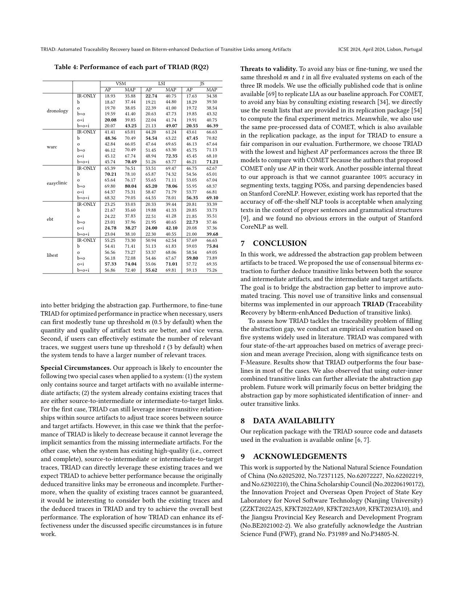

<!-- PDF page 12 -->

## Página PDF 12

ICSE 2024, April 2024, Lisbon, Portugal
Hui Gao, Hongyu Kuang, Wesley K. G. Assunção, Christoph Mayr-Dorn, Guoping Rong, He Zhang, Xiaoxing Ma, and Alexander Egyed
REFERENCES
[1] 2023. Center of Excellence for Software and Systems Traceability. http://www.
coest.org/.
[2] 2023. CoEST community datasets. http://sarec.nd.edu/coest/datasets.html.
[3] 2023. Comet Data Replication Package: LibEST. https://gitlab.com/SEMERU-
Code-Public/Data/icse20-comet-data-replication-package/-/tree/main/LibEST.
[4] 2023. Dronology Datasets. https://dronology.info/datasets/.
[5] 2023. srcML. https://www.srcml.org/.
[6] 2023. TRIAD code. https://github.com/huiAlex/TRIAD.
[7] 2023. TRIAD dataset. https://doi.org/10.5281/zenodo.10430771.
[8] Ahron Abadi, Mordechai Nisenson, and Yahalomit Simionovici. 2008. A Trace-
ability Technique for Specifications. In 16th IEEE International Conference on
Program Comprehension. IEEE, 103–112.
[9] Nasir Ali, Haipeng Cai, Abdelwahab Hamou-Lhadj, and Jameleddine Hassine.
2019. Exploiting Parts-of-Speech for effective automated requirements traceabil-
ity. Inf. Softw. Technol. 106 (2019), 126–141. https://doi.org/10.1016/j.infsof.2018.
09.009
[10] Giuliano Antoniol, Gerardo Canfora, Gerardo Casazza, Andrea De Lucia, and
Ettore Merlo. 2002. Recovering Traceability Links between Code and Documen-
tation. IEEE Trans. Software Eng. 28, 10 (2002), 970–983.
[11] Ricardo Baezayates and Berthier Ribeironeto. 2011. Modern information retrieval.
Addison-Wesley Publishing CompanyUnited States.
[12] Robert Bassett and Julio Deride. 2019. Maximum a posteriori estimators as
a limit of Bayes estimators. Math. Program. 174, 1-2 (2019), 129–144.
https:
//doi.org/10.1007/S10107-018-1241-0
[13] Ted J. Biggerstaff, Bharat G. Mitbander, and Dallas E. Webster. 1993. The Concept
Assignment Problem in Program Understanding. In 15th International Confer-
ence on Software Engineering, Victor R. Basili, Richard A. DeMillo, and Takuya
Katayama (Eds.). IEEE/ACM, 482–498.
[14] Xueqi Cheng, Xiaohui Yan, Yanyan Lan, and Jiafeng Guo. 2014. BTM: Topic
Modeling over Short Texts. IEEE Transactions on Knowledge and Data Engineering
26, 12 (2014), 2928–2941. https://doi.org/10.1109/TKDE.2014.2313872
[15] Elliot J. Chikofsky and James H. Cross II. 1990. Reverse Engineering and Design
Recovery: A Taxonomy. IEEE Softw. 7, 1 (1990), 13–17. https://doi.org/10.1109/
52.43044
[16] Jane Cleland-Huang, Orlena Gotel, Jane Huffman Hayes, Patrick Mäder, and
Andrea Zisman. 2014. Software traceability: trends and future directions. In
Future of Software Engineering. ACM, 55–69.
[17] Jane Cleland-Huang, Raffaella Settimi, Chuan Duan, and Xuchang Zou. 2005.
Utilizing Supporting Evidence to Improve Dynamic Requirements Traceability. In
13th IEEE International Conference on Requirements Engineering. IEEE, 135–144.
[18] Jane Cleland-Huang, Michael Vierhauser, and Sean Bayley. 2018. Dronology: an
incubator for cyber-physical systems research. In 40th International Conference
on Software Engineering. ACM, 109–112. https://doi.org/10.1145/3183399.3183408
[19] Andrea De Lucia, Andrian Marcus, Rocco Oliveto, and Denys Poshyvanyk. 2012.
Information Retrieval Methods for Automated Traceability Recovery. In Software
and Systems Traceability, Jane Cleland-Huang, Olly Gotel, and Andrea Zisman
(Eds.). Springer, 71–98.
[20] Andrea De Lucia, Rocco Oliveto, and Paola Sgueglia. 2006. Incremental Approach
and User Feedbacks: a Silver Bullet for Traceability Recovery. In 22nd IEEE
International Conference on Software Maintenance. IEEE, 299–309.
[21] Andrea De Lucia, Massimiliano Di Penta, Rocco Oliveto, Annibale Panichella, and
Sebastiano Panichella. 2011. Improving IR-based Traceability Recovery Using
Smoothing Filters. In 19th IEEE International Conference on Program Comprehen-
sion. IEEE, 21–30.
[22] Diana Diaz, Gabriele Bavota, Andrian Marcus, Rocco Oliveto, Silvia Takahashi,
and Andrea De Lucia. 2013. Using code ownership to improve IR-based Traceabil-
ity Link Recovery. In 21st IEEE International Conference on Program Comprehen-
sion. IEEE Computer Society, 123–132. https://doi.org/10.1109/ICPC.2013.6613840
[23] Bogdan Dit, Meghan Revelle, and Denys Poshyvanyk. 2013. Integrating informa-
tion retrieval, execution and link analysis algorithms to improve feature location
in software. Empirical Software Engineering 18, 2 (2013), 277–309.
[24] Liming Dong, He Zhang, Wei Liu, Zhiluo Weng, and Hongyu Kuang. 2022.
Semi-supervised pre-processing for learning-based traceability framework on
real-world software projects. In 30th ACM Joint European Software Engineer-
ing Conference and Symposium on the Foundations of Software Engineering, Ab-
hik Roychoudhury, Cristian Cadar, and Miryung Kim (Eds.). ACM, 570–582.
https://doi.org/10.1145/3540250.3549151
[25] Alexander Egyed, Florian Graf, and Paul Grünbacher. 2010. Effort and Quality
of Recovering Requirements-to-Code Traces: Two Exploratory Experiments. In
18th IEEE International Requirements Engineering Conference. IEEE, 221–230.
[26] Davide Falessi, Justin Roll, Jin L. C. Guo, and Jane Cleland-Huang. 2020. Lever-
aging Historical Associations between Requirements and Source Code to Iden-
tify Impacted Classes. IEEE Trans. Software Eng. 46, 4 (2020), 420–441. https:
//doi.org/10.1109/TSE.2018.2861735
[27] Hui Gao, Hongyu Kuang, Xiaoxing Ma, Hao Hu, Jian Lü, Patrick Mäder, and
Alexander Egyed. 2022. Propagating frugal user feedback through closeness of
code dependencies to improve IR-based traceability recovery. Empir. Softw. Eng.
27, 2 (2022), 41. https://doi.org/10.1007/s10664-021-10091-5
[28] Hui Gao, Hongyu Kuang, Kexin Sun, Xiaoxing Ma, Alexander Egyed, Patrick
Mäder, Guoping Rong, Dong Shao, and He Zhang. 2022. Using Consensual
Biterms from Text Structures of Requirements and Code to Improve IR-Based
Traceability Recovery. In 37th IEEE/ACM International Conference on Automated
Software Engineering (ASE ’22). ACM, Article 114.
https://doi.org/10.1145/
3551349.3556948
[29] Malcom Gethers, Rocco Oliveto, Denys Poshyvanyk, and Andrea De Lucia. 2011.
On integrating orthogonal information retrieval methods to improve traceability
recovery. In IEEE 27th International Conference on Software Maintenance. IEEE
Computer Society, 133–142.
[30] J. Grundy, J. Hosking, and W.B. Mugridge. 1998. Inconsistency management
for multiple-view software development environments. IEEE Transactions on
Software Engineering 24, 11 (1998), 960–981. https://doi.org/10.1109/32.730545
[31] Jin Guo, Jinghui Cheng, and Jane Cleland-Huang. 2017. Semantically enhanced
software traceability using deep learning techniques. In 39th International Confer-
ence on Software Engineering, Sebastián Uchitel, Alessandro Orso, and Martin P.
Robillard (Eds.). IEEE/ACM, 3–14.
[32] Mohammad Abdul Hadi and Fatemeh H Fard. 2020. AOBTM: Adaptive Online
Biterm Topic Modeling for Version Sensitive Short-texts Analysis. In IEEE In-
ternational Conference on Software Maintenance and Evolution. 593–604. https:
//doi.org/10.1109/ICSME46990.2020.00062
[33] Jane Huffman Hayes, Alex Dekhtyar, and Senthil Karthikeyan Sundaram. 2006.
Advancing Candidate Link Generation for Requirements Tracing: The Study of
Methods. IEEE Trans. Software Eng. 32, 1 (2006), 4–19.
[34] Tobias Hey, Fei Chen, Sebastian Weigelt, and Walter F. Tichy. 2021. Improving
Traceability Link Recovery Using Fine-grained Requirements-to-Code Relations.
In IEEE International Conference on Software Maintenance and Evolution, ICSME
2021, Luxembourg, September 27 - October 1, 2021. IEEE, 12–22. https://doi.org/
10.1109/ICSME52107.2021.00008
[35] Matthew D. Hoffman and Andrew Gelman. 2014. The No-U-turn sampler: adap-
tively setting path lengths in Hamiltonian Monte Carlo. J. Mach. Learn. Res. 15, 1
(2014), 1593–1623. https://doi.org/10.5555/2627435.2638586
[36] Einar W. Høst and Bjarte M. Østvold. 2009. Debugging Method Names. In 23rd
European Conference on Object-Oriented Programming (LNCS, Vol. 5653), Sophia
Drossopoulou (Ed.). Springer, 294–317. https://doi.org/10.1007/978-3-642-03013-
0_14
[37] I. Ivkovic and K. Kontogiannis. 2004. Tracing evolution changes of software
artifacts through model synchronization. In 20th IEEE International Conference
on Software Maintenance. 252–261. https://doi.org/10.1109/ICSM.2004.1357809
[38] Hongyu Kuang, Hui Gao, Hao Hu, Xiaoxing Ma, Jian Lu, Patrick Mäder, and
Alexander Egyed. 2019. Using frugal user feedback with closeness analysis on
code to improve IR-based traceability recovery. In 27th International Conference
on Program Comprehension, Yann-Gaël Guéhéneuc, Foutse Khomh, and Federica
Sarro (Eds.). IEEE/ACM, 369–379.
[39] Hongyu Kuang, Jia Nie, Hao Hu, Patrick Rempel, Jian Lu, Alexander Egyed, and
Patrick Mäder. 2017. Analyzing closeness of code dependencies for improving
IR-based Traceability Recovery. In 24th IEEE International Conference on Software
Analysis, Evolution and Reengineering, Martin Pinzger, Gabriele Bavota, and
Andrian Marcus (Eds.). IEEE, 68–78.
[40] Tien-Duy B. Le, Mario Linares Vásquez, David Lo, and Denys Poshyvanyk. 2015.
RCLinker: automated linking of issue reports and commits leveraging rich contex-
tual information. In 23rd IEEE International Conference on Program Comprehension.
IEEE, 36–47. https://doi.org/10.1109/ICPC.2015.13
[41] Jinfeng Lin, Yalin Liu, Qingkai Zeng, Meng Jiang, and Jane Cleland-Huang. 2021.
Traceability Transformed: Generating more Accurate Links with Pre-Trained
BERT Models. In 43rd IEEE/ACM International Conference on Software Engineering.
IEEE, 324–335. https://doi.org/10.1109/ICSE43902.2021.00040
[42] Jinfeng Lin, Yalin Liu, Qingkai Zeng, Meng Jiang, and Jane Cleland-Huang. 2021.
Traceability Transformed: Generating more Accurate Links with Pre-Trained
BERT Models. In 43rd IEEE/ACM International Conference on Software Engineering.
IEEE, 324–335. https://doi.org/10.1109/ICSE43902.2021.00040
[43] Andrea De Lucia, Andrian Marcus, Rocco Oliveto, and Denys Poshyvanyk. 2012.
Information Retrieval Methods for Automated Traceability Recovery. In Software
and Systems Traceability, Jane Cleland-Huang, Olly Gotel, and Andrea Zisman
(Eds.). Springer, 71–98. https://doi.org/10.1007/978-1-4471-2239-5_4
[44] Guillermo Macbeth, Eugenia Razumiejczyk, and Rubén Daniel Ledesma. 2011.
Cliff’s Delta Calculator: A non-parametric effect size program for two groups of
observations. Universitas Psychologica 10 (2011), 545–555.
[45] Patrick Mäder and Alexander Egyed. 2015. Do developers benefit from require-
ments traceability when evolving and maintaining a software system? Empir.
Softw. Eng. 20, 2 (2015), 413–441. https://doi.org/10.1007/s10664-014-9314-z
[46] Patrick Mäder, Paul L. Jones, Yi Zhang, and Jane Cleland-Huang. 2013. Strategic
Traceability for Safety-Critical Projects. IEEE Softw. 30, 3 (2013), 58–66. https:
//doi.org/10.1109/MS.2013.60

[Vista original de la página 12](../../../../../images/v5/estructura_colecciones/Documentation-Code/secondary/TRAID/page-12.png)

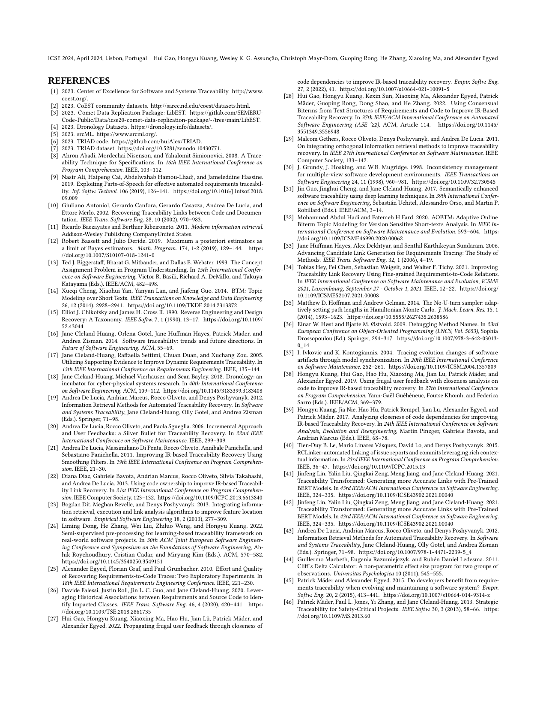

<!-- PDF page 13 -->

## Página PDF 13

TRIAD: Automated Traceability Recovery based on Biterm-enhanced Deduction of Transitive Links among Artifacts
ICSE 2024, April 2024, Lisbon, Portugal
[47] Jonathan I. Maletic and Michael L. Collard. 2015. Exploration, Analysis, and
Manipulation of Source Code Using srcML. In 37th IEEE/ACM International Con-
ference on Software Engineering, Vol. 2. 951–952. https://doi.org/10.1109/ICSE.
2015.302
[48] Christopher D. Manning, Mihai Surdeanu, John Bauer, Jenny Rose Finkel, Steven
Bethard, and David McClosky. 2014. The Stanford CoreNLP Natural Language
Processing Toolkit. In 52nd Annual Meeting of the Association for Computational
Linguistics. ACL, 55–60. https://doi.org/10.3115/v1/p14-5010
[49] Andrian Marcus and Jonathan I. Maletic. 2003. Recovering Documentation-to-
Source-Code Traceability Links using Latent Semantic Indexing. In 25th Inter-
national Conference on Software Engineering, Lori A. Clarke, Laurie Dillon, and
Walter F. Tichy (Eds.). IEEE, 125–137.
[50] Christoph Mayr-Dorn, Michael Vierhauser, Stefan Bichler, Felix Keplinger, Jane
Cleland-Huang, Alexander Egyed, and Thomas Mehofer. 2021. Supporting Quality
Assurance with Automated Process-Centric Quality Constraints Checking. In
43rd IEEE/ACM International Conference on Software Engineering. IEEE, 1298–1310.
https://doi.org/10.1109/ICSE43902.2021.00118
[51] Collin McMillan, Denys Poshyvanyk, and Meghan Revelle. 2009. Combining
textual and structural analysis of software artifacts for traceability link recovery.
In ICSE Workshop on Traceability in Emerging Forms of Software Engineering,
Giuliano Antoniol, Denys Poshyvanyk, and Rocco Oliveto (Eds.). IEEE, 41–48.
[52] Chris Mills, Javier Escobar-Avila, Aditya Bhattacharya, Grigoriy Kondyukov,
Shayok Chakraborty, and Sonia Haiduc. 2019. Tracing with Less Data: Active
Learning for Classification-Based Traceability Link Recovery. In 2019 IEEE In-
ternational Conference on Software Maintenance and Evolution. IEEE, 103–113.
https://doi.org/10.1109/ICSME.2019.00020
[53] Chris Mills, Javier Escobar-Avila, and Sonia Haiduc. 2018. Automatic Traceability
Maintenance via Machine Learning Classification. In 2018 IEEE International
Conference on Software Maintenance and Evolution. IEEE, 369–380. https://doi.
org/10.1109/ICSME.2018.00045
[54] Kevin Moran, David N. Palacio, Carlos Bernal-Cárdenas, Daniel McCrystal, Denys
Poshyvanyk, Chris Shenefiel, and Jeff Johnson. 2020. Improving the effectiveness
of traceability link recovery using hierarchical bayesian networks. In 42nd Inter-
national Conference on Software Engineering, Gregg Rothermel and Doo-Hwan
Bae (Eds.). ACM, 873–885. https://doi.org/10.1145/3377811.3380418
[55] Shiva Nejati, Mehrdad Sabetzadeh, Davide Falessi, Lionel C. Briand, and Thierry
Coq. 2012. A SysML-based approach to traceability management and design
slicing in support of safety certification: Framework, tool support, and case
studies. Inf. Softw. Technol. 54, 6 (2012), 569–590. https://doi.org/10.1016/j.infsof.
2012.01.005
[56] Christian D. Newman, Reem S. Alsuhaibani, Michael John Decker, Anthony
Peruma, Dishant Kaushik, Mohamed Wiem Mkaouer, and Emily Hill. 2020. On
the generation, structure, and semantics of grammar patterns in source code
identifiers. J. Syst. Softw. 170 (2020), 110740. https://doi.org/10.1016/j.jss.2020.
110740
[57] Armstrong Nhlabatsi, Yijun Yu, Andrea Zisman, Thein Than Tun, Niamul Khan,
Arosha K. Bandara, Khaled M. Khan, and Bashar Nuseibeh. 2015. Managing Se-
curity Control Assumptions Using Causal Traceability. In 8th IEEE/ACM Interna-
tional Symposium on Software and Systems Traceability, Patrick Mäder and Rocco
Oliveto (Eds.). IEEE Computer Society, 43–49. https://doi.org/10.1109/SST.2015.14
[58] Kazuki Nishikawa, Hironori Washizaki, Yoshiaki Fukazawa, Keishi Oshima, and
Ryota Mibe. 2015. Recovering transitive traceability links among software ar-
tifacts. In IEEE International Conference on Software Maintenance and Evolution.
IEEE, 576–580. https://doi.org/10.1109/ICSM.2015.7332517
[59] Annibale Panichella, Bogdan Dit, Rocco Oliveto, Massimilano Di Penta, Denys
Poshynanyk, and Andrea De Lucia. 2013. How to effectively use topic models
for software engineering tasks? An approach based on Genetic Algorithms. In
35th International Conference on Software Engineering. 522–531. https://doi.org/
10.1109/ICSE.2013.6606598
[60] Annibale Panichella, Andrea De Lucia, and Andy Zaidman. 2015. Adaptive
User Feedback for IR-Based Traceability Recovery. In 8th IEEE/ACM International
Symposium on Software and Systems Traceability, Patrick Mäder and Rocco Oliveto
(Eds.). IEEE, 15–21.
[61] Annibale Panichella, Collin McMillan, Evan Moritz, Davide Palmieri, Rocco
Oliveto, Denys Poshyvanyk, and Andrea De Lucia. 2013. When and How Using
Structural Information to Improve IR-Based Traceability Recovery. In 17th Eu-
ropean Conference on Software Maintenance and Reengineering, Anthony Cleve,
Filippo Ricca, and Maura Cerioli (Eds.). IEEE, 199–208.
[62] Martin F. Porter. 1980. An algorithm for suffix stripping. Program 14, 3 (1980),
130–137. https://doi.org/10.1108/eb046814
[63] Denys Poshyvanyk, Yann-Gaël Guéhéneuc, Andrian Marcus, Giuliano Antoniol,
and Václav Rajlich. 2007. Feature Location Using Probabilistic Ranking of Meth-
ods Based on Execution Scenarios and Information Retrieval. IEEE Trans. Software
Eng. 33, 6 (2007), 420–432.
[64] Cosmina Cristina Raţiu, Wesley K. G. Assunção, Rainer Haas, and Alexander
Egyed. 2022. Reactive Links across Multi-Domain Engineering Models. In 25th
International Conference on Model Driven Engineering Languages and Systems.
ACM, 76–86. https://doi.org/10.1145/3550355.3552446
[65] Balasubramaniam Ramesh and Matthias Jarke. 2001. Toward Reference Models
of Requirements Traceability. IEEE Trans. Software Eng. 27, 1 (2001), 58–93.
https://doi.org/10.1109/32.895989
[66] Michael Rath, David Lo, and Patrick Mäder. 2018. Analyzing requirements
and traceability information to improve bug localization. In 15th International
Conference on Mining Software Repositories, Andy Zaidman, Yasutaka Kamei, and
Emily Hill (Eds.). ACM, 442–453. https://doi.org/10.1145/3196398.3196415
[67] Michael Rath, Jacob Rendall, Jin L. C. Guo, Jane Cleland-Huang, and Patrick
Mäder. 2019. Traceability in the Wild: Automatically Augmenting Incomplete
Trace Links. In Software Engineering and Software Management (LNI, Vol. P-292).
GI, 63.
[68] Patrick Rempel and Patrick Mäder. 2017. Preventing Defects: The Impact of Re-
quirements Traceability Completeness on Software Quality. IEEE Trans. Software
Eng. 43, 8 (2017), 777–797.
[69] Alberto D. Rodriguez, Jane Cleland-Huang, and Davide Falessi. 2021. Leverag-
ing Intermediate Artifacts to Improve Automated Trace Link Retrieval. In IEEE
International Conference on Software Maintenance and Evolution. IEEE, 81–92.
https://doi.org/10.1109/ICSME52107.2021.00014
[70] Munirathnam Srikanth and Rohini Srihari. 2002. Biterm Language Models for
Document Retrieval. In 25th Annual International ACM SIGIR Conference on
Research and Development in Information Retrieval. ACM, 425–426. https://doi.
org/10.1145/564376.564476
[71] Yan Sun, Qing Wang, and Ye Yang. 2017. FRLink: Improving the recovery of
missing issue-commit links by revisiting file relevance. Inf. Softw. Technol. 84
(2017), 33–47. https://doi.org/10.1016/j.infsof.2016.11.010
[72] Frank Wilcoxon. 1944. Individual Comparisons by Ranking Methods. Biom Bull.
Biometrics 1, 6 (1944), 80–83.

[Vista original de la página 13](../../../../../images/v5/estructura_colecciones/Documentation-Code/secondary/TRAID/page-13.png)

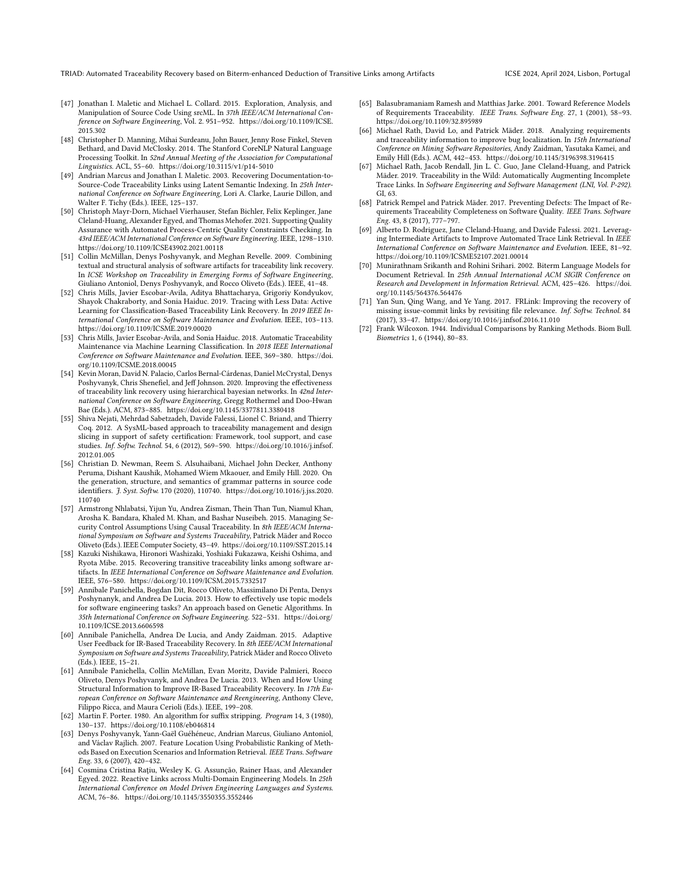
