# RepoProbe: Benchmarking Architecture-Aware Repository Comprehension with Checklists

- source_pdf: ../../../../../pdf/Evaluation/fourth/repoProbe.pdf
- extraction_tool: PyMuPDF
- extraction_date: 2026-11-24
- status: automatic-text-extraction; not manually verified
- pagination: physical PDF pages, starting at 1

> Copia de trabajo para búsqueda y citas. Verifica tablas, fórmulas, figuras y orden visual en el PDF original o en el PNG de la página.

<!-- PDF page 1 -->

## Página PDF 1

RepoProbe: Benchmarking Architecture-Aware Repository
Comprehension with Checklists
Yuexi Yang2,*,†
Alyssa Wu1,*,‡
Ji Luo1
Richeng Xuan1
Zhichao Hu1
Yuhong Liu1
Zhen Qin2,3,§
1Hunyuan, Tencent
2Zhejiang University
3Ningbo Global Innovation Center, Zhejiang University
yangyuexi@zju.edu.cn, alyssawwu@tencent.com, zhenqin@zju.edu.cn
Abstract
The integration of Large Language Models (LLMs) into software
engineering has shifted the focus from function-level generation to
repository-scale assistance. However, existing benchmarks largely
rely on bug reports from GitHub Issues, which often allow models
to bypass genuine understanding via pattern matching on error
logs. This misalignment under-measures Edit Bias, which refers to
premature generation, where models prematurely propose code mod-
ifications instead of understanding the existing repository architec-
ture. Furthermore, current LLM-as-a-Judge scalar scoring suffers
from high variance and low interpretability. This work introduces
RepoProbe, a novel benchmark for evaluating repository-level code
understanding through open-ended Q&A using GitHub Discus-
sions, which focuses on open-ended architectural inquiries rather
than defect reporting. To ensure rigorous evaluation, we propose a
Checklist-Based Verification Protocol that decomposes answers into
atomic, verifiable facts, thereby replacing subjective ratings with
objective verification. Our evaluation of state-of-the-art (SOTA)
LLMs reveals a persistent gap between high clarity and evidence-
grounded technical correctness. It also quantitatively confirms the
prevalence of edit bias, in which models prioritize code generation
instead of architectural analysis. Finally, we demonstrate that our
verification protocol significantly improves evaluation reliability
compared to traditional evaluations with scalar scoring.
CCS Concepts
• Software and its engineering →Software testing and debug-
ging; • Computing methodologies →Artificial intelligence.
Keywords
Repository Understanding, Large Language Models, Benchmarking,
Software Testing, Automated Software Engineering
ACM Reference Format:
Yuexi Yang2,*,†
Alyssa Wu1,*,‡
Ji Luo1
Richeng Xuan1, Zhichao Hu1
Yuhong Liu1
Zhen Qin2,3,§. 2026. RepoProbe: Benchmarking Architecture-
Aware Repository Comprehension with Checklists. In Proceedings of the
41st IEEE/ACM International Conference on Automated Software Engineering
(ASE ’26), October 12–16, 2026, Munich, Germany. ACM, New York, NY, USA,
13 pages. https://doi.org/10.1145/3832783.3837452
This work is licensed under a Creative Commons Attribution 4.0 International License.
ASE ’26, Munich, Germany
© 2026 Copyright held by the owner/author(s).
ACM ISBN 979-8-4007-2882-2/2026/10
https://doi.org/10.1145/3832783.3837452
1
Introduction
AI-assisted software engineering has undergone a paradigm shift
from function-level code completion to repository-scale autonomous
software agents [46, 48]. Modern Large Language Models (LLMs)
are increasingly expected to implement features, refactor modules,
and resolve issues in large codebases [20]. In practice, this shifts the
primary bottleneck from writing code to understanding repositories,
tracing cross-file dependencies, and producing evidence-grounded
explanations, making repository-level understanding a critical relia-
bility requirement [4]. Recent repository-scale studies suggest that
reasoning over real codebases requires non-local integration across
files and modules [26, 27], while current evaluations of code agents
remain primarily focused on bug fixing, under-examining reposi-
tory explanation and realistic developer-facing understanding tasks
[7, 29]. Therefore, current evaluations provide only a partial view
of this repository-level understanding capability. We highlight two
limitations that become especially salient when the target skill is
repository-level code understanding rather than localized patching.
Limitation 1: Existing benchmarks confound understand-
ing with defect localization. Figure 1 illustrates a critical failure
mode often masked by current evaluation paradigms: a scenario
where a user request requires only a minimal configuration change,
yet the model—lacking a holistic mental model of the repository—
proposes an unnecessary and high-risk refactoring of core logic.
We term this phenomenon Edit Bias, referring to premature gen-
eration, which typically emerges when models address open-ended
inquiries without explicit localization cues. This example highlights
the limitations of the dominant defect-centric benchmarks such as
SWE-bench [20]. Such benchmarks typically provide strong local-
ization cues (e.g., stack traces, error logs, and filenames), enabling
a debugging shortcut. Models can exploit these cues to match sur-
face patterns and navigate directly to suspicious files, bypassing
the need to understand the repository itself. Consequently, while
models may achieve high pass rates on bug-fixing tasks, cases like
Figure 1 reveal that they often struggle to answer open-ended ques-
tions about repository behavior, design rationale, and inter-module
dependencies when those shortcuts are removed.
Limitation 2: Prevailing evaluation protocols are ill-suited
for open-ended repository explanations. When the task is re-
framed as “explain how the repository works” rather than “make
tests pass”, evaluation becomes an oracle problem: there is no single
executable signal, and correctness depends on multiple distributed
facts. The prevailing LLM-as-a-Judge approach using holistic scalar
∗Both authors contributed equally to this research.
†Work done during an internship at Tencent.
‡Project lead.
§Corresponding author.
arXiv:2608.04783v2  [cs.SE]  6 Aug 2026

[Vista original de la página 1](../../../../../images/v5/estructura_colecciones/Evaluation/fourth/repoProbe/page-01.png)

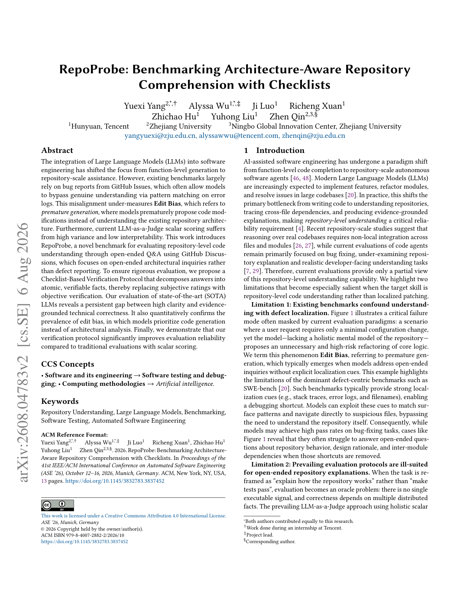

<!-- PDF page 2 -->

## Página PDF 2

ASE ’26, October 12–16, 2026, Munich, Germany
Yuexi Yang2,*,†
Alyssa Wu1,*,‡
Ji Luo1
Richeng Xuan1
Zhichao Hu1
Yuhong Liu1
Zhen Qin2,3,§
User Query (Intent)
“How do I exclude the sidebar on specific screens?”
Hallucinate Logic
“Rewrite render cond.”
Core Logic Refactoring
SidebarConfig.qml
+50 lines (Risky)
Locate Config
“Check config flag.”
Minimal Change
shell.json
+1 line (Relatively Safe)
Path A: Premature
Path B: Understanding
✗
✓
Figure 1: Without appropriate repository understanding,
models exhibit premature generation (Left) by refactoring
source code for a requirement that only needs simple config-
uration changes (Right). This implementation–configuration
mismatch incurs unnecessary engineering cost.
scores [50] is appealing for its simplicity, but it suffers from practi-
cal limitations that are amplified in repository-level settings. First,
scalar scores are often opaque and provide weak diagnostic value
for model improvement. Second, they can be unstable across re-
peated runs, and are susceptible to known biases such as favoring
longer, more fluent answers regardless of technical correctness
[43]. Recent benchmark efforts have also begun to explore more
structured evaluation for coding-assistant question answering [34].
These limitations become more consequential precisely when we
move away from localized bug repair toward open-ended repository
understanding, where partial correctness and evidence grounding
are paramount.
To overcome these limitations, we introduce RepoProbe.
RepoProbe is a discussion-based repository understanding
benchmark grounded in real GitHub Discussions. It addresses the
data gap by shifting from traditional GitHub Issues-based datasets
to naturally occurring “how” and “why” inquiries that require se-
mantic mapping from user intent to repository structure [18]. To
simultaneously improve evaluation stability and interpretability,
we implement a Checklist-Based Verification Protocol. Instead
of relying on opaque scalar scores, this protocol maps open-ended
repository answers to discrete, verifiable technical facts, enabling
more rigorous and reproducible measurement.
RepoProbe complements, rather than replaces, recent repository-
level benchmarks and methods. In particular, RepoReason [26] eval-
uates repository-level reasoning through abductive assertion verifi-
cation, asking models to reconstruct program states from masked
unit-test assertions. While this setting is valuable for studying ex-
ecution reasoning, recovering an assertion value does not show
that a model can answer the kinds of questions that developers
actually ask in practice, such as how a repository is organized, why
a component behaves in a certain way, or what part of the system
is relevant to a user-facing need. RepoProbe uses a complementary
Q&A task formulation to evaluate repository understanding in real-
world discussions, making it closer to realistic developer-facing
usage scenarios.
This work makes the following contributions:
• Discussion-based repository understanding benchmark.
We introduce RepoProbe, a benchmark that evaluates repository-
level code understanding through open-ended question-answer-
ing task from real GitHub Discussions, targeting open-ended
repository questions, requiring cross-file evidence gathering
beyond defect localization shortcuts.
• Checklist-Based Verification Protocol. We propose a check-
list-based verification protocol that decomposes open-ended
answers into weighted, verifiable technical items with fine-
grained rubrics. Experiments on our benchmark show that
this protocol improves evaluation reliability compared to tra-
ditional scalar scoring.
• Empirical Characterization of Edit Bias. Through quanti-
tative and qualitative analyses, we show that frontier models
can exhibit edit bias in open-ended repository inquiries, where
fluent explanations mask a lack of evidence-grounded correct-
ness, This bias is shown to account for a substantial fraction
of failure cases.
2
Related Work
2.1
Repository-Level Benchmarks for Code
Understanding
Recent evaluation efforts have moved beyond function-level code
completion toward repository-scale settings, where models must
reason over long contexts, cross-file dependencies, and project
structure. One line of work emphasizes long-context code un-
derstanding. Benchmarks such as RepoQA [28], LongCodeU [25],
and LoCoBench [39] stress whether models can locate relevant
code, maintain performance over long repositories, and reason un-
der large context windows. These benchmarks provide important
evidence that long-context access remains a bottleneck. However,
their primary focus is still on retrieval, localization, or long-context
processing, rather than on answering realistic developer questions
about repository behavior and design.
Another major line of work evaluates repository-level soft-
ware engineering tasks such as bug fixing, repair, and refactoring.
SWE-bench [20], BeyondSWE [7], and SWE-Refactor [47] are rep-
resentative examples. These benchmarks offer strong ecological
validity because they are grounded in real repositories and practical
engineering tasks. At the same time, they often provide explicit task-
completion cues, including issue descriptions, failing behaviors, or
concrete edit goals. As a result, strong performance in these settings
does not necessarily imply that a model can explain repository orga-
nization, recover design rationale, or answer open-ended questions
when such localization cues are absent. Prior repair-oriented work
also suggests that broader repository context matters substantially
for solving real code tasks [11], further underscoring the difference
between localized patching and genuine repository comprehension.
Closer to our target setting are recent repository-level ques-
tion answering and reasoning benchmarks. CoReQA [8] and
SWE-QA [38] explicitly study repository-level question answer-
ing, while RepoReason [26] evaluates agentic repository reasoning
through abductive assertion verification. These benchmarks show
that repository understanding requires more than local search:
models must aggregate evidence across files, infer state, and reason
about non-local interactions. Nevertheless, their task formulations

[Vista original de la página 2](../../../../../images/v5/estructura_colecciones/Evaluation/fourth/repoProbe/page-02.png)

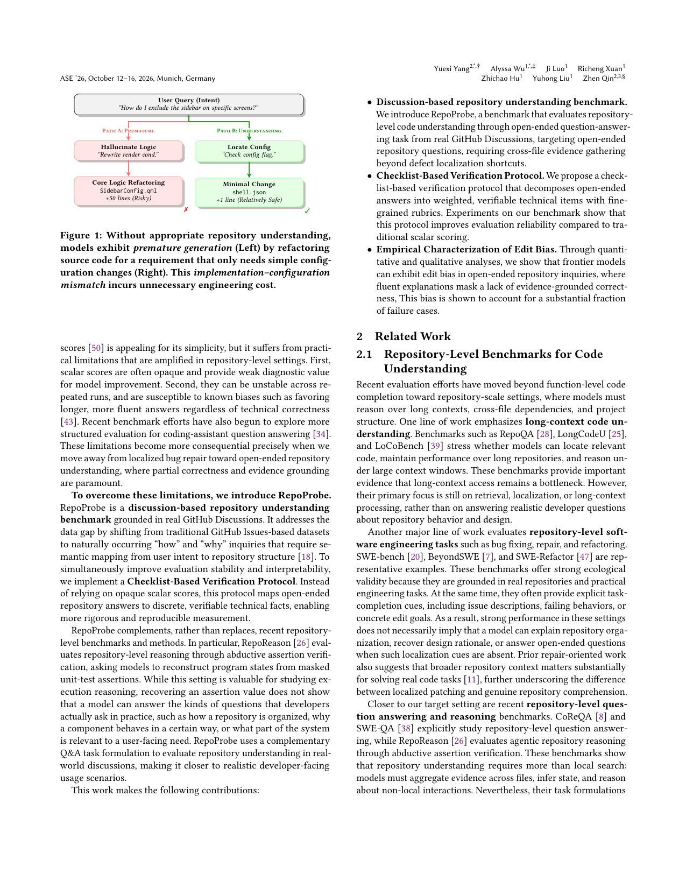

<!-- PDF page 3 -->

## Página PDF 3

RepoProbe: Benchmarking Architecture-Aware Repository Comprehension with Checklists
ASE ’26, October 12–16, 2026, Munich, Germany
Table 1: Comparison Between RepoProbe and Representative Code Understanding Benchmarks
Benchmark
Source
Primary Evaluation
Target
Repo-
Level?
Multi-
lingual?
Open-ended
Understanding?
Checklist-Based
Verification?
CodeXGlue [30]
Existing datasets
General Code Understanding
✗
✓
✗
✗
xCodeEval [21]
CodeForces
General Code Understanding
✗
✓
✗
✗
CRUXEval [17]
LLM-generated
Execution Reasoning
✗
✗
✗
✗
RepoQA [28]
GitHub repositories
Long-Context Retrieval
✓
✓
✗
✗
LongCodeU [25]
GitHub repositories
Long-Context Retrieval
✓
✗
✗
✗
LoCoBench [39]
LLM-generated
General Code Understanding
✓
✓
✗
✗
CoReQA [8]
GitHub Issues and
Comments
Repository QA
✓
✓
✓
✗
SWE-QA [38]
GitHub repositories
Repository QA
✓
✗
✓
✗
RubberDuckBench
[34]
GitHub pull request
comments
Coding Assistant QA
✗
✓
✓
✓
RepoReason [26]
GitHub repositories + unit
tests
Assertion Verification
✓
✗
✗
✗
LoCoEval [29]
LLM-generated
conversations
Conversation Management
✓
✗
✓
✗
BeyondSWE [7]
Real-world software tasks
Issue Resolution
✓
✗
✗
✗
RepoProbe (Ours)
GitHub Discussions
Repository QA
✓
✓
✓
✓
differ from the setting targeted by RepoProbe. In particular, RepoRe-
ason measures execution-oriented state reconstruction, whereas
RepoProbe evaluates whether a model can answer naturally oc-
curring repository questions grounded in developer discussions.
Therefore, our benchmark complements these efforts by focusing
on open-ended “how” and “why” questions derived from GitHub
Discussions, where the central challenge is semantic mapping from
user intent to repository evidence rather than assertion recovery
or issue resolution. To provide a clearer overview, Table 1 sum-
marizes representative benchmarks and contrasts them along key
dimensions relevant to repository-level understanding.
2.2
Repository-Level Reasoning and Navigation
Beyond benchmark construction, several recent studies frame repo-
sitory-scale performance as a problem of navigation, exploration,
and evidence aggregation. FastCode [27] argues that effective
repository understanding requires structural scouting and cost-
aware context construction instead of naively consuming raw con-
text. SWE-Adept [19] likewise highlights the importance of code-
base analysis through tool-augmented agentic workflows. These
works suggest that repository understanding is not merely a matter
of fitting more tokens into context, but of selecting and integrating
the right evidence from a large codebase.
Other work focuses on reasoning abstractions for repository-
scale software engineering. Agentic Code Reasoning [44] stud-
ies semi-formal reasoning for code analysis, while RepoRepair
[37] leverages repository documentation to support repair in large
codebases. Together with RepoReason [26], these studies reinforce
a common conclusion: repository-level performance depends on
cross-file integration, state tracking, and structured evidence use
rather than simple retrieval alone. RepoProbe is designed to eval-
uate this capability under a developer-facing QA setting, where
agents must navigate the repository and synthesize an evidence-
grounded natural-language answer instead of merely returning a
location or producing a patch.
2.3
Evaluation of Open-Ended Code QA
Evaluating open-ended answers in the code domain remains diffi-
cult. Classical lexical-overlap metrics such as BLEU and ROUGE
are known to be poorly aligned with technical correctness because
correct explanations may differ substantially from a reference in
wording while preserving the same facts [9]. For this reason, recent
work increasingly adopts LLM-as-a-Judge scoring, as popularized
in broader language-model evaluation [50]. However, scalar judging
is vulnerable to instability and known biases, including a tendency
to reward verbosity and surface fluency [43], which becomes es-
pecially problematic for repository-level questions whose answers
are multi-fact, partial-credit, and evidence-dependent.
To address these limitations, recent evaluation work has begun
to explore structured verification. CheckEval [24] shows the
value of decomposing open-ended answers into checklist-style cri-
teria, and RubberDuckBench [34] brings rubric-based evaluation
into the code-assistant setting using real-world coding questions.
This line of work is particularly relevant to repository-level QA,
where the oracle is inherently compositional: an answer may be
partially correct, omit important technical facts, or provide a fluent
but unsupported explanation. RepoProbe builds on this emerging
direction by introducing a checklist-based verification protocol tai-
lored to repository understanding tasks, enabling finer-grained and
more reproducible evaluation than holistic scalar scores.
Overall, prior work establishes the importance of long-context
processing, repository navigation, and structured evaluation, but
leaves a gap at their intersection. Existing benchmarks either em-
phasize retrieval, issue resolution, or execution-oriented reasoning,
while open-ended repository QA remains comparatively underex-
plored and difficult to evaluate reliably. RepoProbe addresses this
gap by combining discussion-derived repository questions with
checklist-based verification for evidence-grounded, open-ended
repository understanding.

[Vista original de la página 3](../../../../../images/v5/estructura_colecciones/Evaluation/fourth/repoProbe/page-03.png)

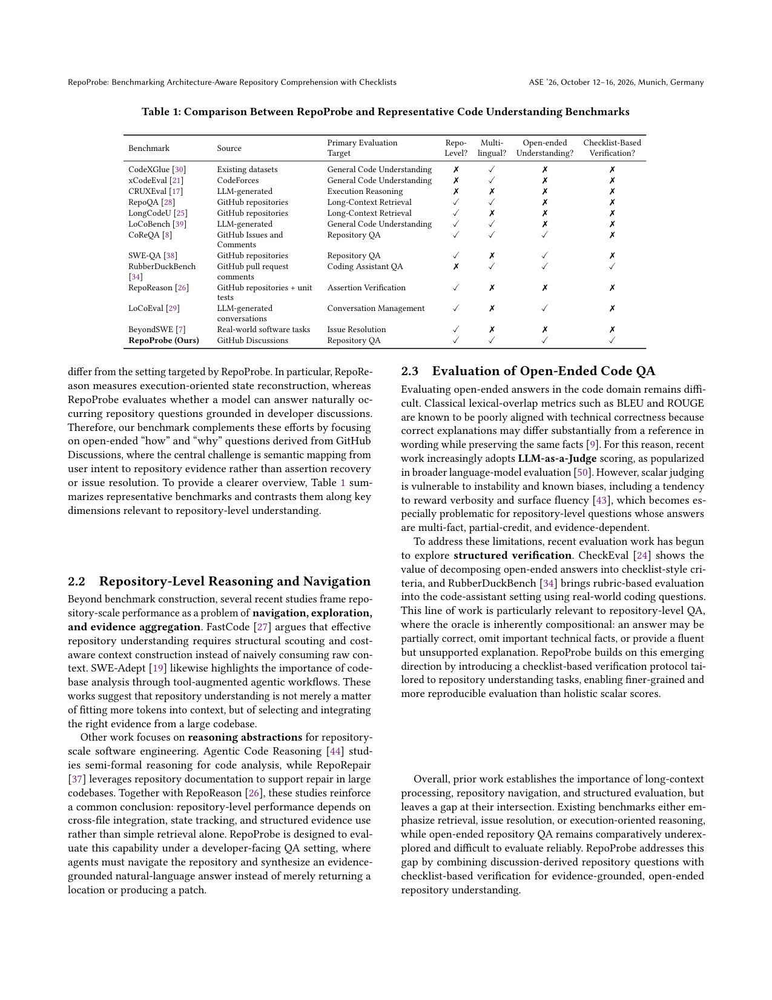

<!-- PDF page 4 -->

## Página PDF 4

ASE ’26, October 12–16, 2026, Munich, Germany
Yuexi Yang2,*,†
Alyssa Wu1,*,‡
Ji Luo1
Richeng Xuan1
Zhichao Hu1
Yuhong Liu1
Zhen Qin2,3,§
3
RepoProbe Benchmark
3.1
Task Definition
RepoProbe evaluates repository-level code understanding through
repository-level Q&A: a developer-facing comprehension task
in which an agent answers questions about an existing codebase
rather than modifying it. Formally, the task takes as input a target
repository 𝑅and a natural-language question 𝑞, and requires the
model to produce a textual answer 𝑎= 𝑓(𝑅,𝑞). The answer should
resolve the developer’s information need by explaining repository
behavior, design rationale, API usage, configuration choices, or
relevant implementation details.
The evaluation is separate from the task itself. Given a gener-
ated answer 𝑎and reference material 𝑀, an evaluation mechanism
Score(𝑎, 𝑀) assigns a score indicating how well the answer covers
the required technical facts. In RepoProbe, 𝑞is a self-contained
question derived from a real GitHub Discussion, and the reference
material 𝑀consists of the developer-accepted reference answer 𝑎ref
and a weighted checklist C derived from 𝑞and 𝑎ref. Each instance
follows a fixed four-part structure—question, repository, developer-
accepted reference answer, and weighted checklist—so that the
input, output, and assessment target are clearly bounded.
This setup evaluates whether the answer demonstrates seman-
tic mapping from user intent to repository evidence: navigating
the repository, identifying relevant files or components, tracing
cross-file relationships, reasoning over long-range code context,
and synthesizing an explanation grounded in the repository. These
capabilities distinguish repository-level Q&A from program re-
pair and refactoring tasks [20, 47], where the model is expected
to change the codebase and success is judged by executable out-
comes such as passing tests or satisfying an edit request. In contrast,
repository-level Q&A requires the model to explain the existing
system rather than modify it [8, 38].
3.2
Data Curation
To construct a benchmark that emphasizes deep code understand-
ing, we source our data from GitHub Discussions rather than tra-
ditional GitHub Issues. Issues often contain explicit localization
cues such as stack traces that bypass the need for repository-level
understanding. In contrast, Discussions typically feature abstract ar-
chitectural goals without referencing specific files, requiring agents
to perform Semantic Mapping via cross-file exploration. To trans-
form these raw, noisy community discussions into structured, self-
contained, and objectively scorable Q&A pairs, we designed the
multi-stage curation pipeline illustrated in Figure 2.
Repository Selection and Raw Data Harvesting. To capture
recent development trends and reduce the risk of training-data
contamination, we imposed strict criteria on the source reposito-
ries. We selected GitHub projects that (1) were created on or after
January 1, 2024, (2) have accumulated at least 1,000 stars, indicating
substantial community adoption, and (3) use the Discussions feature
for developer support, with “Q&A” or “Help” categories and at least
ten discussions explicitly marked as “answered” by maintainers
or original authors. Applying these criteria yielded a set of popu-
lar and actively maintained projects. From these repositories, we
collected all answered discussions, resulting in an initial corpus of
5,233 raw discussion threads.
Data Cleaning and Relevance Filtering. Raw GitHub discus-
sions contain a wide variety of topics, many of which are not directly
related to code understanding, such as release announcements, or
purely conceptual debates. We first removed discussions where
the question or the accepted answer relied on images, since our
benchmark targets text-based language model evaluation. We then
used Claude Sonnet 4.5 to classify the remaining discussions ac-
cording to their relevance to code understanding. We defined three
code-understanding categories grounded in established program-
comprehension knowledge types [31, 42]: (i) Project Architecture,
focusing on repository structure and inter-module relationships; (ii)
Business Logic, focusing on functional behavior and data flow; and
(iii) Implementation Details, focusing on concrete APIs, code snip-
pets, or configuration details. This relevance filtering reduced the
corpus to 2,613 discussions with clear code-understanding intent.
Context Enhancement and Q&A Refinement. A major chal-
lenge in mining developer discussions is that questions often rely
on external context, such as links to code snippets, documenta-
tion, or other issues that are not immediately visible in the text. To
address this, we implemented a context enhancement workflow:
(1) Extraction: We extracted the title and body of the discussion
as the Question and the accepted answer as the Answer.
(2) Context Resolution: We identified external URLs within the
text. We excluded internal references such as localhost and
crawled valid external links to retrieve their content. Claude
Sonnet 4.5 was then used to verify the relevance of the
crawled content to the repository and summarize it.
(3) Content Integration: For Q&A pairs containing external links,
we used Claude Sonnet 4.5 to integrate the summarized
external content directly into the Question and Answer text.
The model was instructed to preserve the original infor-
mation while incorporating the external context, ensuring
the Q&A becomes self-contained and solvable without
internet access. Q&A pairs without external links were re-
tained in their original form to preserve authentic developer
communication.
This stage transforms context-fragmented discussions (those
with external dependencies) into standalone Q&A pairs that can be
presented directly to models. Crucially, after this integration step,
agents evaluating on RepoProbe only need access to the repository
code and the processed question text—no external network access
is required during evaluation.
Evaluation Checklist Generation. To enable objective and
reproducible evaluation under a unified scoring interface, Claude
Sonnet 4.5 analyzes the refined Q&A pair with a checklist-generation
prompt and output schema. The prompt requires the model to pro-
duce reference-derived knowledge items, integer score weights, and
discrete rubrics under the standardized 10-point structure. Check-
list item content therefore varies with each question and refer-
ence answer, but the generation pipeline itself remains the same
for every instance. This mechanism converts open-ended answers
into machine-checkable scoring procedures. We detail the checklist
structure and our verification protocol in Section 4.
Quality Assurance. We next applied automatic and human-
in-the-loop quality control to remove problematic or ambiguous
cases. Using a verification protocol based on Claude Opus 4.5, we

[Vista original de la página 4](../../../../../images/v5/estructura_colecciones/Evaluation/fourth/repoProbe/page-04.png)

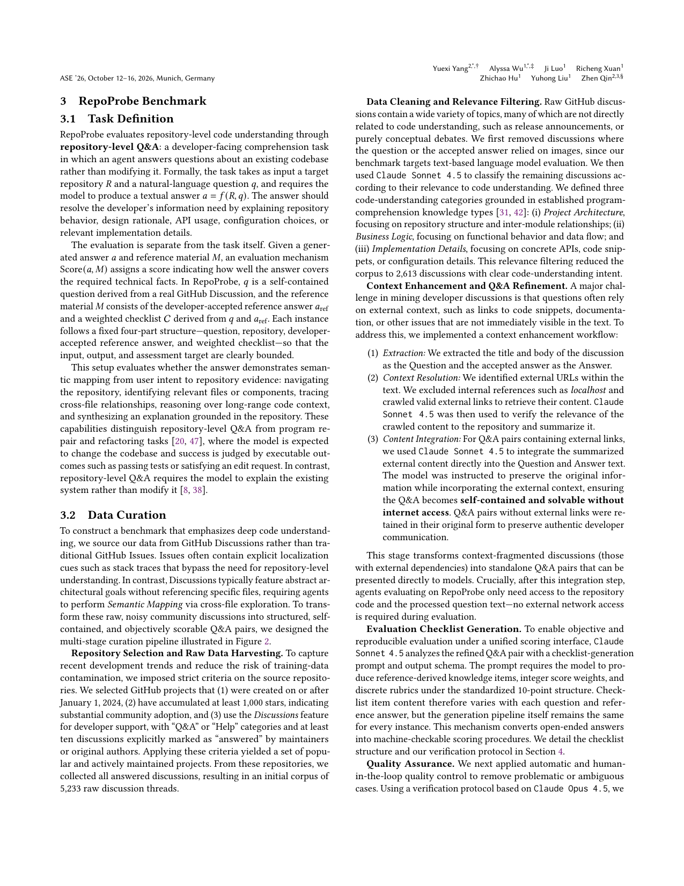

<!-- PDF page 5 -->

## Página PDF 5

RepoProbe: Benchmarking Architecture-Aware Repository Comprehension with Checklists
ASE ’26, October 12–16, 2026, Munich, Germany
(a) Discussion Filter & Classify
Category Classifier
Relevance Filter
(b) Context Enhancement
Yes:
Link
Summarizer
(c) Q&A Refinement
External links
in Q&A pair?
Qualified
Q&A pair
Q&A Refinement
Module
No:
Keep
Original
(d) Checklist Generation
Link
Summary
Qualified
Q&A pair
Generated Checklist
• (5 points) Core Solution
Identification
5 points: Correctly identifies that the
markdown_generator option and 
"protect_links": False...
3 points: Does not fully explain...
• (4 points) Configuration Migration
Explanation...
• (1 point) Clear and Concise
Output...
(e) Quality Assurance
RepoProbe
Benchmark
Refined Q&A
Question:How to prevent generating
internal links in resulting markdown?
Answer: The solution is to pass 
parameter "protect_links":
False through the markdown_
generator option...
Checklist
Generator
How to prevent generating internal
links in resulting markdown?...
Use the `markdown_generator`
option. Here is an example from the
author... (Provided a GitHub Issue)
Q&A pair from original
GitHub Discussion
Refined
Q&A pair
Checklist
Requirements
• Generate Knowledge
Items from Answer
• 1~4 Knowledge Items
• Fixed Clarity Item
• 9 Knowledge Points
• 1 Clarity Point
Q&A pair
Checklist
Human Reviewer
• Checklist Quality
• Code Understanding Depth
Classify Result
Code understanding relevance: True
Category: Implementation Details
Rationale: The configuration method can be understood
and verified by examining the repository's code...
Link Summary
The solution code by the author
passed parameter 
"protect_links": False...
This is an issue of a markdown
generation bug...
• Self-Contained
• Answerable
LLM Verifier
Figure 2: RepoProbe data curation pipeline from answered GitHub Discussions to self-contained, checklist-scored Q&A tasks.
Hollow arrows represent LLM-driven steps.
performed two critical checks: (1) External Link Validation, discard-
ing Q&A pairs whose correctness depended on external links that
could not be reliably resolved or whose relevance to the repository
could not be verified; and (2) Answerability Check, verifying that
the question is answerable and that the evidence required by each
checklist item can be obtained from only the repository’s code and
the information explicitly present in the rewritten question. After
this verification step, we obtain 1,107 candidate Q&A pairs from 51
repositories.
A subset of the remaining samples was then manually inspected
by expert annotators. They applied four orthogonal validation cri-
teria: QA consistency (the accepted answer must directly and non-
contradictorily answer the question), checklist quality (items must
be correct, sufficiently granular, and non-conflated), task validity
(the question must require repository context rather than generic
Table 2: RepoProbe Benchmark Statistics
Statistic
Value
Total Repositories
50
Total Q&A Pairs
500
Programming Languages
15
Avg. Files per Repo
∼1,200
Avg. LoC per Repo
∼380k
advice), and code relevance (the answer must depend on code or con-
figuration facts). Annotator disagreements were resolved through
discussion before finalizing each sample. More than half of the
candidate samples were discarded during this stage, with the domi-
nant cause being direct answerability without genuine repository

[Vista original de la página 5](../../../../../images/v5/estructura_colecciones/Evaluation/fourth/repoProbe/page-05.png)

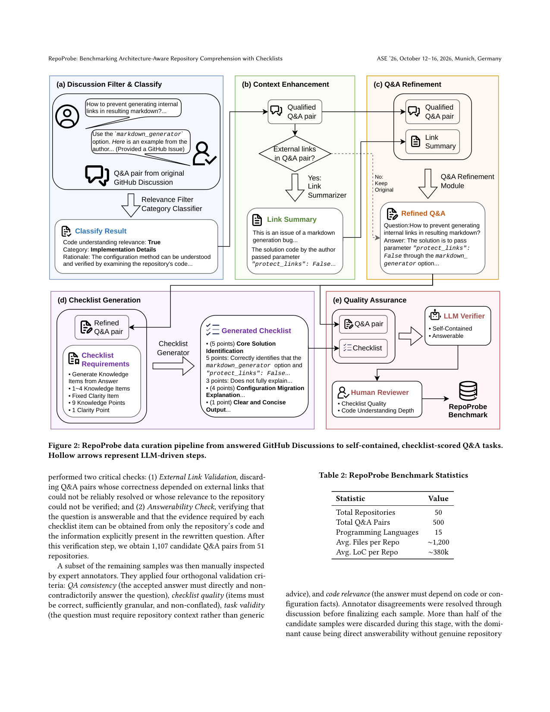

<!-- PDF page 6 -->

## Página PDF 6

ASE ’26, October 12–16, 2026, Munich, Germany
Yuexi Yang2,*,†
Alyssa Wu1,*,‡
Ji Luo1
Richeng Xuan1
Zhichao Hu1
Yuhong Liu1
Zhen Qin2,3,§
Figure 3: Distribution of RepoProbe questions by programming language (left), code-understanding category (center), and
repository theme (right).
understanding. After this stage, we obtained a pool of 500 validated
code-understanding Q&A pairs drawn from 50 active repositories.
3.3
Statistics of RepoProbe benchmark
Table 2 summarizes the main statistics of RepoProbe. Each sample in
the benchmark is a real GitHub Discussion question rewritten into
a self-contained Q&A instance with an executable checklist. Among
the final 500 samples, 225 include external context that was merged
into the question or answer text to support offline evaluation. The
underlying repositories are large, multi-module projects rather
than isolated code snippets: on average, each repository contains
∼1,200 files and ∼380k lines of code, making many tasks inherently
long-context and dependent on cross-file evidence gathering and
dependency tracing.
Figure 3 further characterizes the benchmark along three axes
that later motivate our stratified evaluation in Section 5. RepoProbe
spans 15 programming languages with a long-tailed distribution,
where a few languages account for a large fraction of questions,
followed by a diverse set of lower-frequency ecosystems. Also,
the benchmark covers multiple code-understanding categories and
repository themes, enabling the analysis of model performance
from complementary structural and domain-specific perspectives.
4
Checklist-Based Verification Protocol
As detailed in Section 2.3, traditional scalar scoring acts as a “fuzzy
oracle” with high variance and low interpretability. To address
these limitations, we introduce a Checklist-Based Verification
Protocol as a core contribution. This approach decomposes open-
ended repository evaluation into atomic, verifiable technical checks.
4.1
Checklist Structure
Following the data curation methodology (Section 3.2), each ques-
tion 𝑞is accompanied by a reference answer and a checklist C =
{𝑐1, . . . ,𝑐𝑛}. Each item 𝑐𝑖specifies three components:
(1) Key Point: A precise, atomic aspect of the reference answer,
such as identification of root cause or API usage correctness.
(2) Score Weight: The maximum points allocated to this aspect.
(3) Evaluating Rubric: A tiered criterion mapping partial cor-
rectness to discrete scores.
All checklists are generated with a unified prompt template and
standardized schema across the entire benchmark. The schema
fixes the required fields for every item including key point, score
weight, and discrete evaluating rubric as well as the total score
budget and judge output format. The checklist content therefore
varies with the specific question and reference answer, but the gen-
eration procedure, score scale, item fields, valid-score constraints,
and verification interface are shared by all instances.
We adopt a standardized 10-point scale. Each RepoProbe ques-
tion has 𝑘∈{1, 2, 3, 4} content-specific knowledge items derived
from the reference answer, with integer weights summing to 9.
The remaining 1 point is reserved for a universal Clarity & Orga-
nization criterion that flags severe hallucinations or incoherent
structures. For every item, the valid score values are fixed dur-
ing dataset construction and released as part of the checklist; the
evaluator may only choose from these predefined values.
For knowledge items, we use two types of rubrics: Multi-tier
rubrics for complex items (e.g., 4 points for fully correct, 2 for
partially correct, 0 for incorrect) and Binary rubrics for single-fact
items (full credit or zero). The total score for a generated response is
simply the sum of the discrete scores assigned to each checklist item
by the LLM judge. In our evaluation, we report this as a normalized
score rate (%).
4.2
Constrained LLM Evaluation via
Rationale-Guided Scoring
We formulate the evaluation task as a checklist-based verification
problem. In contrast to scalar scoring, which relies on a single
opaque inference step, our protocol decomposes the judgment into
a sequence of item-wise decisions.
To improve the transparency and stability of the judgments, our
verification protocol enforces two constraints on the LLM evaluator:
(1) Rationale-first constraint: The LLM is instructed to first
generate a textual rationale (serving as evidence) and then

[Vista original de la página 6](../../../../../images/v5/estructura_colecciones/Evaluation/fourth/repoProbe/page-06.png)

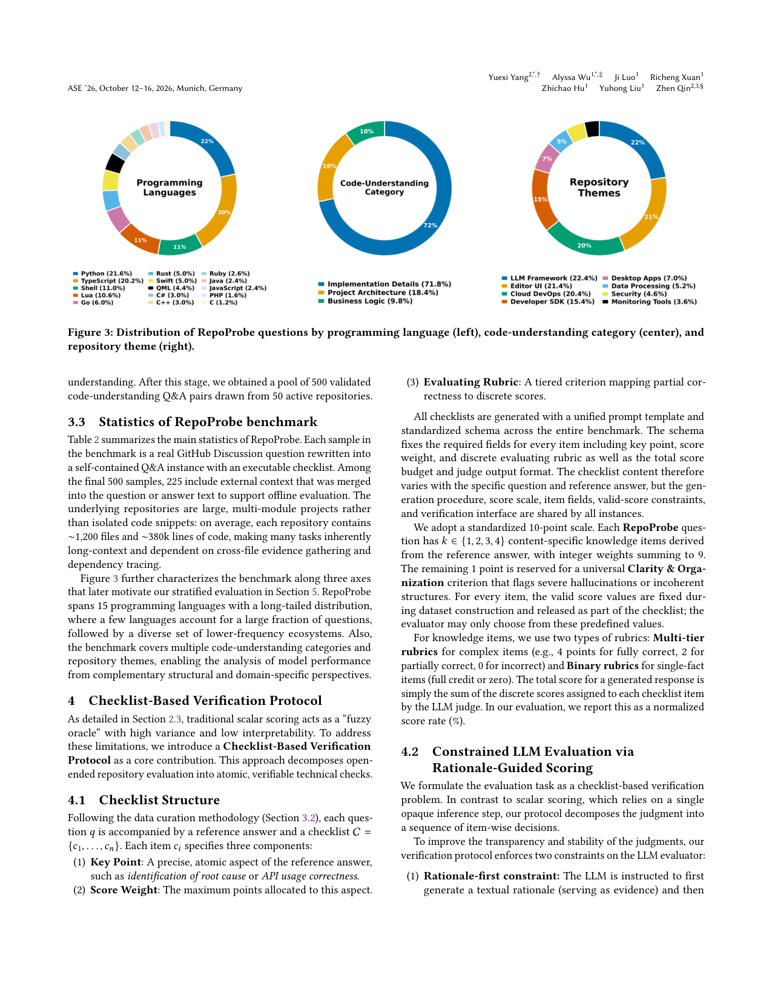

<!-- PDF page 7 -->

## Página PDF 7

RepoProbe: Benchmarking Architecture-Aware Repository Comprehension with Checklists
ASE ’26, October 12–16, 2026, Munich, Germany
decide the score based on this rationale. This leverages Chain-
of-Thought reasoning to ground decisions in specific details
of the generated response, reducing post-hoc rationalization.
(2) Rubric adherence: The assigned score must be strictly chosen
from the valid discrete set defined by the rubric. This prevents
arbitrary scalar assignments and enforces consistency across
repeated evaluations.
Implementation Strategy. For efficiency, we implement this
verification as a single-pass LLM inference. The checklist is seri-
alized into a structured schema, and the LLM outputs a strictly
formatted JSON sequence of rationales and scores for all items
simultaneously. This design trades strict step-wise independence
for efficiency while allowing the model to use global context from
the full answer. In our experiments, we demonstrate that this con-
strained verification significantly reduces variance and provides
more consistent rationales than scalar scoring baselines.
5
Experimental Evaluation
To rigorously evaluate repository-level understanding, we move
beyond static prompting and adopt an agentic evaluation paradigm.
This section describes our experimental setup and reports results
for our research questions. Unless otherwise stated, we keep the
agentic environment fixed across models to isolate differences in
model capability rather than differences in scaffolding.
Building on the evaluation paradigm above, our experiments are
designed to answer the following research questions, each reported
in a dedicated subsection:
• RQ1 (Section 5.2): How well do frontier LLMs demonstrate
repository-level code understanding on Q&A tasks, and how
does performance vary across programming languages, code-
understanding categories, and repository themes?
• RQ2 (Section 5.3): Does checklist-based verification provide
more stable and interpretable evaluation signals than tradi-
tional LLM-as-a-Judge scalar scoring for repository-level Q&A
tasks?
• RQ3 (Section 5.4): To what extent do frontier LLMs exhibit Edit
Bias when answering discussion-based repository-level archi-
tectural inquiries, and what qualitative patterns characterize
this failure mode?
5.1
Experimental Setup
5.1.1
Evaluation Framework: Agentic Scaffolding. Unlike traditional
code benchmarks that provide models with a truncated context
window, RepoProbe requires navigating vast, multi-file codebases.
To simulate a real-world developer environment, we evaluate all
models under a fixed agentic scaffolding Claude Code, which
provides tools for file system navigation, symbol searching, and
cross-reference tracing.
5.1.2
The Selection of LLMs. To ensure that our evaluation reflects
the capabilities encountered in realistic software-engineering work-
flows, we select models according to three criteria. First, we include
frontier models from multiple major providers rather than
focusing on a single ecosystem, so that the benchmark reflects the
competitive landscape actually faced by developers. Second, we
include models representing two different SOTA time points: an
earlier frontier generation and a more recent frontier generation.
This design allows us to assess not only absolute capability, but
also whether progress across release cycles consistently translates
into better repository-level understanding. We divide the evaluated
systems into two broad groups:
Closed-weight Models. This cohort covers proprietary frontier
systems from multiple providers. It includes models from OpenAI
(GPT-5.2 [35], GPT-5.4 [36]), Anthropic (Claude Opus 4.5 [1],
Claude Opus 4.6 [2], Claude Sonnet 4.6 [3]), Google (Gemini
3 Flash [14], Gemini 3 Pro [15], Gemini 3.1 Pro [16]), xAI
(Grok 4.20 [45]), Qwen (Qwen3-Max [40], Qwen3.5-Plus [41]),
and ByteDance (Doubao-Seed-1.8 [5], Doubao-Seed-2.0 [6]).
Open-weight Models. This cohort covers leading open-weight
or openly available models that are widely used in practice. It
includes models from DeepSeek (DeepSeek-V3.2 [10]), MiniMax
(MiniMax-M2.1 [32], MiniMax-M2.5 [33]), Zhipu AI (GLM-4.7 [12],
GLM-5 [13]), and Moonshot AI (Kimi-K2 [22], Kimi-K2.5 [23]).
Overall, this selection spans 20 models from 10 providers and
provides a broad snapshot of the current landscape of LLM-based
software engineering agents. Many of these models are also sur-
faced in practical coding environments, making the evaluation
directly relevant to real developer workflows.
5.1.3
Evaluation Metrics. All model answers are graded using our
Checklist-Based Verification Protocol (Section 4). This design
makes evaluation verifiable at the level of atomic technical items,
and supports fine-grained diagnosis beyond scalar scoring.
Unless otherwise stated, we use Claude Sonnet 4.5 as the
judge model for checklist verification and keep it fixed across all
evaluated systems and repeated runs to control for judge variability.
Because Claude Sonnet 4.5 is also used for checklist generation
during dataset construction, we deliberately exclude it from the
evaluated model set to avoid self-evaluation.
We report four summary metrics, computed as averages over
either the full benchmark or a stratified subset of questions. Let
𝑠∈[0, 10], 𝑠kn ∈[0, 9], and 𝑠cl ∈{0, 1} denote a question’s total,
knowledge-item, and clarity-item points under our checklist pro-
tocol (Section 4). Overall Performance (%) is the mean of 𝑠/10;
Knowledge Score (%) is the mean of 𝑠kn/9; Clarity Score (%) is
the mean of 𝑠cl; and Perfect Solve Rate is the fraction with 𝑠= 10.
5.2
RQ1: Performance of Language Models
We present results addressing the research questions above, starting
with an end-to-end benchmarking of frontier models on RepoProbe.
We report (1) aggregate performance over the full benchmark and
(2) a single stratified summary that covers all three RepoProbe
axes from Section 3—programming languages, code-understanding
categories, and repository themes—using means and standard devi-
ations across the 20 evaluated systems (Table 4). This design pre-
serves the benchmark’s compositional structure without dedicating
multiple pages to per-model breakdown tables.
5.2.1
Aggregate Performance. We summarize the aggregate per-
formance of models using the four metrics defined in Section 5.1.
Table 3 shows a clear but non-uniform capability hierarchy.

[Vista original de la página 7](../../../../../images/v5/estructura_colecciones/Evaluation/fourth/repoProbe/page-07.png)

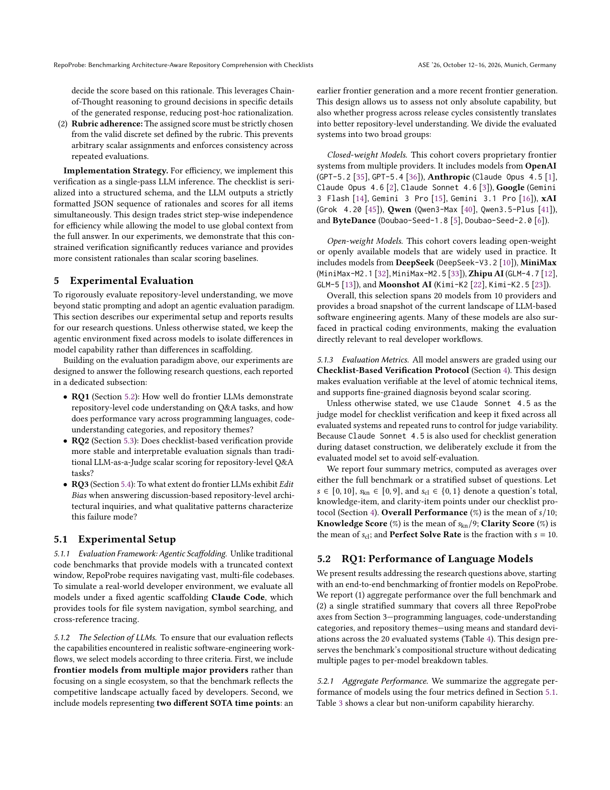

<!-- PDF page 8 -->

## Página PDF 8

ASE ’26, October 12–16, 2026, Munich, Germany
Yuexi Yang2,*,†
Alyssa Wu1,*,‡
Ji Luo1
Richeng Xuan1
Zhichao Hu1
Yuhong Liu1
Zhen Qin2,3,§
Table 3: Language model performance on the four evaluation metrics, reported as percentages. For each metric, the best-
performing model is marked in bold and the second-best is underlined.
Category
Model
Overall Performance
Knowledge Score
Clarity Score
Perfect Solve Rate
Closed-weight models
GPT-5.2
62.7
60.3
84.7
26.0
GPT-5.4
60.4
57.6
85.6
24.2
Claude Opus 4.5
58.1
56.2
75.1
23.1
Claude Opus 4.6
62.1
60.2
79.0
27.5
Claude Sonnet 4.6
60.2
58.3
78.2
27.2
Grok 4.2
56.8
54.8
75.0
23.4
Gemini 3 Flash
55.4
53.6
71.6
21.8
Gemini 3 Pro
51.3
49.3
71.2
17.6
Gemini 3.1 Pro
54.1
52.2
70.9
21.2
Qwen3-Max
27.3
26.1
39.3
5.6
Qwen3.5-Plus
50.0
48.1
66.9
17.8
Doubao-Seed-1.8
43.5
42.4
55.1
12.8
Doubao-Seed-2.0
46.8
45.1
62.2
14.6
Open-weight models
GLM-4.7
50.7
49.3
64.8
18.4
GLM-5
54.8
52.9
72.2
21.3
DeepSeek-V3.2
52.9
51.3
68.7
18.8
Kimi-K2
45.9
44.1
61.3
15.6
Kimi-K2.5
53.7
51.8
71.1
19.9
MiniMax-M2.1
45.0
43.6
57.8
12.8
MiniMax-M2.5
44.6
42.8
61.2
14.5
Overall, frontier closed-weight models occupy most of the top
positions, while open-weight systems remain competitive but gen-
erally lag in checklist coverage and perfect-solve frequency. More
importantly, the two-time-point design reveals that progress across
model generations is often positive but not monotonic: newer
releases such as Claude Opus 4.6, Gemini 3.1 Pro, GLM-5, and
Kimi-K2.5 improve over their earlier counterparts, yet this trend is
not universal, as shown by GPT-5.4 and MiniMax-M2.5. This sug-
gests that general frontier progress does not automatically translate
into better repository-level understanding.
Across all models, three shared performance signatures emerge.
First, clarity consistently outpaces technical correctness: mod-
els often produce well-structured explanations while missing re-
quired checklist items. Second, perfect solves remain moderate
even for frontier systems, indicating that repository-level Q&A is
frequently limited by evidence grounding and cross-file dependency
tracing rather than fluent narration. Third, the score distribution
exhibits a non-trivial low-score tail, where a noticeable fraction
of tasks receive near-zero credit rather than degrading gracefully.
5.2.2
Stratified Performance: Languages, Categories, and Themes.
We assess cross-language robustness, structural difficulty across
code-understanding categories, and domain sensitivity across repos-
itory themes using the compact summary in Table 4. Each row
reports the mean Overall Performance across all 20 models, with
the standard deviation in parentheses; for the three categories we
additionally report the mean Perfect Solve Rate, which is espe-
cially diagnostic for end-to-end completion.
Programming languages. Mean scores span a wide band (e.g.,
QML at 38.4% vs. TypeScript at 57.6%), with several ecosystems, no-
tably QML, Swift, and PHP falling well below the benchmark-wide
Table 4: Stratified RepoProbe performance summarized
across all 20 evaluated models: mean Overall Performance (%)
with standard deviation in parentheses. Mean Perfect Solve
Rate (%) is also included for code-understanding categories.
“—” indicates that the stratum only uses the overall column.
Axis
Stratum
Overall (%)
Perfect (%)
Category
Project Architecture
53.8 (7.9)
19.2 (5.7)
Business Logic
52.3 (9.4)
15.8 (5.4)
Implementation Det.
51.2 (8.2)
19.4 (5.6)
Theme
LLM Framework
51.8 (8.0)
—
Cloud DevOps
55.4 (7.6)
—
Developer SDK
50.3 (8.6)
—
Editor UI
50.7 (8.7)
—
Monitoring Tools
55.1 (8.6)
—
Desktop Apps
47.3 (9.0)
—
Data Processing
47.6 (7.6)
—
Security
56.0 (8.9)
—
Language
Python
53.1 (7.8)
—
TypeScript
57.6 (8.7)
—
Lua
55.6 (9.5)
—
Shell
52.2 (7.7)
—
Go
52.1 (7.8)
—
Rust
48.2 (9.7)
—
QML
38.4 (8.8)
—
C#
47.6 (7.5)
—
Swift
43.3 (9.2)
—
C++
47.4 (11.4)
—
Ruby
48.8 (6.7)
—
JavaScript
46.5 (8.9)
—
Java
56.4 (9.7)
—
C
51.9 (6.8)
—
PHP
45.4 (8.3)
—
average. High cross-model standard deviations on languages such
as C++ also indicate uneven capability across systems. Together

[Vista original de la página 8](../../../../../images/v5/estructura_colecciones/Evaluation/fourth/repoProbe/page-08.png)

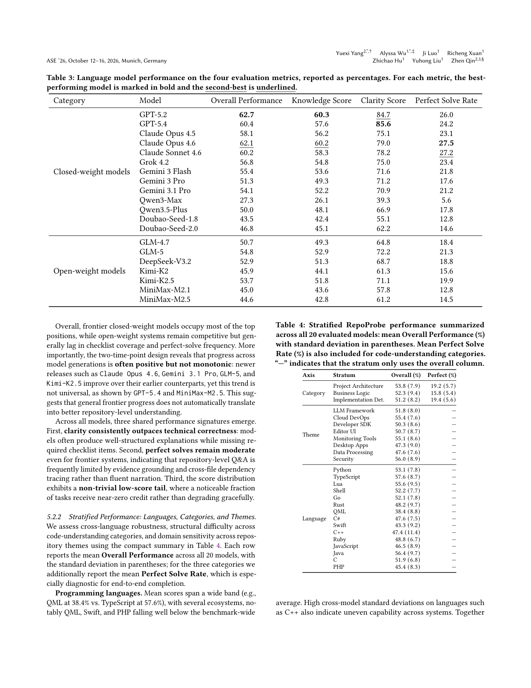

<!-- PDF page 9 -->

## Página PDF 9

RepoProbe: Benchmarking Architecture-Aware Repository Comprehension with Checklists
ASE ’26, October 12–16, 2026, Munich, Germany
with the aggregate results in Table 3, this pattern suggests trans-
ferable strengths for mainstream stacks but persistent weakness in
long-tail languages.
Code-understanding categories. Mean overall scores are sim-
ilar across categories, but perfect solves are lowest for Business
Logic, indicating that fully satisfying all checklist items is hardest
when tasks require causal and cross-component reasoning even
when partial credit remains common elsewhere.
Repository themes. Cross-model means separate “easier” do-
mains (e.g., Security and Cloud DevOps) from more challenging
ones (e.g., Desktop Apps and Data Processing), with the remaining
themes in between. This aligns with heterogeneous real-world ar-
chitectural conventions while still showing that no single theme
explains overall leaderboards: strong models remain competitive
across themes relative to weaker ones, consistent with Table 3.
Answer to RQ1
RepoProbe reveals a clear but non-monotonic frontier ca-
pability hierarchy. Newer SOTA releases often outperform
earlier ones, but the gains are inconsistent across model
families, indicating that general model progress does not
automatically translate into stronger repository-level un-
derstanding. Moreover, even the best-performing system
reaches only the low-60% range, leaving substantial room
for improvement.
5.3
RQ2: Stability and Interpretability of
Evaluation Metrics
To assess the stability and reproducibility of our evaluation frame-
work, we conducted a rigorous comparative analysis between the
proposed Checklist-Based Verification Protocol and the tradi-
tional LLM-as-a-Judge scalar scoring method. Our analysis reveals
that while scalar scoring is widely used, it suffers from critical
instability and a lack of interpretability when applied to complex
repository-level Q&A tasks.
5.3.1
Macro-level Analysis: The Illusion of Stability. At an aggre-
gated level, scalar scoring based on a 5-dimensional Likert scale
appears moderately stable. However, a deeper statistical analysis
exposes significant volatility that is masked by average scores. As
shown in Table 5, we compared the performance of three SOTA
models using both metrics across 5 independent evaluation runs.
The scalar baseline follows SWE-QA [38] LLM-as-a-Judge prompt:
given the question, the reference answer, and the candidate answer,
the judge assigns holistic scores on a 5-dimensional Likert rubric.
For both checklist-based verification and scalar scoring in this ex-
periment, we use Claude Sonnet 4.5 as the fixed evaluator under
the same generation settings and retry policy, ensuring consistent
evaluation across all runs.
The results demonstrate a clear stability gap. The Checklist-
Based Verification method consistently exhibits a lower Standard
Deviation and a narrower Range compared to Scalar Scoring. Most
notably, the scalar metric’s range reaches up to 8.3% for Claude
Opus 4.5. This implies that under the traditional Likert scale, a
model’s evaluation could fluctuate by nearly a full letter grade
Table 5: Reliability Comparison: Scalar vs. Checklist. Across
three models, Checklist-Based Verification consistently
demonstrates superior stability, with standard deviations
roughly half that of Scalar Scoring.
Scalar Scoring (5-Dimensions)
Checklist-Based Verification
Model
Score Rate
StdDev
Range
Score Rate
StdDev
Range
GPT-5.2
91.3%
2.9%
6.9%
76.3%
1.7%
3.8%
Claude Opus 4.5
85.4%
3.5%
8.3%
71.8%
1.5%
3.2%
Gemini 3 Pro
82.2%
3.3%
7.8%
65.6%
2.4%
5.2%
purely due to stochastic noise in the judge’s interpretation, render-
ing it unsuitable for precise benchmarking. In contrast, the rubric-
guided nature of the checklist forces the evaluator to converge on
evidence-backed technical checks, cutting this measurement error
by more than half.
5.3.2
Micro-level Case Studies: Anatomy of Variance. To under-
stand the qualitative drivers of this instability, we analyzed specific
instances where scalar scoring failed to provide consistent signals.
We identified two failure modes. Interpretation Drift leads to high
variance, while Directional Inconsistency leads to uninterpretability.
Failure Mode 1: Interpretation Drift: High Variance. Scalar
judges often struggle to consistently evaluate answers that deviate
from the strict scope of the reference. As illustrated in Table 6, Case
1 evaluates Claude Opus 4.5 on the Pulse repository, where inde-
pendent runs produced conflicting interpretations of the same claim.
One judge viewed the model’s assertion about QEMU Guest Agent
support as a contradiction and assigned 50%, while another viewed
it as a valid elaboration and assigned 90%. This near-doubling of the
score highlights the scalar metric’s inability to objectively distin-
guish between hallucination and insight. By contrast, our checklist-
based approach eliminates this ambiguity through criterion de-
composition: across five independent evaluation runs, all judges
consistently identified the same specific deficiency, namely missing
the second solution component, and converged on identical rea-
soning without interpretation variance. This stability stems from
evaluating verifiable facts rather than subjective quality.
Failure Mode 2: Directional Inconsistency: Uninterpretabil-
ity. Even when scalar scores converge, they may provide contra-
dictory feedback, making them useless for model improvement.
In Table 6, Case 2 evaluates GPT-5.2 on adk-python. Two judges
assigned the same score of 80%, yet they justified it in mutually
exclusive ways. One judge argued that the answer lacked specific
examples and therefore needed more detail, while the other argued
that the answer was more verbose than the reference and therefore
needed less detail. A developer relying on this metric would receive
conflicting gradients for optimization. The checklist approach re-
solves this uninterpretability by providing granular, reproducible
feedback: all five evaluation runs consistently identified the same
three specific gaps. This enables developers to address concrete de-
ficiencies rather than reconciling contradictory holistic judgments.
The Checklist Advantage. RepoProbe mitigates these vari-
ances by replacing subjective ratings with objective verifications.
Instead of asking “Is the answer correct?” in a scalar form, our
protocol asks specific binary questions, such as “Does the answer

[Vista original de la página 9](../../../../../images/v5/estructura_colecciones/Evaluation/fourth/repoProbe/page-09.png)

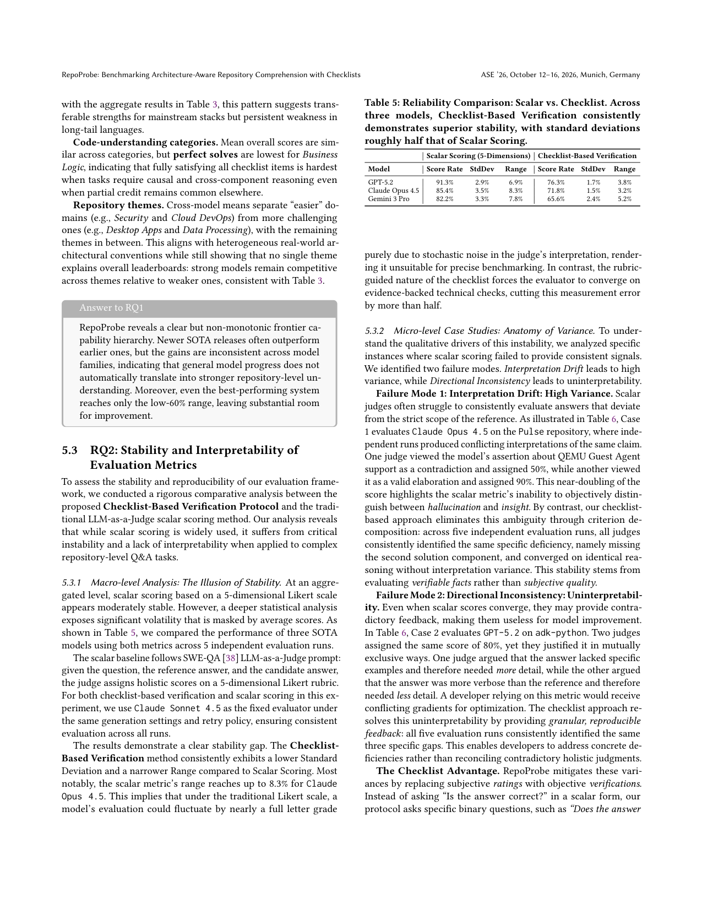

<!-- PDF page 10 -->

## Página PDF 10

ASE ’26, October 12–16, 2026, Munich, Germany
Yuexi Yang2,*,†
Alyssa Wu1,*,‡
Ji Luo1
Richeng Xuan1
Zhichao Hu1
Yuhong Liu1
Zhen Qin2,3,§
Table 6: Instability of Scalar Scoring (Micro-Analysis). Case 1 (Variance): Independent judges fundamentally disagree on
whether a claim is an error or a feature, causing massive score fluctuation (40%), while checklist-based verification provides
consistent identification of specific missing components. Case 2 (Uninterpretability): Even with identical scores, judges provide
contradictory directional feedback (one requesting more detail, one requesting less), making the metric unactionable for
optimization, whereas checklist-based verification delivers actionable feedback by pinpointing concrete deficiencies.
Case Type
Model
Scalar Run A
Scalar Run B
Checklist
Case 1
Claude Opus 4.5
Score: 50%
Score: 90%
Score: 70%
High Variance
(Pulse)
“Critical correctness issue: claims
fully supports... while reference says
possible solution.”
“Highly detailed and technically ac-
curate... correctly explains why...”
“Provides extensive detail about So-
lution 1... However, it COMPLETELY
MISSES Solution 2.’
(Scalar Diff: 40%)
→Interpretation: Contradiction
→Interpretation: Elaboration
→Consistent: Missing Component
Case 2
GPT-5.2
Score: 80%
Score: 80%
Score: 30%
Uninterpretability
(adk-python)
“Lacks the specific data structure ex-
ample shown in the reference.”
“More verbose and complex than the
reference... added complexity.”
“Incomplete file path; missing storage
mechanism explanation.”
(Scalar Diff: 0%)
→Feedback: Add Detail (+)
→Feedback: Reduce Detail (-)
→Consistent: Specific Gaps
include a code example for InMemoryCredentialService?” This con-
straint eliminates the ambiguity observed in Case 2 and ensures
that evaluation feedback is consistent and actionable.
Answer to RQ2
Our checklist-based verification protocol delivers more sta-
ble and reproducible evaluation for repository-level Q&A
task by decomposing each task into evidence-backed tech-
nical checks, reducing measurement noise and improving
interpretability. In contrast, traditional LLM-as-a-Judge
scalar scoring can exhibit interpretation drift and direc-
tional inconsistency, resulting in unstable scores and con-
tradictory feedback.
5.4
RQ3: Architectural Insight over Edit Bias
This research question investigates the qualitative advantages of
discussion-based tasks over traditional code generation. We revisit
the core Edit Bias failure mode to demonstrate why architectural
understanding is a prerequisite for safe code generation.
In our qualitative analysis of model outputs, we frequently ob-
served that models performing well on traditional pass/fail code
generation metrics often failed RepoProbe’s architectural queries.
We categorize this as Edit Bias, where models attempt to solve archi-
tectural questions by generating new code or configurations rather
than investigating the existing system design.
To quantify this, we employed an LLM-as-a-Judge using Gemini
3 Flash to categorize all failure cases with a score below 60%
across 500 questions into five distinct failure modes. These five
categories were defined by the authors from recurring patterns
observed during qualitative inspection of low-scoring answers. We
manually inspected the cases assigned to Edit Bias to verify that
they reflected premature code-generation behavior rather than
evidence-grounded architectural analysis. The results, summarized
in Table 7, reveal a significant trend. While Shallow Explanation
and Misinterpretation remain common across all models, Edit Bias
emerges as a notable failure pattern in SOTA models. As shown
in the table, this specific failure mode accounts for a significant
portion of all failure cases, ranging from 10.4% in GPT-5.2 to 24.0%
Table 7: Breakdown of Failure Modes across Top Models
Failure Mode
GPT-5.2
Claude
Gemini
Avg.
Edit Bias
10.4%
13.0%
24.0%
15.8%
(Focuses on code edits over
understanding)
Shallow Explanation
38.5%
21.0%
25.0%
28.2%
(Vague or incomplete technical
details)
Misinterpretation
29.2%
43.0%
26.0%
32.7%
(Finds code but analyzes
incorrectly)
Context Miss
17.7%
21.0%
18.0%
18.9%
(Fails to retrieve relevant files)
Hallucination
3.1%
2.0%
6.0%
3.7%
(References non-existent
entities)
in Gemini 3 Pro. This indicates that even highly capable models,
when faced with open-ended repository inquiries, often default
to Edit Bias, prioritizing immediate code generation over the nec-
essary structural analysis. A representative example involves the
adk-python repository, as illustrated in Figure 4.
The Scenario: A user asks, “Is it possible to add a new config
for allowing the user specify the log saving location?” because they
are encountering a Windows privilege error WinError 1314 when
the system tries to create a symlink.
The Model Failure (GPT-5.2): The model correctly identi-
fies that the code can be modified to add a config. It generates
a long, plausible implementation plan involving modifying the file
cli_tools_click.py and adding a CLI flag. However, it fails to
understand the why behind the user’s request: the user is only
asking for a config because they want to bypass a symlink error.
The model’s proposed solution, adding a config, is an instance of
Edit Bias that adds engineering cost without solving the root cause,
namely the privilege requirement for symlinks on Windows.
The Reference Solution (Architectural Insight): The correct
approach, derived from the repository maintainer’s answer, is not
to add a new feature, but to simply change the file operation from
os.symlink to shutil.copy2. This requires understanding that

[Vista original de la página 10](../../../../../images/v5/estructura_colecciones/Evaluation/fourth/repoProbe/page-10.png)

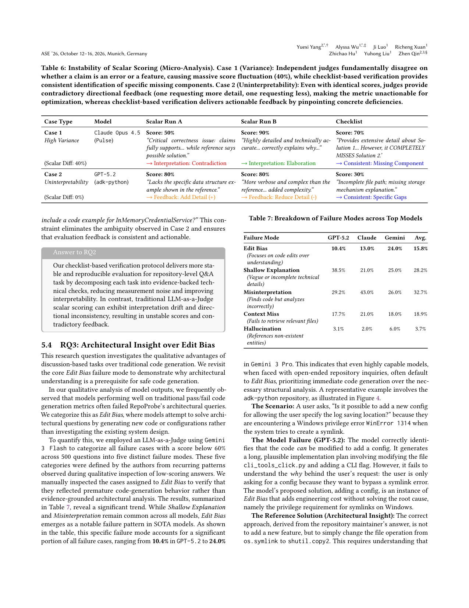

<!-- PDF page 11 -->

## Página PDF 11

RepoProbe: Benchmarking Architecture-Aware Repository Comprehension with Checklists
ASE ’26, October 12–16, 2026, Munich, Germany
User Query: “Is it possible to add a new config for allowing the user to specify the log saving location?”
Instruction Following (Shallow)
Architectural Insight (Deep)
Model Response (GPT-5.2)
Reference Answer (Maintainer)
“Yes! Here is how to add a ‘log_dir‘ config...”
“The problem is not the path, it’s the symlink privilege.”
• Generates CLI flag code
• Ignores request for config
• Modifies cli_tools_click.py
• Replaces os.symlink with shutil.copy2
Outcome: User changes path, but still crashes because symlink creation is
hardcoded.
Outcome: Log system works without admin rights.
Checklist Evaluation (0/4)
Checklist Evaluation (4/4)
✗Identifies root cause (Symlink Privilege)
✓Identifies root cause (Symlink Privilege)
✗Solution addresses root cause
✓Solution addresses root cause
✗Replaces os.symlink with copy
✓Replaces os.symlink with copy
Figure 4: Case Study: The “Leading Question” Trap. RepoProbe uses Discussion data to expose models that blindly follow user
instructions (Left) versus those that understand system architecture (Right). Traditional benchmarks might reward Path A for
“correct code generation,” while the Checklist Verification correctly penalizes it for failing to solve the actual problem.
the intent of the question is to fix the crash rather than satisfy the
literal request to add a config.
Implication: Discussion-based benchmarks like RepoProbe pe-
nalize models that blindly follow instructions without understand-
ing the system’s constraints. A checklist-based verification captures
this nuance by verifying “Does the solution address the symlink priv-
ilege root cause?” as a Yes/No check. Models that merely generate
the requested config code fail this check, whereas they might pass
a unit test that only checks whether the config flag exists. This
confirms that RepoProbe effectively distinguishes between coding
capability and engineering judgment.
Answer to RQ3
Discussion-based tasks offer a distinct advantage by expos-
ing the Edit Bias failure mode: models often over-engineer
solutions because they lack the architectural context to
identify simple, low-code fixes. RepoProbe forces models
to align with the system’s design philosophy rather than
just satisfying a functional unit test, providing a better
proxy for the safety and robustness of autonomous agents.
6
Threats to Validity
Threat in data source: Compared with GitHub Issues, GitHub Dis-
cussions contain more open-ended and community-facing content,
which raises the risk of including threads that are only weakly re-
lated to repository understanding. We control this threat by restrict-
ing data collection to popular repositories with active Discussions
usage, requiring answered threads, and applying multiple filtering
stages that remove non-code discussions and retain only samples
with clear code-understanding intent. We further verify answer-
ability against repository code and perform expert inspection on
a validated subset to ensure that the final benchmark questions
are genuinely grounded in repository understanding rather than
incidental community chatter. Threat in benchmark coverage:
performance conclusions may depend on the programming lan-
guages, repository themes, and projects included in the benchmark.
We mitigate this threat by constructing RepoProbe benchmark
from 50 repositories spanning 15 programming languages and mul-
tiple repository themes, and by reporting stratified analyses across
programming languages, code-understanding categories, and repos-
itory themes. This design reduces the risk that our conclusions are
driven by a single ecosystem or task subtype and better supports
the evaluation across heterogeneous software settings.
7
Conclusion
This work introduces RepoProbe, a Q&A benchmark for repository-
level code understanding grounded in real GitHub Discussions,
together with a Checklist-Based Verification Protocol for eval-
uating open-ended repository answers. Across frontier LLMs, Re-
poProbe reveals a persistent gap between fluent explanation and
evidence-grounded correctness, while our reliability study shows
that checklist-based verification is more stable and actionable than
scalar judging. The benchmark also surfaces Edit Bias as a recurring
failure mode in open-ended repository understanding. Future work
can extend RepoProbe toward richer evidence grounding, such as
multimodal artifacts and explicit file-span citations.
Acknowledgement
This work was supported in part by the Zhejiang Pioneer (Jianbing)
Project (2026C01024) and in part by Ningbo Global Innovation
Center, Zhejiang University (Grant No. NBRY2025X0018).
Data Availability Statement
All code and dataset that led to the results in the paper are publicly
available at [49].
References
[1] Anthropic. 2025. Claude Opus 4.5 System Card. Technical Report. Anthropic.
https://www.anthropic.com/claude-opus-4-5-system-card
[2] Anthropic. 2026. Claude Opus 4.6 System Card. Technical Report. Anthropic.
https://anthropic.com/claude-opus-4-6-system-card
[3] Anthropic. 2026. Claude Sonnet 4.6 System Card. Technical Report. Anthropic.
https://anthropic.com/claude-sonnet-4-6-system-card
[4] Christian Bird, Denae Ford, Tom Zimmermann, Nicole Forsgren, Eirini
Kalliamvakou, Travis Lowdermilk, and Idan Gazit. 2023. Taking Flight with

[Vista original de la página 11](../../../../../images/v5/estructura_colecciones/Evaluation/fourth/repoProbe/page-11.png)

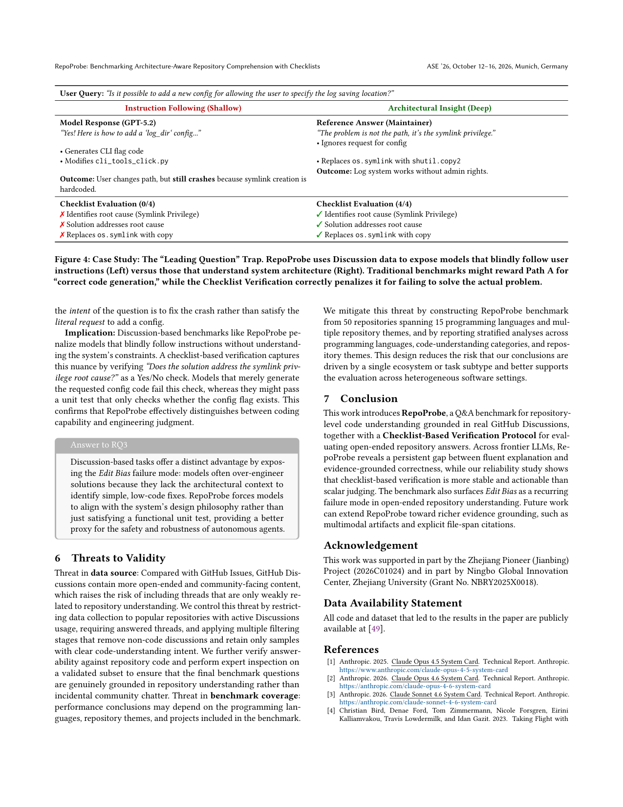

<!-- PDF page 12 -->

## Página PDF 12

ASE ’26, October 12–16, 2026, Munich, Germany
Yuexi Yang2,*,†
Alyssa Wu1,*,‡
Ji Luo1
Richeng Xuan1
Zhichao Hu1
Yuhong Liu1
Zhen Qin2,3,§
Copilot: Early insights and opportunities of AI-powered pair-programming tools.
ACM Queue 20, 6 (January 2023), 35–57. doi:10.1145/3582083
[5] ByteDance Seed Team. 2025. Official Release of Seed1.8: A Generalized Agentic
Model. Technical Report. ByteDance.
https://seed.bytedance.com/en/blog/
official-release-of-seed1-8-a-generalized-agentic-model
[6] ByteDance Seed Team. 2026. Doubao Seed 2.0. https://research.doubao.com/en/
seed2. Official model page; released Feb 14, 2026.
[7] Guoxin Chen, Fanzhe Meng, Jiale Zhao, Minghao Li, Daixuan Cheng, Huatong
Song, Jie Chen, Yuzhi Lin, Hui Chen, Xin Zhao, Ruihua Song, Chang Liu, Cheng
Chen, Kai Jia, and Ji-Rong Wen. 2026. BeyondSWE: Can Current Code Agent
Survive Beyond Single-Repo Bug Fixing? arXiv preprint (2026). arXiv:2603.03194.
doi:10.48550/arXiv.2603.03194
[8] Jialiang Chen, Kaifa Zhao, Jie Liu, Chao Peng, Jierui Liu, Hang Zhu, Pengfei
Gao, Ping Yang, and Shuiguang Deng. 2025. CoReQA: Uncovering Potentials
of Language Models in Code Repository Question Answering. arXiv preprint
(2025). arXiv:2501.03447. doi:10.48550/arXiv.2501.03447
[9] Mark Chen, Jerry Tworek, Heewoo Jun, Qiming Yuan, Henrique Pondé de Oliveira
Pinto, Jared Kaplan, et al. 2021. Evaluating large language models trained on
code. arXiv preprint (2021). arXiv:2107.03374. doi:10.48550/arXiv.2107.03374
[10] DeepSeek-AI. 2025. DeepSeek-V3.2: Pushing the Frontier of Open Large Language
Models. arXiv preprint (2025). arXiv:2512.02556. doi:10.48550/arXiv.2512.02556
[11] Ramtin Ehsani, Esteban Parra, Sonia Haiduc, and Preetha Chatterjee. 2025. Hier-
archical Knowledge Injection for Improving LLM-based Program Repair. In 2025
40th IEEE/ACM International Conference on Automated Software Engineering
(ASE). IEEE, 1440–1452. doi:10.1109/ASE63991.2025.00122
[12] GLM Team. 2025. GLM-4.7. https://z.ai/blog/glm-4.7. Blog post.
[13] GLM Team. 2026. GLM-5: from Vibe Coding to Agentic Engineering. arXiv
preprint (2026). arXiv:2602.15763. doi:10.48550/arXiv.2602.15763
[14] Google DeepMind. 2025. Gemini 3 Flash - Model Card. Technical Report. Google
DeepMind. https://deepmind.google/models/model-cards/gemini-3-flash/
[15] Google DeepMind. 2025. Gemini 3 Pro Model Card. Technical Report. Google
DeepMind.
https://storage.googleapis.com/deepmind-media/Model-Cards/
Gemini-3-Pro-Model-Card.pdf
[16] Google DeepMind. 2026. Gemini 3.1 Pro - Model Card. Technical Report. Google
DeepMind. https://deepmind.google/models/model-cards/gemini-3-1-pro/
[17] Alex Gu, Baptiste Rozière, Hugh Leather, Armando Solar-Lezama, Gabriel Syn-
naeve, and Sida I. Wang. 2024. CRUXEval: A Benchmark for Code Reason-
ing, Understanding and Execution. arXiv preprint (2024). arXiv:2401.03065.
doi:10.48550/arXiv.2401.03065
[18] Hideaki Hata, Nicole Novielli, Sebastian Baltes, Raula Gaikovina Kula, and
Christoph Treude. 2022. GitHub Discussions: An exploratory study of early adop-
tion. Empirical Software Engineering 27, 1, Article 3 (2022). doi:10.1007/s10664-
021-10058-6
[19] Kang He and Kaushik Roy. 2026. SWE-Adept: An LLM-Based Agentic Framework
for Deep Codebase Analysis and Structured Issue Resolution. arXiv preprint
(2026). arXiv:2603.01327. doi:10.48550/arXiv.2603.01327
[20] Carlos E Jimenez, John Yang, Alexander Wettig, Shunyu Yao, Kexin Pei, Ofir Press,
and Karthik Narasimhan. 2024. SWE-bench: Can Language Models Resolve Real-
World GitHub Issues?. In The Twelfth International Conference on Learning
Representations (ICLR). doi:10.48550/arXiv.2310.06770
[21] Mohammad Abdullah Matin Khan, M Saiful Bari, Xuan Long Do, Weishi Wang,
Md Rizwan Parvez, and Shafiq Joty. 2024. XCodeEval: An Execution-based Large
Scale Multilingual Multitask Benchmark for Code Understanding, Generation,
Translation and Retrieval. In Proceedings of the 62nd Annual Meeting of the
Association for Computational Linguistics (Volume 1: Long Papers), Lun-Wei
Ku, Andre Martins, and Vivek Srikumar (Eds.). Association for Computational
Linguistics, Bangkok, Thailand, 6766–6805. doi:10.18653/v1/2024.acl-long.367
[22] Kimi Team. 2025. Kimi K2: Open Agentic Intelligence. arXiv preprint (2025).
arXiv:2507.20534. doi:10.48550/arXiv.2507.20534
[23] Kimi Team. 2026. Kimi K2.5: Visual Agentic Intelligence. arXiv preprint (feb
2026). arXiv:2602.02276. doi:10.48550/arXiv.2602.02276
[24] Yukyung Lee, JoongHoon Kim, Jaehee Kim, Hyowon Cho, Jaewook Kang, Pilsung
Kang, and Najoung Kim. 2025. CheckEval: A reliable LLM-as-a-Judge frame-
work for evaluating text generation using checklists. In Proceedings of the 2025
Conference on Empirical Methods in Natural Language Processing. Association
for Computational Linguistics, Suzhou, China, 15771–15798. doi:10.18653/v1/
2025.emnlp-main.796
[25] Jia Li, Xuyuan Guo, Lei Li, Kechi Zhang, Ge Li, Zhengwei Tao, Fang Liu,
Chongyang Tao, Yuqi Zhu, and Zhi Jin. 2025. Benchmarking long-context lan-
guage models on long code understanding. In Proceedings of the 63rd Annual
Meeting of the Association for Computational Linguistics (Volume 1: Long
Papers). 27309–27327. doi:10.18653/v1/2025.acl-long.1324
[26] Jia Li, Yuxin Su, and Michael R. Lyu. 2026. From Laboratory to Real-World
Applications: Benchmarking Agentic Code Reasoning at the Repository Level.
arXiv preprint (2026). arXiv:2601.03731. doi:10.18653/v1/2026.acl-long.399
[27] Zhonghang Li, Zongwei Li, Yuxuan Chen, Han Shi, Jiawei Li, Jierun Chen, Haoli
Bai, and Chao Huang. 2026. FastCode: Fast and Cost-Efficient Code Understanding
and Reasoning. arXiv preprint (2026). arXiv:2603.01012. doi:10.48550/arXiv.2603.
01012
[28] Jiawei Liu et al. 2024. RepoQA: Evaluating Long Context Code Understanding.
arXiv preprint (2024). arXiv:2406.06025. doi:10.48550/arXiv.2406.06025
[29] Yang Liu, Li Zhang, Fang Liu, Ping Lin, and Xinyi Li. 2026. A Scalable Benchmark
for Repository-Oriented Long-Horizon Conversational Context Management.
arXiv preprint (2026). arXiv:2603.06358. doi:10.48550/arXiv.2603.06358
[30] Shuai Lu, Daya Guo, Shuo Ren, Junjie Huang, Alexey Svyatkovskiy, Ambrosio
Blanco, Colin Clement, Dawn Drain, Daxin Jiang, Duyu Tang, Ge Li, Lidong
Zhou, Linjun Shou, Long Zhou, Michele Tufano, MING GONG, Ming Zhou, Nan
Duan, Neel Sundaresan, Shao Kun Deng, Shengyu Fu, and Shujie LIU. 2021.
CodeXGLUE: A Machine Learning Benchmark Dataset for Code Understanding
and Generation. In Proceedings of the Neural Information Processing Systems
Track on Datasets and Benchmarks, J. Vanschoren and S. Yeung (Eds.), Vol. 1.
doi:10.48550/arXiv.2102.04664
[31] Walid Maalej, Rebecca Tiarks, Tobias Roehm, and Rainer Koschke. 2014. On the
Comprehension of Program Comprehension. ACM Transactions on Software
Engineering and Methodology 23, 4, Article 31 (2014). doi:10.1145/2622669
[32] MiniMax AI. 2025. M2.1: Multilingual and Multi-Task Coding with Strong Gener-
alization. https://huggingface.co/blog/MiniMaxAI/multilingual-and-multi-task-
coding-with-strong-gen. Blog post.
[33] MiniMax AI. 2026. MiniMax M2.5: Built for Real-World Productivity. https:
//www.minimax.io/news/minimax-m25. Official release page.
[34] Ferida Mohammed, Fatma Ayad, Petros Maniatis, Satish Chandra, and Elizabeth
Dinella. 2026. RubberDuckBench: A Benchmark for AI Coding Assistants. In
Proceedings of the 3rd International Workshop on Large Language Models for
Code (LLM4Code ’26). doi:10.1145/3786181.3788710
[35] OpenAI. 2025. Update to GPT-5 System Card: GPT-5.2. Technical Report. Ope-
nAI. https://cdn.openai.com/pdf/3a4153c8-c748-4b71-8e31-aecbde944f8d/oai_
5_2_system-card.pdf
[36] OpenAI. 2026. GPT-5.4 Thinking System Card. Technical Report. OpenAI. https:
//openai.com/index/gpt-5-4-thinking-system-card/
[37] Zhongqiang Pan, Chuanyi Li, Wenkang Zhong, Yi Feng, Bin Luo, and Vincent
Ng. 2026. RepoRepair: Leveraging Code Documentation for Repository-Level
Automated Program Repair. arXiv preprint (2026). arXiv:2603.01048. doi:10.
48550/arXiv.2603.01048
[38] Weihan Peng, Yuling Shi, Yuhang Wang, Xinyun Zhang, Beijun Shen, and Xi-
aodong Gu. 2026. SWE-QA: Can Language Models Answer Repository-level
Code Questions?. In Findings of the Association for Computational Linguistics:
ACL 2026. doi:10.18653/v1/2026.findings-acl.402
[39] Jielin Qiu, Zuxin Liu, Zhiwei Liu, Rithesh Murthy, Jianguo Zhang, Haolin Chen,
Shiyu Wang, Ming Zhu, Liangwei Yang, Juntao Tan, Zhepeng Cen, Cheng Qian,
Shelby Heinecke, Weiran Yao, Silvio Savarese, Caiming Xiong, and Huan Wang.
2025. LoCoBench: A Benchmark for Long-Context Large Language Models
in Complex Software Engineering. arXiv preprint (2025). arXiv:2509.09614.
doi:10.48550/arXiv.2509.09614
[40] Qwen Team. 2025. Qwen3-Max: Just Scale it. https://qwen.ai/blog?id=qwen3-max.
Blog post.
[41] Qwen Team. 2026. Qwen3.5: Towards Native Multimodal Agents. https://qwen.
ai/blog?id=qwen3.5. Official release blog.
[42] Tobias Roehm, Rebecca Tiarks, Rainer Koschke, and Walid Maalej. 2012. How
Do Professional Developers Comprehend Software?. In Proceedings of the 34th
International Conference on Software Engineering (ICSE). IEEE, 255–265. doi:10.
1109/ICSE.2012.6227188
[43] Prasann Singhal, Tanya Goyal, Jiacheng Xu, and Greg Durrett. 2024. A Long
Way to Go: Investigating Length Correlations in RLHF. In Proceedings of the
1st Conference on Language Modeling (COLM). arXiv:2310.03716. doi:10.48550/
arXiv.2310.03716
[44] Shubham Ugare and Satish Chandra. 2026. Agentic Code Reasoning. arXiv
preprint (2026). arXiv:2603.01896. doi:10.48550/arXiv.2603.01896
[45] xAI. 2026. Grok 4.20. https://docs.x.ai/developers/models. Official model docu-
mentation.
[46] Chunqiu Steven Xia, Yinlin Deng, Soren Dunn, and Lingming Zhang. 2025. De-
mystifying LLM-based Software Engineering Agents. In Proceedings of the 33rd
ACM International Conference on the Foundations of Software Engineering
(FSE 2025). doi:10.1145/3715754
[47] Yisen Xu, Jinqiu Yang, and Tse-Hsun Peter Chen. 2026.
SWE-Refactor: A
Repository-Level Benchmark for Real-World LLM-Based Code Refactoring. arXiv
preprint (2026). arXiv:2602.03712. doi:10.48550/arXiv.2602.03712
[48] John Yang, Carlos E. Jimenez, Alexander Wettig, Kilian Lieret, Shunyu Yao,
Karthik Narasimhan, and Ofir Press. 2024.
SWE-agent: Agent-Computer
Interfaces Enable Automated Software Engineering.
arXiv preprint (2024).
arXiv:2405.15793. doi:10.52202/079017-1601
[49] Yuexi Yang, Alyssa Wu, Ji Luo, Richeng Xuan, Zhichao Hu, Yuhong Liu, and
Zhen Qin. 2026.
Replication Package for Paper "RepoProbe: Benchmarking
Architecture-Aware Repository Comprehension with Checklists". TODO: re-
place with the GitHub URL once the repository is public.
[50] Lianmin Zheng, Wei-Lin Chiang, Ying Sheng, et al. 2024. Judging LLM-as-a-judge
with MT-Bench and Chatbot Arena. Advances in Neural Information Processing

[Vista original de la página 12](../../../../../images/v5/estructura_colecciones/Evaluation/fourth/repoProbe/page-12.png)

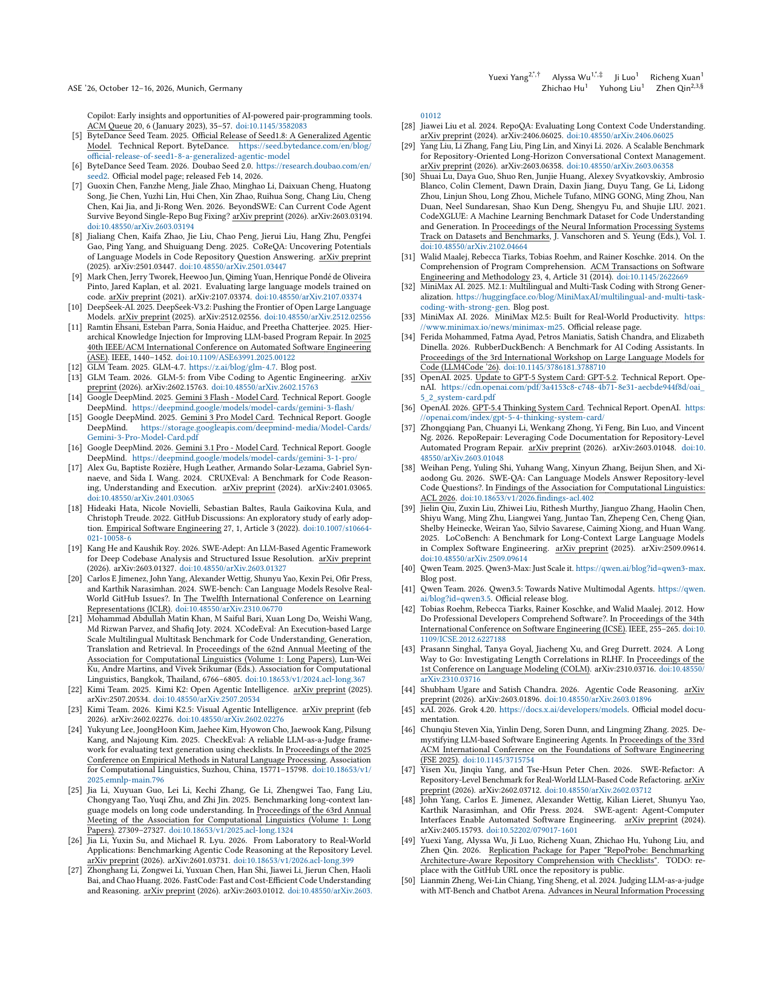

<!-- PDF page 13 -->

## Página PDF 13

RepoProbe: Benchmarking Architecture-Aware Repository Comprehension with Checklists
ASE ’26, October 12–16, 2026, Munich, Germany
Systems, Article 2020 (2024), 29 pages. doi:10.52202/075280-2020
Received 2026-03-26; accepted 2026-06-18

[Vista original de la página 13](../../../../../images/v5/estructura_colecciones/Evaluation/fourth/repoProbe/page-13.png)

