# DevEval

- source_pdf: ../../../../../pdf/Evaluation/primary/DevEval.pdf
- extraction_tool: PyMuPDF
- extraction_date: 2026-11-24
- status: automatic-text-extraction; not manually verified
- pagination: physical PDF pages, starting at 1

> Copia de trabajo para búsqueda y citas. Verifica tablas, fórmulas, figuras y orden visual en el PDF original o en el PNG de la página.

<!-- PDF page 1 -->

## Página PDF 1

Findings of the Association for Computational Linguistics: ACL 2024, pages 3603–3614
August 11-16, 2024 ©2024 Association for Computational Linguistics
DevEval: A Manually-Annotated Code Generation Benchmark Aligned
with Real-World Code Repositories
Jia Li ♂1,2, Ge Li1,2∗, Yunfei Zhao1,2, Yongmin Li1,2, Huanyu Liu1,2, Hao Zhu1,2, Lecheng Wang1,2
Kaibo Liu1,2, Zheng Fang1,2, Lanshen Wang1,2, Jiazheng Ding1,2, Xuanming Zhang1,2
Yuqi Zhu1,2, Yihong Dong1,2, Zhi Jin1,2, Binhua Li3, Fei Huang3, Yongbin Li3∗, Bin Gu4, Mengfei Yang5
1School of Computer Science, Peking University
2Key Laboratory of High Confidence Software Technologies (Peking University), Ministry of Education
3Alibaba Group 4Beijing Institute of Control Engineering 5China Academy of Space Technology
lijia@stu.pku.edu.cn, lige@pku.edu.cn, shuide.lyb@alibaba-inc.com
Abstract
How to evaluate the coding abilities of Large
Language Models (LLMs) remains an open
question. We find that existing benchmarks
are poorly aligned with real-world code reposi-
tories and are insufficient to evaluate the coding
abilities of LLMs.
To address the knowledge gap, we propose a
new benchmark named DevEval, which has
three advances. ❶DevEval aligns with real-
world repositories in multiple dimensions, e.g.,
code and dependency distributions. ❷DevE-
val is annotated by 13 developers and contains
comprehensive annotations (e.g., requirements,
original repositories, reference code, and ref-
erence dependencies). ❸DevEval comprises
1,825 testing samples from 115 repositories,
covering 10 popular domains (e.g., Internet,
Database). Based on DevEval, we propose
repository-level code generation and evalu-
ate 8 popular LLMs on DevEval (e.g., gpt-4,
gpt-3.5, StarCoder 2, DeepSeek Coder, CodeL-
LaMa). Our experiments reveal these LLMs’
coding abilities in real-world code repositories.
For example, the highest Pass@1 of gpt-4
only is 53.04% in our experiments. We also
analyze LLMs’ failed cases and summarize
their shortcomings. We hope DevEval can fa-
cilitate the development of LLMs in real code
repositories. DevEval, prompts, and LLMs’
predictions have been released1.
1
Introduction
Code generation with Large Language Models
(LLMs) has attracted lots of researchers’ attention
(Guo et al., 2024; Rozière et al., 2023; Lozhkov
et al., 2024), and some commercial products have
been produced, e.g., GitHub Copilot (GitHub,
2023). With more and more LLMs emerging, how
to evaluate LLMs on code generation remains an
open question.
*Corresponding authors
1https://github.com/seketeam/DevEval
# imapclient.IMAPClient.namespace
def namespace(self): 
data = self._command_and_check(“namespace”)
parts = []
for item in parse_response(data):
(more lines . . )
for prefix, separator in item:
if self.folder_encode:
prefix = decode_utf7(prefix)
converted.append((prefix, to_unicode)
parts.append(tuple(converted))
return Namespace(*parts)
def has_close_elements(numbers, threshold):
for idx, elem in enumerate(numbers):
for idx2, elem2 in enumerate(numbers):
if idx != idx2:
distance = abs(elem - elem2)
if distance < threshold:
return True
return False
(a) A standalone function in HumanEval
(b) A non-standalone function in a real-world project
Figure 1: Examples of standalone and non-standalone
functions. Dependencies are highlighted, i.e., yellow:
intra-class dependencies, green: intra-file dependencies,
and blue: cross-file dependencies.
Existing benchmarks are mainly composed
of hand-crafted programming problems and are
poorly aligned with real-world code repositories.
LLMs’ performance on these benchmarks is incon-
sistent with developers’ actual experiences in real-
world software development. Thus, a benchmark
aligned with real-world repositories is necessary.
We analyze over 1 million functions from 500 real-
world repositories (see Section 3) and think a good
benchmark should satisfy the following features.
• Real-world Repository. The benchmark should
be collected from real-world code repositories
(Yu et al., 2023).
• Real Code Distribution. Real-world reposito-
ries comprise two types of code, i.e., standalone
and non-standalone code. As shown in Figure 1,
a standalone function solely uses built-in or pub-
lic libraries, while a non-standalone one contains
3603

[Vista original de la página 1](../../../../../images/v5/estructura_colecciones/Evaluation/primary/DevEval/page-01.png)

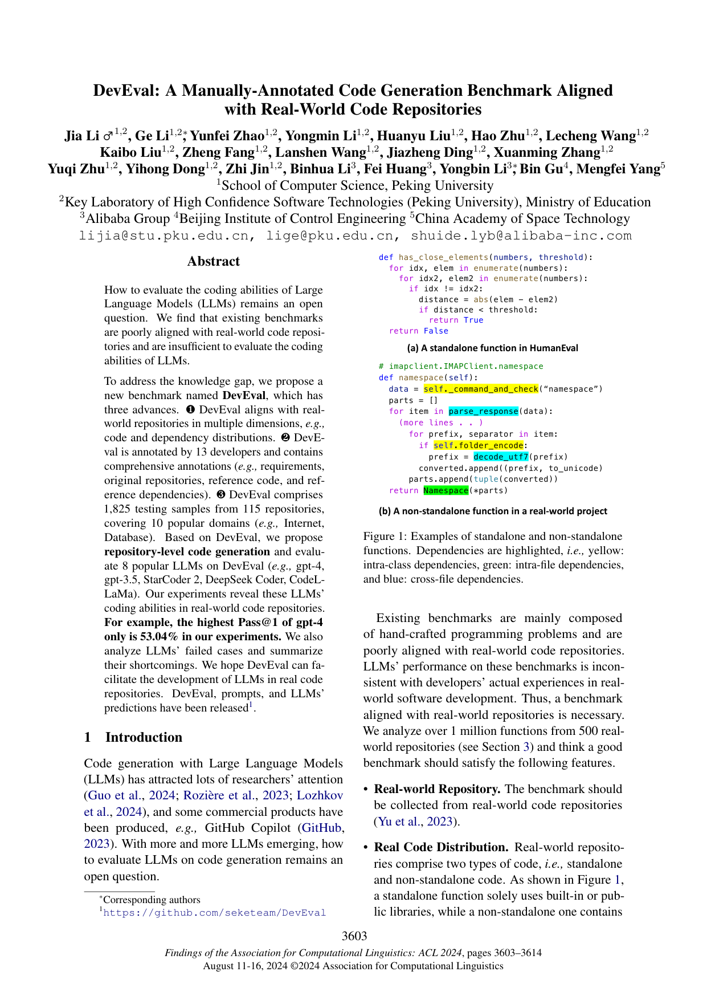

<!-- PDF page 2 -->

## Página PDF 2

Table 1: The comparison between existing benchmarks and DevEval.
Benchmark
Real Repo.
Real Code Distribution
Comprehensive Annota.
Robust Metric
CoNaLA (Yin et al., 2018)
é
é
é
é
Concode (Iyer et al., 2018)
Ë
é
é
é
HumanEval (Chen et al., 2021)
é
é
é
é
MBPP (Austin et al., 2021)
é
é
é
é
APPS (Hendrycks et al., 2021)
é
é
é
é
PandasEval (Zan et al., 2022)
é
é
é
é
NumpyEval (Zan et al., 2022)
é
é
é
é
AixBench (Li et al., 2023b)
Ë
é
é
é
ClassEval (Du et al., 2023)
é
é
é
é
CoderEval (Yu et al., 2023)
Ë
é
é
Ë
DevEval (Ours)
Ë
Ë
Ë
Ë
context-aware dependencies (i.e., invocations of
code elements defined in current repositories).
The benchmark should cover both types of code
and ensure their ratios are realistic. The number
of dependencies should also be consistent with
real-world repositories.
• Comprehensive Annotations. The benchmark
can offer comprehensive annotations, including
natural language requirements, original reposito-
ries, and ground truths (code and dependencies).
• Robust Evaluation Metrics. The benchmark
should provide execution-based metrics (e.g.,
Pass@k) evaluate functional correctness of pro-
grams and metrics to assess the accuracy of de-
pendencies in programs.
However, as shown in Table 1, none of the existing
benchmarks satisfies all aforementioned features.
The problem hinders the evaluation and develop-
ment of LLMs in the real development process.
To address the above problem, we propose
a new code generation benchmark named De-
vEval, which aligns with real-world code repos-
itories. As shown in Table 1, DevEval satisfies
the above features. ❶DevEval comprises 1,825
testing samples from 115 real-world repositories,
which cover 10 popular domains (e.g., Internet,
Database). ❷DevEval is constructed through a
rigorous pipeline and aligns with real-world repos-
itories. Specifically, the distributions of code and
dependencies in DevEval are consistent with the
ones in 500 real-world repositories. Detailed statis-
tics are in Section 2.4. ❸DevEval is annotated by
13 developers and contains comprehensive annota-
tions, e.g., detailed requirements, original reposi-
tories, reference code, and reference dependencies.
❹DevEval leverages test cases to check models’
predictions and report Pass@k. It also proposes
Recall@k to evaluate the dependencies in predic-
tions.
Based on DevEval, we propose repository-level
code generation, which simulates the developers’
coding process in a working repository. The task
asks models to write the code based on require-
ments and a complete repository.
We evaluate 8 popular LLMs (i.e., gpt-4 (Ope-
nAI, 2023b), gpt-3.5 (OpenAI, 2023a), DeepSeek
Coder (Guo et al., 2024), StarCoder 2 (Lozhkov
et al., 2024), CodeLLaMa (Rozière et al., 2023)).
These LLMs exhibit low performance on DevE-
val, especially compared to their performance on
previous benchmarks. For example, gpt-4-turbo-
1106 achieves a Pass@1 score of 80% on Hu-
manEval, while its highest Pass@1 on DevE-
val is only 53.04%. Our results reveal the coding
abilities of these LLMs in real-world repositories.
We further analyze failed cases and summarize the
shortcomings of existing LLMs in DevEval.
In summary, our contributions are as follows:
• We summarize four features (see Table 1) that a
code generation benchmark for real-world repos-
itories should satisfy.
• We propose a new code generation benchmark
- DevEval, satisfying the above features. The
benchmark has been released.
• We propose repository-level code generation,
which provides a challenging and realistic evalu-
ation scenario.
• We evaluate 8 popular LLMs on DevEval, an-
alyzing their strengths and shortcomings in
repository-level code generation.
3604

[Vista original de la página 2](../../../../../images/v5/estructura_colecciones/Evaluation/primary/DevEval/page-02.png)

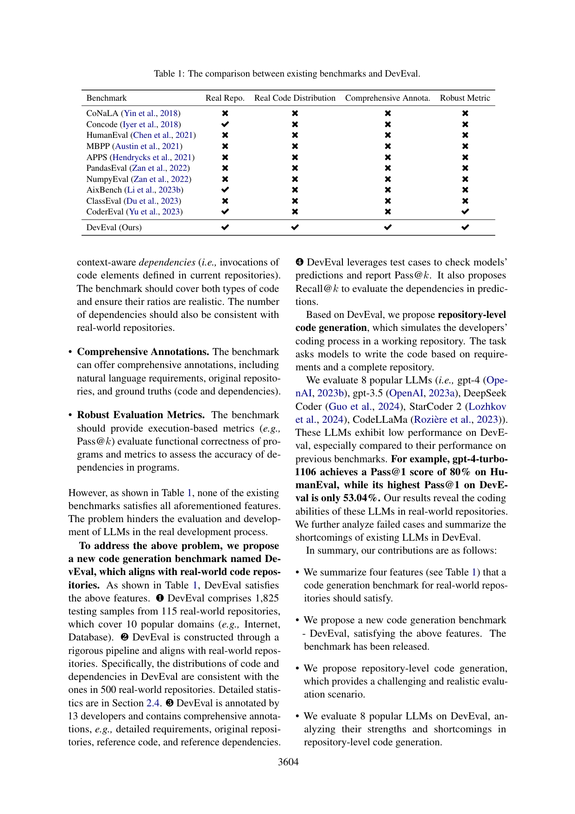

<!-- PDF page 3 -->

## Página PDF 3

import functools
import imaplib
...
class Namespace(tuple):
...
class SocketTimeout(…):
...
class MailboxQuotaRoots(…):
...
class Quota(…):
...
def require_capability(…):
...
Intra-class Dependency:
imapclient.py::IMAPClient::_command_and_check
imapclient.py::IMAPClient::folder_encode
Intra-file Dependency:
imapclient.py::Namespace
Cross-file Dependency:
imap_utf7.py::decode_utf7
response_parser.py::parse_response
def test_namespace(self):
self.set_return(b'(("&AP8-." "/")) NIL NIL‘)
self.assertEqual(self.client.namespace(), ((("\xff.", "/"),), None, None))
. . . .
def namespace(self):
“””Return the namespace for the IMAP account as a tuple of three 
elements: personal, other, and shared. The function should send the
namespace command to the server and receive the response. Then, it
parses the response and converts it into the desired format.
:param self: IMAPClient, an instance of the IMAPClient class.
:return: Namespace. The namespace for the account as a tuple of 
three elements. Each element may be None if no namespace of that type 
exists, or a sequence of (prefix, separator) pairs. ""”
data = self._command_and_check("namespace")
parts = []
for item in parse_response(data):
if item is None:
parts.append(item)
else:
converted = []
for prefix, separator in item:
if self.folder_encode:
prefix = decode_utf7(prefix)
converted.append((prefix, to_unicode(separator)))
parts.append(tuple(converted))
return Namespace(*parts)
DevEval Benchmark
Stats: A code generation benchmark contains 1,825 samples.
Evaluation Task: Repository-level Code Generation: ①②③→④
Evaluation Metrics: Pass@k (functional correctness, label: ⑥), Recall@k (recall of reference dependencies, label: ⑤)
①Signature
②Requirement
④Reference Code
③Repository
⑤Reference
Dependency
⑥Test cases
Figure 2: An overview of DevEval. Each sample consists of six components.
We hope DevEval can align with the actual ex-
periences of developers during the practical devel-
opment process. By DevEval, practitioners can
pick up superior LLMs and facilitate the applica-
tion of code generation techniques in real-world
repositories.
2
Benchmark - DevEval
2.1
Overview
DevEval contains 1,825 samples derived from 115
real-world code repositories. As shown in Figure 2,
each sample consists of six components. ❶Func-
tion Signature: The signature of the target code.
❷Requirement: An English description detailing
the functionality of the target code. ❸Repository
Contexts: Code contexts (e.g., classes, functions,
variables) defined outside the target code in the cur-
rent repository. ❹Reference Code: A developer-
written implementation of the target code. This
code may invoke dependencies defined in the cur-
rent repository. ❺Reference Dependency: The
dependencies invoked in the reference code include
intra-class, intra-file, and cross-file dependencies.
❻Test Cases: Test cases are used to check the
functional correctness of the code.
2.2
Task Definition
Based on DevEval, we propose repository-level
code generation task. A model is given a function
signature, a requirement, and a complete repository.
The model is asked to output a function to satisfy
the requirement. We then insert the function into
its repository and check its correctness.
2.3
Evaluation Metrics
Pass@k (Functional Correctness). Following pre-
vious studies (Chen et al., 2021; Austin et al., 2021;
Yu et al., 2023), we assess the functional correct-
ness of programs by executing test cases and com-
pute the unbiased Pass@k. Specifically, we gen-
erate n ≥k programs per requirement, count the
number of correct programs c ≤n that pass test
cases, and calculate the Pass@k:
Pass@k :=
E
Requirements

1 −
 n −c
k

 n
k



(1)
Recall@k (Recall of Reference Dependency).
Besides the functional correctness, we expect
LLMs to invoke relevant dependencies defined in
contexts. Hence, we propose Recall@k, which
3605

[Vista original de la página 3](../../../../../images/v5/estructura_colecciones/Evaluation/primary/DevEval/page-03.png)

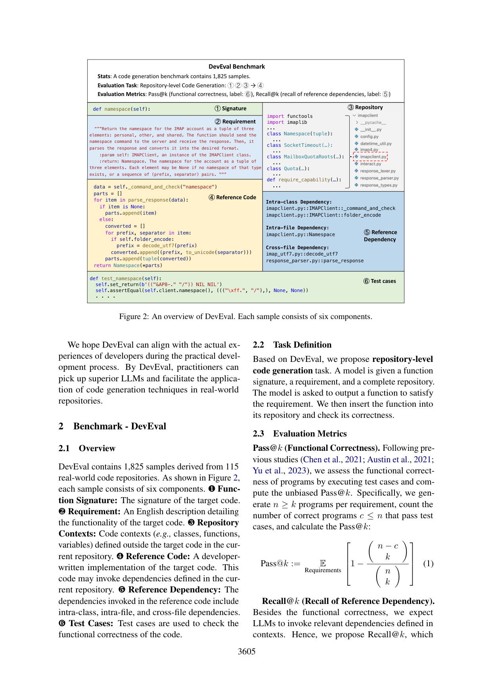

<!-- PDF page 4 -->

## Página PDF 4

Table 2: The comparison between popular code generation benchmarks and DevEval. SA: Standalone. L(Re): the
average lengths (tokens) of requirements.
Benchmark
Code Distribution
Dependency
Repository’s Scale
#L(Re)
#Repo
#Total
SA (%)
Non-SA (%)
#Type
#Total
#Per Sample
Path
#File
#Line
CoNaLA (Yin et al., 2018)
–
500
100%
0%
0
0
0
0
0
13.1
HumanEval (Chen et al., 2021)
–
164
100%
0%
0
0
0
0
0
58.8
MBPP (Austin et al., 2021)
–
974
100%
0%
0
0
0
0
0
16.1
PandasEval (Zan et al., 2022)
–
101
100%
0%
0
0
0
0
0
29.7
NumpyEval (Zan et al., 2022)
–
101
100%
0%
0
0
0
0
0
30.5
AixBench (Li et al., 2023b)
–
175
100%
0%
0
0
0
0
0
34.5
ClassEval (Du et al., 2023)
–
100
100%
0%
0
0
0
0
0
–
Concode (Iyer et al., 2018)
–
2,000
20%
80%
1
2,455
1.23
0
0
16.8
CoderEval (Yu et al., 2023)
43
230
36%
64%
3
256
1.73
71
14,572
41.5
DevEval
115
1,825
27%
73%
3
4,448
3.36
164
36,640
101.6
500 Real-world Repos
500
1M
27%
73%
3
3M
3.22
–
238
46,313
–
Table 3: The distribution of dependency types. The
values in parentheses are the corresponding percentages
in all dependencies.
Dependency
Type
HumanEval
Concode
CoderEval
DevEval
500 Projects
Intra-class
0
2,455 (100%)
117 (46%)
1,714 (39%)
939k (42%)
Intra-file
0
0
90 (35%)
1,406 (31%)
597k (29%)
Cross-file
0
0
49 (19%)
1,328 (30%)
611k (30%)
gauges the recall of reference dependencies in gen-
erated programs.
Specifically, LLMs generate k programs per re-
quirement. For the i-th program, we employ a
parser2 to extract its dependencies as Pi. Subse-
quently, we compare Pi with reference dependen-
cies R and compute the Recall@k:
Recall@k :=
E
Requirements

max
i∈[1,k]
|R ∩Pi|
|R|

(2)
where | · | means the number of elements of a set.
2.4
Features of DevEval
Compared to existing benchmarks, DevEval shows
three unique advances, which we discuss below.
❶Alignment with real-world code reposito-
ries. Table 2 shows the data distributions of exist-
ing benchmarks and DevEval. We also show the
data distributions of 500 real-world repositories
and consider them as the oracle. We can see that
DevEval aligns with 500 real repositories in multi-
ple aspects, i.e., code distributions, the number of
dependencies, and the scale of repositories. Table 3
further shows the distribution of dependency types,
i.e., intra-class, intra-file, and cross-file dependen-
cies. DevEval outperforms previous benchmarks
in all types, showing a distribution that is close to
the distribution in 500 real repositories.
2We develop the parser based on an open-source static
analysis tool - Pyan (Pyan, 2023).
❷Comprehensive Annotations. As shown in
Figure 2, DevEval provides comprehensive anno-
tations that are labeled by 13 human developers.
Particularly, DevEval has advantages in require-
ments and reference dependencies.
Requirements. Original code comments in repos-
itories are often vague and are different from re-
quirements in practice (GitHub, 2023). We en-
gaged 13 developers to write requirements, costing
approximately 674 person-hours manually. As de-
picted in Figure 2, each requirement encapsulates
the code’s functionality and input-output param-
eters. The average length of requirements in De-
vEval (101.6 tokens) more than doubles that of
CoderEval (41.5 tokens). Reference Dependencies.
Previous benchmarks (i.e., CoderEval, ClassEval)
only provide dependencies’ names (e.g., close).
Because many functions have the same name in
practice, it is hard to identify whether generated
dependencies are correct by relying on names.
DevEval annotates dependencies with paths (e.g.,
A.py::ClassB::close), addressing ambigu-
ity and biases. These annotations offer a broad
arena to explore repository-level code generation
and evaluation.
❸A realistic task and evaluation metrics. Tra-
ditional benchmarks fall into a simple requirement-
to-code task. In contrast, DevEval proposes a more
realistic task - repository-level code generation.
This task simulates the coding process of devel-
opers in a working repository. Besides, we design
two metrics to comprehensively assess the correct-
ness of generated programs in functionality and
dependencies.
❹Wide scope for research communities. The
DevEval and repository-level code generation can
serve as an arena to compare approaches ranging
from retrieval and long-context models to decision-
3606

[Vista original de la página 4](../../../../../images/v5/estructura_colecciones/Evaluation/primary/DevEval/page-04.png)

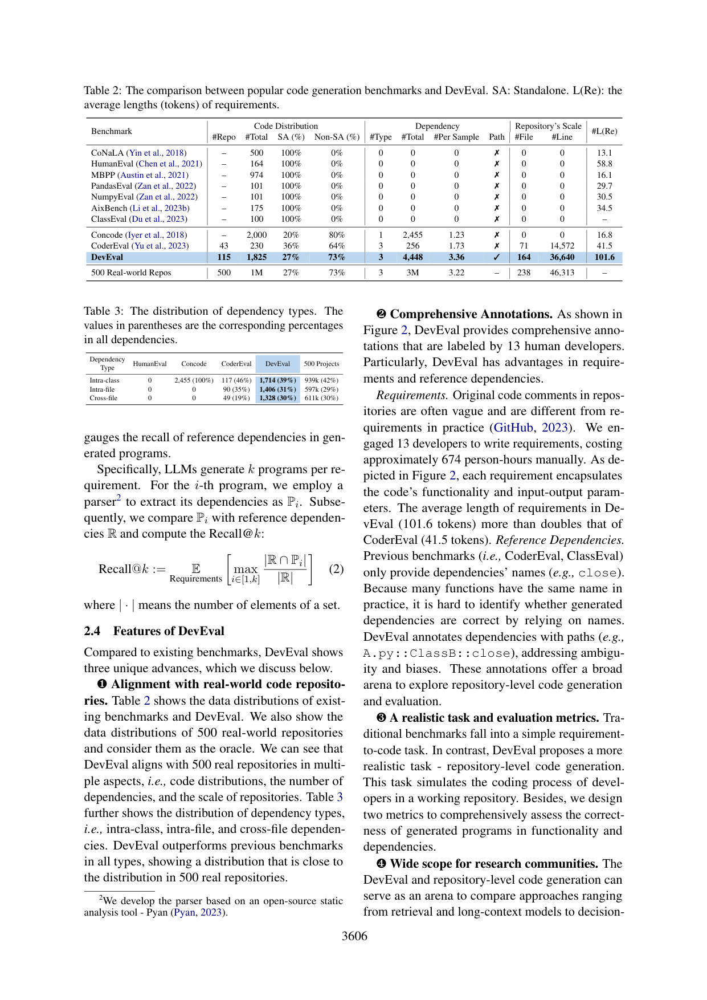

<!-- PDF page 5 -->

## Página PDF 5

①Repository
Selection
PyPI
500 Repositories, 1 million+ Functions
68 Repositories, 590k Functions
②Function Parse
37 Repositories, 3,764 Functions
③Tests
Construction
121 Repositories, 2,846 Functions
④Requirement
Annotation
Signature, Reference Code, Repository
Test Cases
Requirement, Reference Dependency
115 Repositories, 1,825 Functions
⑤Benchmark
Construction
DevEval
Figure 3: The process of collecting DevEval.
making agents. DevEval also allows creative free-
dom, as models can generate diverse programs to
meet requirements.
3
Benchmark Construction
As shown in Figure 3, the collection of DevEval
consists of five stages.
Stage ❶: Repository Selection. PyPI (PyPI) is
a rich data source for real code repositories. We
identify the top 10 popular programming topics
in PyPI and select the top 50 repositories under
each topic. The selection follows three criteria:
open-source licenses, non-fork and non-malicious
repositories, and explicit unit tests. We download
the latest released versions in November 2023 and
finally obtain 500 practical projects (10 topics * 50
projects).
Stage ❷: Function Parse. We extract functions
from 500 repositories and exclude trivial functions
(i.e., empty or initialization functions). We extract
each function’s signature and function body (i.e.,
reference code). The other programs with current
repositories are considered as repository contexts.
Finally, this stage obtain 590,365 candidate func-
tions.
Stage ❸: Tests Construction.
We extract
test cases from repositories invoking specific can-
didate functions. We use a public framework -
setuptools to automatically install running en-
vironments and run test cases with a popular testing
framework - Pytest. Candidate functions with-
out executable test cases are excluded. Meanwhile,
we ensure our test cases succeed in the reference
code and fail in the wrong programs. Finally, we
retain 3,764 candidate functions.
Table 4: Studied LLMs in this paper. Context L.: Con-
text Window.
Type
Name
Version
Context W.
Closed-source
gpt-4
gpt-4-turbo-1106
128,000
gpt-3.5
gpt-3.5-turbo-1106
16,385
Open-source
StarCoder 2
15B
16,384
StarCoder 2
7B
16,384
DeepSeek Coder
33B
16,384
DeepSeek Coder
6.7B
16,384
CodeLLaMa
13B
16,384
CodeLLaMa
7B
16,384
Stage ❹: Human Annotation. We engaged 13
developers to manually annotate requirements and
reference dependencies for each candidate function.
Given their countries of residence, all annotators
obtain adequate payments.
Through discussions with annotators, we estab-
lish two criteria for requirements. Naturalness–
ensuring the requirement reads like a natural de-
scription from the perspective of a real-world devel-
oper. Functionality–demanding clear descriptions
of the code’s purposes and input-output parame-
ters. Each requirement undergoes a dual-annotation
process, with one annotator assigned to its initial
drafting and another responsible for a meticulous
double-check. Trivial functions (e.g., shortcut func-
tions) and functions violating the ethical code (e.g.,
malware) are excluded. Subsequently, the same 13
annotators review the reference code and label its
reference dependencies. Finally, we retain 2,846
functions with high-quality requirements and refer-
ence dependencies.
Stage ❺: Benchmark Construction. We select
candidate functions to construct based on two crite-
ria: consistent with the data distribution of 500 real-
world repositories and including as many functions
as possible. Finally, we select 1,323 (73%) non-
standalone functions and 502 (27%) standalone
functions to construct DevEval.
4
Experiments
4.1
Studied LLMs
As shown in Table 4, we evaluate 8 popular LLMs,
including two closed-source models and six open-
source models. We use official interfaces or imple-
mentations to reproduce these LLMs.
4.2
Experimental Settings
Repository-level code generation takes a require-
ment and a repository as inputs. Typically, a repos-
itory consists of hundreds of code files and is very
3607

[Vista original de la página 5](../../../../../images/v5/estructura_colecciones/Evaluation/primary/DevEval/page-05.png)

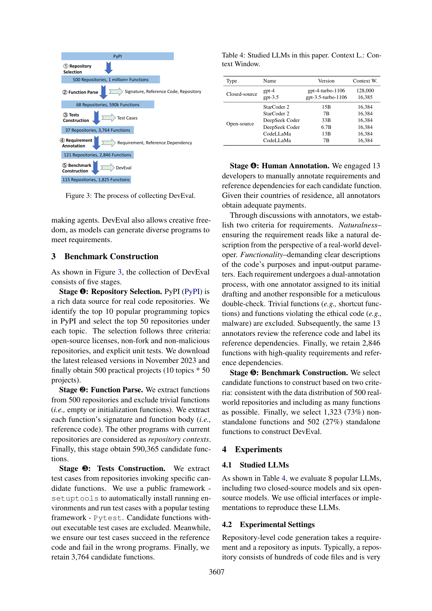

<!-- PDF page 6 -->

## Página PDF 6

Table 5: Pass@k and Recall@k of LLMs on DevEval. The bold values indicate top-1 results.
LLMs
Size
Pass@1
Pass@3
Pass@5
Pass@10
Recall@1
Recall@3
Recall@5
Recall@10
Local File (Infilling)
gpt-4
N/A
53.81
56.84
58.95
61.47
65.42
69.61
70.56
71.66
gpt-3.5
N/A
44.99
51.64
53.82
56.42
61.44
65.39
66.83
68.16
DeepSeek Coder
33B
47.23
54.15
57.16
60.48
64.06
66.66
69.10
72.24
DeepSeek Coder
6.7B
41.64
48.84
52.16
55.83
61.72
65.03
66.77
69.46
Local File (Completion)
gpt-4
N/A
48.16
53.19
55.28
57.78
65.42
69.61
70.56
71.66
gpt-3.5-1106
N/A
40.99
46.00
48.10
50.44
61.44
65.39
66.83
68.16
DeepSeek Coder
33B
42.52
49.17
52.10
55.36
64.06
66.66
69.10
72.24
DeepSeek Coder
6.7B
36.71
43.71
46.85
50.62
61.72
65.03
66.77
69.46
StarCoder 2
15B
38.19
44.94
47.93
51.36
61.20
65.20
67.60
70.24
StarCoder 2
7B
33.26
39.82
42.86
46.42
60.29
63.49
66.31
69.29
CodeLLaMa
13B
42.63
49.50
52.62
56.38
64.25
68.47
70.89
73.34
CodeLLaMa
7B
40.49
47.46
50.65
54.50
61.06
66.01
68.40
71.26
Without Context
gpt-4
N/A
17.00
20.55
21.61
22.92
17.28
18.97
20.03
21.47
gpt-3.5-1106
N/A
14.19
16.61
17.76
19.31
15.27
16.98
17.37
18.27
DeepSeek Coder
33B
15.23
19.12
21.24
23.90
19.46
22.11
23.58
25.55
DeepSeek Coder
7B
12.71
17.41
19.71
22.74
17.46
19.34
20.72
23.07
StarCoder 2
15B
11.23
16.32
18.58
21.50
15.87
18.34
20.39
22.93
CodeLLaMa
13B
13.53
18.22
20.60
23.74
18.54
22.01
24.00
26.57
CodeLLaMa
7B
12.88
17.71
20.14
23.26
16.72
19.49
21.49
24.49
long. For example, the average length of 500 real-
world repositories is 1.1 million tokens, surpassing
the context windows of existing LLMs (e.g., gpt-4:
128k tokens). Inspired by related work (Shrivas-
tava et al., 2023), we try to extract parts of code
contexts from the repository as inputs and design
the following experimental settings.
❶Without context. In this setting, we ignore
contexts and directly generate the code based on
requirements and signatures.
❷Local File (Completion). The local file de-
notes the code file where the reference code is in.
This setting simulates the scenario where devel-
opers continue to write code at the end of a file.
Thus, we consider code snippets above the refer-
ence code in the local file as contexts. Then, LLMs
generate code in an autoregressive manner based
on requirements, signatures, and contexts.
❸Local File (Infilling). Different from the Lo-
cal File (Completion) setting, this setting simulates
the scenario where developers infill code in the
middle of a file. Thus, we use the code snippets
above and below the reference code in the local
file as contexts. We evaluate LLMs that support
code infilling and construct input sequences using
official formats.
4.3
Evaluation
We use Pass@k and Recall@k (see Section 2.3)
to assess generated programs. In this paper, k ∈
[1, 3, 5, 10]. When k = 1, we use the greedy search
and generate a single program per requirement.
When k > 1, we use the nucleus sampling with
a temperature 0.4 and sample 20 programs per re-
quirement. We set the top-p to 0.95 and the max
generation length to 500.
4.4
Main Results
The Pass@k and Recall@k of different LLMs in
three experimental settings are shown in Table 5.
Without Context.
gpt-4 and DeepSeek Coder
achieve the highest Pass@1 and Recall@1 among
all LLMs, respectively. However, all LLMs ex-
hibit relatively low Pass@k and Recall@k values
compared to their performance on previous bench-
marks. For instance, gpt-4 achieves a Pass@1 score
of 88.4 on HumanEval, whereas it scores 17.00 on
Pass@1 in this setting. The decreases validate our
motivation that existing benchmarks can not com-
prehensively assess the coding abilities of LLMs
in real-world repositories. Furthermore, the results
emphasize the importance of contexts.
Local File (Completion) and (Infilling). After
3608

[Vista original de la página 6](../../../../../images/v5/estructura_colecciones/Evaluation/primary/DevEval/page-06.png)

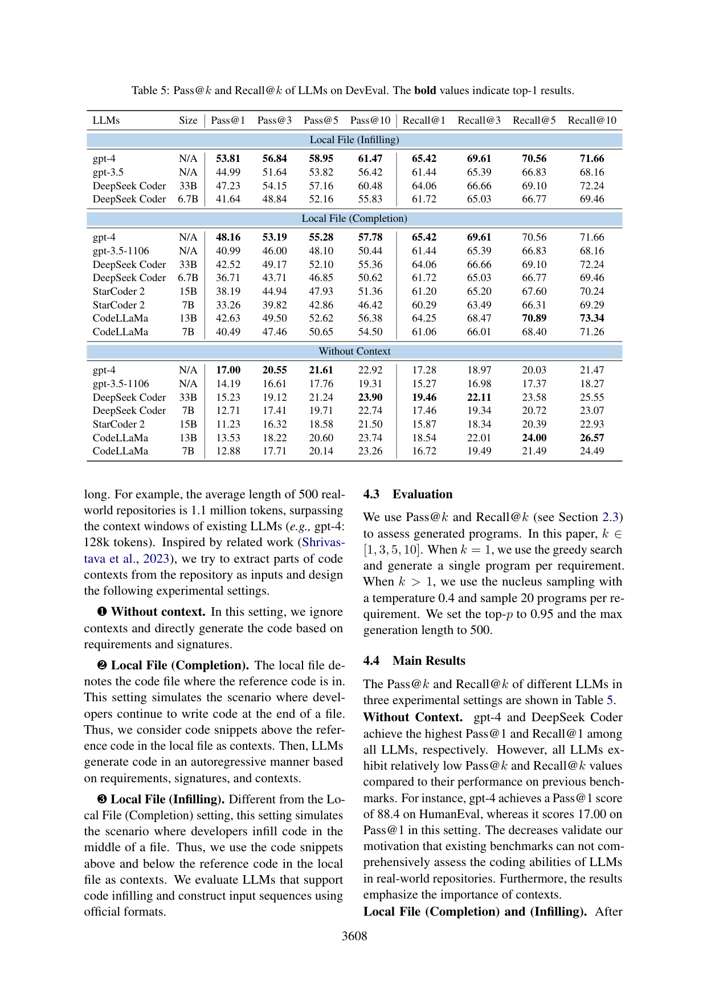

<!-- PDF page 7 -->

## Página PDF 7

introducing the contexts within local files, the
Pass@k and Recall@k of all LLMs obviously in-
crease. For example, the Pass@1 of gpt-4 is im-
proved by 217% and 183% in two settings, respec-
tively.
Successful Case Analyses. We further inspect
successful cases of gpt-4 and attribute the improve-
ments to the synergy of contexts and requirements.
On the one hand, the contexts provide lots of do-
main knowledge. For example, the local file con-
tains essential local environments (e.g., current
classes, imported libraries) and a majority of de-
pendencies (e.g., intra-class and intra-file: 70% in
DevEval). Recent work (Zhang et al., 2023; Ding
et al., 2023) in code completion also proved the
importance of contexts. On the other hand, our
manually written requirements elaborate on the
code’s purposes and the repositories’ background
knowledge. Thus, the requirements help LLMs
understand long contexts and locate relevant depen-
dencies.
Error Case Analyses.
Although promising,
LLMs’ performance in repository-level code gener-
ation is not satisfying. A manual inspection of
failed cases reveals LLMs struggle with under-
standing contexts.
Figure 4 illustrates a failed
case.
LLMs invoke a non-existent function -
create_connection, even though a valid
function connect is present in the contexts. We
think two reasons cause this problem.
First, the contexts are too long. The complete
repositories are lengthy, approximately 9 times the
context window of the state-of-the-art LLM - gpt-
4-1106. Even when partial contexts are considered,
their lengths match or exceed most current LLMs’
context windows. Recent work (Liu et al., 2023a)
has found that LLMs often ignore relevant infor-
mation in the middle of long contexts. This finding
is consistent with our results. Second, the contexts
are heterogeneous. In other words, the contexts are
composed of discrete code snippets from different
files rather than a continuous file. As shown in
Figure 4, the programs within contexts come from
multiple files, e.g., boto.regioninfo.py and
boto.swf.layer1.py. However, LLMs are
typically trained to predict the next tokens based on
the continuous contexts. The gap between training
and inference objectives leads to a poor understand-
ing of LLMs in contexts. Recent work (Shi et al.,
2023) also found similar gaps in reading compre-
hension and question answering.
…
…
(a) Prompt
(b) Generated Code
Figure 4: A failed case of gpt-3.5 in the Local File
(Completion) setting.
Figure 5: Pass@1 of gpt-4 on different program types.
We also obtain some interesting findings from
Table 5.
❶LLMs successfully generate some depen-
dencies without context. Theoretically, LLMs do
not see the contexts and cannot generate dependen-
cies defined in the contexts. According to Table 5,
we are surprised to find that LLMs are able to gen-
erate some dependencies without context. We man-
ually inspect successful cases and summarize two
reasons. First, LLMs can reason about some easy
dependencies from requirements, e.g., initialization
functions of returned objects. Second, LLMs can
“guess“ dependencies from their functionalities. In
practice, dependencies’ names come from their
functional descriptions, e.g., send_request()
- send a request to the server. LLMs are trained
with a large code corpus and can learn the naming
conventions. Thus, LLMs may successfully guess
some dependencies from their functionalities.
❷More contexts benefit code generation.
3609

[Vista original de la página 7](../../../../../images/v5/estructura_colecciones/Evaluation/primary/DevEval/page-07.png)

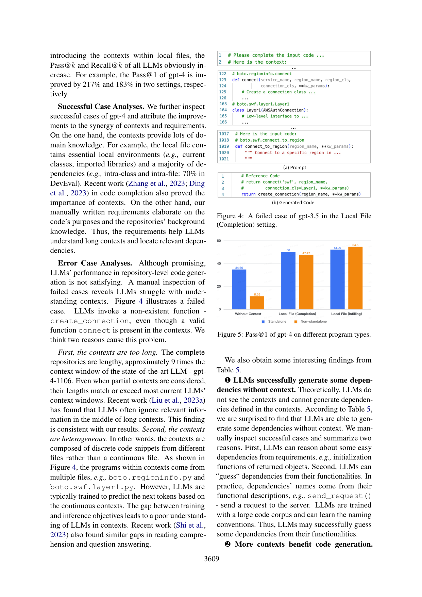

<!-- PDF page 8 -->

## Página PDF 8

Based on Table 5, we compare the performance
of an LLM (e.g., gpt-4) under different settings.
Obviously, the more input contexts, the better the
performance of the LLM. It inspires practitioners
to extend the context windows of LLMs and input
more contexts.
❸In the without context setting, gpt fam-
ily models have higher Pass@k and lower
Recall@k, while other models are the opposite.
We speculate the reason is that gpt family models
are instruction-tuned models and focus on perform-
ing tasks based on given instructions. With limited
contexts, gpt family models are conservative and
tend to generate code independently. Other LLMs
are fundamental language models trained with real
code files containing dependencies. They are ag-
gressive and generate dependencies that may exist.
The comparisons show the importance of instruc-
tion tuning in practical applications.
4.5
Empirical Lessons
Based on the above experiments, we summarize
the empirical lessons we learned as
❶
DevEval
poses
new
challenges,
i.e.,
repository-level code generation. The performance
of existing LLMs on DevEval drops dramatically
compared to their performance on previous
benchmarks.
❷LLMs benefit from code contexts in current
repositories. With limited context windows, the
contexts from local files can improve gpt-4 by
217% in Pass@1.
❸Detailed and accurate requirements help
LLMs understand programs’ purposes and long
contexts.
❹LLMs struggle with understanding long and
heterogeneous contexts. It causes LLMs to disre-
gard the knowledge in contexts and even generate
hallucinations (e.g., non-existent functions).
5
Discussion
Results on different program types. Figure 5
shows Pass@1 of gpt-4 on different program types
(i.e., standalone and non-standalone). We have
two observations from the results. ❶Contexts are
crucial to generating non-standalone functions. For
example, adding local files improves the Pass@1
on non-standalone functions from 11.26 to 54.5. ❷
Contexts also benefit standalone functions. This is
attributed to the domain knowledge within contexts,
aiding LLMs in understanding requirements. ❸
Figure 6: Recall@1 of gpt-4 on different dependency
types.
There is considerable room for improving LLMs on
both programs. How to effectively retrieve relevant
contexts is a key problem.
Results on different dependency types. Figure 6
shows the Recall@1 of gpt-4 on different depen-
dency types (i.e., intra-class, intra-file, and cross-
file). The results yield two insights. ❶Without
context, LLMs can reason about some simple de-
pendencies from requirements (e.g., initialization
functions of returned objects), but still exhibit low
Recall@1 values across three dependency types.
❷With contexts, LLMs exhibit an improvement
in generating dependencies. Nevertheless, LLMs
have yet to grapple with generating dependencies,
especially cross-file dependencies. As illustrated in
Figure 4, LLMs often ignore available dependen-
cies defined in contexts.
Data leakage. Theoretically, all open-source code
repositories may be included in the training data for
LLMs. Consequently, there is a risk of data leakage
where several repositories used to build DevEval
appear in the training data. We think this risk has
only a slight impact on DevEval due to three rea-
sons. ❶DevEval contains new data, i.e., manually
written requirements. These requirements are never
included in the training data. ❷Existing LLMs do
not show overfitting tendencies to DevEval. Based
on the release dates of 8 LLMs (see Section 4.1),
we divide DevEval into two groups: unseen reposi-
tories released later than LLMs and potentially seen
repositories released earlier than LLMs. The aver-
age difference of Pass@1 between the two groups
is around 0.36. Compared to the average varia-
tions between LLMs (e.g., 5.15 in Table 5), 0.36
is slight. ❸DevEval is geared toward evaluating
future LLMs. We release the links to our selected
repositories and encourage practitioners to omit
these repositories when collecting the training data
for future LLMs.
3610

[Vista original de la página 8](../../../../../images/v5/estructura_colecciones/Evaluation/primary/DevEval/page-08.png)

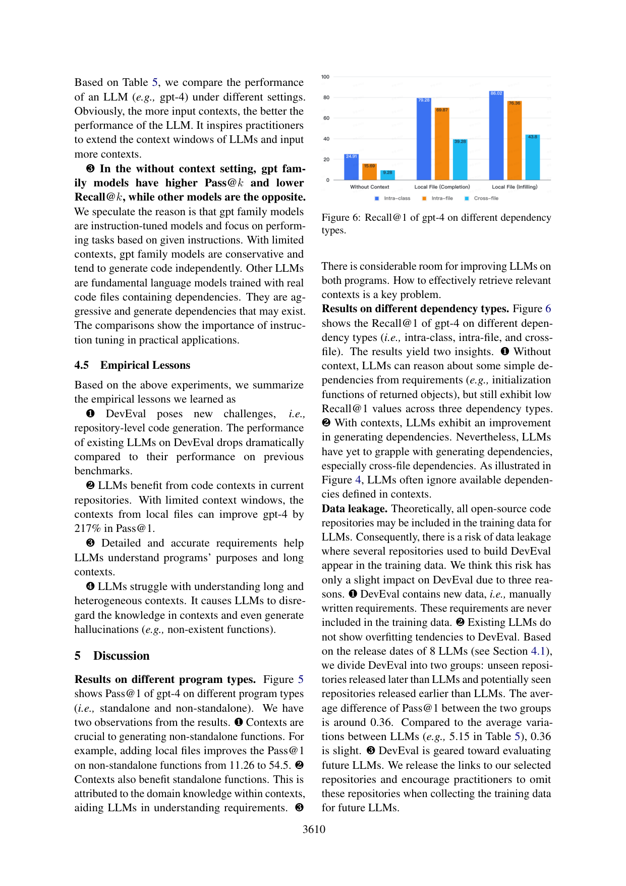

<!-- PDF page 9 -->

## Página PDF 9

The bias of Recall@k. As stated in Section 2.3,
we develop a static analysis-based parser to extract
dependencies in generated programs automatically.
Because Python is a dynamically typed language,
certain dependencies are only determined at run-
time and may elude our parser. It may lead to lower
Recall@k than actual values.
To gauge the above bias, we randomly select
50 programs generated by gpt-4 and annotate de-
pendencies with them by our parser and two hu-
man developers, respectively. Based on the human-
annotated and auto-extracted dependencies, we
compute two Recall@1 values. The bias of two
Recall@1 values is 0.16. Compared to the average
variations between LLMs (2.16 in Table 5), 0.16 is
slight. Consequently, we believe that Recall@k can
effectively rank different LLMs, notwithstanding
its slight bias.
6
Related Work
Large Language Models for Code Generation.
The rise of pre-training technology has brought
new impetus to the field of code generation, both in
academia and industry (Li et al., 2022; Shen et al.,
2022; Nijkamp et al., 2023; Fried et al., 2023). In
this context, more and more LLMs have emerged,
achieving significant advancements in code gen-
eration, such as Codex (Chen et al., 2021), Chat-
GPT (OpenAI, 2023a), CodeLlama (Rozière et al.,
2023), DeepSeek Coder (Guo et al., 2024), and
StarCoder2 (Lozhkov et al., 2024).
To effectively steer LLMs in various code gen-
eration scenarios, some works focus on improving
the prompt technologies by introducing specific pat-
terns, e.g., Structured Chain-of-Thought (Li et al.,
2023a), Self-planning (Jiang et al., 2023), Self-
debug (Chen et al., 2023), Self-collaboration (Dong
et al., 2023), and AceCoder (Li et al., 2023c).
Code Generation Benchmarks. Early code gen-
eration benchmarks (Yin et al., 2018; Chen et al.,
2021; Austin et al., 2021; Zan et al., 2022) eval-
uate code generation on relatively Python func-
tions, such as HumanEval (Chen et al., 2021) and
MBPP (Austin et al., 2021). APPS (Hendrycks
et al., 2021) evaluates code generation on more dif-
ficult competition-style problems. ClassEval (Du
et al., 2023) evaluates LLMs on class-level code
generation and contains 100 human-crafted self-
contained Python classes. Concode (Iyer et al.,
2018) and CoderEval (Yu et al., 2023) further in-
troduce non-standalone programs.
Compared to existing benchmarks, DevEval
aligns with real-world code repositories (e.g., the
distributions of code and dependency) and contains
more comprehensive annotations (e.g., reference
dependencies).
We have also noticed that some benchmarks have
recently been proposed for repository-level tasks.
CrossCodeEval (Ding et al., 2023), RepoBench
(Liu et al., 2023b), and RepoEval (Zhang et al.,
2023) are code completion benchmarks. They lack
the necessary annotations (e.g., natural language
requirements) for code generation. SWE-bench
(Jimenez et al., 2023) focuses on repairing repos-
itories’ issues by revising existing programs. In
contrast, DevEval is collected for code generation
and aims to generate new programs based on re-
quirements for a repository. DevEval offers com-
prehensive annotations (e.g., natural language re-
quirements, original repositories, reference code,
and reference dependencies).
7
Conclusion and Future Work
This paper proposes a new code generation bench-
mark named DevEval. Collected through a meticu-
lous pipeline, DevEval aligns with real-world code
repositories in multiple dimensions, e.g., real code
distributions, sufficient dependencies, and real-
scale repositories. We evaluate 8 popular LLMs
in DevEval. The results reveal the strengths and
weaknesses of LLMs in real repositories. Com-
pared to previous benchmarks, DevEval offers a
more challenging and practical evaluation scenario.
We hope DevEval can facilitate the applications of
LLMs in practical repositories.
In the future, we will continue to update De-
vEval, e.g., multilingual testing samples, more
projects, and more test cases. Besides, we will
explore how to improve the performance of LLMs
in context-based code generation, e.g., retrieval-
augmented and tool-augmented generation.
8
Acknowledgments
This research is supported by the National Key
R&D Program under Grant No. 2023YFB4503801,
the National Natural Science Foundation of
China under Grant No.
62192731, 62152730,
62072007, 62192733, 61832009, 62192730, and
the Major Program (JD) of Hubei Province
(No.2023BAA024). Ge Li and Yongbin Li are the
corresponding authors.
3611

[Vista original de la página 9](../../../../../images/v5/estructura_colecciones/Evaluation/primary/DevEval/page-09.png)

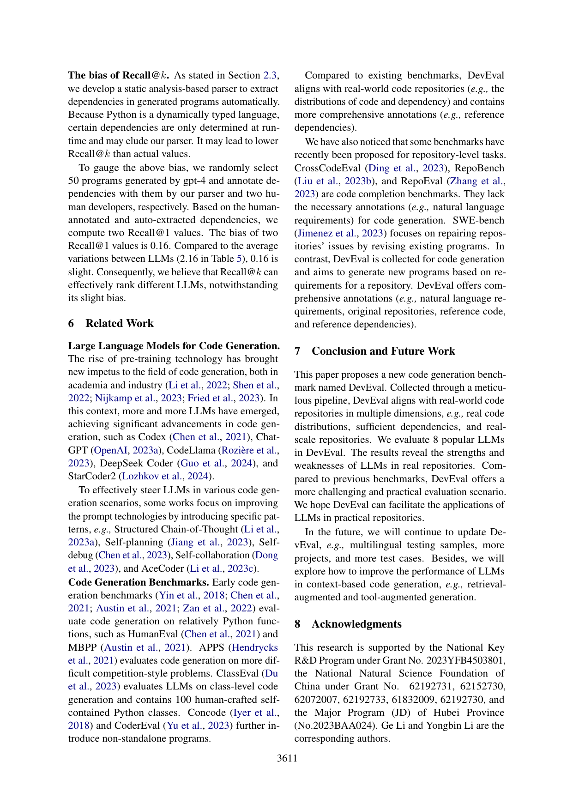

<!-- PDF page 10 -->

## Página PDF 10

9
Limitations
This paper proposes a new code generation bench-
mark - DevEval, which aligns with real-world code
repositories. Based on DevEval, we evaluate 8 pop-
ular LLMs and analyze their strengths and short-
comings. We think that DevEval has three limita-
tions.
❶DevEval is a monolingual benchmark (i.e.,
requirements in English and code in Python) and
ignores other languages. In practice, LLMs re-
quire understanding requirements in different nat-
ural languages (e.g., Chinese, Spanish) and gener-
ating programs in various programming languages
(e.g., Java, C). Thus, we plan to build a multilingual
DevEval in future work.
❷As stated in Section 5, Recall@k values in
DevEval may have slight biases, i.e., they may be
slightly less than actual values. Because Python is a
dynamically typed language, certain dependencies
can only be identified at runtime and may elude
our parser. To gauge the bias introduced by our
parser, we manually annotate dependencies within
100 programs generated by gpt-4. Simultaneously,
we employ the parser to extract dependencies in the
same 50 programs. Based on the human-annotated
and auto-extracted dependencies, we compute two
Recall@1 values. The bias of two Recall@1 is 0.16.
Compared to the average variations between LLMs
(2.16 in Table 5), 0.16 is slight. Consequently,
the Recall@k can effectively rank different LLMs,
notwithstanding its slight bias.
❸In our experiments, we only consider the code
contexts from local files. In the future, we will
explore how to utilize broader contexts (e.g., im-
ported files, sibling files).
10
Ethics Consideration
DevEval is collected from real-world code repos-
itories. We manually check all samples in DevE-
val. We ensure all samples do not contain private
information or offensive content. We ensure all
programs in DevEval are behaving normally and
exclude any malicious programs.
References
Jacob Austin, Augustus Odena, Maxwell I. Nye,
Maarten Bosma, Henryk Michalewski, David Dohan,
Ellen Jiang, Carrie J. Cai, Michael Terry, Quoc V. Le,
and Charles Sutton. 2021. Program synthesis with
large language models. CoRR, abs/2108.07732.
Mark Chen, Jerry Tworek, Heewoo Jun, Qiming Yuan,
Henrique Pondé de Oliveira Pinto, Jared Kaplan,
Harrison Edwards, Yuri Burda, Nicholas Joseph,
Greg Brockman, Alex Ray, Raul Puri, Gretchen
Krueger, Michael Petrov, Heidy Khlaaf, Girish Sas-
try, Pamela Mishkin, Brooke Chan, Scott Gray,
Nick Ryder, Mikhail Pavlov, Alethea Power, Lukasz
Kaiser, Mohammad Bavarian, Clemens Winter,
Philippe Tillet, Felipe Petroski Such, Dave Cum-
mings, Matthias Plappert, Fotios Chantzis, Eliza-
beth Barnes, Ariel Herbert-Voss, William Hebgen
Guss, Alex Nichol, Alex Paino, Nikolas Tezak, Jie
Tang, Igor Babuschkin, Suchir Balaji, Shantanu Jain,
William Saunders, Christopher Hesse, Andrew N.
Carr, Jan Leike, Joshua Achiam, Vedant Misra, Evan
Morikawa, Alec Radford, Matthew Knight, Miles
Brundage, Mira Murati, Katie Mayer, Peter Welinder,
Bob McGrew, Dario Amodei, Sam McCandlish, Ilya
Sutskever, and Wojciech Zaremba. 2021. Evaluat-
ing large language models trained on code. CoRR,
abs/2107.03374.
Xinyun Chen, Maxwell Lin, Nathanael Schärli, and
Denny Zhou. 2023. Teaching large language models
to self-debug. CoRR, abs/2304.05128.
Yangruibo Ding, Zijian Wang, Wasi Uddin Ahmad, Han-
tian Ding, Ming Tan, Nihal Jain, Murali Krishna Ra-
manathan, Ramesh Nallapati, Parminder Bhatia, Dan
Roth, and Bing Xiang. 2023. Crosscodeeval: A di-
verse and multilingual benchmark for cross-file code
completion. CoRR, abs/2310.11248.
Yihong Dong, Xue Jiang, Zhi Jin, and Ge Li. 2023. Self-
collaboration code generation via chatgpt. CoRR,
abs/2304.07590.
Xueying Du, Mingwei Liu, Kaixin Wang, Hanlin Wang,
Junwei Liu, Yixuan Chen, Jiayi Feng, Chaofeng
Sha, Xin Peng, and Yiling Lou. 2023. Classeval: A
manually-crafted benchmark for evaluating llms on
class-level code generation. CoRR, abs/2308.01861.
Daniel Fried, Armen Aghajanyan, Jessy Lin, Sida Wang,
Eric Wallace, Freda Shi, Ruiqi Zhong, Scott Yih,
Luke Zettlemoyer, and Mike Lewis. 2023. Incoder:
A generative model for code infilling and synthesis.
In The Eleventh International Conference on Learn-
ing Representations, ICLR 2023, Kigali, Rwanda,
May 1-5, 2023. OpenReview.net.
GitHub. 2023. Github copilot. https://github.
com/features/copilot.
Daya Guo, Qihao Zhu, Dejian Yang, Zhenda Xie, Kai
Dong, Wentao Zhang, Guanting Chen, Xiao Bi,
Y. Wu, Y. K. Li, Fuli Luo, Yingfei Xiong, and Wen-
feng Liang. 2024. Deepseek-coder: When the large
language model meets programming - the rise of code
intelligence. CoRR, abs/2401.14196.
Dan Hendrycks, Steven Basart, Saurav Kadavath, Man-
tas Mazeika, Akul Arora, Ethan Guo, Collin Burns,
Samir Puranik, Horace He, Dawn Song, and Jacob
Steinhardt. 2021. Measuring coding challenge com-
petence with APPS. In Proceedings of the Neural
3612

[Vista original de la página 10](../../../../../images/v5/estructura_colecciones/Evaluation/primary/DevEval/page-10.png)

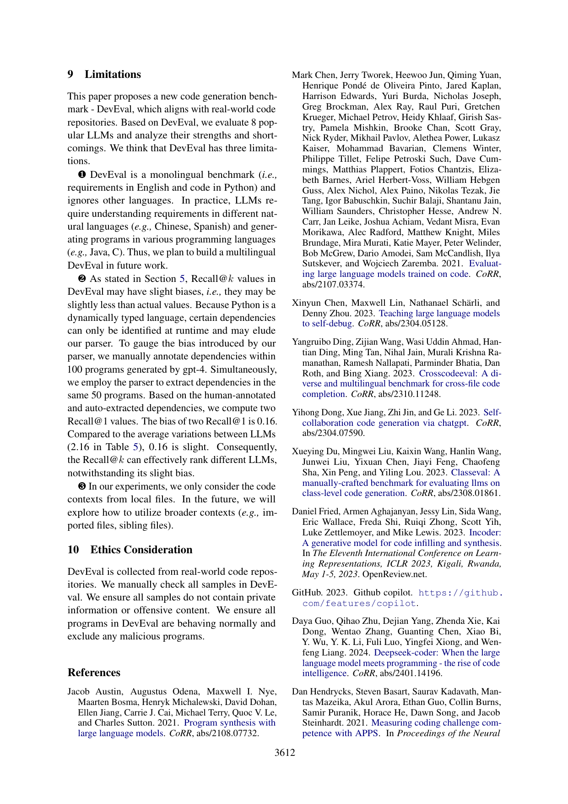

<!-- PDF page 11 -->

## Página PDF 11

Information Processing Systems Track on Datasets
and Benchmarks 1, NeurIPS Datasets and Bench-
marks 2021, December 2021, virtual.
Srinivasan Iyer, Ioannis Konstas, Alvin Cheung, and
Luke Zettlemoyer. 2018. Mapping language to code
in programmatic context. In Proceedings of the 2018
Conference on Empirical Methods in Natural Lan-
guage Processing, Brussels, Belgium, October 31 -
November 4, 2018, pages 1643–1652. Association
for Computational Linguistics.
Xue Jiang, Yihong Dong, Lecheng Wang, Qiwei Shang,
and Ge Li. 2023. Self-planning code generation with
large language model. CoRR, abs/2303.06689.
Carlos E. Jimenez, John Yang, Alexander Wettig,
Shunyu Yao, Kexin Pei, Ofir Press, and Karthik
Narasimhan. 2023.
Swe-bench:
Can language
models resolve real-world github issues?
CoRR,
abs/2310.06770.
Jia Li, Ge Li, Yongmin Li, and Zhi Jin. 2023a. Struc-
tured chain-of-thought prompting for code genera-
tion. arXiv preprint arXiv:2305.06599.
Jia Li, Yongmin Li, Ge Li, Zhi Jin, Yiyang Hao, and
Xing Hu. 2023b. Skcoder: A sketch-based approach
for automatic code generation. In 45th IEEE/ACM
International Conference on Software Engineering,
ICSE 2023, Melbourne, Australia, May 14-20, 2023,
pages 2124–2135. IEEE.
Jia Li, Yunfei Zhao, Li Yongmin, Ge Li, and Zhi Jin.
2023c. Acecoder: Utilizing existing code to enhance
code generation. arXiv preprint arXiv:2303.17780.
Yujia Li, David H. Choi, Junyoung Chung, Nate Kush-
man, Julian Schrittwieser, Rémi Leblond, Tom Ec-
cles, James Keeling, Felix Gimeno, Agustin Dal
Lago, Thomas Hubert, Peter Choy, Cyprien de Mas-
son d’Autume, Igor Babuschkin, Xinyun Chen, Po-
Sen Huang, Johannes Welbl, Sven Gowal, Alexey
Cherepanov, James Molloy, Daniel J. Mankowitz,
Esme Sutherland Robson, Pushmeet Kohli, Nando
de Freitas, Koray Kavukcuoglu, and Oriol Vinyals.
2022. Competition-level code generation with alpha-
code. CoRR, abs/2203.07814.
Nelson F. Liu, Kevin Lin, John Hewitt, Ashwin Paran-
jape, Michele Bevilacqua, Fabio Petroni, and Percy
Liang. 2023a. Lost in the middle: How language
models use long contexts. CoRR, abs/2307.03172.
Tianyang Liu, Canwen Xu, and Julian J. McAuley.
2023b.
Repobench:
Benchmarking repository-
level code auto-completion systems.
CoRR,
abs/2306.03091.
Anton Lozhkov, Raymond Li, Loubna Ben Allal, Fed-
erico Cassano, Joel Lamy-Poirier, Nouamane Tazi,
Ao Tang, Dmytro Pykhtar, Jiawei Liu, Yuxiang Wei,
et al. 2024. Starcoder 2 and the stack v2: The next
generation. arXiv preprint arXiv:2402.19173.
Erik Nijkamp, Bo Pang, Hiroaki Hayashi, Lifu Tu, Huan
Wang, Yingbo Zhou, Silvio Savarese, and Caiming
Xiong. 2023. Codegen: An open large language
model for code with multi-turn program synthesis. In
The Eleventh International Conference on Learning
Representations, ICLR 2023, Kigali, Rwanda, May
1-5, 2023. OpenReview.net.
OpenAI.
2023a.
gpt-3.5-turbo.
https:
//platform.openai.com/docs/models/
gpt-3-5.
OpenAI. 2023b.
GPT-4 technical report.
CoRR,
abs/2303.08774.
Pyan. 2023.
Pyan.
https://github.com/
davidfraser/pyan.
PyPI. Pypi. https://pypi.org/.
Baptiste Rozière, Jonas Gehring, Fabian Gloeckle, Sten
Sootla, Itai Gat, Xiaoqing Ellen Tan, Yossi Adi,
Jingyu Liu, Tal Remez, Jérémy Rapin, Artyom
Kozhevnikov, Ivan Evtimov, Joanna Bitton, Man-
ish Bhatt, Cristian Canton-Ferrer, Aaron Grattafiori,
Wenhan Xiong, Alexandre Défossez, Jade Copet,
Faisal Azhar, Hugo Touvron, Louis Martin, Nico-
las Usunier, Thomas Scialom, and Gabriel Synnaeve.
2023. Code llama: Open foundation models for code.
CoRR, abs/2308.12950.
Sijie Shen, Xiang Zhu, Yihong Dong, Qizhi Guo,
Yankun Zhen, and Ge Li. 2022. Incorporating do-
main knowledge through task augmentation for front-
end javascript code generation. In Proceedings of
the 30th ACM Joint European Software Engineering
Conference and Symposium on the Foundations of
Software Engineering, ESEC/FSE 2022, Singapore,
Singapore, November 14-18, 2022, pages 1533–1543.
ACM.
Weijia Shi, Sewon Min, Maria Lomeli, Chunting Zhou,
Margaret Li, Xi Victoria Lin, Noah A. Smith, Luke
Zettlemoyer, Scott Yih, and Mike Lewis. 2023. In-
context pretraining: Language modeling beyond doc-
ument boundaries. CoRR, abs/2310.10638.
Disha Shrivastava, Hugo Larochelle, and Daniel Tar-
low. 2023. Repository-level prompt generation for
large language models of code. In International Con-
ference on Machine Learning, ICML 2023, 23-29
July 2023, Honolulu, Hawaii, USA, volume 202 of
Proceedings of Machine Learning Research, pages
31693–31715. PMLR.
Pengcheng Yin, Bowen Deng, Edgar Chen, Bogdan
Vasilescu, and Graham Neubig. 2018. Learning to
mine aligned code and natural language pairs from
stack overflow. In Proceedings of the 15th Interna-
tional Conference on Mining Software Repositories,
MSR 2018, Gothenburg, Sweden, May 28-29, 2018,
pages 476–486. ACM.
Hao Yu, Bo Shen, Dezhi Ran, Jiaxin Zhang, Qi Zhang,
Yuchi Ma, Guangtai Liang, Ying Li, Tao Xie, and
Qianxiang Wang. 2023. Codereval: A benchmark
3613

[Vista original de la página 11](../../../../../images/v5/estructura_colecciones/Evaluation/primary/DevEval/page-11.png)

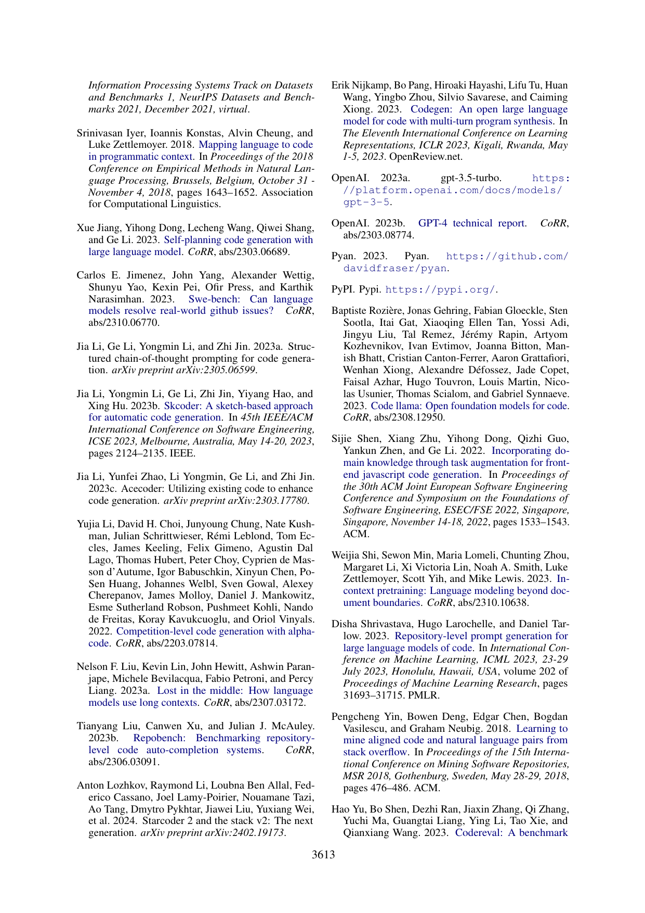

<!-- PDF page 12 -->

## Página PDF 12

of pragmatic code generation with generative pre-
trained models. CoRR, abs/2302.00288.
Daoguang Zan, Bei Chen, Dejian Yang, Zeqi Lin, Minsu
Kim, Bei Guan, Yongji Wang, Weizhu Chen, and
Jian-Guang Lou. 2022. CERT: continual pre-training
on sketches for library-oriented code generation. In
Proceedings of the Thirty-First International Joint
Conference on Artificial Intelligence, IJCAI 2022,
Vienna, Austria, 23-29 July 2022, pages 2369–2375.
ijcai.org.
Fengji Zhang, Bei Chen, Yue Zhang, Jacky Keung, Jin
Liu, Daoguang Zan, Yi Mao, Jian-Guang Lou, and
Weizhu Chen. 2023. Repocoder: Repository-level
code completion through iterative retrieval and gen-
eration. In Proceedings of the 2023 Conference on
Empirical Methods in Natural Language Process-
ing, EMNLP 2023, Singapore, December 6-10, 2023,
pages 2471–2484. Association for Computational
Linguistics.
3614

[Vista original de la página 12](../../../../../images/v5/estructura_colecciones/Evaluation/primary/DevEval/page-12.png)

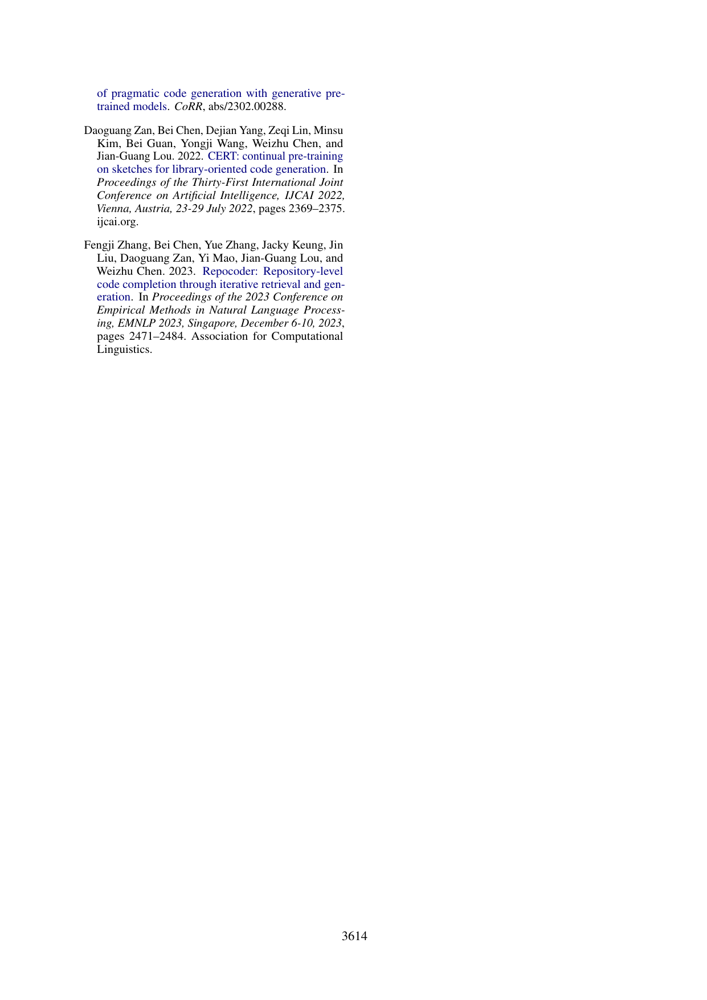
