# RACE-Bench: A Reasoning-Augmented Benchmark for Repository-Level Code Agents on Feature Addition

- source_pdf: ../../../../../pdf/Evaluation/secondary/RACE-Bench.pdf
- extraction_tool: PyMuPDF
- extraction_date: 2026-11-24
- status: automatic-text-extraction; not manually verified
- pagination: physical PDF pages, starting at 1

> Copia de trabajo para búsqueda y citas. Verifica tablas, fórmulas, figuras y orden visual en el PDF original o en el PNG de la página.

<!-- PDF page 1 -->

## Página PDF 1

RACE-Bench: A Reasoning-Augmented Benchmark for
Repository-Level Code Agents on Feature Addition
Shuhan Liu∗
Zhejiang University
Hangzhou, China
liushuhan@zju.edu.cn
Zhiyi Zhao∗
Zhejiang University
Hangzhou, China
zhaozhiyi@zju.edu.cn
Xing Hu†
Zhejiang University
Hangzhou, China
xinghu@zju.edu.cn
Kui Liu†
Independent researcher
Shanghai, China
brucekuiliu@gmail.com
Xiaohu Yang
Zhejiang University
Hangzhou, China
yangxh@zju.edu.cn
Xin Xia
Zhejiang University
Hangzhou, China
Hangzhou High-Tech Zone (Binjiang)
Institute of Blockchain and Data
Security
Hangzhou, China
xin.xia@acm.org
Abstract
Repository-level code agents have shown strong promise in real-
world feature addition tasks, making reliable evaluation of their
capabilities increasingly important. However, existing benchmarks
primarily evaluate these agents as black boxes based on final test cor-
rectness, providing limited insight into how they reason and where
failures arise. To address this limitation, we introduce RACE-Bench,
a reasoning-augmented benchmark for evaluating code agents on
repository-level feature addition tasks. RACE-Bench contains 528
real-world feature addition instances from 12 open-source reposi-
tories. Each instance is paired with executable patch verification
and structured intermediate reference reasoning covering issue
understanding, file localization, implementation tasks, and step
decomposition. Based on this design, we introduce a dual-track
evaluation framework that jointly measures patch correctness and
intermediate reasoning alignment with developer-accepted refer-
ence trajectories. We evaluate three representative repository-level
code agents on RACE-Bench. On the full benchmark, Resolved
Rate ranges from 29% to 70% across different agents. Our reasoning-
level analysis further shows that while current agents perform well
at understanding high-level intent, their performance degrades sub-
stantially when translating intent into concrete implementation
steps. We also find patches that can be applied but still fail the
tests cover fewer reference-reasoning elements (35.7% lower recall)
and contain more unsupported reasoning elements (94.1% higher
over-prediction) than successful patches. These findings highlight
the importance of evaluating repository-level code agents beyond
final patch correctness by examining the quality of their reasoning
processes.
∗Both authors contributed equally to this research.
†Corresponding authors: Xing Hu and Kui Liu
This work is licensed under a Creative Commons Attribution 4.0 International License.
ASE ’26, Munich, Germany
© 2026 Copyright held by the owner/author(s).
ACM ISBN 979-8-4007-2882-2/2026/10
https://doi.org/10.1145/3832783.3837426
CCS Concepts
• Software and its engineering →Software creation and man-
agement.
Keywords
Benchmark, Code Agents, Feature Addition, Large Language Model
ACM Reference Format:
Shuhan Liu, Zhiyi Zhao, Xing Hu, Kui Liu, Xiaohu Yang, and Xin Xia. 2026.
RACE-Bench: A Reasoning-Augmented Benchmark for Repository-Level
Code Agents on Feature Addition. In Proceedings of the 41st IEEE/ACM
International Conference on Automated Software Engineering (ASE ’26), Oc-
tober 12–16, 2026, Munich, Germany. ACM, New York, NY, USA, 13 pages.
https://doi.org/10.1145/3832783.3837426
1
Introduction
Recent years have witnessed the rapid growth of large language
models (LLMs), giving rise to powerful models such as ChatGPT [2]
and Gemini [44]. These models have quickly reshaped automated
software engineering and are now widely applied to code gen-
eration and related development tasks [18, 29, 32, 40, 53]. This
technological shift has influenced real-world development prac-
tices: a substantial proportion of developers regularly rely on LLM-
based tools (e.g., GitHub Copilot [15]) to write, modify, or review
code [5, 11, 49]. These tools significantly improve productivity and
reduce cognitive load during programming activities [24, 45].
Beyond single-turn code generation, recent research has intro-
duced code agents that extend LLMs into autonomous, multi-step
problem-solving systems capable of interacting with code repos-
itories [14, 47, 55]. Unlike LLMs that generate code in isolation,
code agents iteratively reason about a given problem, invoke ex-
ternal tools (e.g., code search, testing frameworks, and execution
environments), and adapt their behavior based on intermediate
feedback. They can perform a broad range of repository-level de-
velopment tasks, including fixing bugs and implementing feature
requests [6, 47, 51, 55], generating tests from natural-language
issue descriptions [3, 35, 36], and automating complex project se-
tups [7, 21]. Among these tasks, feature addition is a distinct setting
1638

[Vista original de la página 1](../../../../../images/v5/estructura_colecciones/Evaluation/secondary/RACE-Bench/page-01.png)

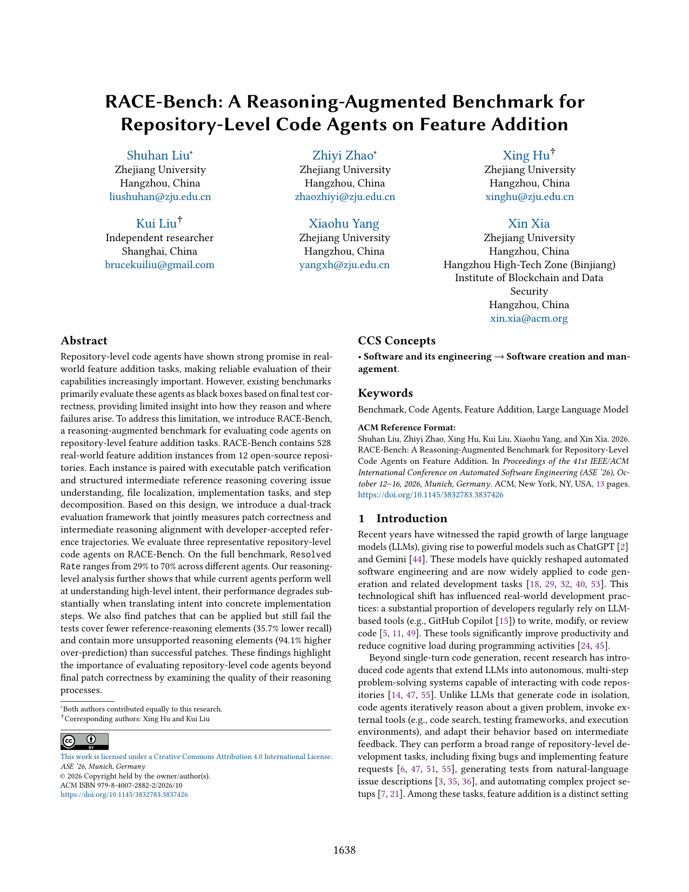

<!-- PDF page 2 -->

## Página PDF 2

ASE ’26, October 12–16, 2026, Munich, Germany
Shuhan Liu, Zhiyi Zhao, Xing Hu, Kui Liu, Xiaohu Yang, and Xin Xia
for code agents. Unlike bug fixing, which often starts from an
observed failure and asks the agent to restore intended behavior,
feature addition requires the agent to infer new externally visible
behavior, decide how to integrate it into existing APIs or module
boundaries, and preserve existing behavior while adding the new
capability. This trend highlights the need to systematically evaluate
the capabilities of code agents in feature addition scenarios.
However, the failure modes of code agents are more complex
compared with traditional code-generation LLMs. In real-world fea-
ture addition workflows, producing a correct patch is the outcome
of a structured reasoning pipeline that involves ❶understanding
the issue and its requirements, ❷identifying the relevant files, ❸
locating the necessary code entities, and ❹formulating an appropri-
ate modification plan. Errors can arise at any stage of this process:
an agent may misunderstand the problem intent, modify irrelevant
files, introduce unnecessary changes, or omit essential steps. More-
over, code agents may occasionally pass test cases despite relying
on coincidental reasoning, leading to apparent success that hides
underlying problems. As a result, evaluating code agents solely
based on whether the final patch passes tests, without examining
the intermediate reasoning process, offers limited insight into their
true capabilities and failure characteristics.
Existing benchmarks for evaluating code LLMs and code agents
fall short in capturing the intermediate reasoning challenges in
repository-level feature addition scenarios. Function-level bench-
marks such as HumanEval [9], MBPP [4], and LiveCodeBench [22]
focus on small, context-independent function generation tasks.
While effective for evaluating isolated code generation capabili-
ties, these benchmarks fail to reflect real-world development, where
changes often span across multiple interdependent files and code en-
tities. To bridge this gap, recent benchmarks such as SWE-bench [23]
and FEA-bench [28] derive tasks from real issues and patches in
open-source repositories. However, although these benchmarks
represent a step toward more realistic evaluation, they focus solely
on whether the final generated patch passes the tests. This black-
box evaluation paradigm offers limited visibility into an agent’s
intermediate reasoning process and makes it difficult to diagnose
where and why an agent fails within the development workflow.
To address this gap, we present a new benchmark named RACE-
Bench (Reasoning-Augmented Code Agent Evaluation) for system-
atically evaluating code agents in realistic repository-level feature
addition scenarios with explicit reasoning evaluation. RACE-Bench
is designed with the following key characteristics: ➀RACE-Bench
is constructed from high-quality, actively maintained open-source
repositories, with each instance grounded in a real feature request
and its corresponding pull request (PR). ➁RACE-Bench focuses
on feature addition tasks, which require agents to infer intended
functionality from natural-language issues and coordinate changes
across multiple files and code entities. ➂RACE-Bench provides
structured developer-accepted reference trajectories for intermedi-
ate reasoning stages, including issue understanding, relevant file
identification, concrete implementation tasks, and abstract task-step
decomposition. ➃Each task is equipped with the Fail-to-Pass (FTP)
and Pass-to-Pass (PTP) test cases, verifying both the correctness of
generated code and the preservation of original functionality. ➄
RACE-Bench enables fine-grained evaluation beyond final patch
correctness by measuring reasoning recall and over-prediction (e.g.,
redundant reasoning steps) at different modules of the develop-
ment workflow. ➅RACE-Bench provides a unified, containerized
execution environment for each instance using Docker, enabling
reliable reproduction of repository states and consistent evaluation
across different agents. Overall, RACE-Bench contains 528 feature
addition instances derived from 12 actively maintained open-source
GitHub repositories. To facilitate more efficient experimentation,
we construct a lightweight subset named RACE-Bench Lite. This
subset contains 100 instances selected through a difficulty-aware
sampling strategy designed to preserve the overall challenge level
of the RACE-Bench.
To evaluate the effectiveness of RACE-Bench, we assess three
representative code agents on the full benchmark using DeepSeek
as the base model. The results reveal substantial performance vari-
ation across agents, with Resolved Rate ranging from 29% to 70%.
Beyond final patch correctness, our reasoning evaluation shows
that code agents usually understand high-level intent, but their
reference-alignment recall drops as reasoning becomes more con-
crete, from file localization to task steps. Furthermore, patches that
can be applied but still fail the tests show 35.7% lower reference-
reasoning recall and 94.1% higher over-prediction than successful
patches. We further extend the evaluation on RACE-Bench Lite
by incorporating additional base LLMs. The results indicate that
although the choice of base LLM influences agent performance,
its impact is constrained by the agent architecture. Agents with
better-designed frameworks maintain relatively stable performance
across different base LLMs.
Contributions: In summary, the main contributions of this paper
can be summarized as follows:
• We introduce RACE-Bench, a repository-level feature-addition
benchmark for code agents. It contains 528 real-world feature
addition instances from 12 GitHub repositories, each equipped
with executable patch verification and structured intermediate
Reference Reasoning.
• We propose a dual-track evaluation framework that measures
both patch correctness and reasoning alignment with developer-
accepted trajectories through five structured reasoning modules,
enabling fine-grained diagnosis beyond patch-only evaluation.
• We conduct a systematic study of three representative code
agents with multiple base LLMs on RACE-Bench, revealing dif-
ferences in effectiveness, reasoning behavior, and efficiency.
2
RACE-Bench
In this section, we present the design and construction of RACE-
Bench.
2.1
Overview
The task instances in RACE-Bench are constructed from real-world
PR data and their corresponding GitHub issues. As illustrated in
Figure 1, an instance supports the evaluation of both final patch
correctness and reasoning alignment. Each instance consists of
three primary components:
❶Task Context. This module provides the necessary information
and execution environment to initialize a development task. The
Feature Request is derived from the original GitHub issue and pro-
vides a natural language description of the intended functionality.
1639

[Vista original de la página 2](../../../../../images/v5/estructura_colecciones/Evaluation/secondary/RACE-Bench/page-02.png)

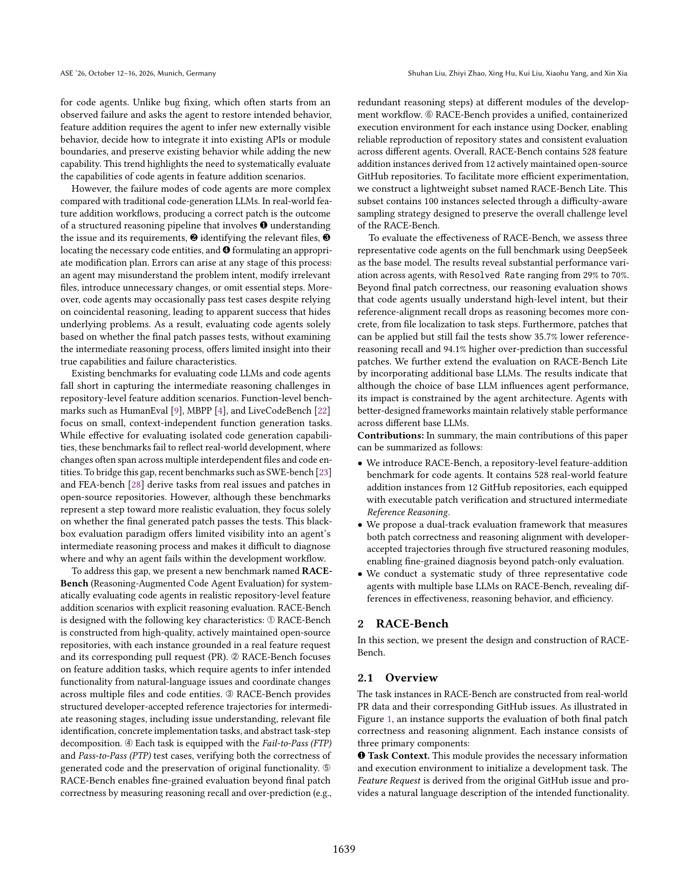

<!-- PDF page 3 -->

## Página PDF 3

RACE-Bench: A Reasoning-Augmented Benchmark for Repository-Level Code Agents on Feature Addition
ASE ’26, October 12–16, 2026, Munich, Germany
Task Context
Add molar mass equivalency
I think the equivalency between amu and 
g/mol should be shipped along with the 
other predefined equivalencies in future 
versions …
Feature Request
Environment Setup
Though perhaps if the two are identical 
by definition then this doesn't even 
belong in equivalencies and is just a 
conversion that should happen 
automatically?  ( … )
Hints Text
Reference Reasoning
Issue Understanding
A unit of molar mass …
amu
g/mol
Atomic mass unit (u) …
Concept Explanations
Goal Expectation
Include a built-in equivalency between 
atomic mass units and grams per mole…
File Localization
Issue Implementation
Necessary Code File
astropy/units/equivalencies.py
Other File
docs/units/equivalencies.rst
Test File
astropy/units/tests/test_eq
uivalencies.py
Specific Tasks
Task ID T1
Entity Name
molar_mass_amu
Change Type
Is Necessary
new
Location astropy/units/equivalencies.py
Purpose
true
Add a new equivalency function that 
provides conversion between…
Step Decomposition
Step ID
Add a new function that returns an equivalency list for converting 
between atomic mass units and grams per mole.
Task Steps
1
Step Type
Introduce New Capability
Related Tasks T1
Goal
Verification
--- a/astropy/units/equivalencies.py
+++ b/astropy/units/equivalencies.py
+ def molar_mass_amu():
…
+ - Gold Patch
--- a/astropy/units/tests/test_equivalencies.py
+++ b/astropy/units/tests/test_equivalencies.py
+ def test_molar_mass_amu():
…
+ - Test Patch
Unit Test
Fail To Pass
astropy/units/tests/test_equivalenci
es.py::test_molar_mass_amu
Pass To Pass
astropy/units/tests/test_equivalenci
es.py::test_dimensionless_angles
Repo    astropy/astropy
Base Commit 
5ed598505bae5aae0f92ac6d643baae602fe040
Version    2.0
Figure 1: An example of a task instance from the RACE-Bench. During agent inference, only the Feature Request and FTP
tests are provided as the observable inputs, while the Environment Setup specifies the execution context for evaluation. Each
instance additionally includes structured developer-accepted Reference Reasoning, the corresponding Gold Patch, and Unit
Tests, enabling end-to-end evaluation of both intermediate reasoning processes and final patch correctness.
The Environment Setup specifies the execution context, including
the repository, release version, and base commit. This setup ensures
that evaluations are conducted in a consistent and reproducible
state. Additionally, the module may include optional Hints Text from
developer discussions to provide extra context for design decisions.
❷Reference Reasoning. To evaluate the reasoning alignment
of code agents, RACE-Bench follows a human-like workflow that
decomposes the reasoning process into four stages containing five
reasoning modules:
• Issue Understanding. This component captures the understand-
ing of the issue intent. The Concept Explanations identify domain-
specific concepts, while the Goal Expectation provides a concise
summary of the expected behavior.
• File Localization. This component identifies the files that are
modified or added. All files are categorized into three types. Nec-
essary Code Files are essential for the patch to pass the tests. Other
Files include auxiliary changes like documentation or changelogs.
Test Files consist of the unit test files for the task instance.
• Issue Implementation. This component identifies the code
entities to be added, modified, or removed. For each entity, it
includes the file location and the change type (i.e., new, modified,
or deleted), along with its purpose and an is_necessary flag to
indicate whether it is an indispensable entity to pass the tests.
This level diagnoses whether an agent covers the concrete code
entities required by the developer-accepted implementation.
• Step Decomposition. This component abstracts the implemen-
tation process into a sequence of essential task steps. Each step
describes a high-level modification action (e.g., introduce new
capability and reuse existing semantics). It evaluates whether
an agent produces a reference-aligned implementation plan.
The five modules follow a human-like workflow for feature ad-
dition. This granularity balances diagnostic value and reliability. A
coarser schema would hide failure sources, while a finer schema
would depend more on implementation details and reduce annota-
tion consistency. The reference reasoning in RACE-Bench is derived
from developer-accepted patches and represents one accepted im-
plementation trajectory rather than the only valid solution.
❸Verification. This module evaluates the functional correctness
of a generated patch through automated testing. Each instance
provides a Gold Patch and an associated Test Patch for the requested
feature from the PR. These patches can be applied to the repository
using the git apply tool. The correctness is verified by executing
the Unit Test with pytest. The FTP test cases fail before applying
the Gold Patch and pass afterward. The PTP test cases ensure that
existing functionalities remain preserved after the modification.
2.2
Benchmark Construction
This subsection describes the end-to-end construction pipeline of
RACE-Bench, including repository selection and environment setup,
instance filtering, Reference Reasoning construction, and the valida-
tion process to ensure data quality and reliability.
2.2.1
Repository Collection and Environment Construction. Follow-
ing the design of SWE-bench [23], we select the same set of 12
popular open-source Python repositories on GitHub as the source
for RACE-Bench instances. These repositories are widely used in
practice, actively maintained, and governed by well-defined contri-
bution guidelines. To ensure that both instance construction and
subsequent benchmark evaluation are performed in a stable and re-
producible environment, we build independent Environment Docker
images for each stable release of the repositories. Each image en-
capsulates the required dependencies and Python runtime. This
approach mitigates environment drift and ensures that tests are
executed consistently across experiments.
2.2.2
Instance Filtering. Starting from all merged PRs across the
selected 12 repositories, we apply a three-stage filtering pipeline to
1640

[Vista original de la página 3](../../../../../images/v5/estructura_colecciones/Evaluation/secondary/RACE-Bench/page-03.png)

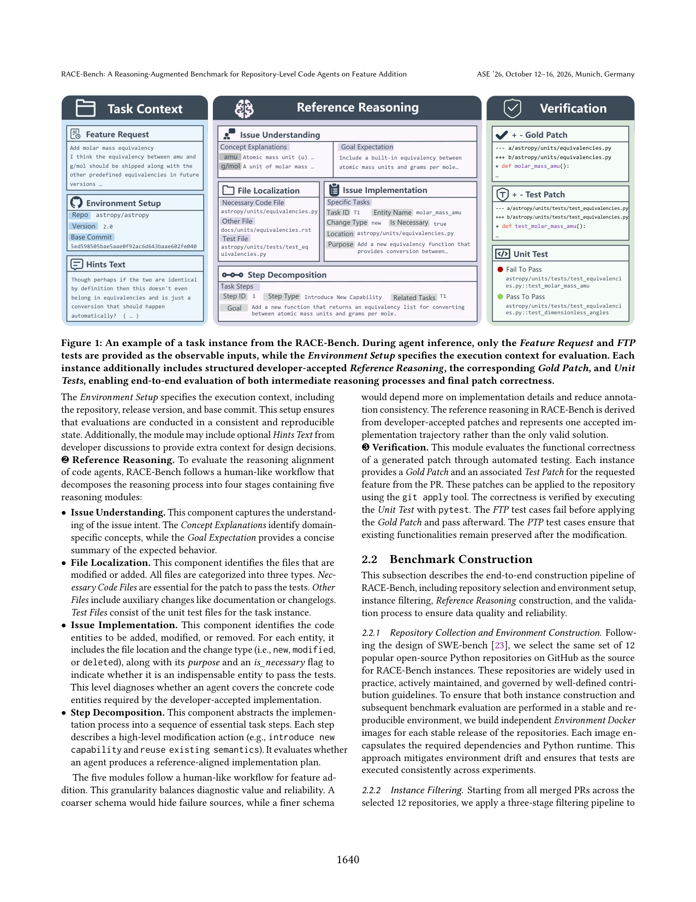

<!-- PDF page 4 -->

## Página PDF 4

ASE ’26, October 12–16, 2026, Munich, Germany
Shuhan Liu, Zhiyi Zhao, Xing Hu, Kui Liu, Xiaohu Yang, and Xin Xia
identify high-quality feature addition instances suitable for evalu-
ating repository-level code agents.
Attribute-based filtering. We first perform coarse-grained filter-
ing based on observable PR attributes. Specifically, we retain only
PRs that (1) modify files under test-related directories (e.g., test
or testing), indicating the presence of explicit test changes, and
(2) are explicitly linked to at least one GitHub issue, ensuring the
availability of a natural-language feature request. After this stage,
14,333 PRs satisfy the filtering criteria.
Intent-based filtering. Next, we identify PRs that correspond to
feature addition tasks. For each remaining PR, we use DeepSeek to
classify the development intent based on the PR title and description,
assigning it to categories such as new feature, bug fix, or refactor. To
assess the reliability of the classifier, we randomly sample 100 PRs
from the filtered pool and manually verify their predicted labels. The
manual inspection shows that the classification accuracy exceeds
99%, indicating that the LLM provides reliable intent predictions
for this task. We retain only PRs whose intent is classified as new
feature and manually recheck the candidate PRs to confirm that
they correspond to feature addition tasks. This filtering step yields
2,931 candidate PRs.
Execution-based filtering. Finally, we apply an execution-driven
validation process to ensure that each candidate PR can serve as
a reliable benchmark instance. For each PR, we retrieve its corre-
sponding base commit and repository version, and perform the
following steps within the matching Environment Docker: (1) clone
and install the repository; (2) check out the base commit; (3) apply
the Test Patch and execute the test suite, where at least one test
is expected to fail; (4) apply the Gold Patch and re-run the tests;
(5) compare the test outcomes before and after applying the Gold
Patch to determine the FTP and PTP test sets. If any step fails (e.g.,
environment setup errors or missing FTP tests), the instance is
discarded. After this stage, 580 PRs remain and are retained as valid
RACE-Bench instances.
2.2.3
Reference Reasoning Construction. For each retained instance,
we construct a structured developer-accepted Reference Reasoning
to enable evaluation of intermediate reasoning behaviors exhibited
by code agents. The reference is organized as the four-stage rea-
soning schema described in Section 2.1, and is derived through a
combination of LLM assistance and patch-driven program analysis.
All LLM calls in this construction stage use DeepSeek with temper-
ature=0.0. The prompts are included in the replication package.
Issue Understanding. The Concept Explanations and Goal Expec-
tation are generated using LLM. We provide the model with the
original Feature Request, the Hints Text, and the repository README to
supply task-specific and project-level context. The model identifies
domain-specific concepts from the issue description and summa-
rizes the expected system behavior after implementation. These
summaries focus on observable behavior. To prevent implementa-
tion leakage, we explicitly prohibit code-level details.
File Localization. The File Localization reference is extracted from
the Gold Patch and Test Patch. All files modified or added in the Gold
Patch are initially marked as relevant. To distinguish necessary files
from others, we employ a test-driven ablation procedure. For each
modified file, we create a patch variant by removing the changes
of that file and then re-executing the Unit Test. A file is labeled as
a Necessary Code File if removing its changes causes a test failure;
otherwise, it is labeled as an Other File. In addition, all files modified
or added in the Test Patch are labeled as Test File.
Issue Implementation. The Specific Tasks reference captures the
set of code entities required to implement the feature. For each in-
stance, we analyze the Gold Patch by statically parsing the modified
source files to extract added, modified, or deleted code entities (i.e.,
functions and methods). We define classes as a structural container
rather than a code entity, as they typically consist of multiple meth-
ods. For each extracted entity, we further annotate its semantic
purpose using DeepSeek. Specifically, we provide the model with
the original Feature Request and the patch-local code context of the
entity, and instruct the LLM to summarize the role of the entity in
terms of observable behavior. To determine whether an entity is
semantically necessary, we additionally provide the FTP tests and
ask the model to assess whether the intended behavior can still be
achieved without modifying that entity.
Step Decomposition. Finally, we construct the Task Steps refer-
ence by abstracting the gold implementation into a minimal se-
quence of essential semantic steps. We define a fixed and closed
taxonomy of step types (i.e., introduce new capability, reuse
existing semantics, change existing semantics, deprecate
or replace behavior and enforce constraints or edge
cases). This taxonomy captures common categories of externally
observable implementation changes required for tests to pass. Given
the filtered Specific Tasks, the Gold Patch, and the original Feature
Request, DeepSeek is prompted to select and order a minimal set
of task steps from this taxonomy. Each step represents exactly one
irreducible semantic responsibility, is grounded in one or more
existing tasks, and is assigned a single step type. This representa-
tion abstracts low-level code details while preserving the essential
structure and ordering of the implementation process.
2.2.4
Validation. To ensure the reliability of the automatically
constructed Reference Reasoning, we perform an LLM-assisted audit
over 580 candidate instances that remain after instance filtering,
followed by targeted human inspection on a subset of cases. The
audit is conducted using GPT-5.2 with temperature 0.0, and the
full audit prompt is provided in the replication package.
For each candidate instance, a GPT 5.2 LLM auditor evaluates
three aspects: (1) For Issue Understanding, we assess whether the
Concept Explanations accurately cover the domain-specific terms
appearing in the Feature Request and whether the Goal Expectation
correctly summarizes the intended requirement. (2) For Specific
Tasks, we verify whether entities labeled as necessary correspond
to genuine requirements of the Feature Request and whether their
inferred purposes are semantically accurate. (3) For Step Decompo-
sition, we assess whether each Task Step represents a distinct and
essential semantic step by performing an ablation check. In this
process, a step is considered valid only if its removal renders the
Feature Request unsatisfiable.
Instances are removed if the auditor detects semantic misinter-
pretation, incorrect necessity judgments, or structural defects. To
assess the reliability of the automatic audit, we manually inspect
100 candidates, including 50 accepted and 50 rejected by the auditor.
Two authors independently review the Feature Request, patches,
Reference Reasoning, and the auditor rationale. They accept a case
1641

[Vista original de la página 4](../../../../../images/v5/estructura_colecciones/Evaluation/secondary/RACE-Bench/page-04.png)

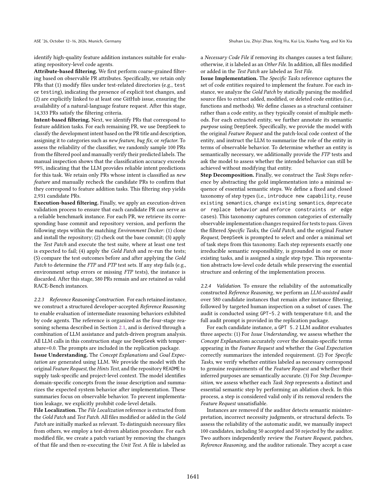

<!-- PDF page 5 -->

## Página PDF 5

RACE-Bench: A Reasoning-Augmented Benchmark for Repository-Level Code Agents on Feature Addition
ASE ’26, October 12–16, 2026, Munich, Germany
if the labels are semantically supported. They reject cases with
unsupported additions, incorrect necessity labels, or invalid step
decompositions. For example, pydata__xarray-9453 is accepted
because its reference reasoning covers all required behaviors. In con-
trast, sympy__sympy-12171 is rejected because its feature request
includes both Derivative printing and Float exponent conversion,
but the reference omits the Float requirement. On this subset, the
human inspectors agree with the auditor’s decision on 96 out of
100 cases (96.0%), suggesting that the automatic audit is generally
reliable for filtering problematic Reference Reasoning. In total, 52
out of the 580 candidate instances are excluded. After this stage,
528 validated instances remain and form the full RACE-Bench.
2.2.5
RACE-Bench Lite Construction. Evaluating repository-level
code agents requires substantial LLM interaction, making large-
scale evaluation costly. To enable efficient experimentation while
preserving the overall difficulty distribution of the benchmark, we
construct a lightweight subset, RACE-Bench Lite.
Starting from the validated instances in the full benchmark, we
select a subset of size 𝑁(default 𝑁=100) whose empirical difficulty
closely matches that of the full benchmark. Specifically, for each
instance we collect two results from the full benchmark runs of
three agent configurations (AutoCodeRover, TraeAgent, and mini-
SWE-Agent): (1) whether the generated patch passes the test suite
(patch success) and (2) whether the patch can be applied successfully
(apply success). Let 𝑟𝑝𝑎𝑡𝑐ℎ
𝑘
and 𝑟𝑎𝑝𝑝𝑙𝑦
𝑘
denote the Resolved Rate
and Patch Apply Rate of configuration 𝑘on the full benchmark.
Given a candidate subset 𝑆, we compute the corresponding rates
ˆ𝑟𝑝𝑎𝑡𝑐ℎ
𝑘
(𝑆) and ˆ𝑟𝑎𝑝𝑝𝑙𝑦
𝑘
(𝑆). The subset selection objective minimizes
the deviation from the full benchmark statistics:
min
𝑆
∑︁
𝑘

(ˆ𝑟𝑝𝑎𝑡𝑐ℎ
𝑘
(𝑆) −𝑟𝑝𝑎𝑡𝑐ℎ
𝑘
)2 + (ˆ𝑟𝑎𝑝𝑝𝑙𝑦
𝑘
(𝑆) −𝑟𝑎𝑝𝑝𝑙𝑦
𝑘
)2
.
We solve this optimization using a randomized local-search pro-
cedure. This process iteratively replaces instances in the subset
to reduce the objective value. The resulting RACE-Bench Lite pre-
serves the Resolved Rate and Patch Apply Rate distributions
observed in the full benchmark while reducing evaluation cost. We
use RACE-Bench Lite for larger-scale experiments across multiple
models in RQ3 (Section 4.3).
2.3
Evaluation Workflow
We propose a dual-track evaluation workflow to systematically
assess both the final patch output and the intermediate reasoning
process of code agents. As illustrated in Figure 2, the workflow
consists of three stages: agent inputs, code agent execution, and
dual-track evaluation.
Agent Inputs. A code agent is initialized in the repository state
defined by the Environment Setup in Figure 1. RACE-Bench targets
feature addition tasks with developer-provided tests. The agent
receives the Feature Request and all FTP tests as inputs, while PTP
tests remain hidden for final evaluation. The FTP tests serve as
an executable specification of the requested behavior, defining the
minimal correctness criteria that the generated patch must satisfy.
Code Agent Execution. A code agent typically operates through
the coordination of an agent controller, external development tools,
Repository
State
Feature
Request
Fail To Pass
Test
Inputs
Agent Controller
Code Agent
LLM
Tools
File Search
Run Tests
. . . 
contain
call
result
chat
input
Patch Verification
Reasoning Assessment
input
Outputs & Evaluation
Patch
Patch Assessment
PTP
Pass
Fail
FTP
summarize
LLM
Concept Explanation
Goal Expectation
supplement
File Localization
Specific Tasks
Task Steps
Reference
Reasoning
compare
Figure 2: The Dual-Track Evaluation Framework for RACE-
Bench.
and an underlying LLM. Commonly used tools include file search,
static analysis, and test execution. Guided by the LLM’s intermedi-
ate outputs, the agent iteratively invokes these tools to inspect the
codebase, validate hypotheses, and gather task-relevant informa-
tion. This reasoning–action loop continues until the agent generates
a final patch. The interaction traces between the agent controller
and the LLM record the decisions and rationales underlying the
code changes, and serve as the primary evidence for analyzing the
agent’s reasoning behavior.
Dual-Track Evaluation. The evaluation of an instance consists of
two complementary components:
• Patch Verification: The agent is expected to generate a patch
that satisfies all FTP tests while preserving existing behaviors
validated by PTP tests. A patch is considered functionally correct
if it passes all required tests in the evaluation environment.
• Reasoning Assessment: We employ a summarizer LLM to post-
process the interaction traces between the agent controller and
the underlying LLM. These traces are converted into a structured
representation that aligns with the predefined Reference Rea-
soning schema. If the agent successfully produces a valid patch,
we further enrich the summarized reasoning by applying the
same patch-driven back-inference procedure used to construct
the Reference Reasoning, extracting additional information such
as file localization, specific implementation tasks, and abstract
task steps. Finally, the resulting structured reasoning is systemati-
cally compared with the Reference Reasoning. Detailed evaluation
metrics are presented in Section 2.4.
1642

[Vista original de la página 5](../../../../../images/v5/estructura_colecciones/Evaluation/secondary/RACE-Bench/page-05.png)

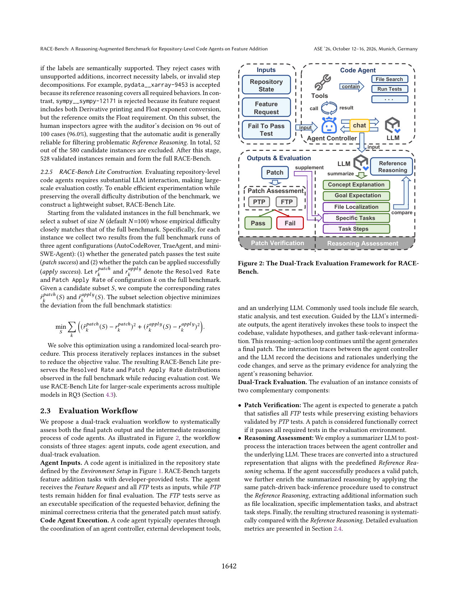

<!-- PDF page 6 -->

## Página PDF 6

ASE ’26, October 12–16, 2026, Munich, Germany
Shuhan Liu, Zhiyi Zhao, Xing Hu, Kui Liu, Xiaohu Yang, and Xin Xia
Table 1: Reasoning evaluation metrics for different intermediate reasoning modules.
Reasoning Module
Metric
Definition
Concept Explanations
Recall@Concept
Proportion of benchmark concepts that are explicitly explained by the agent.
Accuracy@Concept
Proportion of agent-explained concepts whose explanations are judged semantically
consistent with the benchmark by an LLM judge.
Goal Expectation
Score@GoalExpectation
A 10-point LLM-based evaluation of whether the agent correctly understood the core
user intent.
Relevant Files
Recall@RelevantFiles
Coverage of necessary files in the benchmark that are correctly identified by the agent.
OverPrediction@RelevantFiles
Proportion of irrelevant files predicted by the agent to all predicted files.
Specific Tasks
Recall@SpecificTasks
Proportion of necessary implementation tasks covered by the agent.
OverPrediction@SpecificTasks
Proportion of extra tasks predicted by the agent that are not required by the gold patch
to all predicted tasks.
Task Steps
Recall@TaskSteps
Proportion of benchmark steps that are recovered by the agent.
OverPrediction@TaskSteps
Proportion of extra steps predicted by the agent to all predicted steps.
2.4
Evaluation Metrics
We evaluate agents on the proposed benchmark from two comple-
mentary perspectives: Patch Evaluation and Reasoning Evalua-
tion. Patch Evaluation focuses on the correctness of the generated
code, while Reasoning Evaluation assesses the quality of the inter-
mediate reasoning produced during the problem-solving process.
Patch Evaluation. An agent is considered successful on an in-
stance if the generated patch passes all FTP and PTP tests. Follow-
ing prior work on repository-level code generation benchmarks [8,
12, 23, 28], we adopt Resolved Rate (%) as the primary metric for
evaluating patch correctness. This metric measures the percentage
of instances for which the agent produces a successful patch on
the first attempt. We also report the Patch Apply Rate (%), which
captures the proportion of generated patches that are syntactically
valid and can be applied to the repository without errors. Apply-
success is checked before test execution. Patches that fail to apply
with git apply are classified as apply-fail and are not evaluated
on the FTP/PTP tests.
Reasoning Evaluation. Table 1 presents the evaluation metrics
used for each reasoning module. Since feature addition may admit
multiple valid implementations, these metrics should be interpreted
as alignment with the developer-accepted reference reasoning. For a
subset of the intermediate reasoning modules that require semantic
judgment, we employ an LLM-based evaluation paradigm (LLM-
as-Judge). The reliability of LLM-as-Judge has been widely studied
and shown to be effective not only in natural language generation
tasks [33, 42], but also in software engineering-related tasks [19, 46].
All LLM-based reasoning evaluation steps use DeepSeek with tem-
perature 0.0. The prompt and scripts are included in the replication
package. To compute the metrics for Specific Tasks, it is necessary
to align benchmark tasks with the tasks inferred from the agent-
generated patch. We adopt a hybrid alignment strategy that com-
bines deterministic matching with semantic matching. For tasks
whose Change Type is deleted or modified, we apply determinis-
tic alignment: a task is considered aligned if both its Entity Name
and Location match exactly between the benchmark and the agent
output. For tasks with Change Type new, we first attempt determin-
istic matching using the same criteria. If no aligned task is found,
we further employ an LLM-based semantic matcher to compare
the Purpose descriptions and identify an aligned task at the func-
tional level. A similar alignment procedure is applied to the Task
Steps module. For each benchmark step, we first select candidate
agent steps that share the same Step Type and have overlapping
Related Tasks. We then use an LLM-based semantic judgment to
determine whether any candidate step covers the benchmark step’s
intent. To validate the evaluation procedure, two authors manually
reviewed 100 evaluated agent runs. They marked an evaluation
as correct when the reported match or score was supported by
both the Reference Reasoning and the agent trace. They marked
it as incorrect when the evaluator missed a semantically equiva-
lent match, accepted an unrelated match, or assigned a score that
was not supported by the evidence. Disagreements were resolved
through discussion. The authors agreed with the automatic evalua-
tion in 97 of the 100 runs, indicating that the procedure is reliable
for measuring alignment with the Reference Reasoning.
3
Experimental Setup
3.1
Agents and Models
Agent selection. We evaluate three representative repository-
level code agents selected from the SWE-bench leaderboard [43],
which provides a widely used reference point for current auto-
mated software engineering agents. Specifically, we include Au-
toCodeRover [55], a research system that emphasizes structured
repository navigation and localized edits; TraeAgent [14], which
investigates test-time scaling and iterative refinement for software
engineering tasks; and mini-SWE-Agent [51], a lightweight agent
framework derived from SWE-Agent that integrates LLM reasoning
with repository execution environments. We select these agents
because they are widely used in SWE-bench evaluations, represent
both research-oriented and practical agent designs, and have pub-
licly documented workflows that enable reproducible evaluation.
Model selection. We use DeepSeek V3.2 [30] as the base model
and evaluate it across all three agents on the full RACE-Bench.
To broaden model coverage under a lower-cost setting, we addi-
tionally report the results of three agents on RACE-Bench Lite
using GLM-4.7 [57] and GPT-5.2 [37] as base models. In addition,
DeepSeek V3.2 is used as the summarizer LLM to generate a nor-
malized intermediate reasoning chain for the reasoning evaluation.
1643

[Vista original de la página 6](../../../../../images/v5/estructura_colecciones/Evaluation/secondary/RACE-Bench/page-06.png)

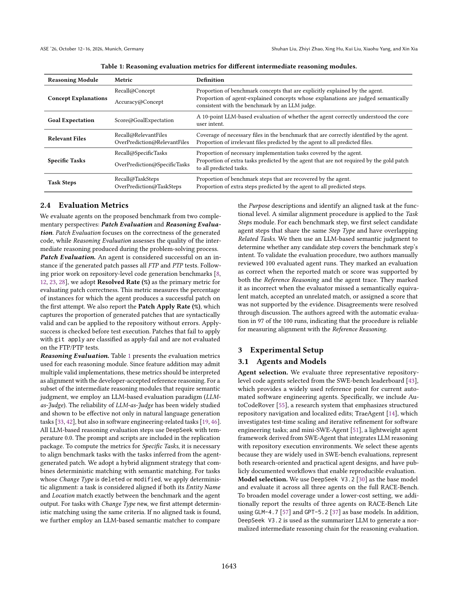

<!-- PDF page 7 -->

## Página PDF 7

RACE-Bench: A Reasoning-Augmented Benchmark for Repository-Level Code Agents on Feature Addition
ASE ’26, October 12–16, 2026, Munich, Germany
3.2
Setup
Execution environment. To ensure reproducibility, we evaluate
each instance in an isolated Instance Docker built on the Environ-
ment Docker image of the related release version described in Sec-
tion 2.2.1. For every instance, we reset the repository to its base
commit, clone the target project, and perform the required project
setup steps (e.g., installing the package with pip install -e .).
Hardware. All experiments are conducted on a Linux server equipped
with two Intel Xeon Platinum 8358P CPUs (64 cores total @ 2.60 GHz)
and 2 TB RAM, running Ubuntu 20.04 LTS.
Agent configuration. For all agents, we use their default configura-
tions, following the recommendations in the official documentation.
To compute Resolved Rate, we run each agent on each instance
exactly once (i.e., single attempt per instance).
LLM configuration. All LLM calls in this work are made through
official APIs. We set temperature=0 and top_p=1. The maximum
generation length is set to 4,096 tokens for agent inference and
8,192 tokens when the model is used as the summarizer LLM for
intermediate reasoning normalization.
4
Results and Analysis
We organize our evaluation around three research questions (RQs):
RQ1. (Capability) How well do code agents resolve repository-
level feature addition tasks on RACE-Bench?
RQ2. (Reasoning) How well do code agents perform on interme-
diate reasoning evaluation, and what does the reasoning profile
reveal about their strengths and limitations?
RQ3. (Generality) How does the choice of the agent’s base LLM
affect performance on RACE-Bench Lite?
4.1
RQ1: Capability
RQ1 evaluates the patch-level capability of code agents to resolve
repository-level feature addition tasks. We evaluate three agents on
the full RACE-Bench and measure their end-to-end effectiveness
by whether the generated patch can (i) be applied cleanly and (ii)
pass the benchmark tests. Table 2 summarizes the results.
“ Main results. AutoCodeRover resolves 28.79% (152/528) of
the instances while achieving a very high Patch Apply Rate
of 96.21% (508/528). This suggests that AutoCodeRover is generally
reliable at producing syntactically valid patches, but it often fails
to fully satisfy the functional requirements enforced by the test
suite. TraeAgent attains a notably higher Resolved Rate of 52.65%
(278/528), indicating stronger task-solving effectiveness. However,
its Patch Apply Rate is substantially lower at 78.98% (417/528).
mini-SWE-Agent achieves the highest Resolved Rate of 70.08%
(370/528), substantially outperforming both AutoCodeRover and
TraeAgent. At the same time, it maintains a high Patch Apply Rate
of 95.83% (506/528). This indicates that mini-SWE-Agent combines
strong problem-solving capability with stable patch generation,
making it the most effective agent on the RACE-Bench.
“ Why does TraeAgent have a lower Patch Apply Rate?
Through manual inspection of failed cases, we find that many apply-
check failures are caused by unstable agent-environment interac-
tions rather than incorrect patch intent. In particular, TraeAgent
can enter unrecoverable terminal states during tool use, such as
invoking interactive Python sessions or opening files with blocking
Table 2: Patch-level results of code agents on the full RACE-
Bench (528 instances).
Agent
Patch Apply Rate
Resolved Rate
AutoCodeRover
508/528 (96.21%)
152/528 (28.79%)
TraeAgent
417/528 (78.98%)
278/528 (52.65%)
mini-SWE-Agent
506/528 (95.83%)
370/528 (70.08%)
commands that require explicit keystrokes to exit. These behaviors
may cause the run to hang and prevent clean patch application.
­
Answer to RQ1: On RACE-Bench, mini-SWE-Agent has the
highest Resolved Rate (70.08%), outperforming TraeAgent
(52.65%) and AutoCodeRover (28.79%). TraeAgent’s perfor-
mance is limited by a lower Patch Apply Rate (78.98%),
highlighting the importance of stable agent–tool interaction.
4.2
RQ2: Reasoning
While RQ1 focuses on end-to-end patch correctness, RQ2 aims
to evaluate the intermediate reasoning processes of code agents
when solving repository-level feature addition tasks. Following the
Reasoning Assessment workflow described in Section 2.3, we first
employ an independent summarizer LLM to normalize the interme-
diate reasoning process (i.e., Concept Explanations, Goal Expectation,
File Localization, Specific Tasks, and Task Steps) of each instance. If
an apply-success patch is generated, we further refine the reasoning
chain by applying the same back-inference procedure used to con-
struct the Reference Reasoning (Section 2.2.3), deriving intermediate
reasoning directly from the generated patch. We then compare each
agent’s reasoning chain against the benchmark-provided Reference
Reasoning using the evaluation metrics introduced in Section 2.4.
Since modules such as File Localization and Specific Tasks can be re-
constructed and supplemented from the generated patch, apply-fail
instances prevent structural reconstruction. To ensure fair com-
parison, we additionally report the failure subset that excludes
apply-fail instances. Table 3 reports the mean reasoning scores for
four groups: All, Success (apply-success and test-success), Failure
(apply-fail or test-fail), and Failure (excluding apply-fail). Our key
findings are summarized as follows:
­ Finding 1. Implicit Conceptual Understanding. Across the
intermediate reasoning process of 528 instances, explicit concept
explanations are nearly absent. AutoCodeRover provides them in
0.18% (1/528) of cases, TraeAgent in 1.70% (9/528), and mini-SWE-
Agent in 0.94% (5/528). In most instances, agents proceed directly
to file exploration or code edits without clarifying domain concepts.
This pattern reflects an execution-first reasoning style that is shaped
by agent prompting. However, all agents achieve consistently high
Score@Goal values (9.2–9.6). To reach such high goal expectation
scores, the agents must correctly interpret the domain-specific
concepts described in the issue. This indicates that the models un-
derstand these concepts internally, even though they rarely explain
them explicitly in their intermediate reasoning processes.
­ Finding 2. Strong Intent Understanding but Waterfall Degra-
dation in Execution. Intent comprehension is not the primary
difficulty for repository-level code agents. As shown in Table 3,
all three agents demonstrate a high-level understanding of feature
requests. The Score@Goal metric remains high across agents, with
1644

[Vista original de la página 7](../../../../../images/v5/estructura_colecciones/Evaluation/secondary/RACE-Bench/page-07.png)

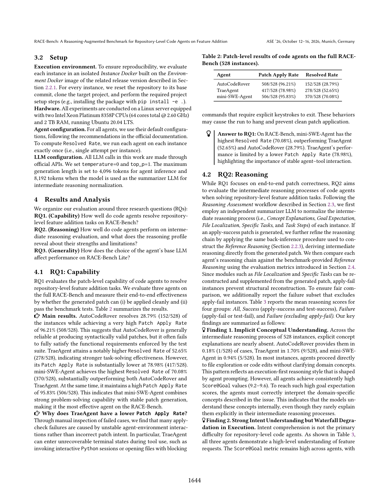

<!-- PDF page 8 -->

## Página PDF 8

ASE ’26, October 12–16, 2026, Munich, Germany
Shuhan Liu, Zhiyi Zhao, Xing Hu, Kui Liu, Xiaohu Yang, and Xin Xia
Table 3: Reasoning evaluation results on RACE-Bench (mean scores). “Success”/“Failure” are split by patch success. We
additionally report “Failure (excl. apply-fail)” whose patches apply successfully but fail at least one test.
Agent
Group
Score@Goal
Recall@Files
OverPred@Files
Recall@Tasks
OverPred@Tasks
Recall@Steps
OverPred@Steps
AutoCodeRover
All
9.344
0.840
0.067
0.675
0.255
0.397
0.579
Success
9.397
0.961
0.034
0.853
0.136
0.565
0.447
Failure
9.321
0.791
0.080
0.602
0.304
0.329
0.633
Failure (excl. apply-fail)
9.348
0.814
0.084
0.613
0.311
0.329
0.655
TraeAgent
All
9.506
0.746
0.420
0.607
0.334
0.340
0.652
Success
9.538
0.955
0.321
0.858
0.149
0.515
0.538
Failure
9.463
0.515
0.530
0.329
0.540
0.144
0.778
Failure (excl. apply-fail)
9.574
0.640
0.568
0.472
0.377
0.214
0.742
mini-SWE-Agent
All
9.251
0.890
0.049
0.751
0.208
0.445
0.584
Success
9.261
0.954
0.039
0.841
0.141
0.527
0.508
Failure
9.220
0.736
0.073
0.537
0.366
0.251
0.762
Failure (excl. apply-fail)
9.264
0.747
0.069
0.580
0.326
0.281
0.753
average scores exceeding 9.2 out of 10 (e.g., 9.506 for TraeAgent and
9.344 for AutoCodeRover). Even in failed instances, these goal com-
prehension scores show a negligible decline. These results indicate
that agents can accurately capture high-level intent from natural
language issues. However, the main challenge arises when translat-
ing high-level intent into concrete implementation plans. We ob-
serve a clear waterfall-style degradation in performance as the rea-
soning chain progresses from file localization to specific tasks and fi-
nally to task steps. For example, although mini-SWE-Agent achieves
a strong Recall@Files of 0.890, its coverage decreases to 0.751 for
Recall@Tasks and further drops to 0.445 for Recall@Steps. At the
same time, OverPred@Steps increases across all models, reaching
0.652 for TraeAgent and 0.584 for mini-SWE-Agent in the overall
setting. These findings suggest that while identifying high-level
intent is comparatively easy for code agents, accurately planning
how to execute it step by step remains a significant challenge.
­ Finding 3. Higher Reference Alignment is Associated with
Patch Success. By comparing the Success and Failure (excluding
apply-fail) subgroups in Table 3, we observe that successful in-
stances are characterized by high recall and low over-prediction.
Specifically, they maintain Recall@Files above 0.950, Recall@Tasks
above 0.840 and Recall@Steps above 0.510. In contrast, apply-
success but test-fail cases show a decline in recall and an increase
in over-prediction. TraeAgent illustrates this pattern with lower
Recall@Files (0.955 →0.640) and higher OverPred@Files (0.321
→0.568). Similar trends are observed across other reasoning mod-
ules (i.e., tasks and steps). Averaged across all agents and reasoning
modules, apply-success but test-fail instances are characterized
by a 35.7% overall decrease in recall and a 94.1% increase in over-
prediction compared to successful instances. These results suggest
that functional failure is often associated with lower alignment
to the developer-accepted reasoning and a broader modification
scope.
­ Finding 4. Distinct Reasoning Styles Across Agents. The
three agents exhibit clearly different reasoning behaviors, reflecting
trade-offs between exploration and exploitation. AutoCodeRover
represents a conservative style. It records low over-prediction scores
across all reasoning modules. For example, its overall OverPred@Files
is only 0.067 and OverPred@Tasks is 0.255. This strict restriction
on redundant edits directly explains its high Patch Apply Rate
of 96.21% observed in RQ1. The agent only modifies code entities
when it is highly confident. However, this conservative exploitation
also limits recall, leading to missed reference changes. In contrast,
TraeAgent adopts an exploratory strategy. Although it achieves a
high Resolved Rate (52.65%), its over-prediction is substantially
higher, especially at the file and step levels (OverPred@Files =
0.420, OverPred@Steps = 0.652). This pattern indicates that Trae
Agent tends to explore more files and task steps, but with weaker
control over modification boundaries, which may contribute to its
lower Patch Apply Rate (78.98%). mini-SWE-Agent demonstrates
a more effective balance between coverage and precision. It achieves
the highest recall across reasoning modules (Recall@Files = 0.890
and Recall@Tasks = 0.751), while keeping over-prediction rela-
tively low (OverPred@Files = 0.049 and OverPred@Tasks = 0.208).
This combination of broad coverage and controlled redundancy
contributes to the higher Resolved Rate (70.08%) observed in RQ1.
­ Finding 5. Implementation Diversity and Equifinality in
Successful Patches. Even in successful cases where patches pass
all tests, recall at the task and step levels does not reach 1.0. For
example, within the Success subgroup, Recall@Tasks ranges from
0.841 to 0.858, and Recall@Steps ranges from 0.515 to 0.565. These
results indicate that agents can achieve functional correctness with-
out strictly following the Reference Reasoning. This reflects a funda-
mental characteristic of software development: a functional objec-
tive can be implemented through multiple implementation paths.
An agent can deviate from the reference but still produce a success-
ful patch. Consequently, the recall metrics in RACE-Bench evaluate
alignment with developer-accepted reference reasoning rather than
strict matching to a single prescribed solution.
­
Answer to RQ2: Code agents demonstrate strong high-level
intent comprehension (average Score@Goal = 9.37/10), but
exhibit a waterfall-style degradation when translating goals
into specific tasks and plans. Furthermore, apply-success
but test-fail cases are characterized by lower recall (35.7%
decrease) and higher over-prediction (94.1% increase) com-
pared to successful cases. Finally, agents exhibit distinct ex-
ploration–exploitation profiles in their reasoning styles.
4.3
RQ3: Generality
To understand how the underlying LLM influences agent behavior,
we evaluate three agents under different base LLMs. Beyond report-
ing overall performance, we analyze the intermediate reasoning
1645

[Vista original de la página 8](../../../../../images/v5/estructura_colecciones/Evaluation/secondary/RACE-Bench/page-08.png)

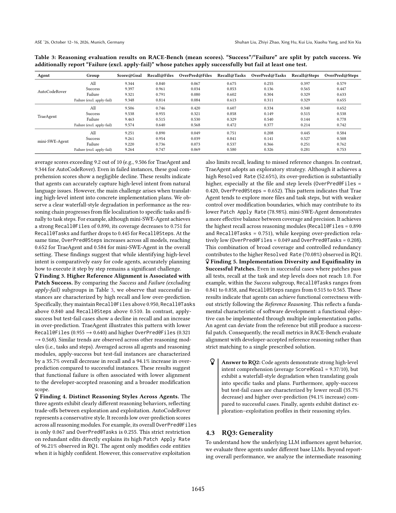

<!-- PDF page 9 -->

## Página PDF 9

RACE-Bench: A Reasoning-Augmented Benchmark for Repository-Level Code Agents on Feature Addition
ASE ’26, October 12–16, 2026, Munich, Germany
Table 4: Patch-level and reasoning-level results on RACE-Bench Lite under different base LLMs. We report the intermediate
reasoning metrics for the Failure (excl. apply-fail) group. Here, R@ and O@ denote Recall and OverPrediction, respectively.
Agent
Base
Resolved Rate
Apply Rate
Score@Goal
R@Files
O@Files
R@Tasks
O@Tasks
R@Steps
O@Steps
AutoCodeRover
DeepSeek
0.290
0.960
9.358
0.791
0.056
0.615
0.319
0.280
0.694
GLM
0.190
0.960
9.000
0.773
0.055
0.585
0.257
0.295
0.681
GPT
0.370
0.990
9.113
0.769
0.066
0.655
0.238
0.362
0.661
TraeAgent
DeepSeek
0.520
0.800
9.731
0.665
0.415
0.558
0.361
0.284
0.735
GLM
0.720
0.920
8.850
0.677
0.378
0.549
0.347
0.273
0.729
GPT
0.770
0.900
9.333
0.767
0.000
0.688
0.156
0.221
0.672
mini-SWE-Agent
DeepSeek
0.710
0.970
9.238
0.760
0.019
0.637
0.197
0.333
0.667
GLM
0.790
0.990
8.222
0.664
0.127
0.521
0.215
0.333
0.600
GPT
0.710
0.990
9.890
0.749
0.033
0.745
0.213
0.400
0.590
process of Failure (excluding apply-fail) cases to investigate why
patches fail the tests. The results are shown in Table 4.
 Finding 1. Base LLM Impact Depends on Agent Architec-
ture. The choice of the base LLM leads to performance variations.
For example, the Resolved Rate of AutoCodeRover varies from
0.190 (GLM) to 0.370 (GPT), while TraeAgent shows a wider variation
from 0.520 (DeepSeek) to 0.770 (GPT). In contrast, mini-SWE-Agent
remains relatively stable across models, with Resolved Rate rang-
ing from 0.710 to 0.790. These results indicate that no single base
LLM consistently performs best across agents, and the agent frame-
work determines the operational boundary of the base LLM. In
conservative agents such as AutoCodeRover, strict AST-guided nav-
igation restricts exploration and causes different LLMs to exhibit
similar reasoning behaviors. For instance, AutoCodeRover shows
consistent reasoning patterns across models, with Recall@Steps
ranging only from 0.280 to 0.362 and OverPred@Steps remaining
high (0.661–0.694). This indicates that the reasoning trajectory is
largely determined by the agent framework rather than the underly-
ing model. In contrast, a more balanced architecture can reduce the
system’s sensitivity to the base LLM. mini-SWE-Agent shows rela-
tively stable performance across models, achieving Resolved Rate
of 0.710 (DeepSeek), 0.790 (GLM), and 0.710 (GPT) while maintaining
high Patch Apply Rate (0.970–0.990). This finding suggests that
well-designed agent architectures can mitigate differences in model
capability and achieve more robust cross-model performance.
 Finding 2. Stronger Base LLMs Improve Different Agents
Through Different Mechanisms. The benefits of stronger base
LLMs vary depending on the agent design. For conservative agents
such as AutoCodeRover, improvements from GPT primarily ap-
pear on the recall side, increasing coverage of relevant tasks and
steps. For example, Recall@Steps increases from 0.280 to 0.362,
while the reduction in over-prediction remains relatively small
(OverPred@Steps decreases from 0.694 to 0.661). This pattern indi-
cates that stronger models help AutoCodeRover identify more re-
quired modifications. In contrast, exploratory agents benefit through
improved redundancy control. For TraeAgent, switching to GPT re-
duces unnecessary exploration. OverPred@Files drops from 0.415
(DeepSeek) to 0.000, while OverPred@Tasks decreases from 0.361
to 0.156. These results suggest that stronger base LLMs improve
exploratory agents mainly by reducing redundant modifications.
 Finding 3. Base LLMs Exhibit Distinct Reasoning Styles.
Different base LLMs consistently exhibit distinct behavioral pat-
terns. GPT tends to produce more precise modifications, resulting in
lower over-prediction across multiple settings. This effect is most
evident in TraeAgent, where OverPred@Files decreases from 0.415
to 0.000 with GPT, while OverPred@Tasks declines from 0.361 to
0.156. These results suggest that GPT is more effective at restricting
the modification scope and avoiding unnecessary exploration. In
contrast, GLM consistently achieves the lowest Score@Goal across
all agents, averaging 7.9% lower than the other base LLMs. This
pattern indicates weaker alignment with the overall task objective,
making GLM more prone to deviating from the intended feature goal.
Overall, these results suggest that different base LLMs introduce
distinct reasoning styles into repository-level code agents.
­
Answer to RQ3: The choice of the base LLM affects agent
performance on RACE-Bench, but its impact is influenced
by the agent architecture. For well-designed agents such as
mini-SWE-Agent, performance remains stable across base
LLMs. Moreover, different base LLMs exhibit distinct reason-
ing styles: GPT tends to produce more precise modifications,
whereas GLM shows weaker goal alignment.
5
Discussion
5.1
Limits of Tests and Reference Reasoning
The reference reasoning in RACE-Bench is derived from developer-
accepted patches. However, feature requests define expected be-
havior rather than a unique implementation. A test-passing patch
may use a different implementation path while still satisfying the
request. We examine this limitation from three aspects: whether the
exposed FTP tests cover the feature request, whether the reference
reasoning can be derived from agent-visible inputs, and whether
successful patches use alternative implementation paths.
Executable Specification Coverage. Prior work shows that devel-
oper tests may not fully capture issue semantics [48]. Because RACE-
Bench exposes FTP tests to agents, we examine how well these
tests cover the corresponding Feature Requests. We use GPT-5.5
to compare each issue description with its exposed FTP tests and
classify the coverage as full, partial, or insufficient. Among the 528
instances, 499 (94.5%) have full or partial coverage, while 29 (5.5%)
are insufficient. RACE-Bench includes FTP tests in the prompt as
a shared specification of expected behavior. Our goal is therefore
to evaluate whether agents can solve feature addition tasks with
developer-provided tests. Although these tests may not capture
every functional requirement, they provide a practical basis for
evaluating agents under this setting.
1646

[Vista original de la página 9](../../../../../images/v5/estructura_colecciones/Evaluation/secondary/RACE-Bench/page-09.png)

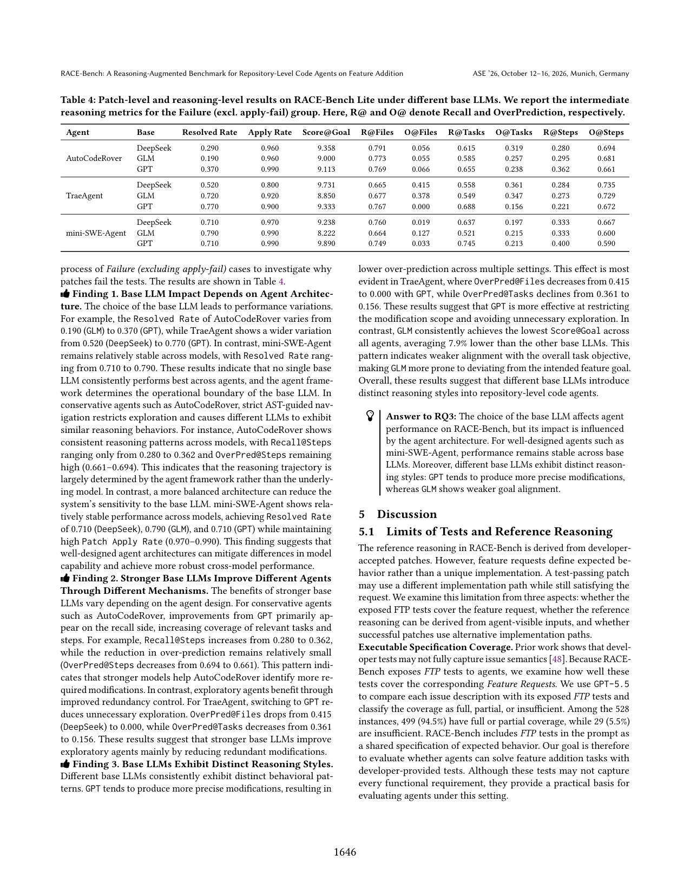

<!-- PDF page 10 -->

## Página PDF 10

ASE ’26, October 12–16, 2026, Munich, Germany
Shuhan Liu, Zhiyi Zhao, Xing Hu, Kui Liu, Xiaohu Yang, and Xin Xia
Visible Input Derivability. Because parts of the Reference Rea-
soning are inferred from the Gold Patch, we assess how much of it
can be derived from the agent-visible inputs. Since RACE-Bench
targets feature-addition tasks where agents receive both the Feature
Request and FTP tests, we perform this analysis under the same
setting using 100 sampled instances. Two reviewers independently
inspect the Feature Request and FTP tests to determine whether
each reference Specific Task and Task Step can be derived from these
inputs. They also identify required tasks or steps that are supported
by the inputs but absent from the Reference Reasoning. Disagree-
ments are resolved through discussion. Overall, 174 of 185 Specific
Tasks (94.05%) and 251 of 256 Task Steps (98.05%) are supported by
the visible inputs. The reviewers also identify six required Specific
Tasks and two Task Steps that are absent from the Reference Reason-
ing, affecting eight instances. These results show that the Reference
Reasoning is largely grounded in agent-visible inputs and support
its use as a diagnostic signal for reasoning alignment.
Implementation Diversity. To examine whether successful patches
always follow the developer-accepted reference trajectory, we an-
alyze 100 sampled instances with at least one successful patch,
yielding 457 successful records. Among them, 422 (92.3%) fully
cover the reference Relevant Files, and 342 (74.8%) fully cover the
reference Specific Tasks. The remaining 127 records (27.8%) pass
patch evaluation but do not fully align with the reference trajectory.
We use GPT-5.5 to classify these cases and find that 89 (70.1%) reflect
meaningful implementation diversity. The most common pattern
is alternative minimal path, where the agent satisfies the feature
request through a smaller or different implementation than the
reference. For example, in a pytest instance, the agent reuses the ex-
isting mechanism to pass timing fields into TestReport, while the
reference modifies TestReport.__init__ directly. These results
show that imperfect alignment does not necessarily indicate in-
correct reasoning. The reasoning metrics in RACE-Bench measure
alignment with a developer-accepted reference trajectory rather
than absolute correctness.
5.2
Design Insights for Code Agents
Beyond comparing agent performance, RACE-Bench provides diag-
nostic signals that reveal reasoning failures in agents. These signals
offer practical design principles and guide improvements for agents.
Design Insights. RACE-Bench provides practical design principles
for repository-level code agents. (1) Avoid overly narrow search.
AutoCodeRover uses AST and API information to guide repository
navigation. It achieves a high Patch Apply Rate of 96.21% and
low over-prediction, but its Resolved Rate is only 28.79% and its
recall is low. This result suggests that conservative exploration can
produce stable patches, but may miss files or changes required to
complete the task. (2) Control redundant modification. TraeAgent
uses iterative exploration and test-time scaling. It achieves a higher
Resolved Rate of 52.65%, but has a much higher OverPred@Files
of 0.420. This result suggests that broad exploration should be
combined with stronger control over the modification scope. (3)
Maintain robust tool states. Manual inspection shows that some
TraeAgent failures arise from unstable tool interactions, such as
interactive sessions and blocking commands. In contrast, mini-
SWE-Agent uses a lightweight bash-centered interaction loop that
keeps the interaction workflow simple and stable. These suggest
that repository-level agents should manage tool states to keep the
reasoning and action loop executable.
Benchmark-guided Case Study. To examine whether the rea-
soning metrics can guide practical improvements, we conduct a
case study on TraeAgent with DeepSeek as the base model. RQ2
shows that apply-success but test-fail cases often have low file-level
alignment (Recall@Files=0.640). Manual inspection reveals a con-
sistent pattern. TraeAgent often starts editing after finding the first
plausible implementation file and stops exploring the repository too
early. When the initial edit introduces new errors, it follows stack
traces for local debugging instead of returning to file localization,
leaving other required files undiscovered. Based on this observation,
we add a lightweight Repository-Level File Localization stage before
code editing. The agent first summarizes signals from the issue
description and FTP tests, identifies candidate implementation files,
and records the final localization decision. The remaining work-
flow is unchanged. On 16 representative localization-failure cases,
the modified agent improves Recall@Files from 0.496 to 0.565,
increases perfect file localization from 0% to 18.8%, and resolves
four previously failed instances. We also evaluate 10 previously
successful cases and observe regressions in some of them, mainly
due to TraeAgent becoming stuck during long-text interactions.
Our goal is not to build a stronger agent, but to validate whether
RACE-Bench can identify actionable reasoning bottlenecks. The
improvements on previously failed cases show that the file local-
ization is a key bottleneck and the corresponding diagnostic signal
can guide architectural improvements.
5.3
Threats to Validity
5.3.1
Internal Validity. A potential threat arises from the use of
the LLM-as-Judge in reasoning assessment, which may introduce
evaluator bias in semantic matching. To mitigate this risk, we adopt
a hybrid evaluation strategy. For tasks involving structured outputs
(e.g., Specific Tasks), we combine deterministic matching rules with
semantic similarity checks, thereby reducing reliance on purely
LLM-based judgments. Another threat comes from the construction
of the Reference Reasoning, as several reasoning modules are gener-
ated with LLM assistance and may therefore contain inaccuracies
or omissions. To mitigate this threat, we complement LLM-assisted
construction with patch-driven analysis and further perform an
LLM-assisted audit over all instances, followed by targeted human
validation (Section 2.2.4) to verify the semantic correctness and con-
sistency of the resulting Reference Reasoning. Another threat con-
cerns the LLM-based classifications used in Section 5.1. Although
these analyses provide supporting evidence, their classifications
have not been independently validated by human reviewers. Future
work may further assess their reliability through manual checks.
A further threat concerns potential randomness in agent evalua-
tion. In our experiments, we report results from a single run for
each instance, which may introduce variance. However, this design
follows the first-attempt evaluation setting commonly adopted in
existing agent benchmarks [23, 28], reflecting realistic deployment
scenarios in which agents are expected to solve tasks without re-
peated retries. In addition, we set the generation temperature to 0
to ensure more stable and reproducible results.
1647

[Vista original de la página 10](../../../../../images/v5/estructura_colecciones/Evaluation/secondary/RACE-Bench/page-10.png)

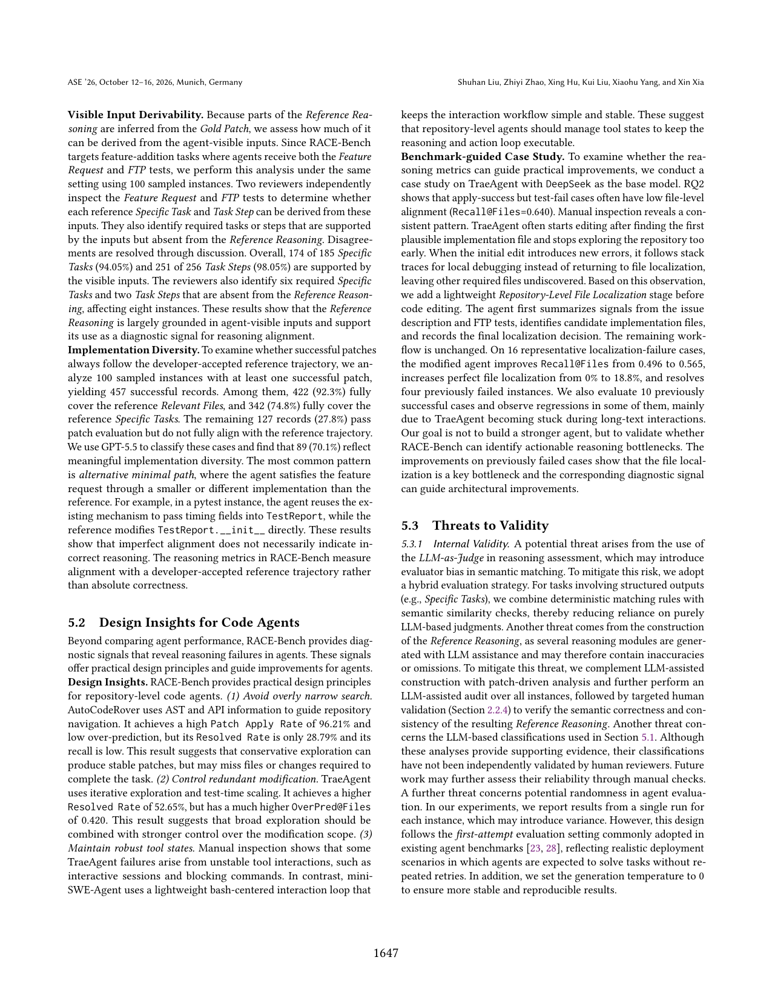

<!-- PDF page 11 -->

## Página PDF 11

RACE-Bench: A Reasoning-Augmented Benchmark for Repository-Level Code Agents on Feature Addition
ASE ’26, October 12–16, 2026, Munich, Germany
5.3.2
External Validity. A threat to external validity is that our
experiments cover only a limited set of agents and base models. To
mitigate this threat, we select agents with diverse design philoso-
phies and base models from different providers. Future work may
extend the evaluation to additional agents and models as the ecosys-
tem continues to evolve. Another threat is that our benchmark eval-
uates only the explicit intermediate reasoning exposed by agents,
whereas agents may also rely on implicit reasoning that is not
directly observable. To mitigate this limitation, we refine interme-
diate reasoning by analyzing the final code patches generated by
the agents. This approach allows us to approximate the underlying
reasoning process even when parts of it are not explicitly reported.
The final threat arises from differences in how agents expose their
intermediate reasoning processes, which may affect the fairness of
cross-agent comparison. To mitigate this threat, we map the inter-
mediate reasoning process into unified reasoning modules, making
the evaluation more comparable across different agent frameworks.
6
Related Work
6.1
Code Generation Benchmarks
Code generation is a core task in software engineering, and a wide
range of benchmarks have been proposed to evaluate the code
generation capabilities of LLMs. Early benchmarks focus on single-
function synthesis from natural language descriptions and unit
tests, such as HumanEval [9] and MBPP [4]. Subsequent bench-
marks extend this paradigm by introducing more complex prob-
lems and richer test suites, including APPS [20], EvalPlus [31],
and CoderEval [54]. Other benchmarks, including ClassEval [13],
BigCodeBench [58], and FullStackBench [10], further expand the
evaluation scope to class-level abstractions, large-scale codebases,
and full-stack development scenarios. Despite these advances, most
benchmarks still ignore repository context and evaluate code gen-
eration in isolation, limiting their ability to reflect realistic scenar-
ios where models must reason over large repositories and gener-
ate multi-file changes. To address this gap, recent work has pro-
posed repository-level code generation benchmarks, such as FEAT-
Bench [8], DevEval [27], EvoCodeBench [26], CodevBench [38],
and ExecRepoBench [52]. Another line of work constructs bench-
marks directly from real-world issue–PR pairs. SWE-bench [23]
extracts bug-fixing tasks from GitHub issues and corresponding
patches, enabling end-to-end evaluation of automated software
maintenance. Similarly, FEA-bench [28] focuses on feature addi-
tion tasks derived from real repositories, capturing the challenges
of introducing new functionality while preserving existing behav-
ior. However, these benchmarks primarily focus on whether the
final generated patch passes the test suite, while largely ignoring
the quality of the intermediate reasoning process. In contrast, our
benchmark augments repository-level tasks with structured Ref-
erence Reasoning, enabling systematic evaluation of intermediate
reasoning alignment and facilitating fine-grained error diagnosis.
6.2
Intermediate Reasoning Evaluation
Recent work has increasingly recognized that evaluating interme-
diate reasoning provides diagnostic signals beyond final-answer
correctness. Existing work mainly focuses on assessing the quality
of reasoning traces in natural language and mathematical reasoning.
For example, ROSCOE [16] measures semantic consistency, logical-
ity, and informativeness of step-by-step rationales, ReCEval [39]
evaluates whether each reasoning step is supported by the input
and preceding context, and ProcessBench [56] models on identify-
ing the earliest erroneous reasoning step in mathematical solutions.
Reasoning evaluation has also been extended to code and agent
settings. CRUXEval [17] evaluates reasoning over short executable
functions, while Xue et al. [50] analyze the efficiency, logical consis-
tency, and completeness of reasoning traces for BigCodeBench tasks.
AgentBoard [34] introduces fine-grained evaluation for multi-turn
agents in general interactive environments. More closely related
to repository-level software engineering, EnConda-Bench [25] pro-
vides process-level diagnosis for environment configuration, and
AgentLens-Bench [41] constructs process references from multi-
ple successful repair trajectories to evaluate trajectory coherence,
efficiency, and divergence. However, existing work either evalu-
ates intermediate reasoning outside repository-level software en-
gineering or focuses on specialized software engineering subtasks
rather than feature implementation. Repository-level benchmarks
such as SWE-bench and FEA-bench evaluate only the final patch
correctness without structured reasoning references. In contrast,
RACE-Bench combines executable patch verification with struc-
tured developer-accepted Reference Reasoning, enabling joint evalu-
ation of final patch correctness and intermediate reasoning align-
ment for repository-level feature addition.
7
Conclusion
In this paper, we present RACE-Bench, a reasoning-augmented
benchmark for evaluating repository-level code agents on real-
world feature addition tasks. RACE-Bench contains 528 instances
from 12 open-source GitHub repositories, each paired with exe-
cutable verification and structured Reference Reasoning, enabling
evaluation at both the patch level and the intermediate reasoning
level. Our experiments on three representative agents show sub-
stantial differences in end-to-end capability, with Resolved Rate
ranging from 29% to 70%. More importantly, the results demon-
strate that evaluating only final test outcomes is insufficient for
understanding agent behavior. Reasoning-level analysis reveals a
clear waterfall-style degradation: agents generally perform well
at high-level goal understanding, but become much weaker when
translating goals into files, tasks, and especially concrete implemen-
tation steps. Step-level reasoning is the most critical bottleneck, and
test-fail instances are often associated with lower recall (a 35.7% de-
crease) and excessive over-prediction (a 94.1% increase). We further
find that the impact of the base LLM is not uniform across agents.
Instead, it is strongly shaped by the agent architecture, suggesting
that model capability and agent design should be studied jointly
rather than in isolation. Overall, RACE-Bench provides a practical
foundation for diagnosing, comparing, and improving repository-
level code agents beyond black-box patch success evaluation.
8
Data Availability Statement
The dataset and the code are publicly available on our website [1].
Acknowledgments
This research is supported by National Key R&D Program of China
(No. 2024YFB4506400) and the CCF-Huawei Populus Grove Fund.
1648

[Vista original de la página 11](../../../../../images/v5/estructura_colecciones/Evaluation/secondary/RACE-Bench/page-11.png)

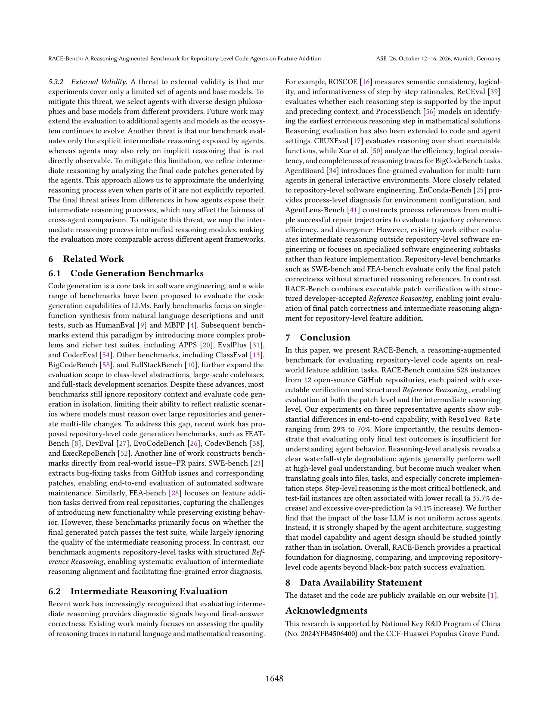

<!-- PDF page 12 -->

## Página PDF 12

ASE ’26, October 12–16, 2026, Munich, Germany
Shuhan Liu, Zhiyi Zhao, Xing Hu, Kui Liu, Xiaohu Yang, and Xin Xia
References
[1] 2026. Replication Package for RACE-Bench. doi:10.5281/zenodo.19221764
[2] Josh Achiam, Steven Adler, Sandhini Agarwal, Lama Ahmad, Ilge Akkaya, Floren-
cia Leoni Aleman, Diogo Almeida, Janko Altenschmidt, Sam Altman, Shyamal
Anadkat, et al. 2023. GPT-4 technical report. arXiv preprint arXiv:2303.08774
(2023).
[3] Toufique Ahmed, Martin Hirzel, Rangeet Pan, Avraham Shinnar, and Saurabh
Sinha. 2024. TDD-Bench Verified: Can LLMs Generate Tests for Issues Before
They Get Resolved? arXiv preprint arXiv:2412.02883 (2024).
[4] Jacob Austin, Augustus Odena, Maxwell Nye, Maarten Bosma, Henryk
Michalewski, David Dohan, Ellen Jiang, Carrie Cai, Michael Terry, Quoc Le,
et al. 2021. Program synthesis with large language models. arXiv preprint
arXiv:2108.07732 (2021).
[5] Shraddha Barke, Michael B. James, and Nadia Polikarpova. 2023. Grounded
Copilot: How Programmers Interact with Code-Generating Models. Proc. ACM
Program. Lang. 7, OOPSLA1, Article 78 (April 2023), 27 pages. doi:10.1145/3586030
[6] Islem Bouzenia, Premkumar Devanbu, and Michael Pradel. 2025. Repairagent:
An autonomous, llm-based agent for program repair. In 2025 IEEE/ACM 47th
International Conference on Software Engineering (ICSE). IEEE, 2188–2200. doi:10.
1109/icse55347.2025.00157
[7] Islem Bouzenia and Michael Pradel. 2025. You name it, I run it: An LLM agent to
execute tests of arbitrary projects. Proceedings of the ACM on Software Engineering
2, ISSTA (2025), 1054–1076. doi:10.1145/3728922
[8] Haorui Chen, Chengze Li, and Jia Li. 2025. FeatBench: Evaluating Coding Agents
on Feature Implementation for Vibe Coding. arXiv preprint arXiv:2509.22237
(2025).
[9] Mark Chen. 2021. Evaluating large language models trained on code. arXiv
preprint arXiv:2107.03374 (2021).
[10] Yao Cheng, Jianfeng Chen, Jie Chen, Li Chen, Liyu Chen, Wentao Chen, Zhengyu
Chen, Shijie Geng, Aoyan Li, Bo Li, et al. 2024. FullStack Bench: Evaluating LLMs
as Full Stack Coders. arXiv preprint arXiv:2412.00535 (2024).
[11] Arghavan Moradi Dakhel, Vahid Majdinasab, Amin Nikanjam, Foutse Khomh,
Michel C Desmarais, and Zhen Ming Jack Jiang. 2023. GitHub Copilot AI pair
programmer: Asset or liability? Journal of Systems and Software 203 (2023),
111734. doi:10.1016/j.jss.2023.111734
[12] Le Deng, Zhonghao Jiang, Jialun Cao, Michael Pradel, and Zhongxin Liu. 2025.
Nocode-bench: A benchmark for evaluating natural language-driven feature
addition. arXiv preprint arXiv:2507.18130 (2025).
[13] Xueying Du, Mingwei Liu, Kaixin Wang, Hanlin Wang, Junwei Liu, Yixuan Chen,
Jiayi Feng, Chaofeng Sha, Xin Peng, and Yiling Lou. 2023. Classeval: A manually-
crafted benchmark for evaluating llms on class-level code generation. arXiv
preprint arXiv:2308.01861 (2023).
[14] Pengfei Gao, Zhao Tian, Xiangxin Meng, Xinchen Wang, Ruida Hu, Yuanan Xiao,
Yizhou Liu, Zhao Zhang, Junjie Chen, Cuiyun Gao, et al. 2025. Trae agent: An
llm-based agent for software engineering with test-time scaling. arXiv preprint
arXiv:2507.23370 (2025).
[15] GitHub. 2021. GitHub Copilot. https://github.com/features/copilot.
[16] Olga Golovneva, Moya Chen, Spencer Poff, Martin Corredor, Luke Zettlemoyer,
Maryam Fazel-Zarandi, and Asli Celikyilmaz. 2022. Roscoe: A suite of metrics
for scoring step-by-step reasoning. arXiv preprint arXiv:2212.07919 (2022).
[17] Alex Gu, Baptiste Rozière, Hugh Leather, Armando Solar-Lezama, Gabriel Syn-
naeve, and Sida I Wang. 2024. Cruxeval: A benchmark for code reasoning,
understanding and execution. arXiv preprint arXiv:2401.03065 (2024).
[18] Daya Guo, Qihao Zhu, Dejian Yang, Zhenda Xie, Kai Dong, Wentao Zhang,
Guanting Chen, Xiao Bi, Yu Wu, YK Li, et al. 2024. DeepSeek-Coder: When the
Large Language Model Meets Programming–The Rise of Code Intelligence. arXiv
preprint arXiv:2401.14196 (2024).
[19] Junda He, Jieke Shi, Terry Yue Zhuo, Christoph Treude, Jiamou Sun, Zhenchang
Xing, Xiaoning Du, and David Lo. 2025. From code to courtroom: Llms as the
new software judges. arXiv preprint arXiv:2503.02246 (2025).
[20] Dan Hendrycks, Steven Basart, Saurav Kadavath, Mantas Mazeika, Akul Arora,
Ethan Guo, Collin Burns, Samir Puranik, Horace He, Dawn Song, et al. 2021. Mea-
suring coding challenge competence with apps. arXiv preprint arXiv:2105.09938
(2021).
[21] Ruida Hu, Chao Peng, XinchenWang, Junjielong Xu, and Cuiyun Gao. 2025.
Repo2Run: Automated Building Executable Environment for Code Repository at
Scale. In Advances in Neural Information Processing Systems, D. Belgrave, C. Zhang,
H. Lin, R. Pascanu, P. Koniusz, M. Ghassemi, and N. Chen (Eds.), Vol. 38. Curran
Associates, Inc., 32679–32718. doi:10.52202/085713-1096
[22] Naman Jain, Han, Alex Gu, Wen-Ding Li, Fanjia Yan, Tianjun Zhang, Sida Wang,
Armando Solar-Lezama, Koushik Sen, and Ion Stoica. 2025. LiveCodeBench: Holis-
tic and Contamination Free Evaluation of Large Language Models for Code. In In-
ternational Conference on Learning Representations, Y. Yue, A. Garg, N. Peng, F. Sha,
and R. Yu (Eds.), Vol. 2025. 58791–58831. https://proceedings.iclr.cc/paper_files/
paper/2025/file/94074dd5a072d28ff75a76dabed43767-Paper-Conference.pdf
[23] Carlos E Jimenez, John Yang, Alexander Wettig, Shunyu Yao, Kexin Pei, Ofir
Press, and Karthik Narasimhan. 2024. SWE-bench: Can Language Models Resolve
Real-world Github Issues?. In International Conference on Learning Representa-
tions, B. Kim, Y. Yue, S. Chaudhuri, K. Fragkiadaki, M. Khan, and Y. Sun (Eds.),
Vol. 2024. 54107–54157. https://proceedings.iclr.cc/paper_files/paper/2024/file/
edac78c3e300629acfe6cbe9ca88fb84-Paper-Conference.pdf
[24] Harshit Joshi, José Cambronero Sanchez, Sumit Gulwani, Vu Le, Gust Verbruggen,
and Ivan Radiček. 2023. Repair is nearly generation: Multilingual program repair
with llms. In Proceedings of the AAAI Conference on Artificial Intelligence, Vol. 37.
5131–5140. doi:10.1609/aaai.v37i4.25642
[25] Jiayi Kuang, Yinghui Li, Xin Zhang, Yangning Li, di yin, Xing Sun, Ying Shen, and
Philip Yu. 2026. Process-Level Trajectory Evaluation for Environment Configu-
ration in Software Engineering Agents. In International Conference on Learning
Representations, C. Vondrick, B. Hariharan, C. Raffel, L. Pinto, D. Yang, and
A. Faust (Eds.), Vol. 2026. 113832–113855. https://proceedings.iclr.cc/paper_files/
paper/2026/file/b90f65cbc09dffca7be5f7034232cc6e-Paper-Conference.pdf
[26] Jia Li, Ge Li, Xuanming Zhang, Yihong Dong, and Zhi Jin. 2024. Evocodebench: An
evolving code generation benchmark aligned with real-world code repositories.
arXiv preprint arXiv:2404.00599 (2024).
[27] Jia Li, Ge Li, Yunfei Zhao, Yongmin Li, Huanyu Liu, Hao Zhu, Lecheng Wang,
Kaibo Liu, Zheng Fang, Lanshen Wang, et al. 2024.
Deveval: A manually-
annotated code generation benchmark aligned with real-world code repositories.
In Findings of the Association for Computational Linguistics: ACL 2024. 3603–3614.
doi:10.18653/v1/2024.findings-acl.214
[28] Wei Li, Xin Zhang, Zhongxin Guo, Shaoguang Mao, Wen Luo, Guangyue Peng,
Yangyu Huang, Houfeng Wang, and Scarlett Li. 2025. Fea-bench: A benchmark
for evaluating repository-level code generation for feature implementation. In
Proceedings of the 63rd Annual Meeting of the Association for Computational
Linguistics (Volume 1: Long Papers). 17160–17176. doi:10.18653/v1/2025.acl-long.
839
[29] Feng Lin, Dong Jae Kim, and Tse-Hsun Chen. 2024. When llm-based code gener-
ation meets the software development process. arXiv preprint arXiv:2403.15852
(2024).
[30] Aixin Liu, Bei Feng, Bing Xue, Bingxuan Wang, Bochao Wu, Chengda Lu, Cheng-
gang Zhao, Chengqi Deng, Chenyu Zhang, Chong Ruan, et al. 2024. DeepSeek-v3
technical report. arXiv preprint arXiv:2412.19437 (2024).
[31] Jiawei Liu, Chunqiu Steven Xia, Yuyao Wang, and Lingming Zhang. 2023. Is your
code generated by chatgpt really correct? rigorous evaluation of large language
models for code generation. Advances in Neural Information Processing Systems
36 (2023), 21558–21572. doi:10.52202/075280-0943
[32] Shuhan Liu, Xing Hu, Kerui Huang, Xiaohu Yang, David Lo, and Xin Xia. 2025.
CREME: Robustness Enhancement of Code LLMs via Layer-Aware Model Editing.
arXiv preprint arXiv:2507.16407 (2025).
[33] Yang Liu, Dan Iter, Yichong Xu, Shuohang Wang, Ruochen Xu, and Chenguang
Zhu. 2023. G-Eval: NLG Evaluation using Gpt-4 with Better Human Alignment.
In Proceedings of the 2023 Conference on Empirical Methods in Natural Language
Processing, Houda Bouamor, Juan Pino, and Kalika Bali (Eds.). Association for
Computational Linguistics, Singapore, 2511–2522. doi:10.18653/v1/2023.emnlp-
main.153
[34] Chang Ma, Junlei Zhang, Zhihao Zhu, Cheng Yang, Yujiu Yang, Yaohui Jin, Zhen-
zhong Lan, Lingpeng Kong, and Junxian He. 2024. Agentboard: An analytical
evaluation board of multi-turn llm agents. Advances in neural information pro-
cessing systems 37 (2024), 74325–74362. doi:10.52202/079017-2365
[35] Niels Mündler, Mark Niklas Müller, Jingxuan He, and Martin Vechev. 2024. Code
agents are state of the art software testers. In ICML 2024 Workshop on LLMs and
Cognition.
[36] Noor Nashid, Islem Bouzenia, Michael Pradel, and Ali Mesbah. 2025.
Is-
sue2Test: Generating Reproducing Test Cases from Issue Reports. arXiv preprint
arXiv:2503.16320 (2025).
[37] OpenAI. 2025. GPT-5.2. https://platform.openai.com/.
[38] Zhenyu Pan, Rongyu Cao, Yongchang Cao, Yingwei Ma, Binhua Li, Fei Huang,
Han Liu, and Yongbin Li. 2024.
Codev-Bench: How Do LLMs Understand
Developer-Centric Code Completion? arXiv preprint arXiv:2410.01353 (2024).
[39] Archiki Prasad, Swarnadeep Saha, Xiang Zhou, and Mohit Bansal. 2023. Receval:
Evaluating reasoning chains via correctness and informativeness. In Proceedings
of the 2023 Conference on Empirical Methods in Natural Language Processing.
10066–10086. doi:10.18653/v1/2023.emnlp-main.622
[40] Baptiste Roziere, Jonas Gehring, Fabian Gloeckle, Sten Sootla, Itai Gat, Xiao-
qing Ellen Tan, Yossi Adi, Jingyu Liu, Romain Sauvestre, Tal Remez, et al. 2023.
Code llama: Open foundation models for code. arXiv preprint arXiv:2308.12950
(2023).
[41] Priyam Sahoo, Gaurav Mittal, Xiaomin Li, Shengjie Ma, Benjamin Steenhoek,
Pingping Lin, and Yu Hu. 2026. AgentLens: Revealing The Lucky Pass Problem
in SWE-Agent Evaluation. arXiv preprint arXiv:2605.12925 (2026).
[42] Hwanjun Song, Hang Su, Igor Shalyminov, Jason Cai, and Saab Mansour. 2024.
FineSurE: Fine-grained summarization evaluation using LLMs. In Proceedings of
the 62nd Annual Meeting of the Association for Computational Linguistics (Volume
1: Long Papers). 906–922. doi:10.18653/v1/2024.acl-long.51
[43] SWE-bench. 2024. SWE-bench Leaderboard. https://www.swebench.com/.
[44] Gemini Team, Rohan Anil, Sebastian Borgeaud, Jean-Baptiste Alayrac, Jiahui
Yu, Radu Soricut, Johan Schalkwyk, Andrew M Dai, Anja Hauth, Katie Millican,
1649

[Vista original de la página 12](../../../../../images/v5/estructura_colecciones/Evaluation/secondary/RACE-Bench/page-12.png)

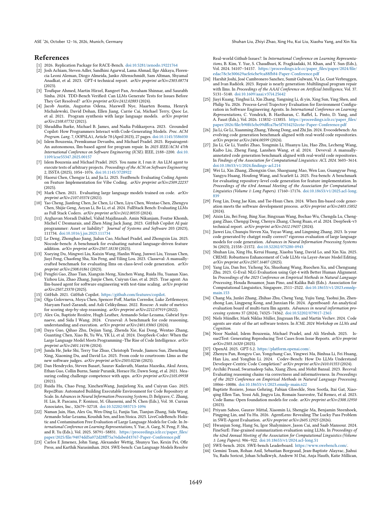

<!-- PDF page 13 -->

## Página PDF 13

RACE-Bench: A Reasoning-Augmented Benchmark for Repository-Level Code Agents on Feature Addition
ASE ’26, October 12–16, 2026, Munich, Germany
et al. 2023. Gemini: a family of highly capable multimodal models. arXiv preprint
arXiv:2312.11805 (2023).
[45] Priyan Vaithilingam, Tianyi Zhang, and Elena L Glassman. 2022. Expectation
vs. experience: Evaluating the usability of code generation tools powered by
large language models. In Chi conference on human factors in computing systems
extended abstracts. 1–7. doi:10.1145/3491101.3519665
[46] Ruiqi Wang, Jiyu Guo, Cuiyun Gao, Guodong Fan, Chun Yong Chong, and Xin
Xia. 2025. Can llms replace human evaluators? an empirical study of llm-as-a-
judge in software engineering. Proceedings of the ACM on Software Engineering
2, ISSTA (2025), 1955–1977. doi:10.1145/3728963
[47] Xingyao Wang, Boxuan Li, Yufan Song, Frank F Xu, Xiangru Tang, Mingchen
Zhuge, Jiayi Pan, Yueqi Song, Bowen Li, Jaskirat Singh, Hoang Tran, Fuqiang
Li, Ren Ma, Mingzhang Zheng, Bill Qian, Daniel Shao, Niklas Muennighoff,
Yizhe Zhang, Binyuan Hui, Junyang Lin, Robert Brennan, Hao Peng, Heng
Ji, and Graham Neubig. 2025.
OpenHands: An Open Platform for AI Soft-
ware Developers as Generalist Agents. In International Conference on Learn-
ing Representations, Y. Yue, A. Garg, N. Peng, F. Sha, and R. Yu (Eds.),
Vol. 2025. 65882–65919. https://proceedings.iclr.cc/paper_files/paper/2025/file/
a4b6ad6b48850c0c331d1259fc66a69c-Paper-Conference.pdf
[48] You Wang, Michael Pradel, and Zhongxin Liu. 2025. Are" solved issues" in swe-
bench really solved correctly? an empirical study. arXiv preprint arXiv:2503.15223
(2025).
[49] Michel Wermelinger. 2023. Using github copilot to solve simple programming
problems. In Proceedings of the 54th ACM Technical Symposium on Computer
Science Education V. 1. 172–178. doi:10.1145/3545945.3569830
[50] Haoran Xue, Gias Uddin, and Song Wang. 2026. An Empirical Study of Reason-
ing Steps in Thinking Code LLMs. In Proceedings of the 3rd ACM International
Conference on AI-Powered Software. 151–159. doi:10.1145/3805760.3814905
[51] John Yang, Carlos Jimenez, Alexander Wettig, Kilian Lieret, Shunyu Yao, Karthik
Narasimhan, and Ofir Press. 2024. SWE-agent: Agent-Computer Interfaces Enable
Automated Software Engineering. In Advances in Neural Information Processing
Systems, A. Globerson, L. Mackey, D. Belgrave, A. Fan, U. Paquet, J. Tomczak,
and C. Zhang (Eds.), Vol. 37. Curran Associates, Inc., 50528–50652. doi:10.52202/
079017-1601
[52] Jian Yang, Jiajun Zhang, Jiaxi Yang, Ke Jin, Lei Zhang, Qiyao Peng, Ken Deng, Yibo
Miao, Tianyu Liu, Zeyu Cui, et al. 2024. Execrepobench: Multi-level executable
code completion evaluation. arXiv preprint arXiv:2412.11990 (2024).
[53] Zhou Yang, Jieke Shi, Premkumar Devanbu, and David Lo. 2025. Ecosystem of
large language models for code. ACM Transactions on Software Engineering and
Methodology 35, 1 (2025), 1–30. doi:10.1145/3731753
[54] Hao Yu, Bo Shen, Dezhi Ran, Jiaxin Zhang, Qi Zhang, Yuchi Ma, Guangtai
Liang, Ying Li, Qianxiang Wang, and Tao Xie. 2024. Codereval: A benchmark of
pragmatic code generation with generative pre-trained models. In Proceedings
of the 46th IEEE/ACM International Conference on Software Engineering. 1–12.
doi:10.1145/3597503.3623316
[55] Yuntong Zhang, Haifeng Ruan, Zhiyu Fan, and Abhik Roychoudhury. 2024. Au-
toCodeRover: Autonomous program improvement. In Proceedings of the 33rd ACM
SIGSOFT International Symposium on Software Testing and Analysis. 1592–1604.
doi:10.1145/3650212.3680384
[56] Chujie Zheng, Zhenru Zhang, Beichen Zhang, Runji Lin, Keming Lu, Bowen Yu,
Dayiheng Liu, Jingren Zhou, and Junyang Lin. 2025. Processbench: Identifying
process errors in mathematical reasoning. In Proceedings of the 63rd Annual
Meeting of the Association for Computational Linguistics (Volume 1: Long Papers).
1009–1024. doi:10.18653/v1/2025.acl-long.50
[57] Zhipu AI. 2025. GLM-4.7. https://open.bigmodel.cn/.
[58] Terry Yue Zhuo, Minh Chien Vu, Jenny Chim, Han Hu, Wenhao Yu, Ratnadira
Widyasari, Imam Nur Bani Yusuf, Haolan Zhan, Junda He, Indraneil Paul, Simon
Brunner, Chen GONG, James Hoang, Armel Zebaze, Xiaoheng Hong, Wen-Ding
Li, Jean Kaddour, Ming Xu, Zhihan Zhang, Prateek Yadav, Naman Jain, Alex
Gu, Zhoujun Cheng, Jiawei Liu, Qian Liu, Zijian Wang, Binyuan Hui, Niklas
Muennighoff, David Lo, Daniel Fried, Xiaoning Du, Harm de Vries, and Lean-
dro Von Werra. 2025. BigCodeBench: Benchmarking Code Generation with
Diverse Function Calls and Complex Instructions. In International Conference
on Learning Representations, Y. Yue, A. Garg, N. Peng, F. Sha, and R. Yu (Eds.),
Vol. 2025. 66602–66656. https://proceedings.iclr.cc/paper_files/paper/2025/file/
a6a90bcc2aa470c3871b2d39a67d26e8-Paper-Conference.pdf
Received 2026-03-26; accepted 2026-06-18
1650

[Vista original de la página 13](../../../../../images/v5/estructura_colecciones/Evaluation/secondary/RACE-Bench/page-13.png)

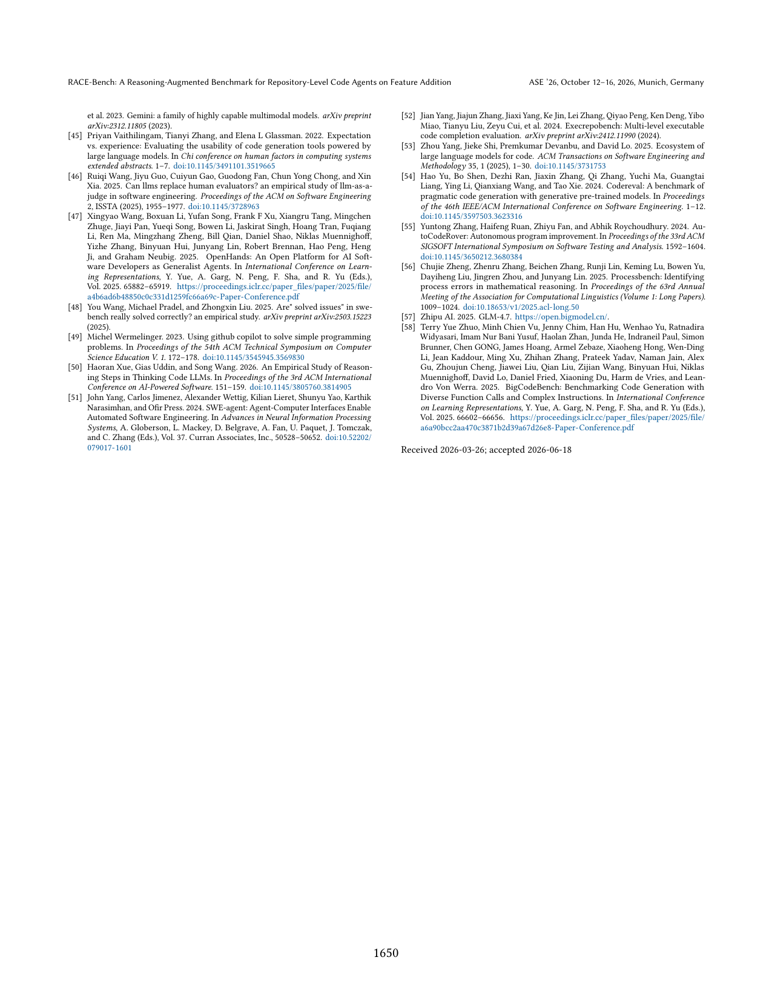
