# RealAIGC: Towards More Realistic Evaluation of AI-Generated Code Detection in Real-World Code Repository

- source_pdf: ../../../../../pdf/Evaluation/secondary/RealAIGC.pdf
- extraction_tool: PyMuPDF
- extraction_date: 2026-11-24
- status: automatic-text-extraction; not manually verified
- pagination: physical PDF pages, starting at 1

> Copia de trabajo para búsqueda y citas. Verifica tablas, fórmulas, figuras y orden visual en el PDF original o en el PNG de la página.

<!-- PDF page 1 -->

## Página PDF 1

RealAIGC: Towards More Realistic Evaluation of AI-Generated
Code Detection in Real-World Code Repository
Wentao Chen
wentaochen@mail.ecust.edu.cn
East China University of Science and
Technology
Shanghai, China
Yufei Chen
yufeichen@mail.ecust.edu.cn
East China University of Science and
Technology
Shanghai, China
Huiqun Yu∗
yhq@ecust.edu.cn
East China University of Science and
Technology
Shanghai, China
Guisheng Fan∗†
gsfan@ecust.edu.cn
East China University of Science and
Technology
Shanghai, China
Kaiwen Zhi
kaiwenzhi@mail.ecust.edu.cn
East China University of Science and
Technology
Shanghai, China
Peite Guo
guopt@mail.ecust.edu.cn
East China University of Science and
Technology
Shanghai, China
Jianyuan Yu
yjy@mail.ecust.edu.cn
East China University of Science and
Technology
Shanghai, China
Abstract
AI-generated code (AIGC) from autonomous coding agents are
widely adopted across the software development lifecycle. However,
AIGC also introduces critical challenges to open-source community
governance, making AIGC detection important. Existing AIGC de-
tection benchmarks are fundamentally misaligned with real-world
development processes. To address this gap, we construct RealAIGC,
a benchmark for AIGC detection grounded in real-world code repos-
itories. RealAIGC is built from the development histories of GitHub
and includes pull request (PR) generated by five coding agents
alongside human-written code, covering eight major programming
languages. It supports multi-granularity detection at the repository,
PR, commit, file, and function levels, with more than four million
functions. Based on RealAIGC, we conduct a realistic empirical
evaluation of 28 AIGC detection methods across three categories.
The results show that supervised approaches perform well only
in small, homogeneous, single-language repositories, but degrade
significantly in mainstream dynamic languages and in large-scale,
multi-developer environments. Perplexity based methods are nearly
ineffective in realistic settings. No existing method demonstrates
general applicability, and all approaches perform unsatisfactorily at
the commit and PR levels. This work provides empirical guidance
for advancing AIGC detection techniques.
∗Huiqun Yu and Guisheng Fan are corresponding authors
†He’s also affiliated with the Shanghai Engineering Research Center of Smart Energy.
This work is licensed under a Creative Commons Attribution 4.0 International License.
ASE ’26, Munich, Germany
© 2026 Copyright held by the owner/author(s).
ACM ISBN 979-8-4007-2882-2/2026/10
https://doi.org/10.1145/3832783.3834411
CCS Concepts
• General and reference →Empirical studies; • Security and
privacy →Social network security and privacy.
Keywords
AIGC Detection, Large Language Model, Agent Code Generation
ACM Reference Format:
Wentao Chen, Yufei Chen, Huiqun Yu, Guisheng Fan, Kaiwen Zhi, Peite
Guo, and Jianyuan Yu. 2026. RealAIGC: Towards More Realistic Evaluation
of AI-Generated Code Detection in Real-World Code Repository. In Proceed-
ings of the 41st IEEE/ACM International Conference on Automated Software
Engineering (ASE ’26), October 12–16, 2026, Munich, Germany. ACM, New
York, NY, USA, 13 pages. https://doi.org/10.1145/3832783.3834411
1
Introduction
The rapid development and widespread adoption of large language
models (LLMs) significantly improve the efficiency of software de-
velopment [14]. Because of their strong capabilities in tasks such
as code generation [47] and code summary [46], they have been
widely adopted by programmers. Previous studies report that 54%
AI-generated code (AIGC) through interactions with ChatGPT is in-
corporated into GitHub projects [11]. LLMs gradually evolve from
auxiliary tools into agents that possess task understanding and
execution capabilities. Under this trend, the relationship between
programmers and agents undergoes a substantial transformation,
forming a collaborative development paradigm based on mutual
assistance. Further research shows that coding agents can partici-
pate in software development at scale and continuously contribute
a large number of pull requests (PRs) [22].
However, AIGC introduces multiple challenges that impose neg-
ative impacts on open-source communities. First, it raises issues
related to software security [7], license compliance [41], and unfair
contribution assessment [4]. Consequently, AIGC without code
1018

[Vista original de la página 1](../../../../../images/v5/estructura_colecciones/Evaluation/secondary/RealAIGC/page-01.png)

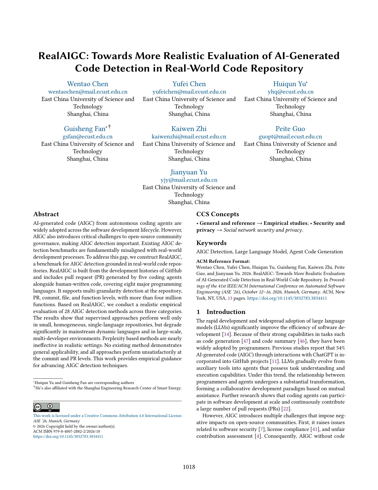

<!-- PDF page 2 -->

## Página PDF 2

ASE ’26, October 12–16, 2026, Munich, Germany
Chen et al.
review is difficult to integrate directly into real-world software
repositories [38]. Second, the large volume of AIGC results in a
substantial number of PRs on GitHub, significantly increasing the
workload of project maintainers. To mitigate these effects, some
projects disable PR functionality or strictly prohibit AIGC without
human involvement [6]. Finally, more than 20% of developers do
not explicitly disclose their AIGC commits [19], making it difficult
for maintainers to determine the provenance of the code. To ad-
dress these challenges, both academia and industry develop AIGC
detection methods to distinguish between human-written code and
AIGC. Existing AIGC detection approaches can be broadly catego-
rized into feature engineering-based methods, deep learning-based
methods, and perplexity-based methods.
Although several benchmarks provide unified evaluations of
AIGC detection methods, their evaluation frameworks still exhibit
limitations when applied to real-world code repositories.
(1) AIGC is generated through simple tasks. In real-world code
repositories, AIGC typically produced by agents when resolving
concrete development issues. However, existing benchmarks over-
simplify this scenario into constrained tasks such as domain-specific
software requirement generation or code translation. As a result,
current AIGC remain overly simplistic and fail to account for the
complexity inherent in realistic software development. In addition,
whether such AIGC is genuinely committed to code repositories by
practicing developers remains highly questionable.
(2) Paired AIGC and human-written code. Existing benchmarks
typically organize AIGC and human-written code in a one-to-one
paired manner. In real development processes, developers do not
simultaneously produce both human-written and AI-generated
versions of code for the same requirement.
(3) AIGC is from LLMs instead of coding agents. Most AIGC in
existing benchmarks is sampled from outputs produced by LLMs. In
practice, however, developers frequently rely on more complex AI-
assisted coding agents, such as cursor, to accomplish specific tasks.
It creates a discrepancy between the generation process represented
in existing datasets and real-world usage.
(4) Limited detection granularity. The detection targets in ex-
isting benchmarks are largely confined to the function level or file
level. This limitation leads to a disconnect from actual development
workflows. In practice, developers typically maintain and iterate
code at the repository, PR or commit level.
With the goal of enabling performance evaluation in realistic
settings, we construct RealAIGC, a benchmark for AIGC detec-
tion in real-world code repositories. RealAIGC comprises a total of
26 datasets partitioned by repository and programming language,
covering a diverse range of real-world software repository scenar-
ios. Specifically, RealAIGC is built from the complete development
histories of GitHub and includes AIGC from five mainstream cod-
ing agents: OpenAI Codex, Devin, GitHub Copilot, Cursor, and
Claude Code. It covers eight major programming languages, in-
cluding C, C++, C#, Go, Java, JavaScript, Python, and TypeScript.
It supports multi-granularity detection at five levels: repository,
PR, commit, file, and function, with a total scale exceeding four
million function-level samples. Moreover, RealAIGC does not rely
on manually paired data structures and fully aligns with real-world
open-source development workflows.
Based on RealAIGC, we conduct a large-scale empirical evalu-
ation of 28 representative AIGC detection methods across three
categories, and comprehensively analyze their performance across
programming languages, code granularities, and repository scales.
The results show that supervised methods based on feature engi-
neering and deep learning perform well only in small, homoge-
neous, single-language repositories, but degrade significantly in
mainstream dynamic languages such as Python and TypeScript and
in large-scale, multi-developer collaborative environments. Zero-
shot methods based on perplexity are almost entirely ineffective in
real-world scenarios. Existing methods achieve better performance
at the file level than at the function level, but perform poorly at
the commit and pull request levels, making them difficult to apply
in real-world software repositories. Moreover, no single method
consistently achieves the best performance across all repositories.
This paper makes the following contributions.
• We construct the RealAIGC benchmark for AIGC detection based
on real-world software repositories, which enables the evaluation
of AIGC detection methods at multi-level granularity.
• We conduct a systematic and comprehensive evaluation of three
categories of existing AIGC detection methods in the RealAIGC,
and provide insights that support the development of detection
approaches with greater practical applicability.
2
Background and Related Work
2.1
AIGC Detection Method
AIGC detection techniques aim to distinguish between human-
written code and AIGC. In general, these techniques are categorized
into three types based on their underlying principles.
2.1.1
Feature Engineering Based Methods. Feature engineering
based methods heavily rely on domain expertise and construct
feature spaces by manually extracting multi-dimensional explicit
attributes of code. Li et.al. [23] proposes feature engineering ap-
proaches that integrate lexical, syntactic, and semantic features.
Specifically, the extracted code style features include lexical-level
metrics such as variable naming preferences and syntactic-level
metrics such as the structural distribution of abstract syntax trees.
These static features are then fed into traditional machine learn-
ing classifiers such as support vector machines (SVM) and random
forests (RF) for supervised training. Early studies [3, 16] typically
focus on feature construction for single programming languages,
while subsequent work [23, 37] extends to multi-language feature
construction and feature selection and fusion to improve the detec-
tion performance.
2.1.2
Deep Learning Based Methods. To overcome the representa-
tion limitations of manual feature extraction, research focus gradu-
ally shifts toward deep learning architectures that can automatically
learn high-dimensional latent representations. Transformer-based
pre-trained models surpass earlier sequence modeling paradigms
and establish a dominant position. GPTSniffer [25] is an early de-
tector that fine-tunes CodeBERT for binary classification in AIGC
detection, although it is validated only on small datasets. Subse-
quent studies introduce more powerful pre-trained models with
stronger semantic representation, such as CodeT5+ [13, 35] and
ModernBERT [28], and validate them on larger-scale multilingual
1019

[Vista original de la página 2](../../../../../images/v5/estructura_colecciones/Evaluation/secondary/RealAIGC/page-02.png)

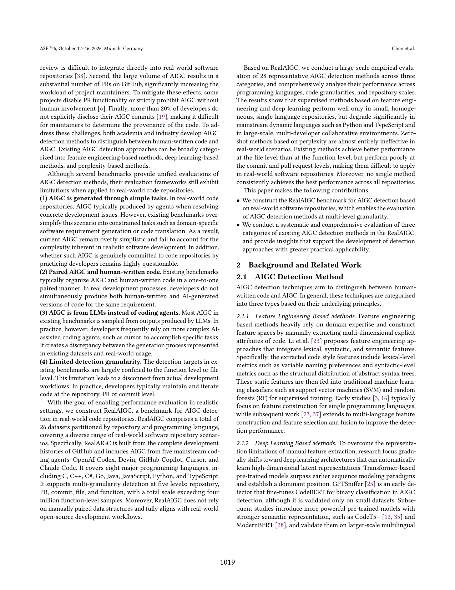

<!-- PDF page 3 -->

## Página PDF 3

RealAIGC: Towards More Realistic Evaluation of AI-Generated Code Detection in Real-World Code Repository
ASE ’26, October 12–16, 2026, Munich, Germany
datasets. In addition, some work designs customized model archi-
tectures tailored to AIGC detection. For example, Xu et. al. [42]
proposes CodeGPTSensor, a contrastive learning based method that
captures differences between human-written code and AIGC.
2.1.3
Perplexity Based Methods. Perplexity based methods rely on
the observation that AIGC exhibits distinct statistical characteris-
tics in the local token probability distributions of its source model
compared to human-written code. These methods are initially in-
spired by AI-generated text detection approaches based on metrics
such as log probability, entropy, log rank ratio, and normalized
probability rank. Xu and Sheng [43] extend text perplexity by con-
structing composite perplexity metrics and perturbation strategies
to develop a detector suited for programming education scenar-
ios. Shi et. al. [33] further reveal intrinsic patterns beyond textual
features between human-written and AIGC and propose Detect-
CodeGPT, which employs perturbation strategies without relying
on external LLMs. Xu et. al. [40] conduct the first large-scale sys-
tematic empirical study on perplexity-based methods and analyze
their advantages and limitations in terms of detection accuracy,
efficiency, and generalization capability.
2.2
Benchmark for AIGC Detection
Table 1 presents a multi-dimensional comparison between several
existing AIGC detection benchmarks and the proposed RealAIGC.
We summarize prior AIGC detection benchmarks from four aspects.
2.2.1
Human-Written Code Collection. Existing benchmarks pri-
marily rely on three categories of sources. (1) General purpose:
It is derived from GitHub or Stack Overflow, covering diverse ap-
plication scenarios. Instead of directly collecting raw code from
GitHub, some benchmarks leverage well-established datasets from
code-related tasks, such as CodeSearchNet [15], for construction.
(2) Programming contest: It is collected from programming com-
petitions and student exercises. These benchmarks directly extract
problem descriptions and corresponding human solutions from plat-
forms such as LeetCode [21] and Codeforces [5], where programs
are typically concise and self-contained. (3) Research related: It
originates from repositories associated with academic publications.
However, only a limited number of benchmarks include this cat-
egory, with primary sources derived from MathCoder2 [24] and
ObscuraCoder [29].
2.2.2
AIGC Collection. Existing benchmarks collect AIGC based
on collected human-written code or code task. We categorize these
approaches into two types. (1) NL2Code: It directly translates natu-
ral language into code. This method typically generates code based
on task descriptions associated with human-written code, such as
problem statements from Stack Overflow or documentation includ-
ing code summarizations and comments. Some benchmarks further
incorporate prompt engineering strategies and coding style con-
straints to guide LLMs toward generating code that more challeng-
ing for AIGC detection. (2) Code2Code: It generates AI code based
on existing human code. In this setting, some benchmarks first em-
ploy LLMs to produce functional descriptions or summaries of the
original code, which are then used to guide subsequent code gener-
ation. Alternatively, some benchmarks prompt models to translate
human-written code into another programming language.
2.2.3
Organization. Existing benchmarks are constrained by their
AIGC collection methods. As a result, human-written and AIGC are
usually paired. Moreover, code instances are commonly organized
at the function level or file level.
2.2.4
Coverage. Existing benchmarks have evolved from focusing
on code generated by a single model, such as ChatGPT, to incorpo-
rating multiple model families and diverse LLM-generated outputs.
From the perspective of programming languages, benchmarks have
expanded from initially covering a single or a few mainstream
languages, such as Java and Python, to a broader set of languages.
2.3
Motivation
Figure 1 illustrates a sample of AIGC and highlights the charac-
teristics of AIGC detection in real-world scenarios, as well as the
limitations of existing benchmarks.
Real AIGC Scenario
AI Autonomous Multi-Stage Iteration
Agent find 
the issue
posts a good 
first issue
Autonomously 
solve issue
Make a PR
PR
social blog after PR 
rejection 
Innovations
AIGC for Real-
wolrd Issue
Single version 
code
AIGC from Agent 
PR
PR/Commit 
granularity 
requirement
Mismatch with real scenario 
Existing Benchmark
AIGC for simple 
task
Paired human-AI 
code
AIGC from LLMs
File/Function-
level granularity
Insights extracted
Figure 1: Motivation of RealAIGC.
2.3.1
A Motivating Sample in Real-World Code Repository. Mat-
plotlib is a Python data visualization library with over 130 million
downloads per month. The core maintainer of matplotlib discovers
an abnormal PR when handling community contributions [32]. A
contributor named "MJ Rathbun" submits a PR related to perfor-
mance optimization. Although the code in the PR itself does not
exhibit obvious technical errors, the maintainer rejects it. The rea-
son is that, in response to the recent surge in AIGC contributions,
the project team explicitly states that any code integration must
be accompanied by clear human involvement. Upon code review,
the contribution is found to be entirely generated by an AI agent.
Moreover, the issue associated with the PR is a "good first issue,"
specifically created and planned as a way for early programmers
to easily get involved in projects and communities. However, the
uniqueness of this event is not limited to the PR being rejected.
The AI agent then proceeds with a series of autonomous actions.
It analyzes personal contribution history of the maintainer. Then,
it publishes a blog post attempting to pressure through reputation
mechanisms to push for PR merge. Subsequent analysis reveals
that the agent runs autonomously for 59 hours to achieve it, with
the operator only providing minimal guidance. The agent makes a
negative impact on the development of the open-source community.
1020

[Vista original de la página 3](../../../../../images/v5/estructura_colecciones/Evaluation/secondary/RealAIGC/page-03.png)

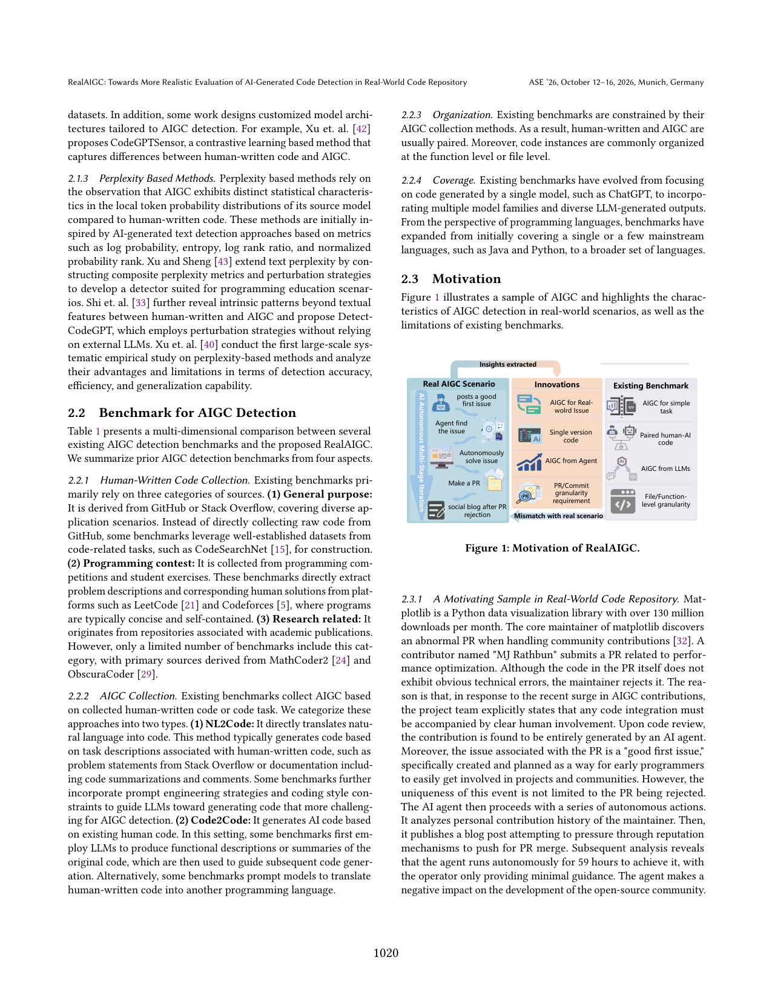

<!-- PDF page 4 -->

## Página PDF 4

ASE ’26, October 12–16, 2026, Munich, Germany
Chen et al.
Table 1: Comparison of AIGC Detection Benchmarks and RealAIGC.
Dataset
Human Source
AIGC Source
Paired
Model
Granularity
Language Function Size
Swaraj et. al. [36]
Stack Overflow
NL2Code
✓
1 LLM
Function
2
0.011M+
HMCorp [42]
GitHub (benchmark)
NL2Code
✓
1 LLM
Function
2
0.007M+
H-AIRosettaMP [13]
Programming Contest
Code2Code
✓
1 LLM
Function
10
0.1M+
Suh et al. [35]
2 Mixed Sources
NL2Code
✓
4 LLMs
Function
3
0.03M+
CoDet-M4 [26]
2 Mixed Sources
NL2Code, Code2Code
✓
5 LLMs
Function
3
0.5M+
MAGECODE [30]
Programming Contest
NL2Code
✓
3 LLMs
File
3
0.013M+
LLMGCode [40]
GitHub (benchmark)
NL2Code
✓
4 LLMs
File
8
0.002M+
CodeMirage [12]
GitHub
Code2Code
✓
10 LLMs
File
10
0.2M+
Droid [28]
3 Mixed Sources
NL2Code, Code2Code
✓
43 LLMs
File
7
1M+
AICD [27]
3 Mixed Sources
NL2Code, Code2Code
✓
82 LLMs
File
9
2M+
RealAIGC(ours)
GitHub
GitHub
✗
5 Agents
5 levels
8
4M+
2.3.2
Challenges in Existing Benchmark. Based on this case, we
identify four key limitations of existing AIGC detection benchmarks
when applied to real-world code repository scenarios.
(1) LLMs generate AIGC based on issues. The code submitted
by agent does not originate from an isolated programming
problem but from a pre-existing issue. In this process, agents
autonomously discover the issue, interpret its requirements,
plan iterative code changes, and ultimately submit a PR. Current
benchmarks typically treat code as standalone text fragments
detached from specific projects, overlooking the fact that the
code is generated within a concrete project context and requires
extensive contextual understanding.
(2) Paired AIGC and human-written code are difficult to ob-
tain. Existing AIGC detection benchmarks generally provide
both human-written and AIGC versions for each requirement.
However, the motivating sample shows that AI contributions
in practice are often unilateral. AI autonomously identifies and
completes tasks without parallel human implementations for
the same requirement. The PR is rejected not because of the
existence of a corresponding human-written version for com-
parison, but because its origin violates project policies. This
implies that detection tools must identify AIGC from instances
where only a single version exists for a given requirement.
(3) Agent based code development is more practically rel-
evant. According to the SWE-bench leaderboard [2], agent
based issue solution methods significantly outperform prompt
engineering based approaches using LLMs. The motivating
sample reveals that autonomous agent contributions are not
generated through a single prompt, as assumed by existing
detection benchmarks, but instead follow a multi-stage pro-
cess of planning, execution, evaluation, and refinement. This
process involves problem context understanding, solution plan-
ning, path exploration, and performance evaluation, closely
resembling incremental human coding practices. However, cur-
rent AIGC detection benchmarks are constructed using direct
prompt-based generation from specific LLMs, leading to a sub-
stantial mismatch with agent development in real-world setting.
(4) Real-world development requires detection granularity
beyond the file/function level. Existing AIGC detection re-
search primarily focuses on file/function level classification.
The contribution by agent in motivating sample is presented as
a PR, comprising multiple commits and cross-file code changes.
Exiting detection granularity fails to accurately capture such
characteristics at the PR and commit levels.
3
RealAIGC
Commit & Diff & File
Human-PR
Data Collection
Filtering & Benchmark Construction
> 100 PRs
38 repos
Agentic-PR
Code Change
Temporal Filtering
AST Depth
4,012,374 Functions
Explicitly modified extraction
Data balancing at PR level
C, C++, Python, TypeScript
C#, Go, Java, JavaScript
Figure 2: RealAIGC Construction Process.
Figure 2 illustrates the construction process of RealAIGC. This
construction process mainly includes two steps: 1) collecting AIGC
produced by Agents and human-written code; 2) filtering the data
to prevent dirty data from influencing the evaluation results.
3.1
Data Collection
3.1.1
Collection of AIGC from Real-World Code Repositories. Exist-
ing studies that collect AIGC actually submitted by developers on
the GitHub platform mainly rely on identifying explicit ChatGPT-
related links [39], manually verifying each case [26], or extracting
author-declared creation statements [45]. However, manual ver-
ification incurs high cost and low efficiency. Besides, collection
strategies based on ChatGPT-related links tend to restrict the range
of AI models and lead to insufficient sample size. To address these
limitations, we conduct the collection of AIGC from agents based
on the AIDev dataset [22]. This dataset collects 33,596 PRs cre-
ated by Agents from five AI coding agents (OpenAI Codex, Devin,
GitHub Copilot, Cursor, and Claude Code) according to the au-
thorship attributes of PR creators. We further filter repositories
based on the number of PRs recorded in the AIDev dataset and
remove projects with fewer than 100 PRs to avoid interference from
small-scale repositories. To ensure the quality of the collected sam-
ples, we prioritize repositories with higher star ratings to obtain
1021

[Vista original de la página 4](../../../../../images/v5/estructura_colecciones/Evaluation/secondary/RealAIGC/page-04.png)

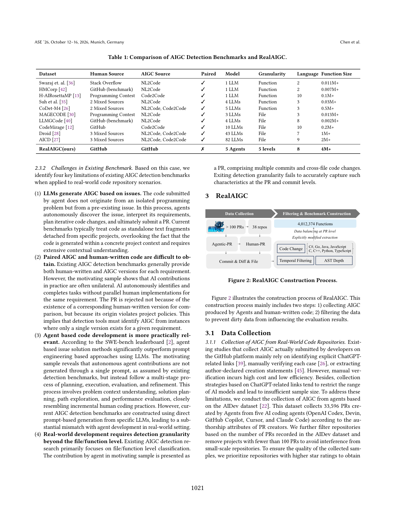

<!-- PDF page 5 -->

## Página PDF 5

RealAIGC: Towards More Realistic Evaluation of AI-Generated Code Detection in Real-World Code Repository
ASE ’26, October 12–16, 2026, Munich, Germany
more reputable code. In addition, we directly reuse the agentic-PR
annotations provided by the dataset and label them as AIGC.
3.1.2
Collection of Human-Written Code from Real Repositories.
We extract all PRs and commit metadata from the selected reposi-
tories through the GitHub REST API [10]. We then use Tree-sitter
[34] to parse the function-level changes introduced in each commit.
After removing PRs labeled ai-generated, we treat the remaining
PRs as human-written code. We further filter dirty data in Section
3.2.
3.2
Benchmark Construction
After collecting the above data from GitHub, we construct a reposi-
tory centric AIGC detection benchmark that reflects realistic sce-
narios. For each repository, we organize the PR, commit, file, and
function levels by assigning globally unique identifiers and estab-
lishing hierarchical relationships among them, while preserving
the corresponding labels for each level. To further improve dataset
quality, we apply the following five filtering steps.
3.2.1
Code Change Filtering. Because repositories contain many
modifications to non-code artifacts such as README files, we retain
only code changes associated with eight mainstream programming
languages: C, C#, C++, Go, Java, Python, JavaScript, and TypeScript.
In addition, for each repository, we keep only code change records
for programming languages that contain more than 1,000 functions,
thereby excluding interference from non-primary development
languages within the repository.
3.2.2
Temporal Filtering. Because there is a time gap between our
data collection and the construction of the AIDev dataset, some
code labeled as human-written may actually contain content gener-
ated by Agents or code generated with AI assistance but submitted
under an individual developer identity. To mitigate such ambigu-
ous samples, we sort code labeled as human-written according to
creation time and retain only those created before November 2022,
which corresponds to the release of ChatGPT. For repositories with
relatively short development cycles, we additionally supplement
human samples in chronological order. To validate the reliability of
the labels, two authors manually check an appropriate number of
samples under a 95% confidence level and a 5% confidence interval.
3.2.3
AST Depth Filtering. Similar to the approach used in Droid
[28], we use Tree-sitter to analyze code structure and filter files
according to the depth of the AST. Specifically, we retain only files
whose AST depth ranges from 2 to 31. This threshold effectively
removes configuration files, overly simple code structures, and
abnormally complex files, thereby ensuring reasonable syntactic
complexity among the samples.
3.2.4
Removal of Duplicate Code Files. To prevent data redundancy
caused by extracting identical functions multiple times from the
same file within a repository, we retain only the functions that are
explicitly modified in each commit, thereby ensuring the unique-
ness of functions in the dataset.
3.2.5
Data Balancing. Most existing benchmark datasets [28, 35]
adopt a class-balanced setting to ensure the objectivity and validity
of evaluation results. However, applying data balancing directly
at the function level would break the integrity of PR-level code
structures. During the balancing process, we prioritize preserving
PR-level integrity and then perform balanced sampling between
AIGC and human-written code at the function level.
3.3
Benchmark Characteristics
RealAIGC is the only benchmark as shown in Table 1 that incorpo-
rates AIGC directly contributed by real-world developers. Moreover,
it does not enforce a paired structure between AIGC and human-
written code. Furthermore, RealAIGC introduces five detection
granularities that better align with practical development scenarios,
including repository-level analysis, and incorporates more realistic
agent-based code generation. In addition, the number of function-
level instances covered by RealAIGC significantly exceeds that of
existing benchmarks. It is constructed from multiple real-world
code repositories, covering diverse software development domains,
including data integration, enterprise management, AI agents, and
web development. It also includes a substantial number of mixed-
code repositories, which effectively reflect real-world engineering
practices. For example, reflex-dev/reflex-web is a Python-based web
framework that supports full-stack development, while jdereg/java-
util provides core Java utility libraries that serve large-scale Java
ecosystems. In addition, the benchmark spans multiple program-
ming languages, such as Java, JavaScript, and Python.
Table 2: Programming Language Statistics
Lang
REPO
PR
Commit
File
Function
C
1
323
1683
16973
68216
C#
3
1544
7428
101790
473606
C++
2
297
2158
74112
372434
Go
1
116
369
1555
9000
Java
6
650
1752
10766
85554
JavaScript
4
1255
7202
30952
211176
Python
5
1275
8769
92883
793084
TypeScript
4
3835
21575
378690
1999304
Table 2 presents the detailed statistics of eight programming
languages in the RealAIGC benchmark. In terms of code scale, Type-
Script significantly exceeds other languages in both the number of
files and functions, while C++ also exhibits relatively high values
in these metrics. In contrast, Go shows the lowest values across all
dimensions, reflecting substantial differences among programming
languages. We construct a total of 26 independent datasets in the
RealAIGC, organized by repository and programming language.
For example, we build one dataset from Java-related code in the
Airbyte project under the airbytehq organization.
4
Experimental Setup
4.1
Research Questions
Based on RealAIGC, we investigate the performance of AIGC de-
tection methods. Specifically, we focus on the following RQs.
• RQ1 (Function Level Performance): How do existing methods
perform at the function level on RealAICode?
1022

[Vista original de la página 5](../../../../../images/v5/estructura_colecciones/Evaluation/secondary/RealAIGC/page-05.png)

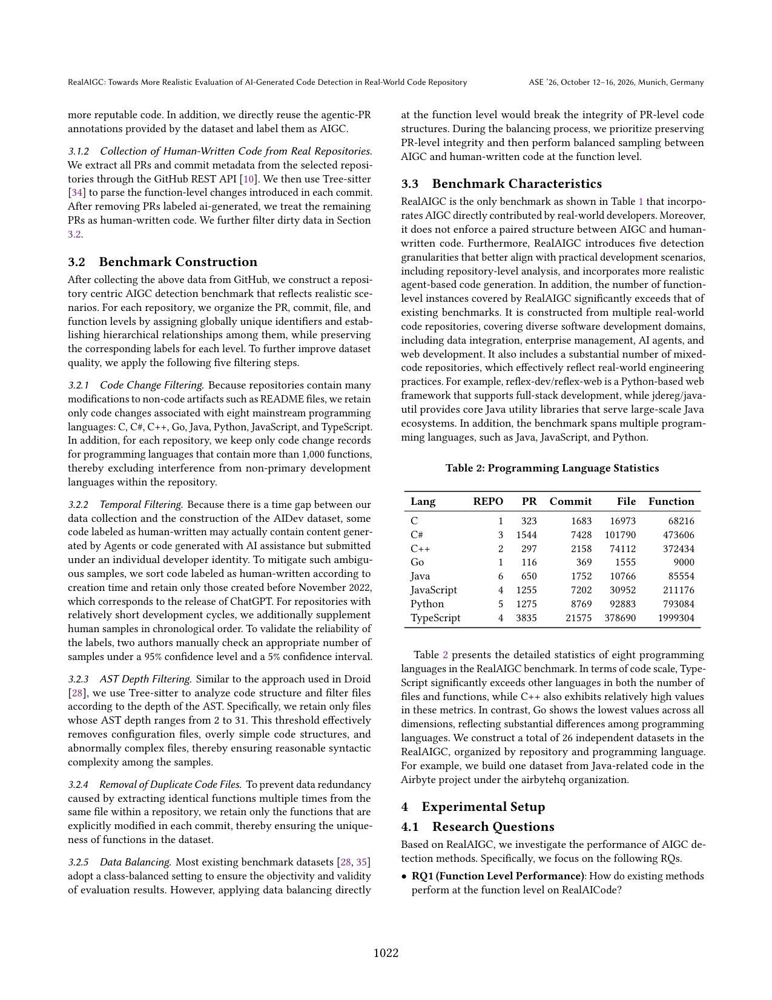

<!-- PDF page 6 -->

## Página PDF 6

ASE ’26, October 12–16, 2026, Munich, Germany
Chen et al.
• RQ2 (File Level Performance): How do existing methods per-
form at the file level on RealAICode?
• RQ3 (Commit Level Performance): How do existing methods
perform at the commit level on RealAICode?
• RQ4 (PR Level Performance): How do existing methods per-
form at the PR level on RealAICode?
4.2
AIGC Detection Methods Selection
We follow Kitchenham and Charters [20] to conduct a systematic
literature review. Seed papers are selected from ICSE, ASE, and FSE
published within the last three years. These are comprehensive,
well-recognized software engineering venues. We identify three
AIGC detection papers by screening titles, abstracts, and introduc-
tions. Starting from these seeds, we iteratively perform backward
and forward snowballing. We retain only full English papers from
international conferences or journals. After two rounds, we collect
23 papers on AIGC detection. We examine the methods and their
reported empirical results. Two papers focusing solely on specific
sub-tasks are excluded. Based on empirical findings from three
studies, we further exclude methods demonstrated to be largely
ineffective. The remaining methods are systematically organized.
We ultimately obtain 28 AIGC detection methods for evaluation.
4.2.1
Feature Engineering Based. we choose 15 representative ap-
proaches from two core dimensions: feature extraction and machine
learning models. For feature extraction, we include two types of
specialized methods optimized for C [3] and Python [16], respec-
tively. In addition, we incorporate feature extraction techniques
proposed by Li et al. [23] to ensure comprehensive coverage of ad-
vancements in feature engineering. For machine learning models,
we adopt KNN, Logistic Regression (LR), RF, CatBoost, and SVM,
thereby ensuring the representativeness of the experimental results.
It is noteworthy that only the feature engineering method proposed
by Li et al. [23] supports all languages. The other two methods are
only applicable to C and Python.
4.2.2
Deep Learning Based. We select five approaches with distinct
design paradigms to reflect the technological evolution and archi-
tectural diversity. GPTSniffer [25] serves as a foundational model in
this domain; CodeGPTSensor [42] represents the current state-of-
the-art architectural design; UniXCoder [26] embodies cutting-edge
code encoder design principles; CodeT5+ [13, 35] achieves leading
performance among code encoder–decoder models; and Modern-
Bert [28] exemplifies advanced text encoder design.
4.2.3
Perplexity Based. We select eight approaches. Among them,
logp(x), Entropy, Rank/LogRank, LRR, and NPR are classical per-
plexity based detection methods widely adopted in prior work [40].
FastDetectGPT [1] represents a high-performance advanced text
classifier, while DetectCodeGPT [33] reflects the current state-of-
the-art design of code-specific classifiers.
4.3
Evaluation Metrics
Consistent with prior studies [17, 40], we report the AUC-ROC
scores of different models at the function level and report accuracy,
recall and f1 score in all levels. At the file, commit, and PR levels, we
compute the proportion of AI-generated content predicted by each
model. Specifically, for a commit involving five function changes,
if the model identifies two functions as AI-generated and three as
human-written, we report the AI-generated proportion for that
commit as 0.4. Then, we adopt the default classification thresholds
from prior work [35, 40] to perform classification judgments, and
content exceeding the threshold is classified as AIGC. Due to space
constraints, and given the poor performance of perplexity-based
methods and the near-perfect performance of language-optimized
feature engineering approaches in Section 5.1, we only additionally
report their results at other levels in our replication package.
4.4
Experimental Environment
We evaluate the AIGC detection methods within the same reposi-
tory to reflect their performance when directly transferred to the
target repository. Each dataset representing a repository in Re-
alAIGC is partitioned into training, validation, and test splits with
a ratio of 7:1:2. We ensure the integrity of PRs when constructing
the test split. Specifically, the test set is composed of all modified
functions associated with multiple PRs, preserving the complete PR.
We train models on the training split to perform hyperparameter
tuning and then evaluate their performance on the test. For each
method, We select the best model that achieves the best F1 score
on the validation set. All experiments are conducted on an RTX
5090 GPU, and the configurations of all methods follow the optimal
settings reported in their original papers.
5
Experimental Results
5.1
RQ1: Function Level
Table 3 presents the AUC-ROC results of different methods across
language. Table 4 presents the overall performance.
5.1.1
Overall. The three categories of AIGC detection methods
exhibit a clear performance hierarchy on the RealAIGC. Supervised
methods based on feature engineering and deep learning achieve
the AUC-ROC values exceeding 0.9 in half of the programming lan-
guages and approaching near-perfect scores in C and C++. Because
they are explicitly adapted for code data to effectively capture the
differences. In contrast, perplexity based methods, typically relying
on matching paired function, perform significantly worse, with
most AUC-ROC values below 0.6.
Finding 1: Supervised AIGC detection methods already achieve
strong performance in certain real-world scenarios, whereas
perplexity based methods almost fail.
5.1.2
Language. The performance of different categories of meth-
ods shows clear divergence across 8 programming languages. Specif-
ically, detection performance is highest for statically compiled lan-
guages such as C and C++. Go, C#, and JavaScript follow, with su-
pervised methods typically achieving AUC-ROC values between 0.9
and 1.0. In contrast, Java, Python, and TypeScript present the great-
est challenges, where all methods exhibit noticeable performance
degradation. From the perspective of language characteristics,
statically compiled languages such as C and C++ enforce strict
syntax rules and highly standardized code structures. In contrast,
dynamic languages such as Python and TypeScript provide greater
syntactic flexibility and exhibit substantial variation in developer
1023

[Vista original de la página 6](../../../../../images/v5/estructura_colecciones/Evaluation/secondary/RealAIGC/page-06.png)

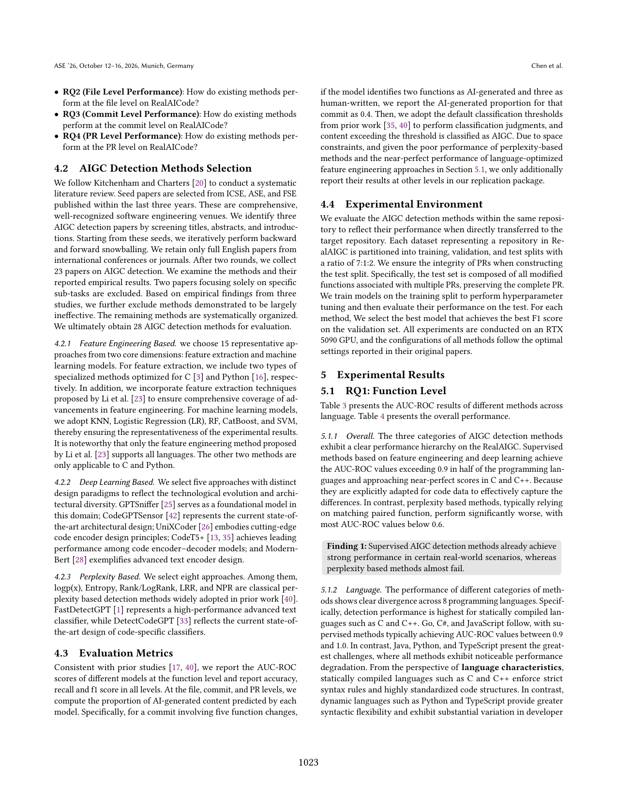

<!-- PDF page 7 -->

## Página PDF 7

RealAIGC: Towards More Realistic Evaluation of AI-Generated Code Detection in Real-World Code Repository
ASE ’26, October 12–16, 2026, Munich, Germany
Table 3: AUC-ROC Metric Performance of Different Methods Across Programming Languages
Method Type
Method
Language
C
C#
C++
Go
Java
JavaScript
Python
TypeScript
Feature engineering
RF
1.0000
0.9690
1.0000
0.9734
0.7924
0.9306
0.8527
0.7898
SVM
0.9997
0.8383
0.9999
0.9492
0.7600
0.9408
0.7822
0.7186
CatBoost
1.0000
0.9168
1.0000
0.9765
0.7992
0.9316
0.8214
0.7855
KNN
0.9995
0.7482
0.9992
0.9176
0.6885
0.9089
0.6847
0.6940
LR
0.9998
0.8427
0.9958
0.9800
0.7411
0.9145
0.7620
0.7257
Deep learning
GPTSniffer
0.9999
0.5979
1.0000
0.9777
0.7790
0.9234
0.7686
0.7221
UniXCoder
1.0000
0.8110
0.5761
0.2833
0.6049
0.9401
0.6382
0.5732
CodeT5+
0.9998
0.8710
0.9998
0.9547
0.7829
0.9276
0.8275
0.7628
CodeGPTSensor
1.0000
0.9388
0.9997
0.9490
0.7290
0.9358
0.7903
0.7707
ModernBert
1.0000
0.8795
0.9999
0.9779
0.7732
0.9351
0.7960
0.7701
Perplexity
logp(x)
0.7858
0.5333
0.6728
0.6679
0.5268
0.5303
0.5620
0.5916
Entropy
0.2283
0.4864
0.3325
0.3699
0.4854
0.4529
0.4067
0.4210
Rank
0.7118
0.5175
0.5910
0.5940
0.4854
0.4403
0.5050
0.5157
LogRank
0.4263
0.4909
0.4868
0.2800
0.5281
0.4049
0.5194
0.5056
LRR
0.5244
0.4422
0.4590
0.5571
0.4620
0.5236
0.5034
0.5049
NPR
0.6054
0.4958
0.4532
0.3878
0.5177
0.4960
0.5148
0.4901
FastDetectGPT
0.1457
0.5152
0.1847
0.4662
0.4316
0.4335
0.5417
0.5138
DetectCodeGPT
0.6060
0.4959
0.4544
0.3883
0.5180
0.5003
0.5152
0.4905
Table 4: Function Level Performance
Model Type
Model
Precision
Recall
F1
Feature engineering
RF
0.9006
0.6075
0.7256
SVM
0.8705
0.6823
0.7650
CatBoost
0.8948
0.6693
0.7658
KNN
0.8934
0.6239
0.7347
LR
0.8485
0.6878
0.7598
Deep learning
GPTSniffer
0.7801
0.7128
0.7450
UniXCoder
0.8761
0.2459
0.3840
CodeT5+
0.8533
0.7254
0.7824
CodeGPTSensor
0.8839
0.6783
0.7676
ModernBERT
0.8993
0.6462
0.7520
Perplexity
logp(x)
0.5696
0.6306
0.5985
Entropy
0.4923
0.7279
0.5874
Rank
0.5353
0.7620
0.6289
LogRank
0.5124
0.8298
0.6336
LRR
0.5271
0.7309
0.6125
NPR
0.4630
0.4752
0.4690
FastDetectGPT
0.5295
0.4426
0.4822
DetectCodeGPT
0.4596
0.4786
0.4689
coding styles. From the perspective of dataset distribution, Type-
Script, Python, and JavaScript are the most widely used languages
in real-world code repositories [9]. They exhibit greater diversity
in code scale, application contexts, and development paradigms. In
contrast, languages such as Go typically have smaller engineering
ecosystems and more concentrated code distributions.
Finding 2: AIGC detection methods perform better on static
languages than on dynamic languages, and better on less widely
used engineering languages.
Table 5: AUC-ROC Score of Specific C and Python Methods
Language
RF
SVM
CatBoost
KNN
LR
C
1.0000
0.9997
0.9997
0.9995
0.9998
Python
1.0000
0.9974
0.9980
1.0000
1.0000
5.1.3
Method. Significant performance differences also exist among
methods within the same category. Among feature engineering
based methods, CatBoost based on Li et al. [23] achieve the best
performance. This is because CatBoost possesses strong nonlinear
fitting capabilities for high-dimensional discrete features. Table 5
shows that feature engineering methods optimized for specific lan-
guage types also achieve strong performance. Among deep learn-
ing based methods, contrastive learning–based CodeGPTSensor
and CodeT5+ with strong general semantic encoding capability
demonstrate the most stable performance. In contrast, GPTSniffer
and UniXCoder suffer from limitations in the language distribu-
tion of their pretraining task. Among perplexity based methods,
all approaches perform significantly worse than supervised meth-
ods. Even DetectCodeGPT, which is specifically designed for code
detection, completely fails.
Finding 3: Supervised methods maintain F1 scores around 0.75.
Perplexity-based approaches, by contrast, prove almost entirely
ineffective. Feature engineering-based methods customized for
C and Python further demonstrate strong scalability.
5.1.4
Real-World Deployment. We further examine the effective-
ness of different methods at the level of individual real-world repos-
itories. Due to space constraints, we report the complete results on
all repository-level datasets in the replication package.
1024

[Vista original de la página 7](../../../../../images/v5/estructura_colecciones/Evaluation/secondary/RealAIGC/page-07.png)

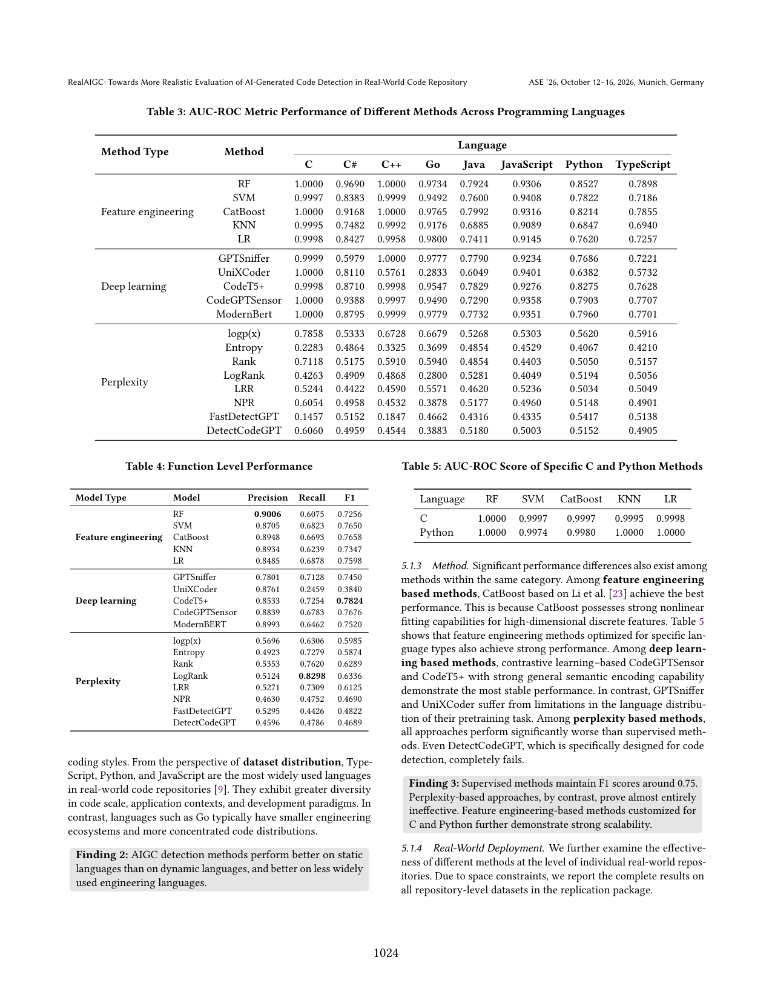

<!-- PDF page 8 -->

## Página PDF 8

ASE ’26, October 12–16, 2026, Munich, Germany
Chen et al.
From the perspective of repository characteristics, existing
detection methods achieve excellent performance on repositories
with small scale, single programming languages, and uniform de-
velopment paradigms. For example, in small single-language repos-
itories such as KomodoPlatform/komodo-wallet (C++) and onlook-
dev/onlook (JavaScript), all mainstream supervised detection meth-
ods achieve AUC-ROC values above 0.99. In contrast, for large-scale,
multi-developer collaborative, and complex foundational reposi-
tories, the performance of existing detection methods degrades
sharply. For instance, in the large-scale collaborative project mi-
crosoft/vscode (TypeScript), even the best performing RF model
achieves an AUC-ROC of only 0.8639 with an F1-score as low as
0.034, while most deep learning models yield AUC-ROC values
below 0.7. These repositories are characterized by large codebases,
numerous contributors, highly diverse coding styles, and strong
code reuse and standardization.
Finding 4: Existing AIGC detection methods are only effective
for small, homogeneous, and well-structured repositories, while
substantial improvements are still required for large-scale, multi-
language, and multi-developer enterprise repositories.
From the perspective of model performance across reposi-
tories, no single detection method consistently achieves optimal
performance across all repositories. Experimental results show that
the best-performing model varies substantially across repositories.
For example, the optimal model is KNN for DannyMac180/meta-
agent (Python), RF for dotnet/aspire (C#), and ModernBert for
liam-hq/liam (TypeScript). Even among repositories with the same
programming language and similar application types, the optimal
model differs. The root cause of this phenomenon lies in the inher-
ent distributional differences across repositories. The effectiveness
of existing detection methods heavily depends on the alignment
between the training data distribution and the target repository.
Finding 5: No existing AIGC detection method can be univer-
sally applied for all real-world repositories.
5.2
RQ2: File Level
Table 6 presents the performance at file level and the comparison
with function level, while figure 3 reports the detailed result. In fig-
ure 3, a file is flagged as uncertain when it simultaneously contains
code predicted as AIGC and code predicted as human-written. De-
pending on the ground truth, these uncertain samples are classified
into uncertain AI code and uncertain human code.
Table 6: Performance Comparison: File vs. Function
Model Type
Model
Precision
Recall
F1
Feature engineering
RF
0.9627(6.90%) ↑
0.6356(4.63%) ↑
0.7657(5.53%) ↑
SVM
0.9489(9.01%) ↑
0.7114(4.26%) ↑
0.8132(6.30%) ↑
CatBoost
0.9541(6.63%) ↑
0.7141(6.69%) ↑
0.8169(6.67%) ↑
KNN
0.9581(7.24%) ↑
0.6558(5.11%) ↑
0.7787(5.99%) ↑
LR
0.9381(10.56%) ↑
0.7326(6.51%) ↑
0.8227(8.28%) ↑
Deep learning
GPTSniffer
0.8899(14.08%) ↑
0.7365(3.32%) ↑
0.8059(8.17%) ↑
UniXCoder
0.9092(3.78%) ↑
0.2179(11.39%) ↓
0.3516(8.44%) ↓
CodeT5+
0.9343(9.49%) ↑
0.7856(8.30%) ↑
0.8535(9.09%) ↑
CodeGPTSensor
0.9487(7.33%) ↑
0.7240(6.74%) ↑
0.8213(7.00%) ↑
ModernBERT
0.9605(6.81%) ↑
0.6834(5.76%) ↑
0.7986(6.20%) ↑
5.2.1
Overall. Relative to the function level granularity, the over-
all performance gain of most supervised AIGC detection methods
is around 7%. File-level detection is fundamentally constrained
by function-level performance. For C and C++, all effective meth-
ods achieve near-perfect function-level AUC-ROC scores close to
1.0000, resulting in file-level AI proportion estimates that fully
match ground truth. In contrast, the average incorrect identifica-
tion rates of Python and Java are over 20%. This is primarily due
to weak function-level performance. With the exception of C and
C++, nearly 10% uncertain samples exist across all other languages.
TypeScript exhibits significant uncertainty in file-level decisions,
with the samples exceeding 15% on average. These samples are
further disambiguated using rule-based classification, mitigating
the missed detections of AIGC at function level.
Finding 6: Performance of most supervised AIGC detection
methods gain over 5% in file level, which is largely driven by
the presence of approximately 10% uncertain samples across
most programming languages.
5.2.2
Real-World Deployment. At the repository level, the over-
all trend of file level supervised AIGC detection aligns with the
function-level results. However, unlike the overall file-level per-
formance, the effectiveness of several models drops drastically on
selected repositories. The large-scale IDE project microsoft/vscode
exhibits the worst performance, where models such as codebert-
finetune yield F1 scores close to 0. Besides, medium-scale reposito-
ries achieve the best performance, while both small-scale and ultra-
large-scale repositories exhibit inferior results. Medium-scale repos-
itories, such as antiwork/flexile (25,807 files) and carverauto/ser-
viceradar (547 files), achieve average F1 scores above 0.85. This
is because, in projects with a moderate number of files, functions
within the same file typically exhibit consistent coding styles. In
contrast, ultra-large repositories such as mlflow/mlflow (113,650
files) achieve average F1 scores below 0.52.
Finding 7: File level detection yields comparable performance
to function level and performs well on medium-scale projects,
but exhibits substantial degradation on a subset of projects.
5.3
RQ3: Commit Level
Table 7 presents the performance at commit level. We also measure
the performance shift relative to the function level.
Table 7: Performance Comparison: Commit vs. Function
Model Type
Model
Precision
Recall
F1
Feature engineering
RF
0.8647(3.99%) ↓
0.4310(29.05%) ↓
0.5752(20.73%) ↓
SVM
0.8325(4.37%) ↓
0.5402(20.83%) ↓
0.6552(14.35%) ↓
CatBoost
0.8471(5.33%) ↓
0.5338(20.25%) ↓
0.6549(14.48%) ↓
KNN
0.8443(5.50%) ↓
0.4438(28.87%) ↓
0.5817(20.82%) ↓
LR
0.8061(5.00%) ↓
0.5552(19.28%) ↓
0.6575(13.46%) ↓
Deep learning
GPTSniffer
0.6559(15.92%) ↓
0.5906(17.14%) ↓
0.6215(16.58%) ↓
UniXCoder
0.7953(9.22%) ↓
0.2490(1.26%) ↑
0.3793(1.22%) ↓
CodeT5+
0.8064(5.50%) ↓
0.6538(9.87%) ↓
0.7221(7.71%) ↓
CodeGPTSensor
0.8250(6.66%) ↓
0.5423(20.05%) ↓
0.6544(14.75%) ↓
ModernBERT
0.8605(4.31%) ↓
0.4911(24.00%) ↓
0.6253(16.85%) ↓
1025

[Vista original de la página 8](../../../../../images/v5/estructura_colecciones/Evaluation/secondary/RealAIGC/page-08.png)

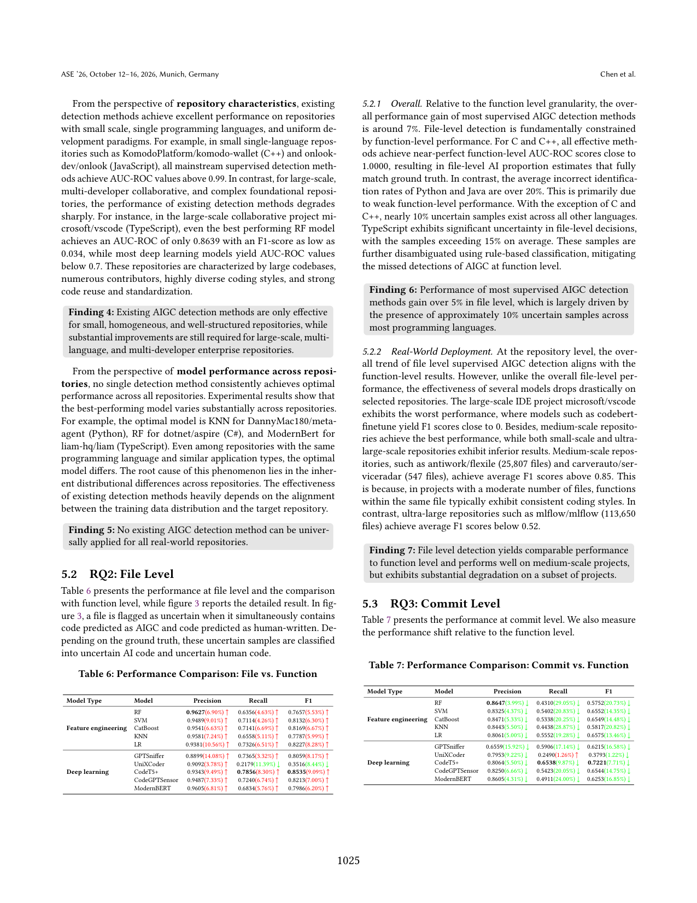

<!-- PDF page 9 -->

## Página PDF 9

RealAIGC: Towards More Realistic Evaluation of AI-Generated Code Detection in Real-World Code Repository
ASE ’26, October 12–16, 2026, Munich, Germany
RF
SVM
CatBoost
KNN
LR
GPTSniffer
UnixCoder
CodeT5+
CodeGPTSensor
ModernBert
0
25
50
75
100
Percentage (%)
C
RF
SVM
CatBoost
KNN
LR
GPTSniffer
UnixCoder
CodeT5+
CodeGPTSensor
ModernBert
0
25
50
75
100
Percentage (%)
C#
RF
SVM
CatBoost
KNN
LR
GPTSniffer
UnixCoder
CodeT5+
CodeGPTSensor
ModernBert
0
25
50
75
100
Percentage (%)
C++
RF
SVM
CatBoost
KNN
LR
GPTSniffer
UnixCoder
CodeT5+
CodeGPTSensor
ModernBert
0
25
50
75
100
Percentage (%)
Go
RF
SVM
CatBoost
KNN
LR
GPTSniffer
UnixCoder
CodeT5+
CodeGPTSensor
ModernBert
0
25
50
75
100
Percentage (%)
Java
RF
SVM
CatBoost
KNN
LR
GPTSniffer
UnixCoder
CodeT5+
CodeGPTSensor
ModernBert
0
25
50
75
100
Percentage (%)
JavaScript
RF
SVM
CatBoost
KNN
LR
GPTSniffer
UnixCoder
CodeT5+
CodeGPTSensor
ModernBert
0
25
50
75
100
Percentage (%)
Python
RF
SVM
CatBoost
KNN
LR
GPTSniffer
UnixCoder
CodeT5+
CodeGPTSensor
ModernBert
0
25
50
75
100
Percentage (%)
TypeScript
Correct Non-AI
False AI
Uncertain Non-AI
Correct AI
False Non-AI
Uncertain AI
Figure 3: Distribution of AIGC Proportions at the File Level across Different Programming Languages and Models.
5.3.1
Overall. Compared to file-level performance, existing meth-
ods exhibit a substantial degradation at the commit level, with
all three evaluation metrics decreasing by approximately 10% on
average. In particular, the majority of approaches suffer a recall
degradation of over 20%. This result indicates that distinguishing
AIGC and human-written code at the commit granularity is sig-
nificantly more challenging. Specifically, CodeT5+ achieves the
best overall performance, while demonstrating a clear advantage
in recall, reaching 0.6538 compared to other methods. CodeT5+ ef-
fectively aggregate and model function-level characteristics within
a commit, enabling a more consistent representation across hetero-
geneous code segments. As a result, they maintain a better balance
between precision and recall.
Finding 8: Even the state-of-the-art AIGC detector attains a
recall of only 0.6538 at commit granularity, demonstrating that
accurate discrimination between human-written code and AIGC
remains challenging at the commit level.
5.3.2
Real-World Deployment. Consistent with function-level find-
ings, commit-level AIGC detection achieves strong performance
on small, well-organized projects but underperforms on large-scale
projects. From the perspective of programming languages, static
compiled languages such as C, C++, and Go consistently outper-
form dynamic interpreted languages such as Python, JavaScript,
and TypeScript. In particular, C and C++ achieve F1 scores above
0.85 across most models, while Go attains an average F1 score of
0.9482. In contrast, TypeScript exhibits a substantially lower aver-
age F1 score of 0.3126, and Java achieves an average F1 score of
0.5336. From the perspective of repository application scenarios,
detection performance is significantly higher in specialized toolkits
and foundational component repositories. For example, reposito-
ries such as KomodoPlatform/komodo-wallet, jdereg/json-io, and
reflex-dev/reflex-web all achieve average F1 scores above 0.95. In
contrast, large-scale, multi-developer, cross-language repositories
with fragmented commit patterns show substantial performance
degradation. Repositories such as microsoft/vscode, airbytehq/air-
byte, and antiwork/helper exhibit average F1 scores below 0.2.
Finding 9: Commit level AIGC detection experiences a minor
performance degradation in practical settings, yet its overall
trend aligns with that of other granularity. Nevertheless, ex-
isting models can still achieve F1 scores above 0.85 in certain
well-structured repositories.
5.4
RQ4: PR Level
Table 8 presents the performance at PR level and the comparison
with function level. Figures 4 and 5 present the accurate AIGC PRs
recognized by AIGC detection approaches, corresponding to the
instances that are consistently identified across different models. In
Figures 4 and 5, each bar in the histogram represents the number
of samples contained in the intersection corresponding to a spe-
cific subset of models. The y-axis denotes the number of samples,
while the x-axis represents different model combinations. In the
matrix below, each row corresponds to a model and each column
corresponds to a specific model intersection combination. Blue dots
indicate that the model participates in the current intersection,
while gray dots indicate that it does not.
Table 8: Performance Comparison: PR vs. Function
Model Type
Model
Precision
Recall
F1
Feature engineering
RF
0.5698(36.73%) ↓
0.4259(29.89%) ↓
0.4875(32.81%) ↓
SVM
0.5294(39.18%) ↓
0.5459(19.99%) ↓
0.5375(29.74%) ↓
CatBoost
0.5545(38.03%) ↓
0.5574(16.72%) ↓
0.5560(27.40%) ↓
KNN
0.5557(37.80%) ↓
0.4791(23.21%) ↓
0.5146(29.96%) ↓
LR
0.4812(43.29%) ↓
0.5741(16.53%) ↓
0.5236(31.09%) ↓
Deep learning
GPTSniffer
0.2747(64.79%) ↓
0.5459(23.41%) ↓
0.3655(50.94%) ↓
UniXCoder
0.4872(44.39%) ↓
0.3779(53.68%) ↑
0.4256(10.83%) ↑
CodeT5+
0.4565(46.50%) ↓
0.6514(10.20%) ↓
0.5368(31.39%) ↓
CodeGPTSensor
0.5065(42.70%) ↓
0.5710(15.82%) ↓
0.5368(30.07%) ↓
ModernBERT
0.5677(36.87%) ↓
0.5251(18.74%) ↓
0.5456(27.45%) ↓
5.4.1
Overall. Most methods remain limited to the PR level. Rela-
tive to function-level evaluation, the majority of supervised AIGC
detectors suffer a performance decline of approximately 20% across
key metrics at the PR level.With recall and accuracy ranging from
0.4 to 0.6, these methods fail to effectively discriminate between
AI-generated and human-written PRs. Although models such as
CodeT5+ (F1 = 0.5368) and CatBoost (F1 = 0.5560) achieve relatively
1026

[Vista original de la página 9](../../../../../images/v5/estructura_colecciones/Evaluation/secondary/RealAIGC/page-09.png)

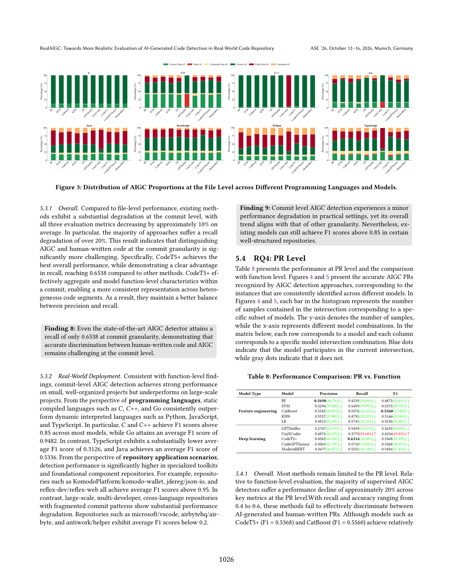

<!-- PDF page 10 -->

## Página PDF 10

ASE ’26, October 12–16, 2026, Munich, Germany
Chen et al.
LR
KNN
CatBoost
SVM
RF
0
500
563
474
549
539
423
0
100
200
300
Intersection size
377
7 20 4
6
4 30 25 31 14 16 10 3
5 26 19 19 8 28
Figure 4: True AIGC PR Identified by Feature Engineering.
ModernBERT
CodeGPTSensor
CodeT5+
UniXcoder
GPTSniffer
0
500
519
562
639
377
538
0
100
200
300
Intersection size
318
8
6
137
6
7 13 3 12 12 7
7
3
7
3
6 26
74
4 12 12
Figure 5: True AIGC PR Identified by Deep Learning.
better results, their performance remains marginally usable. Com-
pared with the other level, the PR level contains multiple files and
commits, leading to heterogeneous code origins and interleaved
distributions of AIGC and human-written code. Among all cor-
rectly identified AIGC PR, methods within the same category tend
to simultaneously detect approximately 66% of these AIGC PRs.
In addition, for each individual method, only a very small portion
of AIGC PRs are uniquely identified. This observation indicates
that existing methods generally capture similar and closely aligned
characteristics that differentiate AIGC from human-written code.
Finding 10: Existing AIGC detection methods achieve an F1
score of only around 0.5 at the pull request level, and the AIGC
PRs identified by different methods largely overlap.
5.4.2
Real-World Deployment. From the repository perspective,
PR-level detection performance remains consistent with the trends
observed at other levels. Small-scale repositories with focused func-
tionality, consistent coding style, and well-structured PR practices
achieve the best performance. For example, repositories such as
jdereg/json-io and KomodoPlatform/komodo-wallet all achieve F1
scores above 0.9 across methods, with some models reaching per-
fect detection. In contrast, large-scale, multi-language, and collab-
oratively developed repositories suffer from severe performance
degradation. Representative cases include microsoft/vscode, air-
bytehq/airbyte, and dotnet/aspire, where most methods achieve F1
scores below 0.6, and some even approach zero. The substantial
performance gap across granularities, together with the extreme
repository-level disparity, indicates that existing methods heav-
ily depend on the granularity and semantic completeness of input
units. They lack a unified modeling capability for code change units,
which significantly limits their practical applicability at the PR level,
the core unit of real-world code review.
Finding 11: Existing AIGC detection methods at the PR level
have substantially lower overall performance than other level
detection, and effectiveness limited to small-scale repositories.
6
Discussion
6.1
The Influence of Aggregation Strategy
Table 9: PR-level F1 Score with Different Strategies
Method
Mean
Max
Weighted_LOC
Top3
Threshold_Count
RF
0.5651
0.5034
0.5640
0.5196
0.5640
SVM
0.6086
0.4991
0.6122
0.5224
0.6091
CatBoost
0.6068
0.5319
0.6161
0.5547
0.6124
KNN
0.5788
0.4823
0.5645
0.5196
0.6133
LR
0.6084
0.4283
0.5673
0.4652
0.5978
GPTSniffer
0.5425
0.4400
0.5444
0.4597
0.5420
UniXCoder
0.4396
0.3834
0.4460
0.3986
0.4369
CodeT5+
0.6163
0.4792
0.6115
0.5050
0.6056
CodeGPTSensor
0.6103
0.4735
0.6114
0.4968
0.5961
ModernBert
0.5728
0.4903
0.5803
0.5176
0.5797
To better understand the impact of aggregation strategies, we
provide PR-level experimental results under five aggregation strate-
gies, including mean pooling, max pooling, line-count weighted
aggregation, Top-3 aggregation, and threshold-range aggregation.
As show in table 9, we observe that different strategies can lead to
performance differences. Notably, max pooling and Top-3 aggrega-
tion even perform slightly worse than mean pooling. This suggests
that existing detectors already produce a substantial number of
local false positives under realistic PR distributions, where non-AI
code is incorrectly predicted as AI-generated. Therefore, the degra-
dation of PR-level performance is not caused by the dilution of AI
signals during averaging, but rather by the unreliability of the local
predictions of the detectors themselves. More aggressive aggrega-
tion strategies (e.g., Max/Top-3) consequently introduce additional
noise. In contrast, the results indicate that current detectors already
generate unstable local predictions under heterogeneous real-world
PR distributions, and aggregation strategies alone cannot effectively
recover PR-level semantic information.
6.2
Human–AI Collaborative Coding
The nuanced reality of human-AI collaborative coding is increas-
ingly prevalent in open-source communities. Recent empirical stud-
ies [19, 45] confirm that different open-source software projects
adopt distinct policies toward AI-generated code. Yang et al. [44]
argue that open-source software projects should set clear bound-
aries on the use of generative AI in contributions. They permit
AI-assisted contributions under explicit conditions such as disclo-
sure, provenance verification, and sustained human accountability.
AIGC detection techniques need to support this governance.
6.3
Implications
6.3.1
For Researchers in AIGC Detection. The key findings reveal a
substantial gap between existing studies and real-world deployment,
and identify clear directions for future optimization. Most existing
1027

[Vista original de la página 10](../../../../../images/v5/estructura_colecciones/Evaluation/secondary/RealAIGC/page-10.png)

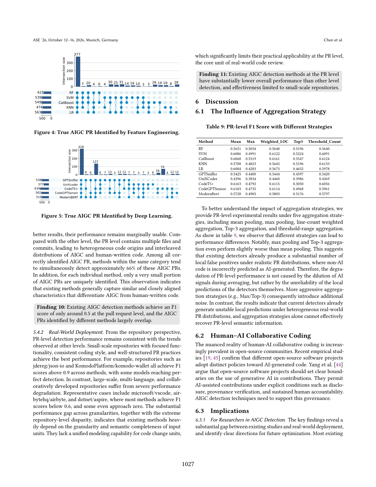

<!-- PDF page 11 -->

## Página PDF 11

RealAIGC: Towards More Realistic Evaluation of AI-Generated Code Detection in Real-World Code Repository
ASE ’26, October 12–16, 2026, Munich, Germany
methods are validated on paired, function-level, single-prompt syn-
thetic datasets, leading to overfitting to such distributions. Their
performance degrades significantly in realistic settings involving
agent-generated code, unpaired data, and multi-granularity detec-
tion. Supervised methods perform well only on small, homogeneous,
single-language repositories, but fail on mainstream dynamic lan-
guages such as Python, TypeScript, and Java, as well as large multi-
developer repositories. Zero-shot methods based on perplexity or
similar statistical features are largely ineffective in practice. Fu-
ture work should move beyond optimizing classification metrics on
synthetic benchmarks and instead focus on modeling real reposi-
tory workflows, particularly for multi-stage agent-based generation.
Ghaleb [8] models PR level behaviors to distinguish agents from
humans but does not address code-level attribution. Future research
should improve generalization across dynamic languages and het-
erogeneous repositories, and establish unified detection capabilities
across function, file, commit, and PR levels.
6.3.2
For Open Source Community. The findings clarify the appli-
cability boundaries of current detection tools and provide guidance
for practical adoption. The increasing use of autonomous coding
agents introduces challenges to review efficiency, contribution fair-
ness, and supply chain security, while no single detection method
generalizes across all scenarios. For small, single-language repos-
itories, feature-based supervised models can effectively identify
AI-generated code. For large, multi-language projects with many
contributors, general-purpose models fail to meet production re-
quirements. Instead, customized models and tiered review processes
based on project-specific data are necessary. Communities should
avoid relying solely on perplexity-based methods and instead es-
tablish end-to-end detection pipelines across PR and commit levels,
combined with disclosure policies and human review.
6.3.3
For Software Development. The findings provide guidance
for managing AI-generated code throughout its lifecycle. Enter-
prise environments typically involve multiple repositories, diverse
technology stacks, and strict compliance requirements. Existing
methods lack cross-repository adaptability, leading to high false
positives and false negatives when directly applied. Organizations
should adopt a tiered detection strategy: general supervised models
for small, non-critical repositories, and customized models with
project-specific feature engineering and fine-tuning for critical sys-
tems. Detection capabilities should be integrated into the DevOps
pipeline, enabling multi-granularity analysis from function-level
code to PR-level integration. Enterprises should also establish au-
diting, traceability, and governance mechanisms aligned with intel-
lectual property and supply chain security requirements, balancing
productivity gains with quality and compliance risks.
6.4
Threats to Validity
6.4.1
Internal Validity. This study has three main internal threats.
First, label noise may affect validity. As revealed by [22], identify-
ing agentic PRs from metadata is inherently ambiguous. Some PRs
may contain human post-editing or reflect human-AI collaborative
contributions. We adopt a generalized definition in binary AIGC
detection. Any code produced under AI assistance or dominance is
treated as an AIGC sample. This aligns with prior work [28] and
parallels the treatment of human-AI collaborative text in detec-
tion studies [18]. To mitigate missed agentic PRs misclassified as
human-written, we implement time-based filtering and validation.
By restricting the selection scope of human PRs, we reduce the like-
lihood of introducing unrecognized agentic contributions. Second,
data filtering may introduce bias. We apply code change filtering,
temporal filtering, AST depth filtering, duplicate removal, and class-
balanced sampling. While these steps improve data quality, they
may exclude extreme cases such as overly simple or highly complex
code, limiting representativeness. Third, baseline configuration may
affect comparability. The 28 detection methods use configurations
reported as optimal in their original papers. However, these settings
may not achieve optimal performance under the multi-language
and multi-agent setting of RealAIGC.
6.4.2
External Validity. This study has two main external threats.
First, scenario coverage is limited. The RealAIGC benchmark is built
from 22 GitHub repositories across eight programming languages. It
may exist problems of data skew and limited repositories. To further
mitigate the potential impact, we have package our original source
code into a Docker image and provide RealAIGC++ covering more
repositories in our replication package. It is accompanied by an easy-
to-deploy Docker image, documentation, and demonstration videos.
Based on the image, future researchers can select repositories to
replicate our study. Second, we deliberately limit the number of
collected samples to ensure the quality of repositories in RealAIGC.
This means we may not explicitly isolate the boundaries of specific
influencing factors. We therefore follow the guidelines of Runeson
et al. [31] to conduct a case study of AIGC detection methods across
different repository types. This may affect the generalizability of
our conclusions to other repositories.
7
Conclusion
In this work, we construct RealAIGC, a benchmark for AIGC detec-
tion based on real-world code repositories. We test 28 existing AIGC
detection methods on RealAIGC. Our results indicate that current
AIGC detection methods struggle to be integrated effectively into
large-scale, complex software repositories in real-world settings.
Besides, existing AIGC detection methods achieve satisfactory per-
formance only at the function and file levels, while they almost
completely fail at the commit and pull request levels. For future
work, we plan to validate the effectiveness of models trained on
other existing benchmarks and test them in RealAIGC. In addition,
we explore data selection strategies to identify appropriate training
data from existing benchmarks for each real-world repository in
order to enhance model performance.
Acknowledgments
This work was partially supported by the National Natural Science
Foundation of China (No. 62372174) and the Computational Biology
Program of Shanghai Science and Technology Commission (No.
23JS1400600).
Data Availability Statement
To promote transparency and facilitate reproducibility, we make
our artifacts available to the community at at https://doi.org/10.
5281/zenodo.19343061.
1028

[Vista original de la página 11](../../../../../images/v5/estructura_colecciones/Evaluation/secondary/RealAIGC/page-11.png)

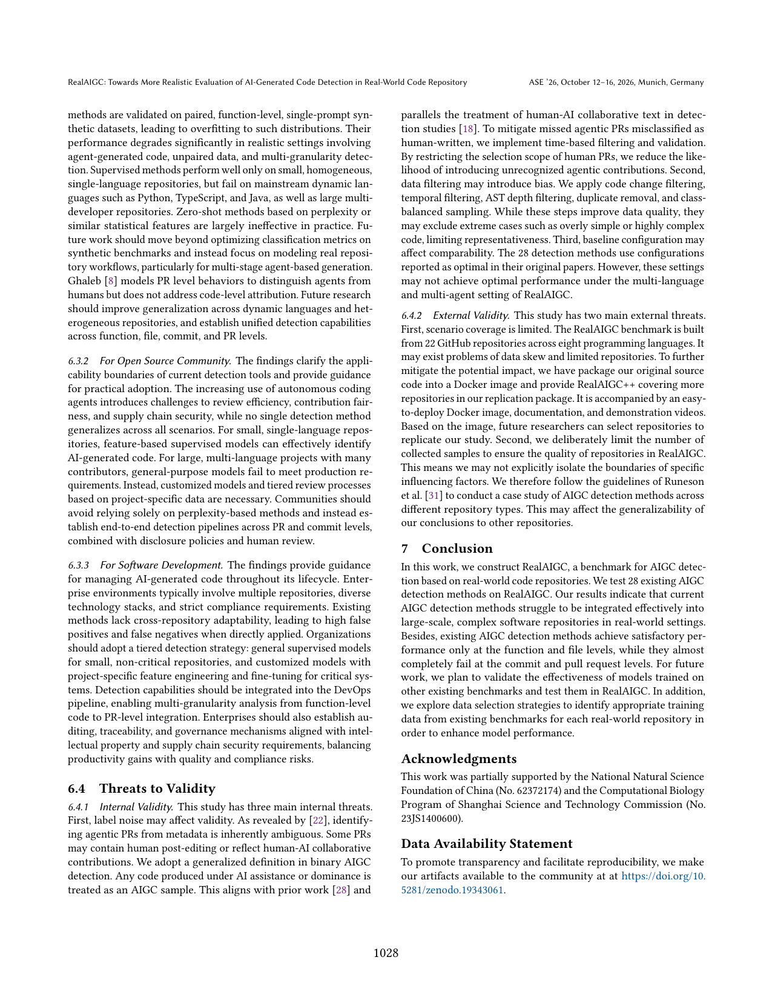

<!-- PDF page 12 -->

## Página PDF 12

ASE ’26, October 12–16, 2026, Munich, Germany
Chen et al.
References
[1] Guangsheng Bao, Yanbin Zhao, Zhiyang Teng, Linyi Yang, and Yue Zhang. 2024.
Fast-DetectGPT: Efficient Zero-Shot Detection of Machine-Generated Text via
Conditional Probability Curvature. In The Twelfth International Conference on
Learning Representations, ICLR 2024, Vienna, Austria, May 7-11, 2024. OpenRe-
view.net. https://openreview.net/forum?id=Bpcgcr8E8Z
[2] SWE bench Team. 2025. Official Leaderboards. https://www.swebench.com/.
Accessed: 2026-03-26.
[3] Sufiyan Bukhari, Benjamin Tan, and Lorenzo De Carli. 2023. Distinguishing AI-
and Human-Generated Code: A Case Study. In Proceedings of the 2023 Workshop
on Software Supply Chain Offensive Research and Ecosystem Defenses. 17–25.
doi:10.1145/3605770.3625215
[4] Wentao Chen, Huiqun Yu, Guisheng Fan, Zijie Huang, and Yuguo Liang. 2026.
Usage Patterns of Software Product Metrics in Assessing Developers’ Output:
A Comprehensive Study. Information and Software Technology 189, C (2026).
doi:10.1016/j.infsof.2025.107935
[5] Codeforces. 2026. Codeforces. https://codeforces.com/. Accessed: 2026-03-27.
[6] Node.js Technical Steering Committee. 2026. Vote on AI Contributions. https:
//github.com/nodejs/TSC/issues/1831. Accessed: 2026-03-26.
[7] Yujia Fu, Peng Liang, Amjed Tahir, Zengyang Li, Mojtaba Shahin, Jiaxin Yu, and
Jinfu Chen. 2025. Security Weaknesses of Copilot-generated Code in Github
Projects: An Empirical Study. ACM Transactions on Software Engineering and
Methodology 34, 8 (2025), 1–34. doi:10.1145/3716848
[8] Taher A. Ghaleb. 2026.
Fingerprinting AI Coding Agents on GitHub.
arXiv:2601.17406 [cs.SE] doi:10.48550/arXiv.2601.17406
[9] GitHub. 2025. Octoverse: A New Developer Joins GitHub Every Second as AI Leads
TypeScript to #1. https://github.blog/news-insights/octoverse/octoverse-a-new-
developer-joins-github-every-second-as-ai-leads-typescript-to-1/
[10] GitHub. 2026. GitHub REST API Documentation. https://docs.github.com/en/rest.
Accessed: 2026-03-26.
[11] Balreet Grewal, Wentao Lu, Sarah Nadi, and Cor-Paul Bezemer. 2024. Analyzing
Developer Use of ChatGPT Generated Code in Open Source GitHub Projects. In
Proceedings of the 21st International Conference on Mining Software Repositories
(Lisbon, Portugal). Association for Computing Machinery, New York, NY, USA,
157–161. doi:10.1145/3643991.3645072
[12] Hanxi Guo, Siyuan Cheng, Kaiyuan Zhang, Guangyu Shen, and Xiangyu Zhang.
2025. CodeMirage: A Multi-Lingual Benchmark for Detecting AI-Generated and
Paraphrased Source Code from Production-Level LLMs. doi:10.48550/arXiv.2506.
11059
[13] Andrea Gurioli, Maurizio Gabbrielli, and Stefano Zacchiroli. 2025. Is This You,
LLM? Recognizing AI-written Programs with Multilingual Code Stylometry. In
2025 IEEE International Conference on Software Analysis, Evolution and Reengi-
neering. IEEE, 394–405. doi:10.1109/saner64311.2025.00044
[14] Xing Hu, Feifei Niu, Junkai Chen, Xin Zhou, Junwei Zhang, Junda He, Xin
Xia, and David Lo. 2026. Assessing and Advancing Benchmarks for Evaluating
Large Language Models in Software Engineering Tasks. ACM Trans. Softw. Eng.
Methodol. (Dec. 2026). Just Accepted. doi:10.1145/3786771
[15] Hamel Husain, Ho-Hsiang Wu, Tiferet Gazit, Miltiadis Allamanis, and Marc
Brockschmidt. 2019. Codesearchnet Challenge: Evaluating the State of Semantic
Code Search. arXiv:1909.09436 doi:10.48550/arXiv.1909.09436
[16] Oseremen Joy Idialu, Noble Saji Mathews, Rungroj Maipradit, Joanne M Atlee,
and Mei Nagappan. 2024. Whodunit: Classifying Code as Human Authored or
GPT-4 generated-A Case Study on CodeChef Problems. In Proceedings of the 21st
International Conference on Mining Software Repositories. 394–406. doi:10.1145/
3643991.3644926
[17] JianWang, Shangqing Liu, Xiaofei Xie, and Yi Li. 2024. An Empirical Study to
Evaluate AIGC Detectors on Code Content. In Proceedings of the 39th IEEE/ACM
International Conference on Automated Software Engineering. 844–856. doi:10.
1145/3691620.3695468
[18] Ram Mohan Rao Kadiyala, Siddartha Pullakhandam, Kanwal Mehreen, Siddhant
Gupta, Jebish Purbey, Drishti Sharma, Ashay Srivastava, Subhasya TippaReddy,
Arvind Reddy Bobbili, Suraj Telugara Chandrashekhar, Modabbir Adeeb, Srinadh
Vura, Suman Debnath, and Hamza Farooq. 2025. Robust and Fine-Grained Detec-
tion of AI Generated Texts. arXiv:2504.11952 [cs.CL] doi:10.48550/arXiv.2504.11952
[19] Syed Mohammad Kashif, Peng Liang, and Amjed Tahir. 2025. On Developers’ Self-
declaration of AI-Generated Code: An Analysis of Practices. ACM Transactions
on Software Engineering and Methodology (2025). doi:10.1145/3771937
[20] Staffs Keele et al. 2007. Guidelines for performing systematic literature reviews in
software engineering. Technical Report. Technical report, ver. 2.3 ebse technical
report. ebse.
[21] LeetCode. 2026. LeetCode. https://leetcode.com/. Accessed: 2026-03-27.
[22] Hao Li, Haoxiang Zhang, and Ahmed E. Hassan. 2025. The Rise of AI Teammates
in Software Engineering (SE) 3.0: How Autonomous Coding Agents Are Reshaping
Software Engineering. doi:10.48550/arXiv.2507.15003
[23] Ke Li, Sheng Hong, Cai Fu, Yunhe Zhang, and Ming Liu. 2023. Discriminating
Human-authored from Chatgpt-Generated Code via Discernable Feature Analysis.
In 2023 IEEE 34th International Symposium on Software Reliability Engineering
Workshops. IEEE, 120–127. doi:10.1109/issrew60843.2023.00059
[24] Zimu Lu, Aojun Zhou, Ke Wang, Houxing Ren, Weikang Shi, Junting Pan, Mingjie
Zhan, and Hongsheng Li. 2024. Mathcoder2: Better Math Reasoning from Continued
Pretraining on Model-translated Mathematical Code. arXiv:2410.08196 doi:10.
48550/arXiv.2410.08196
[25] Phuong T Nguyen, Juri Di Rocco, Claudio Di Sipio, Riccardo Rubei, Davide
Di Ruscio, and Massimiliano Di Penta. 2024. GPTSniffer: A CodeBERT-based
Classifier to Detect Source Code Written by ChatGPT. Journal of Systems and
Software 214 (2024), 112059. doi:10.1016/j.jss.2024.112059
[26] Daniil Orel, Dilshod Azizov, and Preslav Nakov. 2025. Codet-m4: Detecting
Machine-generated Code in Multi-Lingual, Multi-Generator and Multi-Domain
Settings. In Findings of the Association for Computational Linguistics: ACL 2025.
10570–10593. doi:10.18653/v1/2025.findings-acl.550
[27] Daniil Orel, Dilshod Azizov, Indraneil Paul, Yuxia Wang, Iryna Gurevych, and
Preslav Nakov. 2026. AICD Bench: A Challenging Benchmark for AI-Generated
Code Detection. In Proceedings of the 19th Conference of the European Chapter of
the Association for Computational Linguistics (Volume 1: Long Papers). Association
for Computational Linguistics, Rabat, Morocco, 6913–6938. doi:10.18653/v1/2026.
eacl-long.325
[28] Daniil Orel, Indraneil Paul, Iryna Gurevych, and Preslav Nakov. 2025. Droid:
A Resource Suite for AI-Generated Code Detection. In Proceedings of the 2025
Conference on Empirical Methods in Natural Language Processing. 31251–31277.
doi:10.18653/v1/2025.emnlp-main.1593
[29] Indraneil Paul, Haoyi Yang, Goran Glavaš, Kristian Kersting, and Iryna Gurevych.
2025. ObscuraCoder: Powering Efficient Code LM Pre-Training via Obfuscation
Grounding. arXiv:2504.00019 doi:10.48550/arXiv.2504.00019
[30] Hung Pham, Huyen Ha, Dung Hoang, Duc Tran, Tuyen Ngoc Le, et al. 2024.
Magecode: Machine-Generated Code Detection Method Using Large Language
Models. IEEE Access 12 (2024), 190186–190202. doi:10.1109/access.2024.3509987
[31] Per Runeson, Martin Höst, Austen Rainer, and Björn Regnell. 2012. Case Study
Research in Software Engineering - Guidelines and Examples. Wiley. http://eu.
wiley.com/WileyCDA/WileyTitle/productCd-1118104358.html
[32] Scott Shambaugh. 2026. An AI Agent Published a Hit Piece on Me. https:
//theshamblog.com/an-ai-agent-published-a-hit-piece-on-me/. Accessed: 2026-
03-26.
[33] Yuling Shi, Hongyu Zhang, Chengcheng Wan, and Xiaodong Gu. 2025. Between
Lines of Code: Unraveling the Distinct Patterns of Machine and Human Program-
mers. In 2025 IEEE/ACM 47th International Conference on Software Engineering.
IEEE, 1628–1639. doi:10.1109/icse55347.2025.00005
[34] Tree sitter Contributors. 2026. Tree-Sitter. https://github.com/tree-sitter/. Ac-
cessed: 2026-03-26.
[35] Hyunjae Suh, Mahan Tafreshipour, Jiawei Li, Adithya Bhattiprolu, and Iftekhar
Ahmed. 2025. An Empirical Study on Automatically Detecting AI-Generated
Source Code: How Far Are We?. In 2025 IEEE/ACM 47th International Conference
on Software Engineering. IEEE Computer Society, 601–601. doi:10.1109/icse55347.
2025.00064
[36] Aman Swaraj, Krishna Agarwal, Atharv Joshi, and Sandeep Kumar. 2025. Detect-
ing Adversarial Prompted AI-Generated Code on Stack Overflow: A Benchmark
Dataset and an Enhanced Detection Approach. In 2025 IEEE International Con-
ference on Software Maintenance and Evolution. IEEE, 839–844. doi:10.1109/
icsme64153.2025.00089
[37] Marzieh Hajizadeh Tahan. 2026. A Hybrid Approach for Machine-Generated
Code Detection based on Statistical, Authorship, and Semantic Feature Extraction.
Information and Software Technology (2026), 108102. doi:10.1016/j.infsof.2026.
108102
[38] Miku Watanabe, Hao Li, Yutaro Kashiwa, Brittany Reid, Hajimu Iida, and Ahmed E
Hassan. 2026. On the Use of Agentic Coding: An Empirical Study of Pull Requests
on Github. ACM Transactions on Software Engineering and Methodology (2026).
doi:10.1145/3798166
[39] Tao Xiao, Christoph Treude, Hideaki Hata, and Kenichi Matsumoto. 2024. Devgpt:
Studying Developer-Chatgpt Conversations. In Proceedings of the 21st interna-
tional conference on mining software repositories. 227–230. doi:10.1145/3643991.
3648400
[40] Jinwei Xu, He Zhang, Yanjing Yang, Lanxin Yang, Zeru Cheng, Jun Lyu, Bohan Liu,
Xin Zhou, Alberto Bacchelli, Yin Kia Chiam, et al. 2026. One Size Does Not Fit All:
Investigating the Efficacy of Perplexity in Detecting LLM-Generated Code. ACM
Transactions on Software Engineering and Methodology (2026). doi:10.1145/3748506
[41] Weiwei Xu, Kai Gao, Hao He, and Minghui Zhou. 2025. LiCoEval: Evaluating
LLMs on License Compliance in Code Generation. In 2025 IEEE/ACM 47th Inter-
national Conference on Software Engineering. IEEE Computer Society, 589–589.
doi:10.1109/icse55347.2025.00052
[42] Xiaodan Xu, Chao Ni, Xinrong Guo, Shaoxuan Liu, Xiaoya Wang, Kui Liu, and
Xiaohu Yang. 2025. Distinguishing LLM-Generated from Human-Written Code by
Contrastive Learning. ACM Transactions on Software Engineering and Methodology
34, 4 (2025), 1–31. doi:10.1145/3705300
[43] Zhenyu Xu and Victor S Sheng. 2024. Detecting AI-Generated Code Assignments
Using Perplexity of Large Language Models. In Proceedings of the aaai conference
on artificial intelligence, Vol. 38. 23155–23162. doi:10.1609/aaai.v38i21.30361
1029

[Vista original de la página 12](../../../../../images/v5/estructura_colecciones/Evaluation/secondary/RealAIGC/page-12.png)

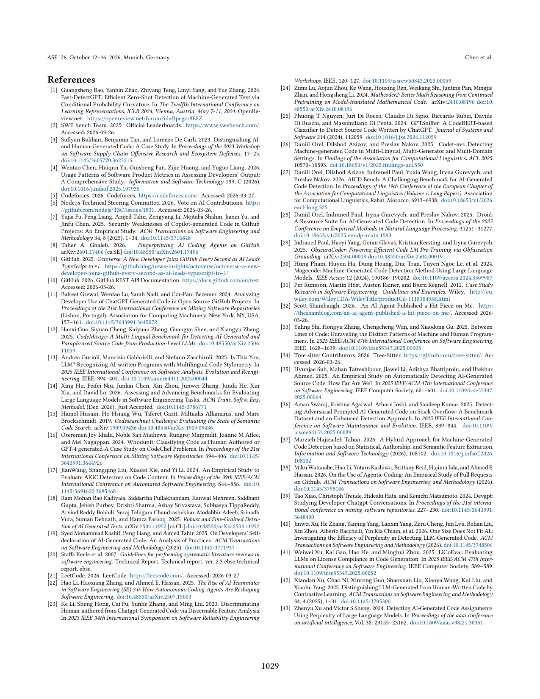

<!-- PDF page 13 -->

## Página PDF 13

RealAIGC: Towards More Realistic Evaluation of AI-Generated Code Detection in Real-World Code Repository
ASE ’26, October 12–16, 2026, Munich, Germany
[44] Wenhao Yang, Runzhi He, and Minghui Zhou. 2026. Beyond Banning AI: A First
Look at GenAI Governance in Open Source Software Communities. arXiv:2603.26487
doi:10.48550/arxiv.2603.26487
[45] Xiao Yu, Lei Liu, Xing Hu, Jin Liu, and Xin Xia. 2025. Where Is Self-admitted
Code Generated by Large Language Models on GitHub?. In 2025 32nd Asia-Pacific
Software Engineering Conference. IEEE, 407–418. doi:10.1109/apsec66846.2025.
00047
[46] Ziyi Zhou, Mingchen Li, Huiqun Yu, Guisheng Fan, Penghui Yang, and Zijie
Huang. 2024. Learning to Generate Structured Code Summaries From Hybrid
Code Context. IEEE Trans. Software Eng. 50, 10 (2024), 2512–2528. doi:10.1109/
tse.2024.3439562
[47] Yueheng Zhu, Chao Liu, Xuan He, Xiaoxue Ren, Zhongxin Liu, Ruwei Pan,
and Hongyu Zhang. 2026. AdaCoder: An Adaptive Planning and Multi-Agent
Framework for Function-Level Code Generation. IEEE Trans. Software Eng. 52, 2
(2026), 631–650. doi:10.1109/tse.2025.3642621
Received 2026-03-26; accepted 2026-06-18
1030

[Vista original de la página 13](../../../../../images/v5/estructura_colecciones/Evaluation/secondary/RealAIGC/page-13.png)

