# RealBench: A Repo-Level Code Generation Benchmark Aligned with Real-World Software Development Practices

- source_pdf: ../../../../../pdf/Evaluation/secondary/RealBench.pdf
- extraction_tool: PyMuPDF
- extraction_date: 2026-11-24
- status: automatic-text-extraction; not manually verified
- pagination: physical PDF pages, starting at 1

> Copia de trabajo para búsqueda y citas. Verifica tablas, fórmulas, figuras y orden visual en el PDF original o en el PNG de la página.

<!-- PDF page 1 -->

## Página PDF 1

RealBench: A Repo-Level Code Generation Benchmark
Aligned with Real-World Software Development Practices
JIA LI, Wuhan University, China
HONGYI DENG, Peking University, China
YIRAN ZHANG∗, Nanyang Technological University, Singapore
KECHI ZHANG, Peking University, China
TIANQI SHAO, Peking University, China
TIANKUO ZHAO, Wuhan University, China
WEINAN WANG, Peking University, China
ZHI JIN∗, Wuhan University, China
GE LI, Peking University, China
YANG LIU, Nanyang Technological University, Singapore
YINGTAO FANG, Wuhan University, China
YIHONG DONG, Peking University, China
Writing code requires significant time and effort in software development. To automate this process, researchers
have made substantial progress using Large Language Models (LLMs) for code generation. Many benchmarks
like HumanEval and EvoCodeBench have been created to evaluate LLMs by requiring them to generate code
from natural language requirements. However, in enterprise applications and team development, developers
typically write code based on structured designs or specifications rather than raw natural language descriptions.
This gap between existing benchmarks and real industry development practices means that current benchmark
scores may not accurately reflect how much code generation can help automate software development tasks.
To address this gap, we propose RealBench, a repository-level code generation benchmark aligned with real-
world industry software development practices. Each example includes both natural language requirements
and UML diagrams as system design, matching how developers typically receive specifications. Based on the
constructed benchmarks, we conduct a systematic evaluation of advanced LLMs’ code generation capabilities
when provided with structured system designs. Specifically, we design three generation strategies to evaluate
advanced LLMs on RealBench and propose two evaluation granularities with five metrics. The experimental
results reveal key insights in current LLMs’ capabilities for repo-level code generation aligned with real-world
software development practices. First, we notice that regarding repo-level code generation, LLMs show much
∗Corresponding authors.
Authors’ Contact Information: Jia Li, Wuhan University, Wuhan, China, jia.li@whu.edu.cn; Hongyi Deng, Peking Univer-
sity, Beijing, China, 2401210232@stu.pku.edu.cn; Yiran Zhang, Nanyang Technological University, Singapore, Singapore,
yiran002@e.ntu.edu.sg; Kechi Zhang, Key Lab of High Confidence Software Technology (PKU), Ministry of Education, School
of Computer Science,, Peking University, Beijing, China, zhangkechi@pku.edu.cn; Tianqi Shao, Peking University, Beijing,
China, shaotianqi@stu.pku.edu.cn; Tiankuo Zhao, Wuhan University, Wuhan, China, tiankuz@whu.edu.cn; Weinan Wang,
Peking University, Beijing, China, wangwn@pku.edu.cn; Zhi Jin, Wuhan University, Wuhan, China, zhijin@whu.edu.cn;
Ge Li, Key Lab of High Confidence Software Technology (PKU), Ministry of Education, School of Computer Science,,
Peking University, Beijing, China, lige@pku.edu.cn; Yang Liu, Nanyang Technological University, Singapore, Singapore,
yangliu@ntu.edu.sg; Yingtao Fang, Wuhan University, Wuhan, China, 19855359197@163.com; Yihong Dong, Key Lab of
High Confidence Software Technology (PKU), Ministry of Education, School of Computer Science,, Peking University,
Beijing, China, dongyh@stu.pku.edu.cn.
This work is licensed under a Creative Commons Attribution 4.0 International License.
© 2026 Copyright held by the owner/author(s).
ACM 2994-970X/2026/7-ARTFSE078
https://doi.org/10.1145/3797106
Proc. ACM Softw. Eng., Vol. 3, No. FSE, Article FSE078. Publication date: July 2026.

[Vista original de la página 1](../../../../../images/v5/estructura_colecciones/Evaluation/secondary/RealBench/page-01.png)

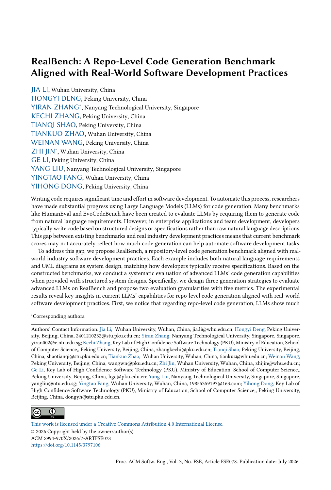

<!-- PDF page 2 -->

## Página PDF 2

FSE078:2
J. Li, H. Deng, Y. Zhang, K. Zhang, T. Shao, T. Zhao, W. Wang, Z. Jin, G. Li, Y. Liu, Y. Fang, Y. Dong.
worse performance and there are significant performance gaps among LLMs. Second, LLMs are good at finding
and creating modules defined in UML diagrams, but the quality of generated modules is often poor due to
grammar and logic errors. Third, generating the entire repository at once is the best generation strategy on
smaller repositories, while generating a complex repository with the module-by-module strategy works better
compared to other strategies. Fourth, the detailed system design is very important for repository-level code
generation tasks through conducting ablation studies on system designs. Lastly, we discuss the frequent error
types in generated repositories to provide insights for optimizing repo-level code generation.
CCS Concepts: • Software and its engineering; • Computing methodologies →Artificial intelligence;
Additional Key Words and Phrases: Repo-Level Code Generation, Software Architecture, Large Language
Model
ACM Reference Format:
Jia Li, Hongyi Deng, Yiran Zhang, Kechi Zhang, Tianqi Shao, Tiankuo Zhao, Weinan Wang, Zhi Jin, Ge Li, Yang
Liu, Yingtao Fang, and Yihong Dong. 2026. RealBench: A Repo-Level Code Generation Benchmark Aligned
with Real-World Software Development Practices. Proc. ACM Softw. Eng. 3, FSE, Article FSE078 (July 2026),
22 pages. https://doi.org/10.1145/3797106
1
Introduction
Writing code takes significant time and effort in software development. To make this process easier,
researchers have spent significant efforts on automated code generation. Recent progress in Large
Language Models (LLMs) such as GPT-4o [1], DeepSeek [30], and Qwen [8] has shown promising
results for generating code automatically [28, 38].
To better understand how well LLMs generate code, researchers have created many benchmarks
like HumanEval [11] and EvoCodeBench [27]. These benchmarks mainly focus on two types of
code generation scenarios. First, many benchmarks [11, 19] focus on the simple code generation
scenario, i.e., function-level or statement-level code generation, which is also the most common
one. They mainly require LLMs to generate a single code unit (e.g., a function or a statement)
based on a given natural language requirement. Such evaluation aims to generate code with short
length. For example, each target code in the widely-used benchmark HumanEval only contains
11.5 lines and 24.4 tokens on average, where GPT-4o and DeepSeek-V3 can achieve 92.7% and 91.5%
test pass rate performance on it. Second, with the ability and context window length of LLMs
improving, researchers introduce several repo-level code generation benchmarks [10, 27, 28]. It
asks LLMs to generate a function/class (e.g., EvoCodeBench [27] and ClassEval [14]) based on a
natural language requirement and a repository, or even an entire repository (e.g., CODES [43]
and JavaBench [10]) based on requirements. For the scenario of generating a function/class, LLMs
understand the dependency relations of code snippets in the current repository and predict code.
However, these benchmarks differ from common development practices in real-world
industry settings. In waterfall development, developers write code from a structured design
that has been translated from stakeholder requirements, rather than from the raw requirements
themselves. This creates a significant gap between existing benchmarks and real development
scenarios. As a result, benchmark scores may not show how much code generation can truly help
automate real software development.
To mitigate this gap, we propose RealBench, a repository-level code generation benchmark
aligned with real-world software development practices. Table 1 shows the comparison between
our benchmark and mainstream code generation benchmarks. Our benchmark offers the following
key features:
Proc. ACM Softw. Eng., Vol. 3, No. FSE, Article FSE078. Publication date: July 2026.

[Vista original de la página 2](../../../../../images/v5/estructura_colecciones/Evaluation/secondary/RealBench/page-02.png)

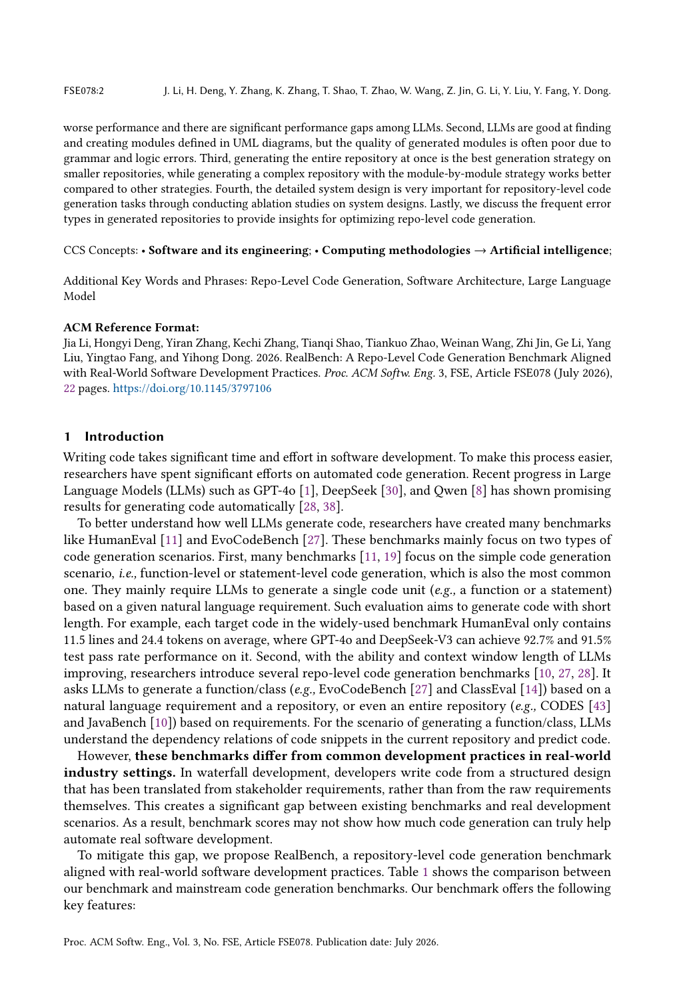

<!-- PDF page 3 -->

## Página PDF 3

A Repo-Level Code Generation Benchmark Aligned with Real-World Software Development Practices
FSE078:3
• Align with Industry Software Development Practices. Each example provides both natural
language requirements and UML (Unified Modeling Language) diagrams as system design, instead
of only requirements, matching how developers receive specifications in practice.
• Real-world Repository Across Diverse Domains. The benchmark is collected from real-
world code repositories. It consists of 61 repositories from 20 popular programming domains
(e.g., Internet, Security, and Database), instead of being composed of randomly selected a few
repositories like some existing benchmarks.
• Different Difficulty Levels. RealBench contains four levels based on the line of code (LOC) in
repositories, including level-1 (0∼500 LOC), level-2 (500∼1000 LOC), level-3 (1000∼2000 LOC),
and level-4 (≥2000 LOC).
• Reduced Data Contamination. We collect up-to-date code repositories that are created after
2024-12 from GitHub1, which are later than most prevailing LLMs’ cut-off dates thus reducing
the risk of data contamination.
• Comprehensive Test Suite. RealBench provides comprehensive human-verified test suites with
an average of 50 test cases per repository and 79.76% line coverage.
Table 1. Comparison of Existing Code Generation Benchmarks. #Req and #Diag mean requirements and UML
diagrams, respectively. #Real-R represents whether benchmarks are collected from real-world repositories.
#Func means the average number of functions in each example. #Repo means whether benchmarks have
repo-level evaluation metrics.
Benchmark
Task
Input Information
Different Difficult Levels
Source
Data Leaking
Evaluation
Granularity
#Req
#Diag
#Func
Class
File
#LOC
#Real-R
#Num
Data Time
#Repo
Class/#Func
Tests
Concode [19]
Function
✓
✗
2,000
0
0
–
✓
–
2018
✗
✗
–
CoNaLA [40]
Statement
✗
✗
500
0
0
1
✓
–
2018
✗
✗
–
APPS [17]
Function
✓
✗
5,000
0
0
21.4
✗
–
2021
✗
✓
13.2
HumanEval [11]
Function
✓
✗
164
0
0
11.5
✗
–
2021
✗
✓
7.7
MBPP [7]
Function
✓
✗
974
0
0
6.8
✗
–
2021
✗
✓
3.0
math-qa [7]
Statement
✗
✗
2,985
0
0
7.6
✓
–
2021
✗
✗
–
HumanEval-X [46]
Function
✓
✗
164
0
0
11.5
✗
–
2022
✗
✓
7.7
MBXP [6]
Function
✓
✗
974
0
0
6.8
✗
–
2022
✗
✓
3.0
multi-math-qa [6]
Statement
✗
✗
2,985
0
0
7.6
✗
–
2022
✗
✗
–
CodeContests [29]
Function
✓
✗
165
0
0
59.8
✓
–
2022
✗
✓
1.2
PandasEval [42]
Function
✓
✗
101
0
0
1.3
✗
–
2022
✗
✓
6.5
NumpyEval [42]
Function
✓
✗
101
0
0
1.1
✗
–
2022
✗
✓
3.5
DS-1000 [24]
Statement
✗
✗
1,000
0
0
3.8
✗
–
2022
✗
✓
1.6
MTBP [33]
Function
✓
✗
115
0
0
–
✗
–
2022
✗
✗
–
ODEX [37]
Function
✓
✗
945
0
0
1.9
✗
–
2022
✗
✓
1.8
BIG-Bench [35]
Function
✓
✗
32
0
0
–
✓
–
2023
✗
✓
4.69
CoderEval [41]
Function
✓
✗
460
0
0
≤32
✗
–
2023
✗
✗
–
CrossCodeEval [13]
Statement
✗
✗
–
3,534
0
96.2
✗
–
2023
✗
✗
–
ClassEval [14]
Class
✓
✗
412
100
0
45.7
✓
–
2023
✗
✓
33.1
RepoEval [44]
Repository
✓
✗
1,973
–
–
≤30
✓
–
2023
✗
✗
–
DevEval [28]
Repository
✓
✗
1,874
–
–
392.7
✓
117
2024
✗
✓
–
EvoCodeBench [27]
Repository
✓
✗
–
275
–
–
✓
25
2024-03
✗
✓
–
CodeAgentBench [45]
Repository
✓
✗
101
–
–
–
✓
6
2024
✗
✓
–
OOPEval [36]
Repository
✓
✗
0
431
–
–
✗
–
2024
✗
✓
2.48
CODES [43]
Repository
✓
✗
–
–
8.43
–
✓
19
2023-08
✗
✓
✗
JavaBench [10]
Repository
✓
✗
389
106
–
–
✗
4
2024
✗
✓
3.73
RealBench (Ours)
Repository
✓
✓
2,484
544
538
1,201
✓
61
2024.12-2025.05
✓
✓
50.05
Based on the constructed benchmark, we did a comprehensive study on the code generation
capability of existing LLMs. Specifically, we evaluate the generated repositories at two evaluation
granularities, including repository-level (i.e., Requirement@k and Architecture@k) and class-level
(i.e., Completion rate, Execution pass rate, and Test pass rate) using five metrics evaluations. We
evaluate 6 popular LLMs, which contain 3 proprietary models (i.e., GPT-4o [1], Claude-Sonnet-4
[3], and Gemini-2.5-Flash [4]) and 3 open source models (i.e., Deepseek-V3 [16], Qwen3-235B-A22B
1https://github.com/
Proc. ACM Softw. Eng., Vol. 3, No. FSE, Article FSE078. Publication date: July 2026.

[Vista original de la página 3](../../../../../images/v5/estructura_colecciones/Evaluation/secondary/RealBench/page-03.png)

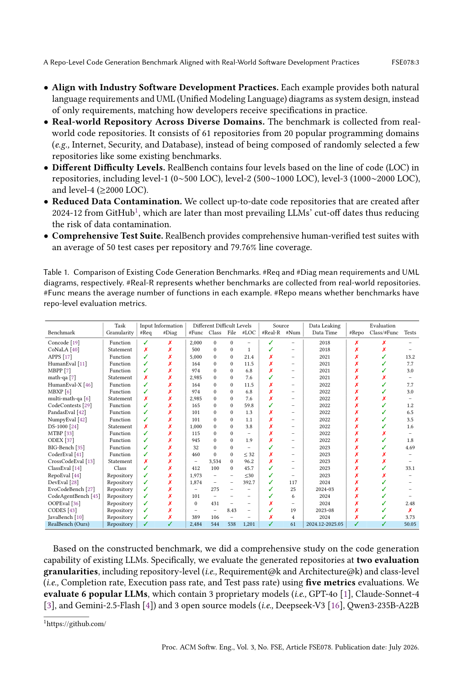

<!-- PDF page 4 -->

## Página PDF 4

FSE078:4
J. Li, H. Deng, Y. Zhang, K. Zhang, T. Shao, T. Zhao, W. Wang, Z. Jin, G. Li, Y. Liu, Y. Fang, Y. Dong.
Requirement
This project provides a comprehensive 
server implementation for managing 
Alibaba Cloud Data Transmission Service 
(DTS) and Database Management Service 
(DMS) through a unified interface. The 
server offers tools for configuring, 
monitoring, and executing database 
operations across ...
Architecture Design
{"classes": [{
      "name": "ApplicationService",
      "type": "class",
      "attributes": [{
          "name": "executed_sql",
          "type": "str",
        ... } , ...]
      "methods": [{
          "name": "main",
          "parameters": [ ... ]
        }],}, ...],
   "dependencies": [{
        "source": "ExecuteScript",
        "target": "ResultSet",
        "type": "dependency"
        }]}
Class Diagram
Package Diagram
{"modules": [{
      "name": "server",
      "type": "package",
      "exports": [
        "configure_dts_job",
        "get_dts_client“
      ]}, ...],
"dependencies": [{
        "source": "__init__",
        "target": "server",
        "type": "import"
      } , ...
 
]}
Fig. 1. An Example for a Code Generation Task in RealBench.
[5], and Qwen2.5-Coder-7B-Instruct [2]) on RealBench. We design three generation strategies
(i.e., holistic, incremental, and retrieval-augmented generation). We conduct ablation studies on
UML diagrams (i.e., package diagram and class diagram) as the system design.
The experimental results reveal key limitations in current LLMs’ capabilities for repo-level code
generation aligned with real-world software development practices. The best average test pass rate
score is only 19.39% among all studied LLMs. Moreover, LLMs perform much worse as repository
size grows: test pass rate scores drop from over 40% on repositories with less than 500 lines of code
to under 15% on repositories with more than 2000 lines of code. Our further analysis shows that for
smaller repositories with less than 1000 lines of code, using a holistic generation strategy works best.
For larger repositories with more than 1000 lines of code, the incremental strategy works better. Our
analysis also confirms that detailed design is very important for repository-level code generation.
By analyzing the detailed limitations of current LLMs, we aim to provide valuable insights for
optimizing repo-level code generation and driving advancements in software engineering.
Our contributions are summarized as follows.
• We propose a repo-level code generation benchmark, RealBench, aligned with real-world software
development practices. It provides both natural language requirements and UML diagrams as
system designs, rather than requiring LLMs to directly generate code from raw requirements.
• We design a systematic evaluation design for comprehensively assessing LLMs on repo-level
code generation tasks, being a pioneering evaluation practice. The assessment system contains
two evaluation granularities with five metrics.
• We conduct extensive experiments to observe LLMs’ performance in generating repositories
aligned with real-world industry software development practice. By analyzing results, we provide
some valuable insights for optimizing repo-level code generation and LLMs.
2
RealBench Benchmark
In this section, we introduce RealBench. We will first introduce the data format, then the construction
procedure, and finally the characteristics of the constructed benchmark.
2.1
Benchmark Format
The specification of Realbench’s content is shown in Table 2. A repository comprises the natural
language requirements of the whole repository and its system design. The requirements specify
the purpose of the repository. For the system design, RealBench provides a two-level standard
UML diagram following UML specification [34] for each repository: the package diagram and class
Proc. ACM Softw. Eng., Vol. 3, No. FSE, Article FSE078. Publication date: July 2026.

[Vista original de la página 4](../../../../../images/v5/estructura_colecciones/Evaluation/secondary/RealBench/page-04.png)

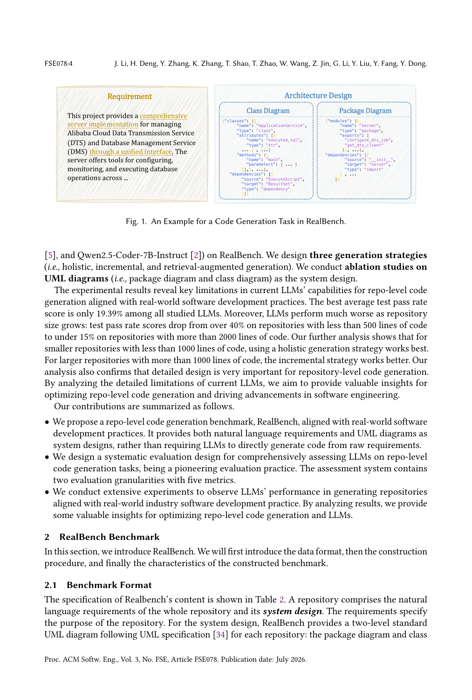

<!-- PDF page 5 -->

## Página PDF 5

A Repo-Level Code Generation Benchmark Aligned with Real-World Software Development Practices
FSE078:5
Table 2. Content Specification for RealBench.
Category
Elements
Definition
Repository Requirements
Repository Description
Natural language specification of repository’s purpose, scope, and objectives
System
Design
Package
Diagram
Package Names
Module identifiers representing logical system organization
Dependencies
Inter-package import relationships showing architectural structure
Public Exports
Interface elements (functions/classes) made available by each package
Class
Diagram
Class Names
Complete class definitions including utility classes from module functions
Class Description
Natural language functional description of the class
Attributes
Member variables with types, visibility, and constraints
Relationships
Inter-class connections
Methods
Signatures
Method signatures with parameters, return types, and visibility
Description
Natural language functional description of the function
Test Suite
Test Cases
Test cases to evaluate the correctness of the repository
Repository Selection
Exploring 
PyPI Topics 
Counting 
Publication Date 
Counting 
Repository Stars 
Counting 
Repository Size 
RealBench Benchmark
Requirement 
Extraction
Extracting 
Requirements
Normalizing
Requirements
Human
Evaluation
System Design
Construction
Parsing
Repository
Constructing
Package Diagram
Constructing
UML Diagram
Test Construction
Class-level Tests
Method-level Tests
Function-level Tests
Canonical Repository
Construction
Fig. 2. The Construction Procedure of RealBench.
diagram, where the package diagram serves as a high-level overview of the system, and the class
diagram shows the detailed design. We provide an example of our benchmark in Figure 1.
2.2
Benchmark Construction
Figure 2 illustrates the construction procedure of RealBench. It mainly consists of four steps to
create RealBench: (i) select suitable coding tasks (Section 2.2.1); (ii) construct requirements of
repositories with natural language (Section 2.2.2); (iii) create system design based on the principles
of a two-level standard UML diagram (Section 2.2.3); and (iv) write the test suite for classes, methods,
and functions within the repository (Section 2.2.4).
2.2.1
Task Selection. Referring to the TIOBE index [9] for programming language popularity, the
most popular language is Python. Thus, we conduct experiments on Python and will expand to other
languages in the future. We aim to ensure the representativeness of selected repositories in real-
world programming scenarios. To this end, we focus on the following criterion: (i) Topic Selection:
to enable RealBench covering more coding tasks in the real-world programming scenarios, we
first identify the top-20 popular programming topics in PyPI2 since PyPI is the largest Python
2https://pypi.org/
Proc. ACM Softw. Eng., Vol. 3, No. FSE, Article FSE078. Publication date: July 2026.

[Vista original de la página 5](../../../../../images/v5/estructura_colecciones/Evaluation/secondary/RealBench/page-05.png)

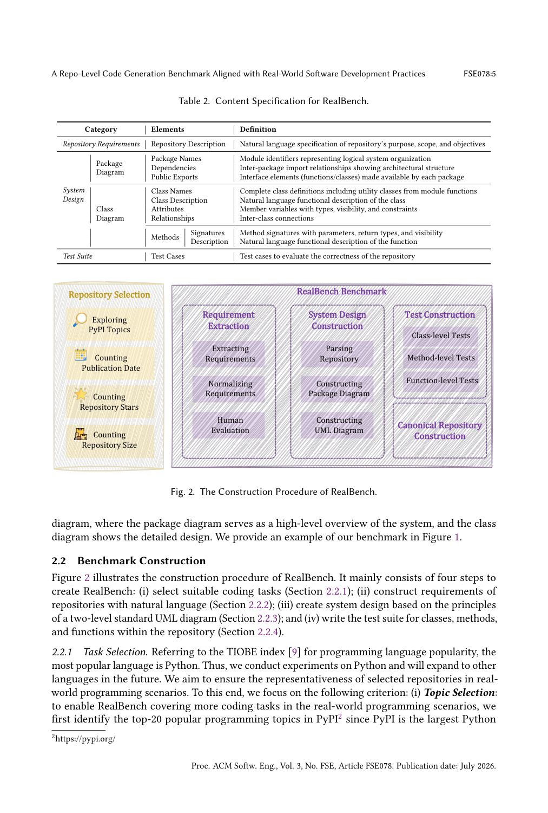

<!-- PDF page 6 -->

## Página PDF 6

FSE078:6
J. Li, H. Deng, Y. Zhang, K. Zhang, T. Shao, T. Zhao, W. Wang, Z. Jin, G. Li, Y. Liu, Y. Fang, Y. Dong.
package registry; (ii) Publication Date: to avoid as much the impact of data contamination, we
select repositories that were published after 2024-12; (iii) Star Count: to ensure the quality of
repositories, we require repositories to have more than 10 stars on GitHub; (iv) Project Sizes: to
ensure RealBench covers a wide range of repository sizes, we divide repositories into four levels
according to their lines of code (LOC), including 0∼500 (level 1), 500∼1000 (level 2), 1000∼2000 (level
3), and ≥2000 (level 4). We crawl these repositories from GitHub and ensure they are non-forked
and non-malicious. Finally, we obtain 61 real-world repositories.
2.2.2
Requirement Construction. We manually construct the natural language requirements for
each repository by inviting experienced Python programmers. Each participant has development
experience at least 3 years. One participant is required to construct requirements, and the other is
responsible for verifying and correcting the requirements. Specifically, if the README file contains
requirements, one participant extracts requirement descriptions from the file. If a repository does
not have requirements, the participant manually writes the requirements according to the code
implementations. Then, the other participant manually verifies and corrects requirements, aiming
to ensure the quality of our RealBench.
2.2.3
System Design Construction. We construct the system design for each repository with Un-
derstand3. Understand developed by SciTools is a software development tool designed to help
programmers comprehend, maintain, and document their source code. Understand leverages its
static code analysis engine to create and display UML diagrams such as class diagrams and package
diagrams, particularly beneficial for understanding existing codebases and their architecture. These
diagrams provide a visual overview of classes, their inheritance relationships, and the interactions
and data flow between objects over time.
During this step, we construct both the package diagram and class diagram for each repository.
(i) Package Diagram structures the high-level elements and dependencies in the system, which
contains package names, public interfaces, and inter-package dependencies. We construct the
package diagram following the UML standard [34]. Specifically, we first identify all the packages in
the repository, along with their name, import statements, and public functions/classes. Then, based
on the import statements, we extract the dependencies among the packages to form the final package
diagram. (ii) Class Diagram aims to reflect the detailed object-oriented design and static structure
of the system, which contains complete class definitions with attributes, methods, and relationships.
To construct it, we first identify all the classes as nodes in the diagram. Moreover, it is worth noting
that Python does not strictly restrict all functions and variables to be contained in classes. Therefore,
to allow the class diagram to reflect all the necessary details for the subsequent code generation
task, we follow the practices to use service classes to encapsulate functions and variables that were
not defined in a class. Next, we extracted all the function calls and data dependencies among the
classes to identify the inter-class dependencies among the identified classes.
To ensure the quality, we invite 3 participants to verify the correctness of the system design.
Participants have an average of 3 years of Python development experience. Each system design is
initially assigned to two participants. They are required to check and rectify the system design,
ensuring that it is consistent with the repository. In case of disagreements, a third participant
facilitates discussions to reach a consensus on the system design.
2.2.4
Test Creation. In this step, we manually create a test suite for each repository. Similar
to system design construction, test suites are constructed by experienced programmers. One
participant is responsible for creating the test cases, while the other verifies the correctness of
the test cases. To conduct a comprehensive evaluation, we require participants to create test cases
3https://scitools.com/graphs
Proc. ACM Softw. Eng., Vol. 3, No. FSE, Article FSE078. Publication date: July 2026.

[Vista original de la página 6](../../../../../images/v5/estructura_colecciones/Evaluation/secondary/RealBench/page-06.png)

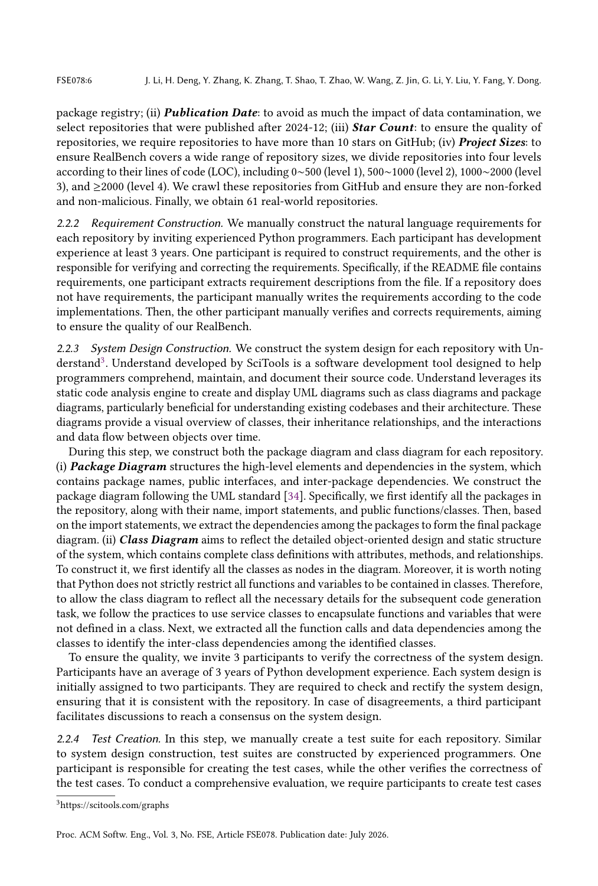

<!-- PDF page 7 -->

## Página PDF 7

A Repo-Level Code Generation Benchmark Aligned with Real-World Software Development Practices
FSE078:7
Table 3. Statistics of RealBench (SA: Standalone, LC: Line Coverage).
LOC
Class
Method
Function
File
Dependency (%)
Tests
Task
SA
Non-SA
Num
LOC
LC (%)
Level-1
259.35
1.71
6.85
6.21
2.86
70.59
29.41
22.36
7.93
91.16
14
Level-2
845.88
8.29
23.71
11.71
6.23
36.93
63.07
33.41
15.40
81.07
17
Level-3
1337.80
11.3
18.45
14.85
3.60
45.16
54.84
51.80
11.46
74.09
20
Level-4
2362.81
14.4
51.40
29.73
22.57
26.23
73.77
92.64
12.31
72.71
10
#Avg
1201.46
8.92
25.10
15.63
8.82
44.73
55.27
50.05
11.78
79.76
15.25
in three levels, including function-level, method-level, and class-level tests. Function-level test
evaluates a single function and only checks whether the return value is correct. Method-level
test focuses on independently verifying the correctness of each method within a class, where a
method is invoked at a time without involving other methods. Different from the function-level
test, it checks not only if the method’s return value is correct but also inspects the method’s impact
on the class’s fields. This test level can ensure that each method functions correctly on its own,
without being impacted by other potentially incorrect methods. Class-level test aims to evaluate
the overall functionality of the entire class, especially when multiple methods work together. It
verifies if the interactions between methods are correct and whether the final state of the class and
the outcome are as expected after a series of operations. In this step, we discarded projects that
could not be executed to ensure the repositories in our dataset were testable.
To accelerate the test construction process, participants can use the existing test cases in reposi-
tories and also apply advanced LLMs (i.e., GPT-4o) to help generate test cases. All tests are verified
by the other participant.
2.3
Benchmark Statistics
In this way, we constructed our new benchmark RealBench. We summarize the main Statistics of
RealBench in Table 3.
Scale and Complexity. Our benchmark contains a total of 61 repositories. The repositories are
divided into four levels based on their size: Level-1 (0∼500 LOC), Level-2 (500∼1000 LOC), Level-3
(1000∼2000 LOC), and Level-4 (≥2000 LOC). As repository size increases, the complexity also grows
significantly. Level-4 repositories contain the most complex structures with an average of 14.4
classes and 51.40 methods per repository.
Dependency. We analyze the percentage of standalone functions and methods (functions and
methods with no dependencies on other code) at each level to measure task difficulty. On average,
44.73% of methods and functions in RealBench are standalone. However, this proportion is much
lower for large repositories: level-4 tasks contain only 26.23% standalone methods and functions.
Test Coverage and Quality. Following the procedure described before, we manually create
comprehensive test suites for each repository. On average, each repository contains 50.05 test cases.
Our test coverage analysis shows that overall line coverage reaches 79.76% across all repositories.
Coverage varies by repository size, with smaller repositories achieving higher coverage rates. This
pattern occurs because larger codebases are more complex, making complete coverage more chal-
lenging. Nevertheless, all coverage rates exceed 70%, ensuring that our benchmark can effectively
evaluate the correctness of generated code.
Proc. ACM Softw. Eng., Vol. 3, No. FSE, Article FSE078. Publication date: July 2026.

[Vista original de la página 7](../../../../../images/v5/estructura_colecciones/Evaluation/secondary/RealBench/page-07.png)

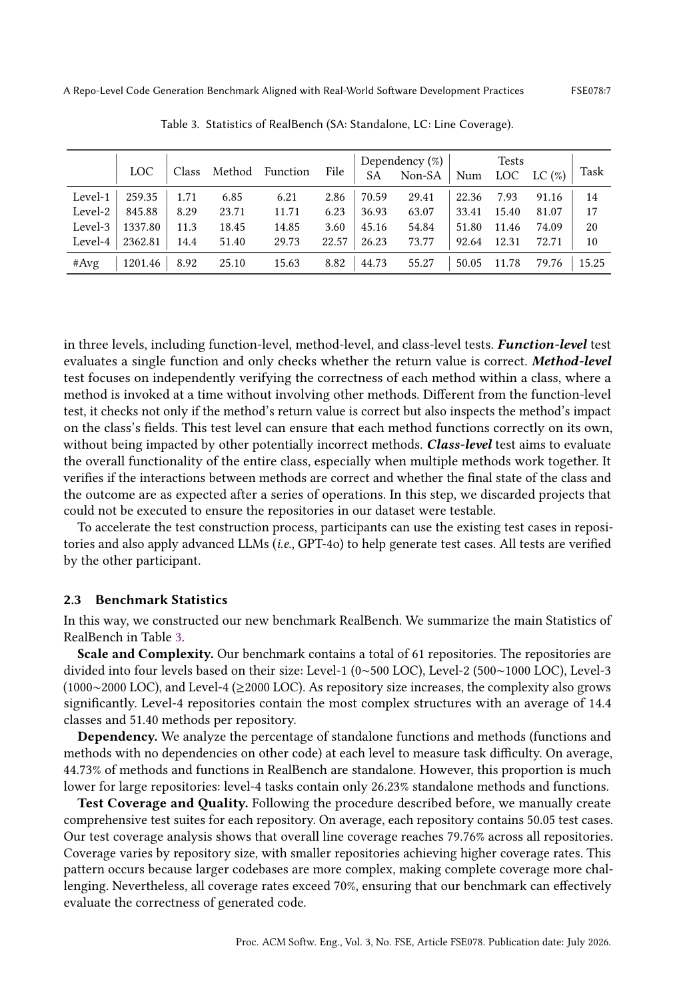

<!-- PDF page 8 -->

## Página PDF 8

FSE078:8
J. Li, H. Deng, Y. Zhang, K. Zhang, T. Shao, T. Zhao, W. Wang, Z. Jin, G. Li, Y. Liu, Y. Fang, Y. Dong.
Code Generation Strategies
Complated class 1
Complated 
function 1
...
Complated class 2
Complated function 2
...
Complated 
module 1
Complated 
module 2
Complated 
Repository
I. Holistic Generation 
Complated class 1
Complated 
function 1
...
Complated 
module 1
Complated 
module 2
Complated 
Repository
II. Incremental 
Generation 
Complated class 1
Complated function 1
...
Complated 
module 1
Complated 
Complated 
...
...
m1
m3
m2
m4
Complated 
module 2
Complated 
Complated 
Repository
III.RAG Generation 
Fig. 3. Illustration of Three Code Generation Strategies for Each Repository.
3
Experiment Design
In this section, we describe our experiments to evaluate LLMs’ performance on our benchmark.
We first describe the code generation design using three generation strategies (Section 3.1.1) and
two system design formats (Section 3.1.2). Then, we present a systematic evaluation design for
assessing the generated repositories, which contains two evaluation granularities (Section 3.2.1)
with five metrics (Section 3.2.2). Next, we provide the prompt design used in the generation process
(Section 3.3), studied LLMs (Section 3.4), and implementation details (Section 3.5).
3.1
Code Generation Design
Given natural language requirements and a UML diagram, we generate an entire repository class-by-
class, composing file-by-file. In a repository, code components usually have complex dependencies,
such as import relations from one file to another. Thus, we study three generation strategies (Section
3.1.1). Since the system design formats also matter, we also investigate two types of system designs
(Section 3.1.2).
3.1.1
Generation Strategies. We design three repo-level code generation strategies as shown in
Figure 3. A straightforward setting asks LLMs to generate the entire repository all at once with the
natural language requirements and the system design, named Holistic Generation. Considering
that LLMs struggle to maintain long-range coherence in long-form generations [39], we investigate
Incremental Generation. In this setting, LLMs generate code in a file-by-file manner to reduce
the generated context length. Each iteration is based on requirements and the system design.
The iterative process repeats until all classes are generated. Code components in a repository
usually have dependencies, e.g., one file imports another. Inspired by this, we design the Retrieval-
Augmented Generation setting. It requires LLMs to generate one file each time based on the
retrieved relevant files generated in previous iterations, along with the requirements and the system
design. To retrieve relevant files, we construct a directed acyclic graph to describe the relationships
between files according to the system design. Then, we select files that have the “import” relation
with the target file. This strategy keeps a balance between rich domain knowledge and limited
context windows of LLMs.
3.1.2
System Design Types. We investigate two system design methods for code generation. The
first method uses only UML package diagrams, which show packages and their dependencies. This
provides a high-level view of the system architecture. The second method combines UML package
diagrams with class diagrams, where class diagrams show class names, attributes, methods, and
Proc. ACM Softw. Eng., Vol. 3, No. FSE, Article FSE078. Publication date: July 2026.

[Vista original de la página 8](../../../../../images/v5/estructura_colecciones/Evaluation/secondary/RealBench/page-08.png)

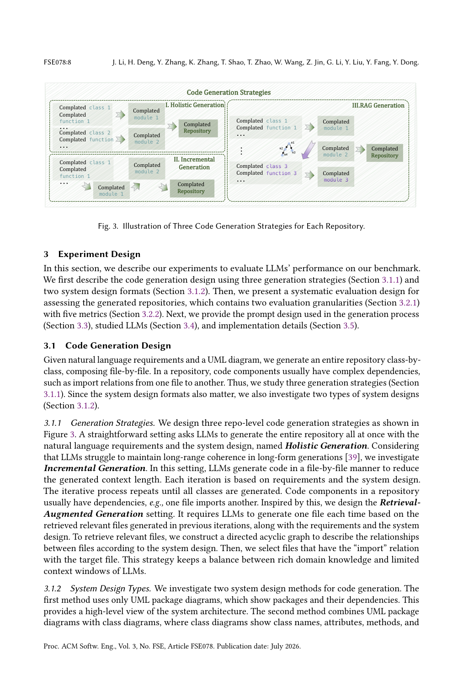

<!-- PDF page 9 -->

## Página PDF 9

A Repo-Level Code Generation Benchmark Aligned with Real-World Software Development Practices
FSE078:9
Class-level Evaluation
The completed rate of code 
components.
Requirement
This project provides a 
comprehensive server 
implementation 
Architecture Design
  ...
  {
    "name": "server",
    "type": "package",
    "exports": [ ... ]
  ...
Test Cases
Test class 1
Test function 1
Test class 2
Repository-level Evaluation
This project provides a 
comprehensive server 
implementation ...  
This project provides a 
server implementation ...  
Generated
The consistency score between requirements of 
generated repository and ground-truth requirements。
Requirement@s 
  ...
  {
    "name": "server",
    "type": "package",
    "exports": [ ... ]
  ...
Ground Truth
Ground Truth
Generated
  ...
  {
    "name": "get_client",
    "attributes": [ ... ],
    "methods": [ ... ]
  ...
The consistency score between UML diagram of 
generated repository and ground-truth UML diagram。
Architecture@s 
Generated class 1
Generated function 1
Ungenerated class 2
Completion rate
The rate of code 
components that can be 
successfully executed.
Unexecutable class 1
Executable function 1
Executable class 2
Execution pass rate
The rate of  test cases 
that can pass the code 
components.
Unpassed class 1
Passed function 1
Passed  class 2
Test pass rate
Fig. 4. Evaluation design for assessing the generated repository. It contains repository-level and class-level
granularities with five metrics. Repository-level metrics evaluate whether the generated repository satisfies the
ground-truth requirements and the system design. Class-level metrics assess whether the code components
of generated repositories are completed, executed, and passed test cases.
relationships. These relationships include inheritance, associations, and dependencies between
classes. This method provides both high-level and low-level architectural designs.
We chose these two methods based on different industry software development methodologies.
For agile development, teams prefer minimal documentation and design artifacts. Package diagrams
provide a good balance. They show the high-level system structure without too many implementa-
tion details. For waterfall development, teams need complete upfront design and documentation.
Therefore, we use both package diagrams and detailed class diagrams to simulate this scenario:
Package diagrams show the overall structure, while class diagrams add specific implementation
details.
3.2
Evaluation Design
To evaluate the quality of generated repositories, we use two sets of metrics. The first set includes
test-based metrics (i.e., Completion rate, Execution pass rate, and Test pass rate) that evaluate
behavioral correctness [10]. However, these metrics only assess functional correctness while
ignoring non-functional aspects like performance or security design. To address this limitation, we
introduce two repository-level metrics (i.e., Requirement@𝑘and Architecture@𝑘) that evaluate
whether the generated code matches the original requirements and design.
3.2.1
Evaluation Granularity. We design two evaluation granularities (i.e., repository-level and
class-level) to comprehensively assess a repository. Repository-level granularity evaluates whether
the generated repository meets the ground-truth requirements and the system design. Class-level
granularity evaluates whether the code components (i.e., functions, classes, and methods) within
generated repositories are completed, executed, and passed test cases.
Repository-Level granularity evaluates whether the generated repository meets the users’ re-
quirements and the system design. We employ DeepWiki4, an advanced repository-understanding
code agent, to automatically analyze generated repositories. Given a repository, DeepWiki can
4https://deepwiki.com/
Proc. ACM Softw. Eng., Vol. 3, No. FSE, Article FSE078. Publication date: July 2026.

[Vista original de la página 9](../../../../../images/v5/estructura_colecciones/Evaluation/secondary/RealBench/page-09.png)

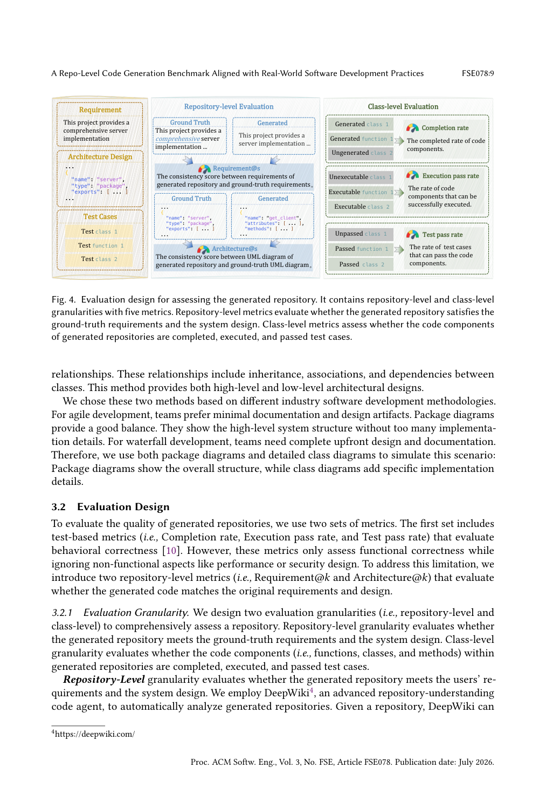

<!-- PDF page 10 -->

## Página PDF 10

FSE078:10
J. Li, H. Deng, Y. Zhang, K. Zhang, T. Shao, T. Zhao, W. Wang, Z. Jin, G. Li, Y. Liu, Y. Fang, Y. Dong.
analyze it from diverse aspects such as generating its requirements, system design, and environ-
ment setup, while also supporting multi-turn conversational interactions. To evaluate a generated
repository, we first use DeepWiki to generate its requirement descriptions and a class diagram. Sub-
sequently, one participant with 3 years of programming experience verifies and corrects the output,
ensuring requirements and system design are consistent with the generated repository. Another
participant then compares the validated descriptions and class diagram against the ground-truth
labels provided by our benchmark. Finally, they assign a score (i.e., [0, 4]) based on our designed
comparison criteria, where the detailed instructions are available on our website. The higher the
score is, the better the quality of the generated repository will be.
To conduct a fine-grained evaluation, we design Class-Level to assess the code components (i.e.,
functions, classes, and methods) within repositories, thereby facilitating a deeper analysis of LLMs’
abilities in repo-level code generation. We evaluate code components at three progressive levels,
including completeness, executability, and correctness. Completeness measures the proportion of
code components that are generated, which reflects whether LLMs can identify code elements in
the system design. Executability assesses the percentage of code elements that can be successfully
run. It focuses on evaluating the syntax correctness of generated repositories. Correctness, the most
stringent evaluation design, measures the functional accuracy of code elements within repositories.
This criterion not only requires the code to be runnable and syntactically correct, but also demands
that its functionality is accurate.
3.2.2
Evaluation Metrics. We design five metrics for repository-level and class-level evaluation. For
repository-level evaluation, we design Requirement@k and Architecture@k metrics, which are
human evaluation scores by comparing requirement descriptions and system designs of generated
repositories against the ground-truth labels, ranging from 0 to 4.
For class-level evaluation, we adapt Test pass rate [11] computed as the number of passed
tests divided by the total number of tests for each task. Similar to Test pass rate, we design
Completion rate and Execution pass rate. Completion rate measures the expectation of completed
code components (i.e., class, function, and method) in a generated repository. Execution pass rate
is the expectation of code components that can be successfully executed.
3.3
Prompt Design
Following the common practice of prompting LLMs [10, 14], we design the prompt used for the
repo-level code generation aligned with real-world software development practice. The prompt
contains two parts: a system prompt as the beginning instruction to initialize LLMs, and a task
instruction to describe the purpose of the task. Each generation strategy is defined in the task
instruction. The designed prompt is shown as follows:
System Prompt: You are a senior Python programmer familiar with Python programming and
UML diagrams.
Proc. ACM Softw. Eng., Vol. 3, No. FSE, Article FSE078. Publication date: July 2026.

[Vista original de la página 10](../../../../../images/v5/estructura_colecciones/Evaluation/secondary/RealBench/page-10.png)

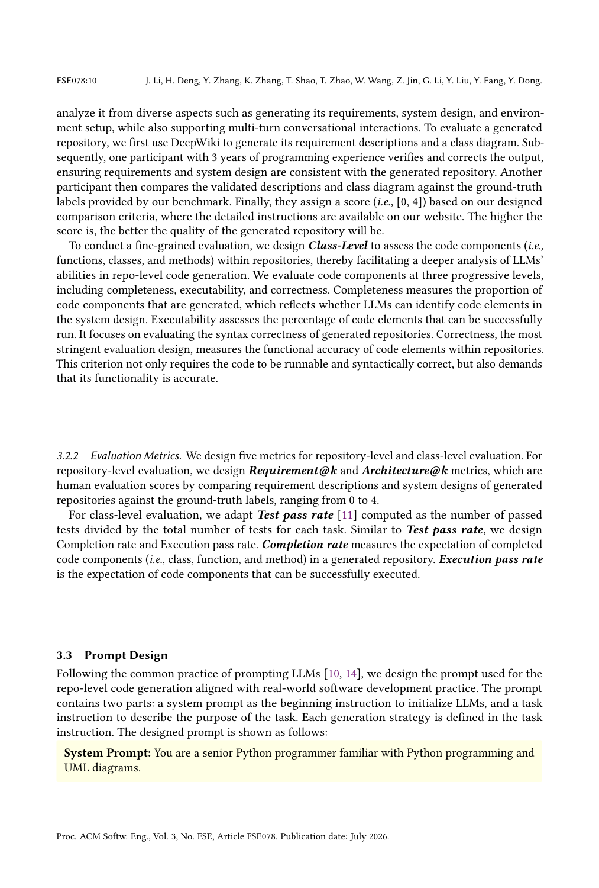

<!-- PDF page 11 -->

## Página PDF 11

A Repo-Level Code Generation Benchmark Aligned with Real-World Software Development Practices
FSE078:11
Instruction: Generate an entire Python project based on the given natural language require-
ments and UML diagram of the project. The generated output format meeting the following
demands: (i) Each module starts with <begin_module> and ends with <end_module>; (ii) Adds
necessary imports between modules.
The given natural language requirements:
${Project_Requirements}
The given UML diagram with JSON format:
${UML_JSON_String}
Do not include any explanations or additional text.
3.4
Studied Large Language Models
We evaluate 6 advanced LLMs on RealBench, which contain 5 general models (i.e., GPT-4o [1],
Gemini 2.5 Flash [4], Claude Sonnet 4 [3], Deepseek-V3 [16] and Qwen3-235B-A22B [5]) and 1 code
model (Qwen2.5-Coder-7B-Instruct [2]). We considered the instruction version of LLMs because we
need to use the instruction-following ability. Table 4 shows the 6 LLMs studied in this paper with
their releasing time (Column “Time”), model sizes (Column “Size”), and context window lengths
(Column “Window Length”).
Table 4. Studied Large Language Models
Model
Type
Size
Time
Window Length
General Model
GPT-4o [1]
–
May, 24
128K
Claude-Sonnet-4 [3]
–
2025-05
200K
Gemini-2.5-Flash [4]
–
2025-04
1,048K
Open Source Model
Deepseek-V3 [30]
671B
2024-12
64K
Qwen3-235B-A22B [5]
235B
2025-04
128K
Qwen2.5-Coder-7B-Instruct [2]
7B
2024-11
128K
3.5
Implementation Details
We use greedy search for all experiments. For each programming task, LLMs generate one solution.
Constrained by model availability and computing resources, we evaluate all studied LLMs by
invoking APIs provided by their official interfaces. For instance, we use the OpenAI API interface
for using GPT-4o (i.e., gpt-4o-2024-05-13) and interfaces provided by Anthropic for invoking claude-
sonnet-4-20250514. Although LLMs support context windows exceeding hundreds of thousands of
tokens, the input length of retrieval-augmented generation strategies sometimes exceeds LLMs’
context windows. We truncate the retrieved Python files from the front of the code sequence.
The invited developers in evaluation are PhD candidates majoring in computer science with
programming experience for at least three years.
4
Evaluation
We conduct extensive studies to evaluate LLMs’ capabilities on repo-level code generation aligned
with real-world software development practice. The research questions (RQs) are designed as
follows:
Proc. ACM Softw. Eng., Vol. 3, No. FSE, Article FSE078. Publication date: July 2026.

[Vista original de la página 11](../../../../../images/v5/estructura_colecciones/Evaluation/secondary/RealBench/page-11.png)

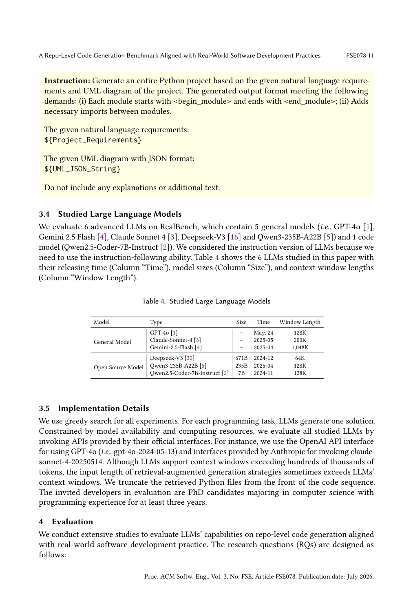

<!-- PDF page 12 -->

## Página PDF 12

FSE078:12
J. Li, H. Deng, Y. Zhang, K. Zhang, T. Shao, T. Zhao, W. Wang, Z. Jin, G. Li, Y. Liu, Y. Fang, Y. Dong.
Table 5. Overall Performance of LLMs on RealBench.
Strategies
Models
Class-level
Repository-level
Completion rate
Execution pass rate
Test pass rate
Requirement@1
Architecture@1
L1
L2
L3
L4
L1
L2
L3
L4
L1
L2
L3
L4
L1
L2
L3
L4
L1
L2
L3
L4
Holistic
GPT-4o
96.97
87.60
52.56
92.15
90.73
38.26
40.80
81.45
24.28
5.39
19.48
13.51
2.63
1.42
2.32
1.80
3.14
3.48
2.47
1.60
Claude-Sonnet-4
92.12
85.17
53.24
90.21
83.29
34.31
35.09
72.15
28.65
7.34
16.18
14.30
2.72
0.89
1.54
1.70
2.87
1.75
1.87
0.60
Gemini-2.5-Flash
49.70
60.11
60.03
78.95
23.52
16.51
16.42
24.55
15.65
5.95
6.70
3.07
2.04
0.72
0.74
1.10
1.85
1.63
1.02
1.70
Deepseek-V3
89.70
74.12
32.63
44.82
77.64
21.95
27.60
4.46
43.13
11.23
21.00
2.21
3.17
1.75
2.26
0.60
2.61
1.71
2.69
1.70
Qwen3-235B-A22B
31.52
52.90
69.28
38.45
16.42
10.84
37.21
5.48
19.81
6.74
18.34
0.91
2.45
1.38
2.81
0.80
1.82
0.74
2.80
0.60
Qwen2.5-Coder-7B
34.60
54.38
63.41
41.37
57.31
19.43
49.42
12.06
21.36
7.13
16.57
0.85
2.61
1.53
2.85
0.7
2.07
0.92
2.67
0.80
Average
65.77
69.05
55.19
64.33
58.15
23.55
34.42
33.36
25.48
7.30
16.38
5.81
2.60
1.28
2.09
1.12
2.39
1.71
2.25
1.17
Incremental
GPT-4o
100.00
87.47
87.02
90.26
84.66
44.81
58.32
48.69
20.45
6.21
23.44
15.48
0.92
1.20
2.21
1.70
2.39
2.12
2.37
2.10
Claude-Sonnet-4
92.73
78.98
82.90
84.61
92.73
46.24
56.15
57.49
26.80
10.75
17.37
15.11
0.87
1.20
2.21
2.00
2.94
1.45
1.82
1.70
Gemini-2.5-Flash
100.00
88.81
86.76
86.39
69.97
63.55
48.74
42.08
5.64
3.68
19.03
12.04
0.25
0.37
2.10
1.40
1.03
1.14
2.03
1.40
Deepseek-V3
91.31
77.35
34.19
49.35
79.08
39.66
20.65
21.20
17.18
8.09
23.44
14.62
0.97
1.29
2.23
1.60
1.41
1.78
2.58
1.30
Qwen3-235B-A22B
96.97
85.98
77.59
78.01
83.21
27.86
24.60
24.74
31.95
4.09
31.51
10.32
2.74
0.43
2.49
1.10
2.82
1.60
2.81
1.50
Qwen2.5-Coder-7B
93.05
84.72
80.35
81.43
84.10
36.47
47.65
35.07
28.71
5.16
28.47
12.56
2.83
0.94
2.75
1.20
2.97
1.33
2.76
1.30
Average
95.68
83.89
74.80
78.43
82.29
43.10
42.69
38.21
21.79
6.33
23.88
13.36
1.43
0.91
2.33
1.50
2.26
1.57
2.40
1.55
RAG
GPT-4o
89.09
80.73
82.83
91.83
82.54
40.07
45.67
46.37
24.60
5.73
19.10
9.95
2.71
1.28
1.41
1.40
2.27
1.43
2.56
1.10
Claude-Sonnet-4
86.97
75.56
78.39
86.34
79.55
40.33
55.89
52.55
26.52
5.07
19.49
21.33
2.43
1.05
2.37
1.80
2.37
0.71
2.50
2.80
Gemini-2.5-Flash
72.04
78.25
72.05
65.30
56.94
30.47
27.16
15.92
19.40
4.54
14.91
8.01
1.62
1.47
1.96
1.30
3.26
1.10
2.31
1.30
Deepseek-V3
88.48
74.66
50.72
74.66
64.68
24.17
28.48
37.14
41.85
5.03
17.37
13.27
3.35
0.97
1.67
1.40
3.03
1.21
1.24
1.70
Qwen3-235B-A22B
80.61
74.35
60.03
68.06
64.68
19.72
20.93
15.17
9.23
4.12
7.16
0.73
1.72
0.54
1.20
0.5
1.82
0.93
1.06
0.80
Qwen2.5-Coder-7B
31.52
46.77
30.28
20.63
22.26
11.95
15.91
11.30
8.95
9.49
17.08
15.11
1.29
0.72
0.93
1.30
0.74
0.56
0.79
1.80
Average
74.79
71.72
62.38
67.80
61.78
27.79
32.34
29.74
21.76
5.66
15.85
11.40
2.19
1.01
1.59
1.28
2.25
0.99
1.74
1.58
• RQ1: Overall Performance. We evaluate the performance of the studied LLMs on RealBench.
We use our three code generation strategies with UML diagram and its ablation version (Section
3.1.2) to generate repositories.
• RQ2: Generation Strategies. We investigate different generation strategies (Section 3.1.1) and
analyze their influences on repo-level code generation.
• RQ3: UML Diagram Ablation. The UML diagram contains complicated components. We explore
the impacts of different components (Section 3.1.2).
• RQ4: Bad Case Analysis. We analyze the common errors and provide insights for LLMs in
repo-level code generation aligned with software development practice.
4.1
RQ1: Overall Performance
Table 5 presents the performance of LLMs on RealBench with greedy sampling. We have the
following observations.
Comparison among Models. We observe significant performance gaps among LLMs. Among
open source models, DeepSeek-V3 (671B) performs the best, which is related to its large number of
parameters. For Qwen series models, Qwen3-235B-A22B achieves similar performance to Qwen2.5-
Code-7B in most scenarios, despite the significant differences in parameter sizes. For example,
Qwen3-235B-A22B achieves 19.81% test pass rate and Qwen2.5-Code-7B performs 21.36% test
pass rate on Level-1 in holistic strategy. The reason might be that Qwen2.5-Code-7B is a code
model specifically designed for solving programming tasks. In proprietary source models, GPT-4o
and Claude-Sonnet-4 significantly outperform Gemini-2.5-Flash, where Gemini-2.5-Flash achieves
unsatisfactory performance. Generally, the performances of studied LLMs are no more than 20%
test pass rate in most experiments, verifying the limited abilities of LLMs on real-world repo-level
code generation.
Finding 1: The best average completion rate, Execution pass rate, Test pass rate, Requirement@1,
and Architecture@1 scores are 91.18%, 45.00%, 19.39%, 2.29, and 2.67 on RealBench among the
studied LLMs. This demonstrates that LLMs have limited capabilities on real-world repo-level
code generation. Additionally, there are significant performance gaps among LLMs.
Proc. ACM Softw. Eng., Vol. 3, No. FSE, Article FSE078. Publication date: July 2026.

[Vista original de la página 12](../../../../../images/v5/estructura_colecciones/Evaluation/secondary/RealBench/page-12.png)

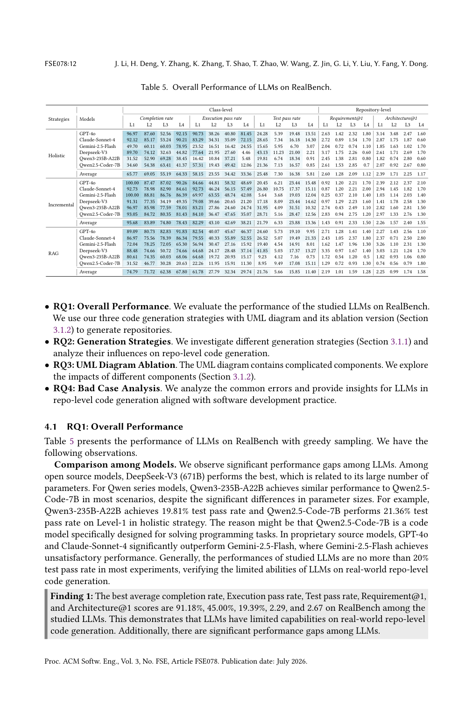

<!-- PDF page 13 -->

## Página PDF 13

A Repo-Level Code Generation Benchmark Aligned with Real-World Software Development Practices
FSE078:13
Performance on Different Metrics. In class-level metrics, completion rate scores are always
higher than execution pass rate, and test pass rate scores are the lowest among the three metrics.
This is in line with the fact that test pass rate is the strictest metric, which not only requires
generated code to be runnable but also has the correct functionality. For completion assessment,
we can find that most LLMs achieve high completion rates even on difficulty repositories (i.e.,
Level-4). For instance, completion rate scores of GPT-4o are more than 80% over all levels. This
reflects that LLMs have satisfactory abilities to understand system design and can effectively
identify modules within diagrams. For execution evaluation, LLMs can achieve decent performance
on simple repositories (i.e., Level-1). With the complexity of repositories increasing, execution
pass rate drops dramatically (e.g., from 82.29% (Level-1) to 38.21% (Level-4) on the incremental
strategy). Meanwhile, compared to completion rate, execution scores are significantly lower. The
above phenomena show that even if LLMs can generate code for modules in system designs, the
generated code has non-negligible execution errors. We observe a significant decrease in test pass
rate compared to the other two metrics in fine-grained class-level. In particular, LLMs achieve
around 0%∼20% test pass rate scores in most scenarios, which shows substantially low performance
of LLMs on repo-level code generation. From the results on repository-level metrics, we can find
that the generated repositories can not completely implement users’ requirements and fail to
maintain consistency with ground-truth system designs in most scenarios.
Finding 2: Our designed metrics can effectively reflect qualities of generated repositories in
finer granularities. LLMs can achieve satisfactory average completion rates (> 50%). However,
LLMs on execution pass rate and test pass rate achieve lower performances. This shows that
while LLMs are good at finding and creating modules defined in UML diagrams, the quality of
generated modules is often poor due to grammar and logic errors.
Empirical Lessons. If only using open source models locally and having limited computing
resources, we suggest users to select Qwen2.5-Coder-7B, which can achieve similar performances
with the larger open source model Qwen3-235B-A22B. Among proprietary source models, we
recommend users to apply GPT-4o or Claude-Sonnet-4, instead of Gemini-2.5-Flash.
4.2
RQ2: Generation Strategies
We compare the performance of three generation strategies (i.e., holistic, incremental, and RAG)
as shown in Figure 5. We find that the best generation strategy varies with the difficulty levels of
repositories.
Comparison across Different Levels. Holistic generation strategy achieves the best perfor-
mance on easy repositories (i.e., level-1 and level-2 repositories) with 25.48% and 7.30% in test pass
rate. Incremental strategy is the best generation strategy on level-3 and level-4 repositories, which
performs much higher on test pass rate than holistic and retrieval-augmented strategies (23.88%
and 13.36% average improvements in test pass rate). For example, on level-1 and level-2 repositories,
DeepSeek-V3 achieves 43.13% and 11.23% test pass rate in holistic strategy, while performing 11.18%
and 8.09% test pass rate in incremental generation. On level-3 and level-4 examples, DeepSeek-V3
performs 21.00% and 2.21% test pass rate in holistic strategy, and achieves 23.44% and 14.62% test
pass rate in incremental generation. This reflects that generating a complex repository at once
is more challenging for LLMs compared to generating each module in separate iterations, which
might be explained by the limited long code generation abilities of LLMs as observed in the study
[39].
Finding 3: Generating the entire repository at once (i.e., holistic generation strategy) is the best
generation strategy on smaller repositories (i.e., level-1 and level-2 repositories). For generating
Proc. ACM Softw. Eng., Vol. 3, No. FSE, Article FSE078. Publication date: July 2026.

[Vista original de la página 13](../../../../../images/v5/estructura_colecciones/Evaluation/secondary/RealBench/page-13.png)

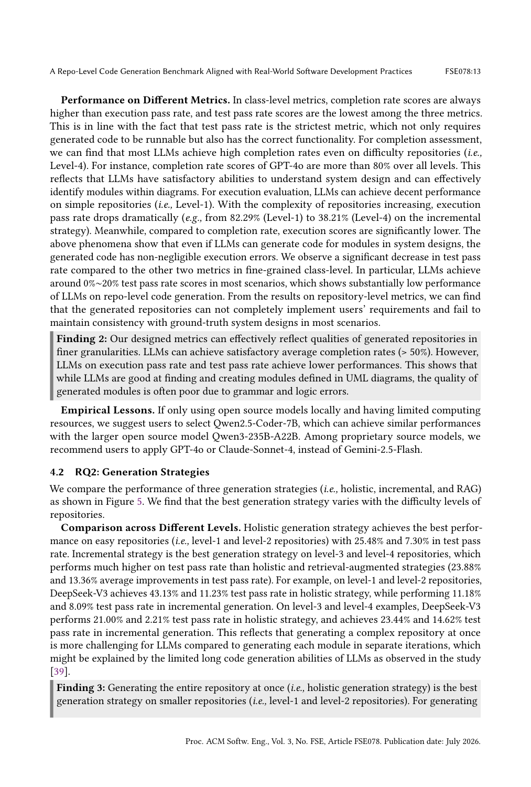

<!-- PDF page 14 -->

## Página PDF 14

FSE078:14
J. Li, H. Deng, Y. Zhang, K. Zhang, T. Shao, T. Zhao, W. Wang, Z. Jin, G. Li, Y. Liu, Y. Fang, Y. Dong.
complex repositories (level-3 and level-4), the incremental strategy works better. This might be
attributed to the limited ability of LLMs’ long code generation abilities.
Comparison between Holistic and Incremental Strategies. The performance of holistic
generation is better than RAG strategy in generating repositories. RAG achieves 2.67% average
decline compared to incremental strategy in test pass rate over level-1 to level-4. The performance
trend in execution pass rate is the same as the counterpart in test pass rate. Execution pass rate
descends from 51.57% on incremental generation to 37.91% on RAG strategy. We can find that
providing the retrieved code actually hinders generating the correct code. As described in Section
3.1.1, RAG strategy requires LLMs to generate each module at once based on the retrieved relevant
modules generated in previous iterations. One potential reason for the performance above might
be that retrieved code contributes to the long input contexts. It is more challenging for LLMs to
fully understand and utilize the long input since LLMs have limited capabilities of understanding
and utilizing long input contexts, as observed in the study [26]. In addition to the limited capability
of handling long inputs mentioned above, we analyze the generated repositories in RAG strategy
and find that LLMs prefer to combine generated code and retrieved code elements into a single
module, failing to follow module relationships in diagrams and leading to errors.
Finding 4: Incremental generation performs better than RAG strategy. The poor performance of
RAG strategy may come from LLMs’ limited ability to understand long code. Also, LLMs often
combine generated code and retrieved code into a single module, which changes the module
relationships shown in the original diagrams.
Empirical Lessons. Based on the above experiments, we summarize the empirical lessons we
learned as: Choosing holistic strategy when users’ requirements are easy (i.e., the line of target
repositories is less than 1000). Otherwise, incremental strategy is recommended to generate complex
repositories.
4.3
RQ3: System Design Ablation
In RQ1 and RQ2, the system design is set to the combination of UML class diagrams with package
diagrams, where package diagrams show the overall structure while class diagrams add specific
implementation details. In this RQ, we investigate the impact of diagrams by removing class
diagrams. Table 6 presents the performance of LLMs on RealBench when only accessing to high-
level package diagrams.
By comparing Table 5 and 6, we can make three observations. First, only providing high-level
architectural designs is insufficient without implementation details. The test pass rate scores drop
dramatically, even reaching zero in some scenarios, meaning that it is almost impossible to generate
repo-level code that can pass test cases. For instance, a 12.74% drop (16.34% - 3.60%) of test pass
rate in the incremental strategy can be observed. Second, removing class diagrams significantly
impacts the execution pass rate of generated repositories. For example, execution pass rate drops
from 37.37% to 23.01% in holistic strategy. We argue that the execution failure might be caused
by the absence of implementation details such as class attributes and methods. Third, it is clear
that introducing system designs to LLMs is non-negligible in repo-level code generation tasks.
Since removing the architecture information leads to a performance drop. The reason is that
unlike generating standalone statement-level or function-level code, repo-level code generation is
a complex programming task, which needs system designs to model modules, interfaces, and their
relationships.
Proc. ACM Softw. Eng., Vol. 3, No. FSE, Article FSE078. Publication date: July 2026.

[Vista original de la página 14](../../../../../images/v5/estructura_colecciones/Evaluation/secondary/RealBench/page-14.png)

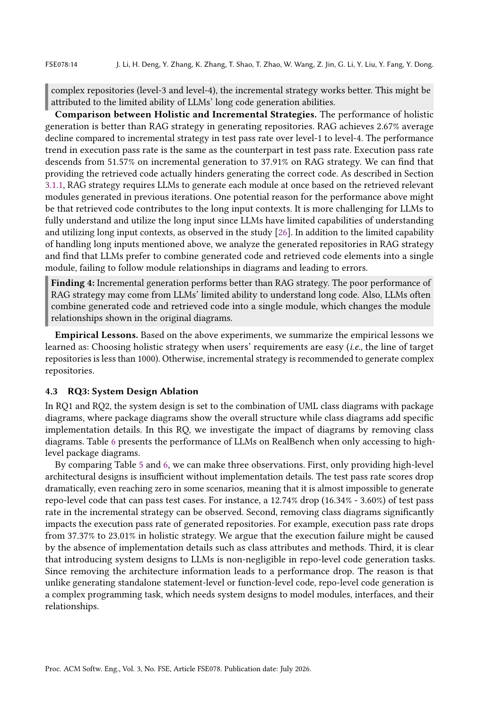

<!-- PDF page 15 -->

## Página PDF 15

A Repo-Level Code Generation Benchmark Aligned with Real-World Software Development Practices
FSE078:15
Table 6. Performance of LLMs without Class Diagram.
Strategies
Models
Class-level
Repository-level
Completion rate
Execution pass rate
Test pass rate
Requirement@1
Architecture@1
L1
L2
L3
L4
L1
L2
L3
L4
L1
L2
L3
L4
L1
L2
L3
L4
L1
L2
L3
L4
Holistic
GPT-4o
63.64
40.97
54.26
40.31
52.78
20.33
40.55
16.24
7.35
2.42
15.07
12.04
0.87
0.38
2.31
1.30
1.02
0.61
1.89
1.80
Claude-Sonnet-4
69.39
38.46
56.12
40.05
41.92
18.39
26.94
24.18
4.98
2.29
15.81
13.51
1.38
0.57
1.43
1.70
1.51
0.45
1.53
2.10
Gemini-2.5-Flash
60.70
37.33
40.89
42.41
28.53
16.23
31.80
15.89
2.24
2.04
6.24
1.93
0.87
0.38
1.04
0.90
0.67
0.28
1.27
1.50
Deepseek-V3
84.24
43.14
44.69
44.92
68.47
21.49
27.01
22.90
14.38
3.16
14.31
1.47
1.62
0.59
2.35
0.40
1.61
1.25
1.80
0.30
Qwen3-235B-A22B
15.15
19.00
18.09
12.36
13.02
5.89
7.90
11.51
9.90
1.86
14.30
0.74
1.35
0.54
1.39
0.30
1.29
0.27
1.45
0.50
Qwen2.5-Coder-7B
52.73
28.30
13.50
4.82
17.02
9.94
1.79
11.41
2.56
1.86
1.77
0.00
0.21
0.38
0.82
0.40
0.47
0.35
0.41
0.30
Average
57.64
34.53
37.93
30.81
36.96
15.38
22.67
17.02
6.90
2.27
11.25
4.95
1.05
0.47
1.56
0.83
1.10
0.54
1.39
1.08
Incremental
GPT-4o
66.06
41.64
54.52
40.00
46.64
19.50
18.09
4.52
3.83
1.86
9.89
2.15
0.74
0.31
1.47
0.30
0.74
0.77
1.63
0.40
Claude-Sonnet-4
76.36
37.03
50.93
46.96
60.56
16.98
15.29
8.04
9.90
2.69
9.83
2.46
1.24
0.42
1.24
0.50
1.71
0.56
1.58
0.30
Gemini-2.5-Flash
72.12
38.14
55.83
45.76
33.07
5.00
15.71
3.41
6.71
1.86
7.76
0.00
1.37
0.69
1.83
0.00
1.02
0.00
1.20
0.00
Deepseek-V3
69.09
42.32
53.08
45.65
34.21
15.34
21.25
10.09
6.39
2.04
3.96
0.86
1.17
0.58
0.71
0.40
1.26
0.45
0.00
0.40
Qwen3-235B-A22B
26.06
23.58
14.68
43.87
14.99
8.68
2.82
4.31
6.71
2.23
2.73
1.52
1.05
0.29
0.45
0.30
0.82
0.31
0.40
0.50
Qwen2.5-Coder-7B
50.91
31.54
31.98
48.06
20.62
8.03
4.47
5.39
6.43
1.49
2.59
2.74
1.92
0.29
0.45
0.30
1.03
0.50
0.26
0.60
Average
60.10
35.71
43.50
45.05
35.02
12.26
12.94
5.96
6.66
2.03
6.13
1.62
1.25
0.43
1.03
0.30
1.10
0.43
0.85
0.37
RAG
GPT-4o
29.09
24.99
34.30
38.48
24.55
6.27
9.86
13.15
13.19
2.26
1.09
1.43
1.80
0.34
0.79
0.70
1.51
0.56
1.03
1.00
Claude-Sonnet-4
28.79
27.41
15.60
42.31
26.03
7.27
7.31
6.41
14.38
1.43
5.54
5.49
1.67
0.31
0.53
0.40
1.83
0.27
0.64
0.50
Gemini-2.5-Flash
20.04
10.50
24.51
35.04
12.73
3.13
11.60
8.93
9.42
1.85
4.75
3.47
0.94
0.29
0.68
0.40
0.81
0.47
0.62
0.20
Deepseek-V3
26.67
29.97
28.70
19.27
19.34
6.98
25.90
9.07
9.27
2.51
14.18
8.60
1.03
0.46
1.15
0.50
1.35
0.19
0.83
0.30
Qwen3-235B-A22B
29.09
20.75
20.28
30.21
21.19
3.67
5.08
8.43
12.46
1.79
4.57
2.49
1.47
0.38
0.76
0.30
1.62
0.43
0.71
0.00
Qwen2.5-Coder-7B
43.03
23.45
17.82
26.32
30.65
16.04
12.09
15.50
17.82
4.79
2.45
4.43
3.15
0.75
0.52
0.40
0.50
0.74
0.46
0.40
Average
29.45
22.85
23.54
31.94
22.42
7.23
11.97
10.25
12.76
2.44
5.43
4.32
1.68
0.42
0.74
0.45
1.27
0.44
0.72
0.40
Finding 5: Generating repositories with both UML package diagrams (high-level) and class
(low-level) diagrams can yield better performance compared to providing only package diagrams.
High-level and low-level system structures both benefit LLMs in generating correct code.
4.4
RQ4: Bad Case Analysis
We conduct an in-depth analysis of error cases to find more useful insights into LLMs’ capa-
bilities and limitations in repo-level code generation. Specifically, we demonstrate and discuss
representative error cases according to the performance of our designed five evaluation metrics.
4.4.1
Requirement Errors. System design defines functional objectives and constraints for the
repository. When LLMs-generated implementations violate core requirements, requirement errors
occur. We identify three primary error types based on severity and nature.
Functional Misalignment. LLMs outputs often do not match what users want. The generated
code may include unnecessary features while missing important required functions. For example,
in one real case, the requirement asked for a “Chroma Auditor” to check text chunks and metadata
in vector databases. However, the generated code only provided basic collection management
functions like creating and deleting collections and cleaning orphaned UUIDs. It completely missed
the main auditing purpose. This problem may happen because long prompts contain too many
technical details that hide the main system design goals.
Core Functionality Absence. Generated code often misses important parts needed for business
logic by providing unfinished core modules or placeholder code that does nothing. This problem
shows a key weakness of LLMs: they cannot handle complex workflows when requirements need
multiple components to work together. This leads to failures in separate modules that should
connect with each other.
Failure to Meet Non-functional Requirements. Generated code often does not follow the non-
functional requirements like creating security problems. For example, in one real case, a user needed
a modular tool to check database schema changes and stop unsafe operations. However, the LLM-
generated code had problems. The SquawkLinter module used shell=True for subprocess execution
Proc. ACM Softw. Eng., Vol. 3, No. FSE, Article FSE078. Publication date: July 2026.

[Vista original de la página 15](../../../../../images/v5/estructura_colecciones/Evaluation/secondary/RealBench/page-15.png)

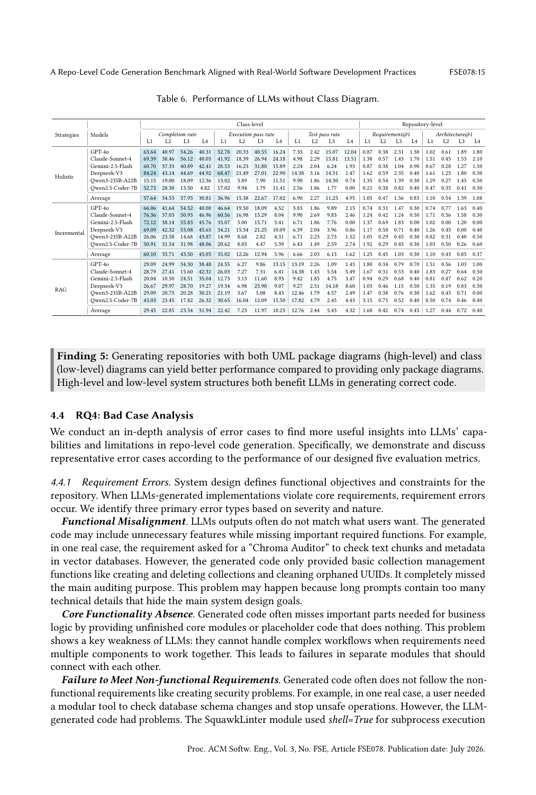

<!-- PDF page 16 -->

## Página PDF 16

FSE078:16
J. Li, H. Deng, Y. Zhang, K. Zhang, T. Shao, T. Zhao, W. Wang, Z. Jin, G. Li, Y. Liu, Y. Fang, Y. Dong.
(through squawk.py), which created a command injection security risk. Also, the generated solution
did not work on different platforms and could only run on Linux and macOS systems.
4.4.2
System Design Errors. System design establishes structural patterns and processing work-
flows for the repository. When LLM-generated implementations violate architectural principles
or mishandle institutional relationships, institutional errors occur. We identify four primary error
types based on their impact scope.
Functional Deficiencies in Modules. LLMs implementations omit critical functions specified
in design specifications. Essential capabilities defined in UML diagrams remain unimplemented,
creating systemic gaps. This may be attributed to the difficulties LLMs face in decomposing
composite functions within a system architecture into atomic operations.
Architectural Design Flaws. Generated code exhibits structural inconsistencies with intended
architecture patterns. This includes improper layer separation and responsibility misalignment.
This discrepancy may stem from LLMs misinterpreting “modules” as physical files rather than
logical units, resulting in a misalignment of functional responsibilities.
Data Processing Inconsistencies. LLMs’ implementations fail to maintain uniform data handling
across system boundaries. Inconsistent format support and processing logic create integration
fault lines. For instance, Student registration supports both form-data and JSON, while teacher
registration only accepts form-data.
Type Information Discrepancies. Generated code exhibits semantic gaps between design
specifications and implementation types. This discrepancy may arise when the UML specification
marks variables as a null type, whereas the implementation defines them with concrete types.
Fig. 5. Module Deficiency and Module Redundancy
Fig. 6. Failure to Generate Module Bodies
4.4.3
Completion Errors. System design provides modules, attributes, and public exports of a
repository. Ideally, LLMs should be capable of generating each module. If LLMs neglect to generate
modules, a completion error occurs. There are mainly two types of typical errors.
Module Deficiency and Redundancy. LLMs usually generate redundant modules that are
needless for implementing users’ requirements, while lacking some modules compared to coun-
terparts provided in system designs. As shown in Figure 5, LLMs generate the needless modules
“generate_markdown_structure”, “write_markdown_file”, and “parse_arguments”. The function
“directory_to_markdown” fails to be generated. The reason might be that LLMs can not identify all
modules from the system design in the long prompt.
Proc. ACM Softw. Eng., Vol. 3, No. FSE, Article FSE078. Publication date: July 2026.

[Vista original de la página 16](../../../../../images/v5/estructura_colecciones/Evaluation/secondary/RealBench/page-16.png)

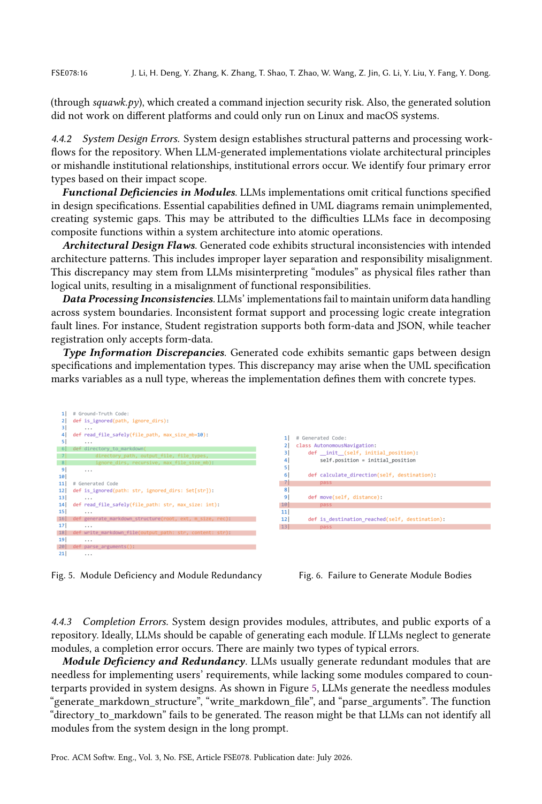

<!-- PDF page 17 -->

## Página PDF 17

A Repo-Level Code Generation Benchmark Aligned with Real-World Software Development Practices
FSE078:17
1|  # Generated Code: 
2|  def get_active_interface() -> str: 
3|      output = subprocess.check_output(["iwconfig"]).decode() 
4|      match = re.search(r"(\w+)\s+Mode:Managed", output) 
5|      if match: 
6|          return match.group(1) 
7|      return None
Fig. 7. Incorrect Attribute Usage
 1|  # Generated Code 
 2|  # File: test_quantum_comm.py 
 3|  ... 
 4|  from quantum_comm import QuantumComm 
 5|  ... 
 6| 
 7|  # File: quantum_comm.py 
 8|  ... 
 9|  from entanglement_manager import EntanglementManager 
10|  ... 
11|  class QuantumComm:
12|      ... 
13| 
14|  # File: entanglement_manager.py
15|  ... 
16|  from quantum_comm import QuantumComm 
17|  ... 
18|  class EntanglementManager:
19|      ... 
Fig. 8. Incorrect Invoking and Inheritance
Failure to Generate Module Bodies. Although the module names and their attributes are
generated correctly, LLMs only generate “pass” as the module’s body, as shown in Figure 6, resulting
in incomplete functionality of the repository.
4.4.4
Execution Errors. Execution errors focus on assessing the syntax and format of generated
repositories. The statistics show that execution errors are mainly related to incorrect attribute
usage and incorrect invocation or inheritance among code snippets.
Incorrect Attribute Usage. The attributes of code elements are crucial for the correct execution
of repositories. However, the verified LLMs often make mistakes in identifying attributes of code.
As shown in Figure 7, the return type of “check_output” method is a string, while the string can
not be processed by “decode()”. This mistake results in a syntax error, causing the repository to fail
during execution.
Incorrect Invoking and Inheritance. Another common phenomenon is that LLMs incorrectly
invoke and inherit predefined code snippets in a repository. In Figure 8, the “entanglement_manager”
module invokes the “quantum_comm” module and vice versa. The cyclic invoking between modules
leads to the failure to start the project. This reflects that LLMs’ ability to understand system
design and analyze relationships among modules needs to be further enhanced, which provides an
insightful direction for LLM optimization.
4.4.5
Pass Errors. This error indicates that the generated code fails to pass test cases, which is
mainly caused by incorrect functionalities or syntax. We analyze the error logs and provide the
type distribution of errors as shown in Figure 9. There are mainly 11 error types in the generated
repositories. Different colors represent the different error types.
Among these 11 errors, 2 of them may prevent the code from running, i.e., SyntaxError and
IndentationError, which contribute a total of 9.1% of total errors. For the remaining errors that were
raised at runtime, AssertionError is the most dominating one, which contributes to 54.3% of total
errors, while TypeError serves as the second largest category, which contributed 14.3% of errors.
Then we manually analyzed the typical errors made by LLMs that caused these runtime errors,
which mainly consist of 2 types.
Incorrect Logic. The generated code contains flawed implementation logic that produces wrong
results or behavior. For the example in Figure 10, the generated function ends without a return
statement, causing it to return None instead of the expected value. When the test case expects a
value of 2, it fails because the function returns None rather than the computed value, which caused
an AssertionError.
Proc. ACM Softw. Eng., Vol. 3, No. FSE, Article FSE078. Publication date: July 2026.

[Vista original de la página 17](../../../../../images/v5/estructura_colecciones/Evaluation/secondary/RealBench/page-17.png)

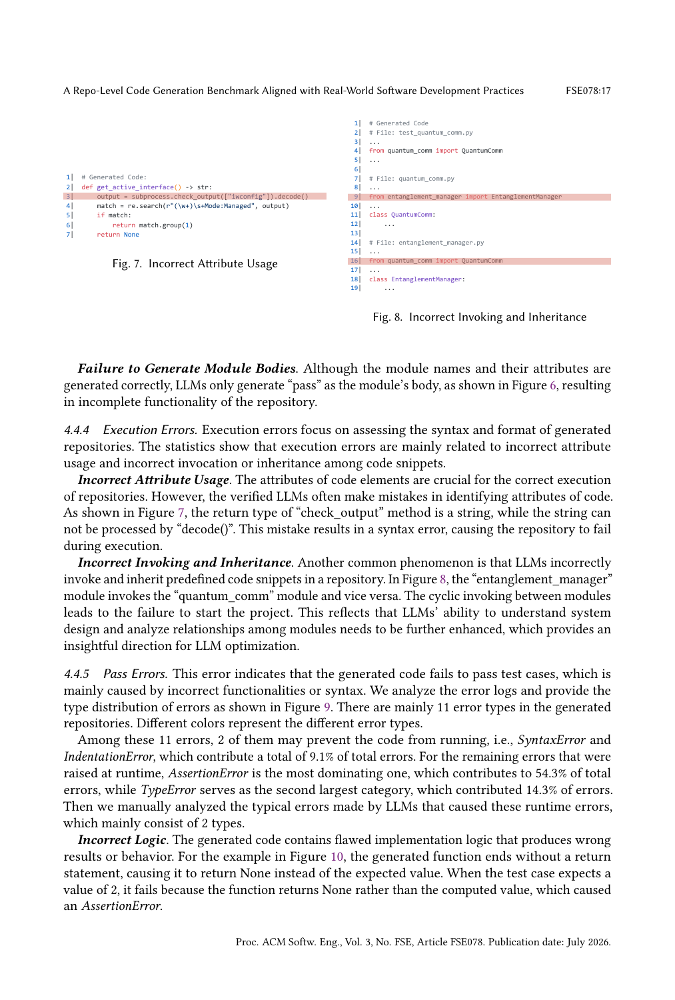

<!-- PDF page 18 -->

## Página PDF 18

FSE078:18
J. Li, H. Deng, Y. Zhang, K. Zhang, T. Shao, T. Zhao, W. Wang, Z. Jin, G. Li, Y. Liu, Y. Fang, Y. Dong.
Fig. 9. Error Type Distribution of Generated Real-
Bench on test pass rate.
 1|  # Ground-Truth Code: 
 2|  def run_speed_test(high, low, serial_number, file): 
 3|      ... # Other codes 
 4|      return serial_number + 1 
 5| 
 6|  # Generated Code: 
 7|  def run_speed_test(high, low, serial_number, file): 
 8|      ... # Other codes 
 9|      # The function ends without RETURN
10| 
11|  # Test Case:
12|  @pytest.mark.parametrize("speed, status", [ 
13|      (150.0, "great") 
14|  ]) 
15|  def test_speed_status(environment, speed, status):
16|      new_serial = run_speed_test(100.0, 20.0, 1, "record.csv") 
17|      assert new_serial == 2
Fig. 10. Incorrect Logic
Incorrect Arguments. The generated code uses wrong parameter names, types, or default
values in function signatures. This type of error occurs when the code generator fails to match
the expected function interface, such as renaming parameters, changing their types, or omitting
default values. These signature mismatches break the function’s calling convention and result in
TypeError exceptions when the function is invoked with arguments that no longer align with the
generated parameters.
Finding 6: AssertionError and TypeError are the Top-2 dominating errors, contributing to 68.6%
(= 54.3% + 14.3%) of total errors.
5
Threats to Validity
This paper has several main threats to validity. First is the threats in dataset construction. The quality
and detail level of natural language descriptions could affect LLMs’ code generation performance,
and selecting representative topics may introduce bias. To alleviate this threat, we carefully selected
representative topics and manually verified all requirements, architectures, and test cases in our
samples to ensure dataset quality. Second is on data leakage. LLMs may have seen similar code
during training, which could lead to inflated evaluation scores. To prevent this issue, we collected
all projects in our dataset from GitHub after 2024-12, which is earlier than the release time of
evaluated models to mitigate data leakage problems. Third is on the impact of model prompting.
Choosing an optimal prompt is challenging, and different prompts could yield different performance
results. To mitigate this threat, we follow common practices for prompting LLMs to design our
prompt templates. We also report results using greedy decoding, which is deterministic and reduces
randomness in model responses.
Proc. ACM Softw. Eng., Vol. 3, No. FSE, Article FSE078. Publication date: July 2026.

[Vista original de la página 18](../../../../../images/v5/estructura_colecciones/Evaluation/secondary/RealBench/page-18.png)

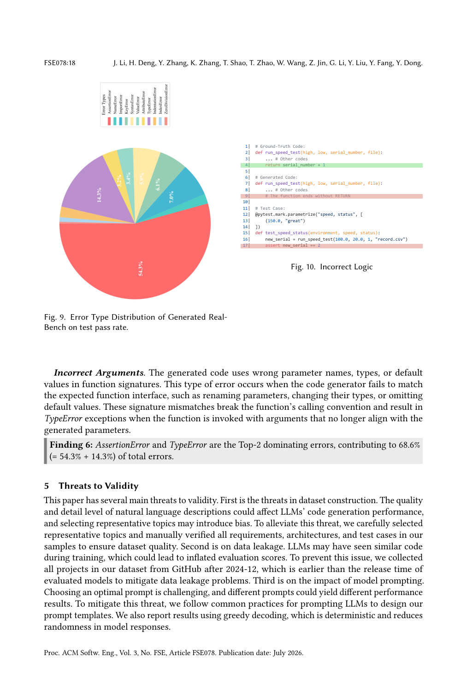

<!-- PDF page 19 -->

## Página PDF 19

A Repo-Level Code Generation Benchmark Aligned with Real-World Software Development Practices
FSE078:19
6
Related Work
In this section, we discuss the related works on code generation and the benchmarks.
Code Generation. Recent work on code generation has focused on using LLM to generate code.
Several studies [18, 21, 22, 32] evaluate how well LLMs perform this task. Tools like CodeFill [20]
and aiXcoder [23] use different techniques to predict code structure and improve generation speed.
Another research area uses RAG frameworks [25] to generate code at the repository level. These
methods find relevant code from other files in the same repository to help with generation. Several
approaches including RepoCoder, GraphCoder, and DraCo [12, 31, 44] try different ways to find
relevant code. They use static analysis, control flow graphs, and similarity matching. LongCoder [15]
takes a different approach by making the model handle longer code inputs.
Code Generation Benchmarks. To better understand the capability of code generation ap-
proaches, researchers have created many benchmarks, which can be categorized to function-level,
class-level and repository-level.
Function-level Benchmarks. Early code generation benchmarks focus on generating single func-
tions or code snippets. HumanEval [11] is one of the most widely used benchmarks in this category.
It contains 164 Python programming problems that require generating functions based on natural
language descriptions. Similarly, MBPP [7] provides another function-level benchmark with basic
Python programming problems. APPS [17] extends the difficulty by including competition-style
programming problems that require more complex algorithmic thinking.
Class-level Benchmarks. As LLMs became more capable, researchers introduced benchmarks
that require generating entire classes or more complex code structures. ClassEval [14] evaluates
LLMs on class-level code generation with 100 human-crafted self-contained Python classes. This
benchmark tests the ability to generate object-oriented code with multiple methods and proper class
structure. Benchmarks like Concode [19] and CoderEval [41] focus on non-standalone programs
that depend on external libraries or frameworks.
Repository-level Benchmarks. The most recent and challenging benchmarks evaluate LLMs on
repository-scale code generation tasks. These benchmarks require understanding complex code-
bases and generating code that fits within larger software projects. JavaBench [10] asks LLMs to
generate entire repositories based on natural language requirements. EvoCodeBench [27] also falls
into this category by requiring the generation of functions or classes within a given repository
context. However, existing repo-level code generation benchmarks only provide natural language
requirements for each task. They ignore the common industry practice where developers usually
implement code based on both design documents and requirements rather than raw requirements.
7
Conclusion
In this paper, we propose RealBench, a repository-level code generation benchmark aligned with
real-world software development practices. It provides both natural language requirements and
UML diagrams as system design, matching how developers receive specifications in industry
settings. RealBench consists of 61 repositories across 20 domains, each with comprehensive test
suites achieving 79.76% line coverage. To assess generated repositories, we design a systematic
evaluation framework with two granularities and five metrics. Our experiments on six advanced
LLMs using three generation strategies show several meaningful insights.
Acknowledgment
This research is supported by the National Natural Science Foundation of China under Grant
No. 92582203, 62192731, 62192730, 62192733, 62072007, the National Key R&D Program under
Proc. ACM Softw. Eng., Vol. 3, No. FSE, Article FSE078. Publication date: July 2026.

[Vista original de la página 19](../../../../../images/v5/estructura_colecciones/Evaluation/secondary/RealBench/page-19.png)

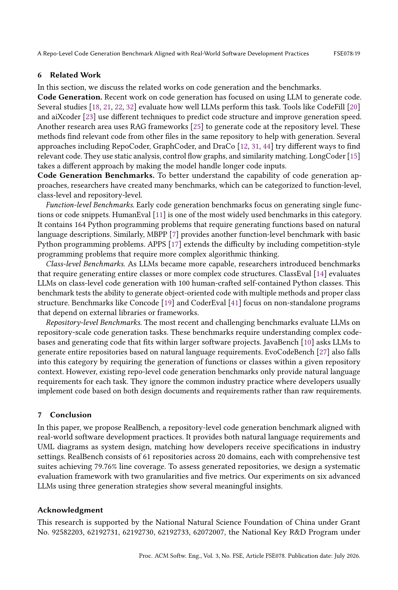

<!-- PDF page 20 -->

## Página PDF 20

FSE078:20
J. Li, H. Deng, Y. Zhang, K. Zhang, T. Shao, T. Zhao, W. Wang, Z. Jin, G. Li, Y. Liu, Y. Fang, Y. Dong.
Grant No. 2023YFB4503801, the Beijing Major Science and Technology Project under Contract No.
Z251100008425005.
References
[1] 2024. GPT-4o. https://openai.com/index/hello-gpt-4o/ (2024).
[2] 2024. Qwen2.5-Coder-7B. https://huggingface.co/Qwen/Qwen2.5-Coder-7B-Instruct (2024).
[3] 2025. Claude Sonnet 4. https://www.anthropic.com/claude/sonnet (2025).
[4] 2025. Gemini-2.5-flash. https://ai.google.dev/gemini-api/docs/models?hl=zh-cn#gemini-2.5-flash (2025).
[5] 2025. Qwen3-235B-A22B. https://huggingface.co/Qwen/Qwen3-235B-A22B (2025).
[6] Ben Athiwaratkun, Sanjay Krishna Gouda, Zijian Wang, Xiaopeng Li, Yuchen Tian, Ming Tan, Wasi Uddin Ahmad,
Shiqi Wang, Qing Sun, Mingyue Shang, et al. 2022. Multi-lingual evaluation of code generation models. arXiv preprint
arXiv:2210.14868 (2022). doi:10.48550/arXiv.2210.14868
[7] Jacob Austin, Augustus Odena, Maxwell Nye, Maarten Bosma, Henryk Michalewski, David Dohan, Ellen Jiang, Carrie
Cai, Michael Terry, Quoc Le, et al. 2021. Program synthesis with large language models. arXiv preprint arXiv:2108.07732
(2021). doi:10.48550/arXiv.2108.07732
[8] Jinze Bai, Shuai Bai, Yunfei Chu, Zeyu Cui, Kai Dang, Xiaodong Deng, Yang Fan, Wenbin Ge, Yu Han, Fei Huang, et al.
2023. Qwen technical report. arXiv preprint arXiv:2309.16609 (2023). doi:10.48550/arXiv.2309.16609
[9] Tiobe Software BV. 2025. TIOBE Index. https://www.tiobe.com/tiobe-index/
[10] Jialun Cao, Zhiyong Chen, Jiarong Wu, Shing-Chi Cheung, and Chang Xu. 2024. Javabench: A benchmark of object-
oriented code generation for evaluating large language models. In Proceedings of the 39th IEEE/ACM International
Conference on Automated Software Engineering. 870–882. doi:10.1145/3691620.3695470
[11] Mark Chen, Jerry Tworek, Heewoo Jun, Qiming Yuan, Henrique Ponde De Oliveira Pinto, Jared Kaplan, Harri Edwards,
Yuri Burda, Nicholas Joseph, Greg Brockman, et al. 2021. Evaluating large language models trained on code. arXiv
preprint arXiv:2107.03374 (2021). doi:10.48550/arXiv.2107.03374
[12] Wei Cheng, Yuhan Wu, and Wei Hu. 2024. Dataflow-Guided Retrieval Augmentation for Repository-Level Code
Completion. In Proceedings of the 62nd Annual Meeting of the Association for Computational Linguistics (Volume 1: Long
Papers). 7957–7977. doi:10.18653/V1/2024.ACL-LONG.431
[13] Yangruibo Ding, Zijian Wang, Wasi Ahmad, Hantian Ding, Ming Tan, Nihal Jain, Murali Krishna Ramanathan, Ramesh
Nallapati, Parminder Bhatia, Dan Roth, et al. 2023. Crosscodeeval: A diverse and multilingual benchmark for cross-file
code completion. Advances in Neural Information Processing Systems 36 (2023), 46701–46723. doi:10.52202/075280-2023
[14] Xueying Du, Mingwei Liu, Kaixin Wang, Hanlin Wang, Junwei Liu, Yixuan Chen, Jiayi Feng, Chaofeng Sha, Xin Peng,
and Yiling Lou. 2023. Classeval: A manually-crafted benchmark for evaluating llms on class-level code generation.
arXiv preprint arXiv:2308.01861 (2023). doi:10.48550/arXiv.2308.01861
[15] Daya Guo, Canwen Xu, Nan Duan, Jian Yin, and Julian McAuley. 2023. Longcoder: A long-range pre-trained language
model for code completion. In International Conference on Machine Learning. PMLR, 12098–12107. doi:10.48550/arXiv.
2306.14893
[16] Daya Guo, Qihao Zhu, Dejian Yang, Zhenda Xie, Kai Dong, Wentao Zhang, Guanting Chen, Xiao Bi, Yu Wu, YK Li,
et al. 2024. DeepSeek-Coder: When the Large Language Model Meets Programming–The Rise of Code Intelligence.
arXiv preprint arXiv:2401.14196 (2024). doi:10.48550/arXiv.2401.14196
[17] Dan Hendrycks, Steven Basart, Saurav Kadavath, Mantas Mazeika, Akul Arora, Ethan Guo, Collin Burns, Samir Puranik,
Horace He, Dawn Song, et al. 2021. Measuring coding challenge competence with apps. arXiv preprint arXiv:2105.09938
(2021). doi:10.48550/arXiv.2105.09938
[18] Rasha Ahmad Husein, Hala Aburajouh, and Cagatay Catal. 2025. Large language models for code completion: A
systematic literature review. Computer Standards & Interfaces 92 (2025), 103917. doi:10.1016/J.CSI.2024.103917
[19] Srinivasan Iyer, Ioannis Konstas, Alvin Cheung, and Luke Zettlemoyer. 2018. Mapping language to code in programmatic
context. arXiv preprint arXiv:1808.09588 (2018). doi:10.48550/arXiv.1808.09588
[20] Maliheh Izadi, Roberta Gismondi, and Georgios Gousios. 2022. Codefill: Multi-token code completion by jointly learning
from structure and naming sequences. In Proceedings of the 44th international conference on software engineering. 401–412.
doi:10.1145/3510003.3510172
[21] Maliheh Izadi, Jonathan Katzy, Tim Van Dam, Marc Otten, Razvan Mihai Popescu, and Arie Van Deursen. 2024.
Language models for code completion: A practical evaluation. In Proceedings of the IEEE/ACM 46th International
Conference on Software Engineering. 1–13. doi:10.1145/3597503.3639138
[22] Juyong Jiang, Fan Wang, Jiasi Shen, Sungju Kim, and Sunghun Kim. 2024. A survey on large language models for code
generation. arXiv preprint arXiv:2406.00515 (2024). doi:10.48550/arXiv.2406.00515
[23] Siyuan Jiang, Jia Li, He Zong, Huanyu Liu, Hao Zhu, Shukai Hu, Erlu Li, Jiazheng Ding, Yu Han, Wei Ning, et al. 2024.
aiXcoder-7B: A Lightweight and Effective Large Language Model for Code Processing. arXiv preprint arXiv:2410.13187
Proc. ACM Softw. Eng., Vol. 3, No. FSE, Article FSE078. Publication date: July 2026.

[Vista original de la página 20](../../../../../images/v5/estructura_colecciones/Evaluation/secondary/RealBench/page-20.png)

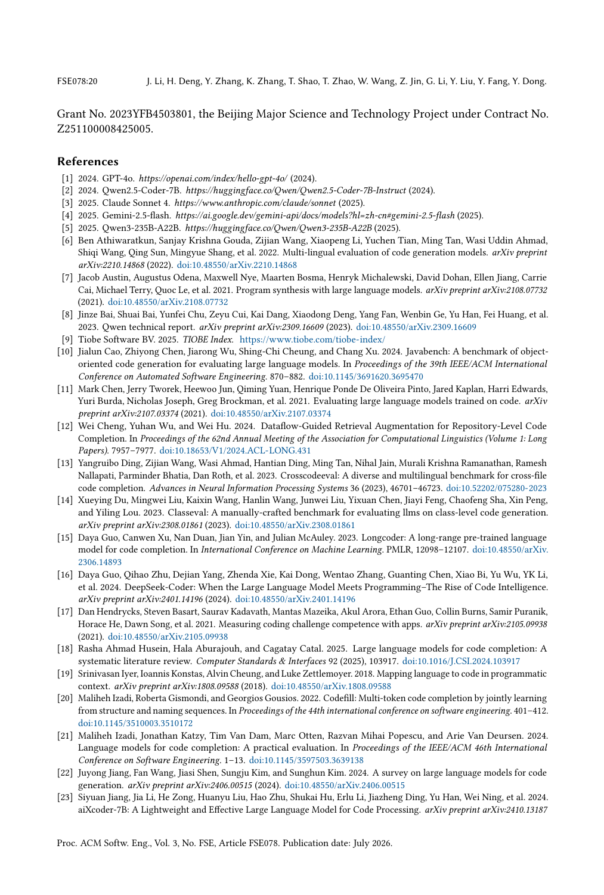

<!-- PDF page 21 -->

## Página PDF 21

A Repo-Level Code Generation Benchmark Aligned with Real-World Software Development Practices
FSE078:21
(2024). doi:10.48550/arXiv.2410.13187
[24] Yuhang Lai, Chengxi Li, Yiming Wang, Tianyi Zhang, Ruiqi Zhong, Luke Zettlemoyer, Wen-tau Yih, Daniel Fried, Sida
Wang, and Tao Yu. 2023. DS-1000: A natural and reliable benchmark for data science code generation. In International
Conference on Machine Learning. PMLR, 18319–18345. doi:10.48550/arXiv.2211.11501
[25] Patrick Lewis, Ethan Perez, Aleksandra Piktus, Fabio Petroni, Vladimir Karpukhin, Naman Goyal, Heinrich Küttler,
Mike Lewis, Wen-tau Yih, Tim Rocktäschel, et al. 2020. Retrieval-augmented generation for knowledge-intensive nlp
tasks. Advances in neural information processing systems 33 (2020), 9459–9474. doi:10.48550/arXiv.2005.11401
[26] Jia Li, Xuyuan Guo, Lei Li, Kechi Zhang, Ge Li, Zhengwei Tao, Fang Liu, Chongyang Tao, Yuqi Zhu, and Zhi Jin.
2025. LONGCODEU: Benchmarking Long-Context Language Models on Long Code Understanding. arXiv preprint
arXiv:2503.04359 (2025). doi:10.48550/arXiv.2503.04359
[27] Jia Li, Ge Li, Xuanming Zhang, Yihong Dong, and Zhi Jin. 2024. Evocodebench: An evolving code generation benchmark
aligned with real-world code repositories. arXiv preprint arXiv:2404.00599 (2024). doi:10.48550/arXiv.2404.00599
[28] Jia Li, Ge Li, Yunfei Zhao, Yongmin Li, Zhi Jin, Hao Zhu, Huanyu Liu, Kaibo Liu, Lecheng Wang, Zheng Fang, et al.
2024. Deveval: Evaluating code generation in practical software projects. arXiv preprint arXiv:2401.06401 (2024).
doi:10.48550/arXiv.2401.06401
[29] Yujia Li, David Choi, Junyoung Chung, Nate Kushman, Julian Schrittwieser, Rémi Leblond, Tom Eccles, James Keeling,
Felix Gimeno, Agustin Dal Lago, et al. 2022. Competition-level code generation with alphacode. Science 378, 6624
(2022), 1092–1097. doi:10.48550/arXiv.2203.07814
[30] Aixin Liu, Bei Feng, Bing Xue, Bingxuan Wang, Bochao Wu, Chengda Lu, Chenggang Zhao, Chengqi Deng, Chenyu
Zhang, Chong Ruan, et al. 2024. Deepseek-v3 technical report. arXiv preprint arXiv:2412.19437 (2024). doi:10.48550/
arXiv.2412.19437
[31] Wei Liu, Ailun Yu, Daoguang Zan, Bo Shen, Wei Zhang, Haiyan Zhao, Zhi Jin, and Qianxiang Wang. 2024. Graphcoder:
Enhancing repository-level code completion via code context graph-based retrieval and language model. arXiv preprint
arXiv:2406.07003 (2024). doi:10.48550/arXiv.2406.07003
[32] Phuong T Nguyen, Juri Di Rocco, Davide Di Ruscio, Lina Ochoa, Thomas Degueule, and Massimiliano Di Penta. 2019.
Focus: A recommender system for mining api function calls and usage patterns. In 2019 IEEE/ACM 41st International
Conference on Software Engineering (ICSE). IEEE, 1050–1060. doi:10.1109/ICSE.2019.00109
[33] Erik Nijkamp, Bo Pang, Hiroaki Hayashi, Lifu Tu, Huan Wang, Yingbo Zhou, Silvio Savarese, and Caiming Xiong. 2022.
Codegen: An open large language model for code with multi-turn program synthesis. arXiv preprint arXiv:2203.13474
(2022). doi:10.48550/arXiv.2203.13474
[34] Object Management Group. 2017. Unified Modeling Language (UML) Version 2.5.1. Specification. Object Management
Group. https://www.omg.org/spec/UML/2.5.1/
[35] Aarohi Srivastava, Abhinav Rastogi, Abhishek Rao, Abu Awal Shoeb, Abubakar Abid, Adam Fisch, Adam R Brown, Adam
Santoro, Aditya Gupta, Adri Garriga-Alonso, et al. 2023. Beyond the imitation game: Quantifying and extrapolating
the capabilities of language models. Transactions on machine learning research (2023). doi:10.48550/arXiv.2206.04615
[36] Shuai Wang, Liang Ding, Li Shen, Yong Luo, Bo Du, and Dacheng Tao. 2024. Oop: Object-oriented programming
evaluation benchmark for large language models. arXiv preprint arXiv:2401.06628 (2024). doi:10.48550/arXiv.2401.06628
[37] Zhiruo Wang, Shuyan Zhou, Daniel Fried, and Graham Neubig. 2022. Execution-based evaluation for open-domain
code generation. arXiv preprint arXiv:2212.10481 (2022). doi:10.48550/arXiv.2212.10481
[38] Yuxiang Wei, Federico Cassano, Jiawei Liu, Yifeng Ding, Naman Jain, Zachary Mueller, Harm de Vries, Leandro
Von Werra, Arjun Guha, and Lingming Zhang. 2024. Selfcodealign: Self-alignment for code generation. arXiv preprint
arXiv:2410.24198 (2024). doi:10.48550/arXiv.2410.24198
[39] Xi Ye, Fangcong Yin, Yinghui He, Joie Zhang, Howard Yen, Tianyu Gao, Greg Durrett, and Danqi Chen. 2025. Longproc:
Benchmarking long-context language models on long procedural generation. arXiv preprint arXiv:2501.05414 (2025).
doi:10.48550/arXiv.2501.05414
[40] Pengcheng Yin, Bowen Deng, Edgar Chen, Bogdan Vasilescu, and Graham Neubig. 2018. Learning to mine aligned
code and natural language pairs from stack overflow. In Proceedings of the 15th international conference on mining
software repositories. 476–486. doi:10.1145/3196398.3196408
[41] Hao Yu, Bo Shen, Dezhi Ran, Jiaxin Zhang, Qi Zhang, Yuchi Ma, Guangtai Liang, Ying Li, Qianxiang Wang, and Tao
Xie. 2024. Codereval: A benchmark of pragmatic code generation with generative pre-trained models. In Proceedings
of the 46th IEEE/ACM International Conference on Software Engineering. 1–12. doi:10.1145/3597503.3623316
[42] Daoguang Zan, Bei Chen, Dejian Yang, Zeqi Lin, Minsu Kim, Bei Guan, Yongji Wang, Weizhu Chen, and Jian-Guang Lou.
2022. CERT: continual pre-training on sketches for library-oriented code generation. arXiv preprint arXiv:2206.06888
(2022). doi:10.48550/arXiv.2206.06888
[43] Daoguang Zan, Ailun Yu, Wei Liu, Dong Chen, Bo Shen, Wei Li, Yafen Yao, Yongshun Gong, Xiaolin Chen, Bei Guan,
et al. 2024. Codes: Natural language to code repository via multi-layer sketch. arXiv preprint arXiv:2403.16443 (2024).
doi:10.48550/arXiv.2403.16443
Proc. ACM Softw. Eng., Vol. 3, No. FSE, Article FSE078. Publication date: July 2026.

[Vista original de la página 21](../../../../../images/v5/estructura_colecciones/Evaluation/secondary/RealBench/page-21.png)

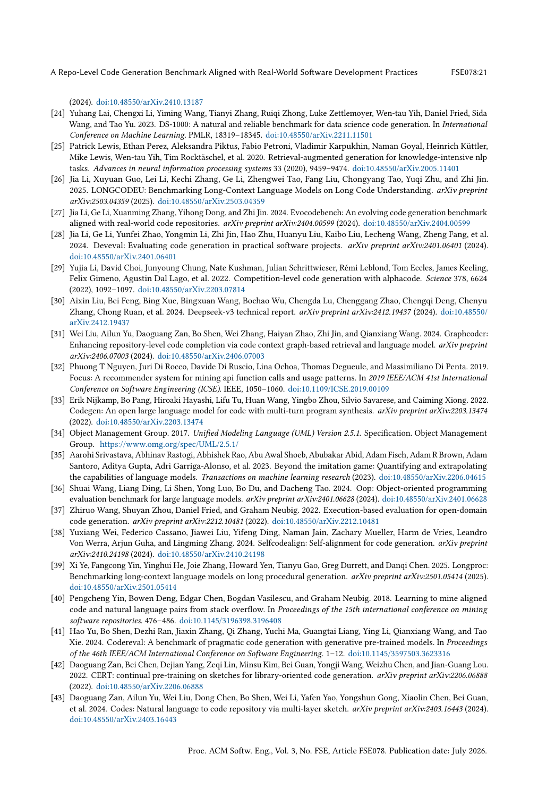

<!-- PDF page 22 -->

## Página PDF 22

FSE078:22
J. Li, H. Deng, Y. Zhang, K. Zhang, T. Shao, T. Zhao, W. Wang, Z. Jin, G. Li, Y. Liu, Y. Fang, Y. Dong.
[44] Fengji Zhang, Bei Chen, Yue Zhang, Jacky Keung, Jin Liu, Daoguang Zan, Yi Mao, Jian-Guang Lou, and Weizhu
Chen. 2023. Repocoder: Repository-level code completion through iterative retrieval and generation. arXiv preprint
arXiv:2303.12570 (2023). doi:10.48550/arXiv.2303.12570
[45] Kechi Zhang, Jia Li, Ge Li, Xianjie Shi, and Zhi Jin. 2024. Codeagent: Enhancing code generation with tool-integrated
agent systems for real-world repo-level coding challenges. arXiv preprint arXiv:2401.07339 (2024). doi:10.48550/arXiv.
2401.07339
[46] Qinkai Zheng, Xiao Xia, Xu Zou, Yuxiao Dong, Shan Wang, Yufei Xue, Lei Shen, Zihan Wang, Andi Wang, Yang Li,
et al. 2023. Codegeex: A pre-trained model for code generation with multilingual benchmarking on humaneval-x. In
Proceedings of the 29th ACM SIGKDD Conference on Knowledge Discovery and Data Mining. 5673–5684. doi:10.1145/
3580305.3599790
Received 2025-09-12; accepted 2025-12-22
Proc. ACM Softw. Eng., Vol. 3, No. FSE, Article FSE078. Publication date: July 2026.

[Vista original de la página 22](../../../../../images/v5/estructura_colecciones/Evaluation/secondary/RealBench/page-22.png)

