# CodeRAG: Finding Relevant and Necessary Knowledge for Retrieval-Augmented Repository-Level Code Completion

- source_pdf: ../../../../../pdf/Related/fourth/codeRag.pdf
- extraction_tool: PyMuPDF
- extraction_date: 2026-11-24
- status: automatic-text-extraction; not manually verified
- pagination: physical PDF pages, starting at 1

> Copia de trabajo para búsqueda y citas. Verifica tablas, fórmulas, figuras y orden visual en el PDF original o en el PNG de la página.

<!-- PDF page 1 -->

## Página PDF 1

CodeRAG: Finding Relevant and Necessary Knowledge for
Retrieval-Augmented Repository-Level Code Completion
Sheng Zhang1,†, Yifan Ding1,†, Shuquan Lian1, Shun Song2, Hui Li1,§
1Key Laboratory of Multimedia Trusted Perception and Efficient Computing
Ministry of Education of China, Xiamen University
2Ant Group
{sheng, dingyf, shuquanlian}@stu.xmu.edu.cn, songshun.ss@antgroup.com
hui@xmu.edu.cn
Abstract
Repository-level code completion automati-
cally predicts the unfinished code based on
the broader information from the repository.
Recent strides in Code Large Language Mod-
els (code LLMs) have spurred the develop-
ment of repository-level code completion meth-
ods, yielding promising results. Nevertheless,
they suffer from issues such as inappropriate
query construction, single-path code retrieval,
and misalignment between code retriever and
code LLM. To address these problems, we in-
troduce CodeRAG, a framework tailored to
identify relevant and necessary knowledge for
retrieval-augmented repository-level code com-
pletion. Its core components include log prob-
ability guided query construction, multi-path
code retrieval, and preference-aligned BESTFIT
reranking. Extensive experiments on bench-
marks ReccEval and CCEval demonstrate that
CodeRAG significantly and consistently out-
performs state-of-the-art methods. The imple-
mentation of CodeRAG is available at https:
//github.com/KDEGroup/CodeRAG.
1
Introduction
Recent years have witnessed the remarkable suc-
cess of Large Language Models (LLMs) in various
areas (Zhao et al., 2023). As a branch of LLMs,
Code Large Language Models (code LLMs), are
trained on massive code data, enabling them to
comprehend and generate code snippets, thus as-
sisting programmers in coding tasks and boosting
development efficiency (Nijkamp et al., 2023; Roz-
ière et al., 2023; Li et al., 2023).
A typical application of code LLMs is code com-
pletion, which automatically predicts the unfin-
ished code (Svyatkovskiy et al., 2019). Early code
completion methods solely leverage code context
(i.e., information from the function or source code
†The first two authors contribute equally.
§Hui Li is the corresponding authors.
file that the programmer is working on) (Li et al.,
2018; Wang and Li, 2021). However, real-world
software source code generally consists of multiple
code files with complex interdependencies, which
were neglected by early methods. These code files
are essential ingredients for programmers to con-
sider when developing unfinished code and they
are typically organized as a source code repository.
Thus, a practical code completion tool should be
repository-level and leverage both code context and
information retrieved from the entire codebase to
provide more accurate and comprehensive code
suggestions (Zhang et al., 2023).
Since repository-level code completion can bet-
ter facilitate collaborative development and soft-
ware maintenance, there is a surge of work in
this direction (Zhang et al., 2023; Liu et al.,
2024; Cheng et al., 2024) and most of them con-
sider applying Retrieval-Augmented Generation
(RAG), a prevalent solution incorporating external
knowledge to help LLMs generate more accurate
text (Gao et al., 2023). Based on the idea of RAG,
these methods retrieve relevant code knowledge
from the entire repository as supplementary to code
context when predicting the unfinished code.
Despite the blossom of related approaches, they
still suffer from the following shortcomings:
• P1: Inappropriate Query Construction. Previ-
ous approaches use either the last k lines before
the cursor position (Tan et al., 2024) or the last
k lines together with the generated code from
code LLM (Zhang et al., 2023) as the query for
code retrieval and find relevant code knowledge
to assist completion, causing information loss
and introducing noises. For example, program-
mers may define key variables and classes, or
import packages at the beginning of a file, which
are essential for understanding and completing
the code accurately. If the last k lines contain ir-
relevant code, the retrieved code knowledge will
1
arXiv:2509.16112v1  [cs.CL]  19 Sep 2025

[Vista original de la página 1](../../../../../images/v5/estructura_colecciones/Related/fourth/codeRag/page-01.png)

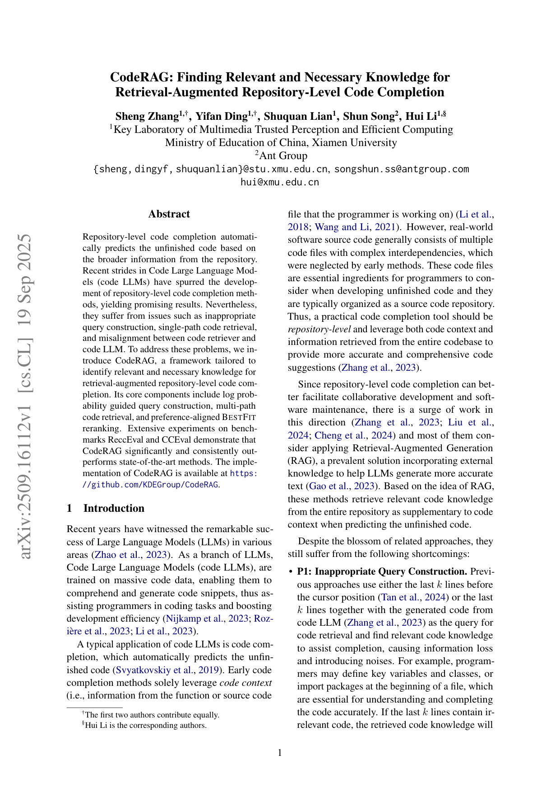

<!-- PDF page 2 -->

## Página PDF 2

config = T5Config.from_pretrained()
Model = 
T5ForCausalLM.from_pretrained()
# build search engine
name = "some name”
searcher = retriever(name) 
model = ModelProvider(args)
model.select_model(some_args)
config = AutoModelConfig.from_pretrained()
model = 
AutoModelForCausalLM.from_pretrained()
Code Knowledge 1
def retriever(engine_name):
‘‘‘construct the retrieval engine’’’
pass
Code Knowledge 2
class ModelProvider:
def __init__(self):
def select_model(self):
Code Knowledge 3
Sparse Retrieval
Dense Retrieval
Dataflow-guided 
Retrieval
Figure 1: Examples of different code retrieval paths,
where the gray text indicates the code to be generated.
mislead code LLM to generate inaccurate code.
• P2: Single-path Code Retrieval. Existing meth-
ods either model code as plain text and chuck
code to construct the knowledge base for later
sparse/dense retrieval (Zhang et al., 2023; Wu
et al., 2024), or construct specific data structures
(e.g., dataflow graph) representing code for later
retrieval (Liu et al., 2024; Cheng et al., 2024).
While each method has its unique advantage and
may apply to some code completion cases, nei-
ther of them can handle all completion cases
well. For instance, Fig. 1 depicts three code
completion examples and each fits one retrieval
method. Sparse retrieval is ideal when the query
and code knowledge directly overlap. Dense re-
trieval is more appropriate when the query and
code knowledge are semantically related. In con-
trast, dataflow-guided retrieval facilitates addi-
tional searches based on variable instantiation.
• P3: Misalignment between Code Retriever
and Code LLM. Similar to other RAG appli-
cations (Jin et al., 2024), inconsistencies may
exist between retrieved code knowledge and nec-
essary knowledge for code LLM, due to the sep-
arate training process and learning objective of
code retriever and code LLM. While this issue
has recently been studied in various works on
RAG for question answering (Zhang et al., 2024;
Dong et al., 2024), it is still underexplored for
repository-level code completion.
To address these issues, we propose a new frame-
work CodeRAG for finding relevant and necessary
knowledge in retrieval-augmented repository-level
code completion. Our contributions are:
• To overcome P1, instead of using last k lines,
CodeRAG adopts log probability guided probing
to construct retrieval query for code retrieval.
• To address P2, CodeRAG employs multi-path
code retrieval over the constructed code knowl-
edge base to benefit from the unique advantage
of each code-specific retrieval path.
• To alleviate P3, CodeRAG adopts preference-
aligned BESTFIT reranking to efficiently find
necessary code knowledge. The retrieved code
knowledge is reranked via LLM reranker accord-
ing to code LLM’s preference. To reduce the
reranking overhead, we further distill the pref-
erence of LLM reranker into a smaller reranker
and use it to conduct reranking.
• CodeRAG feeds the reranked code knowledge
into code LLM for repository-level code comple-
tion. Experiments on benchmarks ReccEval and
CCEval show that CodeRAG significantly and
consistently exceeds state-of-the-art methods.
2
Our Method CodeRAG
As depicted in Fig. 2, CodeRAG involves five parts:
code knowledge base construction (Sec. 2.1), re-
trieval query construction (Sec. 2.2), multi-path
code retrieval (Sec. 2.2.1), preference-aligned
BESTFIT code reranking (Sec. 2.3) and retrieval-
augmented repository-level code completion.
2.1
Code Knowledge Base Construction
Constructing the repository-level code knowledge
base involves parsing and processing the code in
the repository, transforming raw code into struc-
tured knowledge to enable more efficient retrieval,
understanding, and reuse.
To construct the knowledge base for retrieval,
general RAG methods typically segment the text
corpus based on predefined rules, such as split-
ting by length or delimiters (Sarthi et al., 2024).
However, applying these approaches to code data
compromises the structural integrity and leads to
the loss of pertinent information. For instance, di-
viding a class arbitrarily may result in omitting
essential class-related details.
To alleviate the above problem, we propose a
segmentation strategy tailored to the construction
of code knowledge base. Specifically, we consider
four elements in constructing the code knowledge
base: functions, global variables, class variables,
and class functions, as depicted in Fig. 3. For a
target code repository, we first extract the Abstract
Syntax Tree (AST) of each code file. Then, we
extract the four types of elements from ASTs. This
way, the code repository can be transformed into
a structured knowledge base, including function
2

[Vista original de la página 2](../../../../../images/v5/estructura_colecciones/Related/fourth/codeRag/page-02.png)

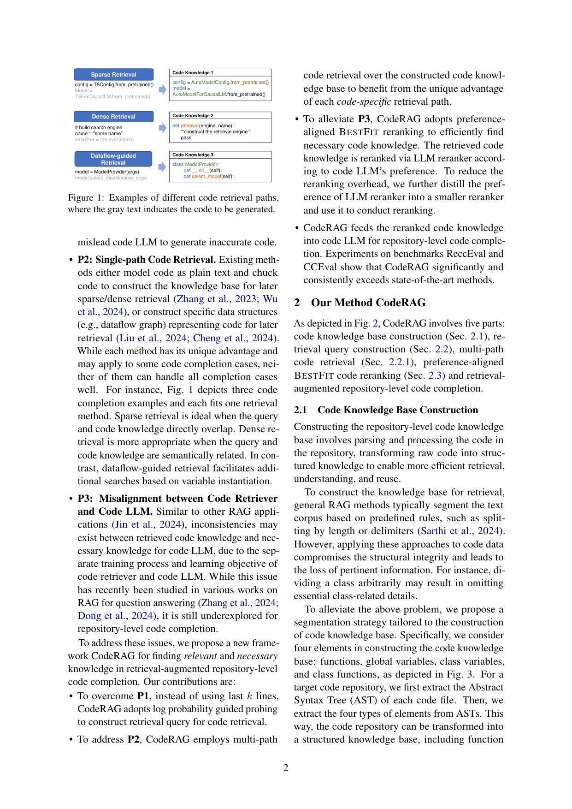

<!-- PDF page 3 -->

## Página PDF 3

…
Code Files
in the
Repository
ASTs
Code
Knowledge Base
Code Knowledge Base Construction
1
Current Code File
Code Chunk 1
Code Chunk 2
Target Chunk
Code LLM
Code Retrieval
Query r
0.4
0.3
s1
Retrieval Query Construction via Log 
Probability Guided Probing
…
…
…
s2
0.3
0.2
0.4
2
Multi-path Code Retrieval
Keyword 
matrix
Sparse
Retrieval
1
0
1
0
1
0
Sim Score
Encoder
Dense
Retrieval
Dataflow 
Guided 
Retrieval
var.unlink
var = func()
def func():
pass
3
Preference-Aligned BestFit Reranking
4
BestFit
Prompting
Distilled
Reranker
rerank
Retrieval-Augmented
Code Completion
5
0
1
1
0.1
0.1
0.2
Code
Knowledge 1
Code
Knowledge n
Code
Knowledge 4 …
Code
Knowledge 2
LLM
Reranker
Code LLM
Figure 2: Overview of CodeRAG.
1
Functions
def func(*args):
pass
2
Variables
VAR_CONST = “test”
3
Cls Funcs
class myClass:
def func(self)
4
Cls Vars
class myClass:
self.name = “”
Element
Knowledge
Figure 3: Examples of Code Knowledge Base Items.
calls and variable usage, providing data support for
repository-level code completion.
2.2
Retrieval Query Construction via Log
Probability Guided Probing
In standard RAG, a retrieval query conveys the
user intent from the user query or consists of a
specific text chunk from a document. Using the
retrieval query, the RAG framework can retrieve
relevant knowledge from the knowledge base to
assist text generation. In existing repository-level
code completion methods, the concept of retrieval
query shifts to represent an incomplete code seg-
ment (Zhang et al., 2023), which could be an un-
finished function, a partially defined variable, or a
method call within a class (i.e., code context).
To overcome the limitation of using the last k
lines as the code retrieval query (i.e., P1 illustrated
Algorithm 1: Construct Retrieval Query
Input: C (code file to be completed), f (chunk
length), m (number of generation step), g
(number of selected chunks)
Output: r (code retrieval query)
Function QueryConstruction(C, f, m, g):
Divide C into fine-grained chunks and each
chunk having f lines.
for each chunk ci do
if ci is the target chunk then
Pass.
Concatenate ci to the target chunk.
Feed the concatenation into code LLM to
generate m new tokens.
Record the highest log probability for all
tokens in the vocabulary at each generation
step.
Sum m probability scores as the confidence
score si.
Select the top-g chunks with the highest
confidence scores s.
Concatenate the g chunks with the target chunk
as the retrieval query r.
return r.
in Sec. 1), we propose to construct the code re-
trieval query based on the log probability gain.
Alg. 1 depicts the overall procedure for code re-
trieval query construction. The core idea is to use
log probability to find the fine-grained code chunks
that are most important to constructing code re-
trieval query. In repository-level code completion,
we can view log probability as the confidence of
code LLMs, given the code retrieval query. In other
3

[Vista original de la página 3](../../../../../images/v5/estructura_colecciones/Related/fourth/codeRag/page-03.png)

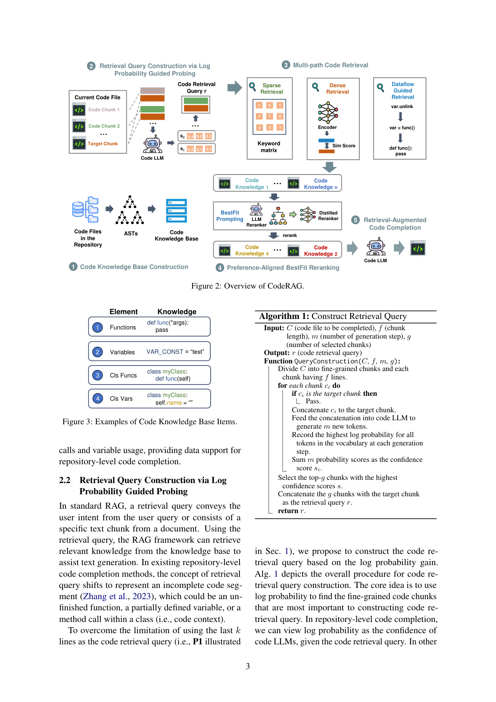

<!-- PDF page 4 -->

## Página PDF 4

words, log probability can reveal the relevance of
the code chunks in the retrieval query.
As shown in Alg. 1, we first chunk the code
file that the programmer is working on into fine-
grained pieces and each of them contains f lines.
Then, we concatenate each fine-grained chunk to
the chunk containing unfinished code (the target
chunk) as the probe and feed it to code LLM to
generate m tokens. For simplicity, we choose the
token with the maximum log probability at each
step and use CodeT5p-220m1 as code LLM for this
step. The sum of the log probabilities for all gen-
erated token is recorded as the relevance score for
the fine-grained chunk corresponding to the probe.
Finally, the top-g fine-grained chunks with the high-
est relevance scores are concatenated together with
the target chunk as the retrieval query.
2.2.1
Multi-path Code Retrieval
As an essential part of RAG, code retriever finds rel-
evant code knowledge from code knowledge base
according to the code retrieval query. Early code
retrieval methods rely on traditional information
retrieval methods like TF-IDF and BM25 (sparse re-
trieval), and recent code retrieval approaches com-
monly adopt embedding based methods (Dense
Retrieval) (Sun et al., 2024). Most recently, Cheng
et al. (2024) find that dataflow can also be used
to guide code retrieval (dataflow-guided retrieval).
These methods consider code retrieval from a sin-
gle perspective and retrieve word-matching knowl-
edge, semantically relevant knowledge, or knowl-
edge having data dependency relations with the tar-
get chunk. Each of them has its unique advantages
and can well provide retrieved code knowledge for
some code completion cases. Hence, we argue that
conducting a multi-path code retrieval can better of-
fer code knowledge for later code completion. Our
designed multi-path code retrieval step involves the
following three code retrieval paths:
Sparse Retrieval. Sparse retrieval relies on key-
word matching between the retrieval query and
code knowledge in the code knowledge base, which
identifies exact or closely related keywords within
the codebase, to obtain relevant invocation details,
API calls, and code snippets that share similar struc-
tures or functionality. Sparse retrieval is efficient
and particularly effective when searching syntacti-
cally similar code or commonly used functions, as
1https://huggingface.co/Salesforce/
codet5p-220m
it can quickly pinpoint segments that contain spe-
cific terms or identifiers. We use TF-IDF (Jones,
2004) for sparse retrieval.
Dense Retrieval. Dense retrieval leverages an en-
coding model to encode the retrieval query and
code knowledge in the code knowledge base into
representations. The query is encoded at the chunk
level, whereas the items in the knowledge base are
either at the function level (functions) or the line
level (variables). Code knowledge that has high
similarity with the retrieval query w.r.t. their rep-
resentations is retrieved. We use cosine similarity
as the similarity measure and adopt the pre-trained
encoder in CodeT5p-220m as the encoding model.
Dataflow-Guided Retrieval. It finds relevant in-
formation w.r.t. the target chunk in the current code
file according to data dependency relations. Fol-
lowing Cheng et al. (2024), we first formulate the
unfinished code file into a dataflow graph. Once
the graph is built, we can retrieve the dependency
starting from the last unfinished line in the dataflow
graph as the retrieved code knowledge.
For sparse and dense retrieval, we use the con-
structed retrieval query to retrieve j results from
each path. If data dependency exists in the dataflow
graph, we retrieve dependency-related code via
dataflow-guided retrieval. After receiving all re-
trieved results from three paths, we add them to a
retrieval list containing n (i.e., 2j + 1) results.
2.3
Find Necessary Code Knowledge through
Preference-Aligned BESTFIT Reranking
The retrieved code knowledge is used to augment
the code completion prompt, directly affecting the
quality of code completion. Solely using the multi-
path code retriever may not provide an appropriate
order of relevant knowledge. The reason is the
misalignment between the code retriever and code
LLM, which is caused by their separate training ob-
jectives (Zhang et al., 2024). Therefore, we further
deploy a reranking module that reranks retrieved
code knowledge according to code LLM’s prefer-
ence and only keep top-u code knowledge (u < n).
2.3.1
BESTFIT Code Reranking
To address the misalignment, a natural way is to
train the reranker using feedback signals from code
LLM. However, in repository-level code comple-
tion, it is very difficult to acquire feedback from
code LLM that can perfectly show the quality of
the generated code. One possible solution is ap-
4

[Vista original de la página 4](../../../../../images/v5/estructura_colecciones/Related/fourth/codeRag/page-04.png)

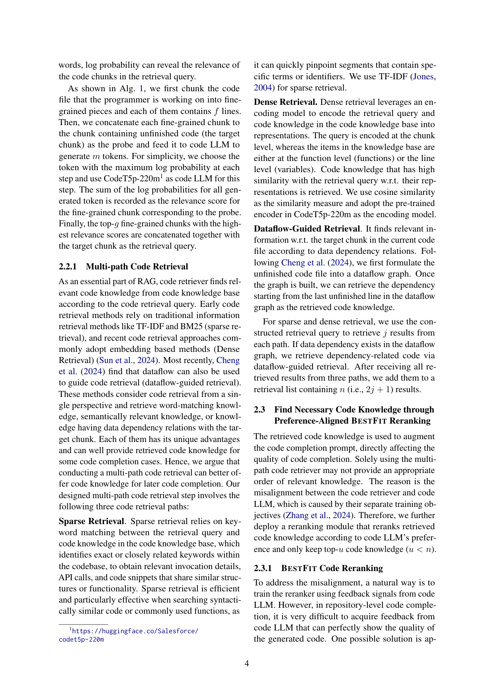

<!-- PDF page 5 -->

## Página PDF 5

Which of the retrieved code snippets is most
helpful for completing the following code snippet?
The code snippet to be completed:
{query}
The retrieved code snippet(s):
{code snippets}
Please provide only the label of the most helpful
retrieved
code
snippet,
enclosed
in
square
brackets, within the answer tags. For example, if
the code snippet C is the most helpful, the
answer should be: <answer>[C]</answer>
Figure 4: Prompt used for LLM-based BESTFIT code
reranking.
plying unit tests on the generated code from code
LLM (Ma et al., 2025). While conducting unit tests
is possible for function-level code completion, it
is costly in the repository-level setting where the
complete project must be executed in order to see
the impact of inserting generated code. Besides,
unlike function-level code completion where inputs
and outputs to unit test are easy to design, craft-
ing inputs and labeling outputs to unit tests in the
repository-level setting is much harder (e.g., more
execution parameters or outputs are not variables).
Considering the above difficulty, an alternative
is to apply an LLM as a zero-shot reranker (Sun
et al., 2023). And the LLM is instructed to di-
rectly produce the reranking list of the retrieval
code knowledge pieces according to their relevance
to the query. Although recent studies (Sun et al.,
2023; Pradeep et al., 2023) have shown the strong
ability of LLMs on zero-shot document reranking,
we empirically find that this listwise prompting so-
lution does not work well on reranking code knowl-
edge: (1) LLMs with a few billion parameters that
can be deployed locally more easily do not strictly
adhere to listwise prompting, while calling APIs of
online LLMs that have much larger model sizes and
can understand and strictly follow listwise prompt-
ing incurs high overhead. (2) Listwise prompting
itself is computationally intensive since the rerank-
ing list is generated token by token. LLM reranker
must do one inference for each next token predic-
tion during reranking list generation.
To overcome this issue, we propose BESTFIT
code reranking that prompts the LLM reranker to
pick the most relevant code knowledge from the
retrieval list to the query. The prompt is listed
in Fig. 4. This way, the inference cost is signifi-
… rank code knowledge
… which code knowledge
is most relevant …
…
Retrieved
Code
LLM
Reranker
[Index 1]…[Index u]
[Index x]
Listwise Prompting
BestFit Prompting
Results
Figure 5: A comparison between listwise code reranking
and BESTFIT code reranking.
Figure 6: Heap sort operation finally moves top-u code
knowledge pieces to the top. Each circle denotes a
window of 3 code knowledge pieces.
cantly reduced as we only need a single forward
pass of the LLM reranker. Fig. 5 depicts the differ-
ence between listwise and BESTFIT code reranking.
Moreover, we find that an LLM with a few billion
parameters can strictly follow BESTFIT prompt-
ing. Hence, we directly use Qwen3-8B as LLM
reranker2, avoiding additional instructing tuning of
LLM reranker or calling online LLM APIs.
To avoid exceeding LLM’s input length, we im-
plement a sliding window strategy that divides the
retrieval list into several equal-sized windows, and
the adjacent two windows share one code knowl-
edge. Fig. 6 provides an example with a window
size of 3. Each time, we feed one window to LLM
reranker and ask it to pick only the most helpful
code knowledge. Inspired by prior work (Qin et al.,
2024; Zhuang et al., 2024) that uses sorting algo-
rithms to speed up LLM-based pairwise reranking,
we apply heap sort to accelerate BESTFIT code
reranking. Windows are organized as a heap tree
and each time we use LLM reranker as the com-
parator to find the most relevant code in a window.
Heap sort can quickly find the top-u most relevant
code knowledge in the reranking list. We choose
heap sort instead of other sorting methods due to
its simplicity and the complexity O(NlogN).
2.3.2
Distilled Reranker
Even though BESTFIT code reranking only re-
quires the LLM reranker to have a few billion pa-
rameters, directly employing the LLM reranker
2https://huggingface.co/Qwen/Qwen3-8B
5

[Vista original de la página 5](../../../../../images/v5/estructura_colecciones/Related/fourth/codeRag/page-05.png)

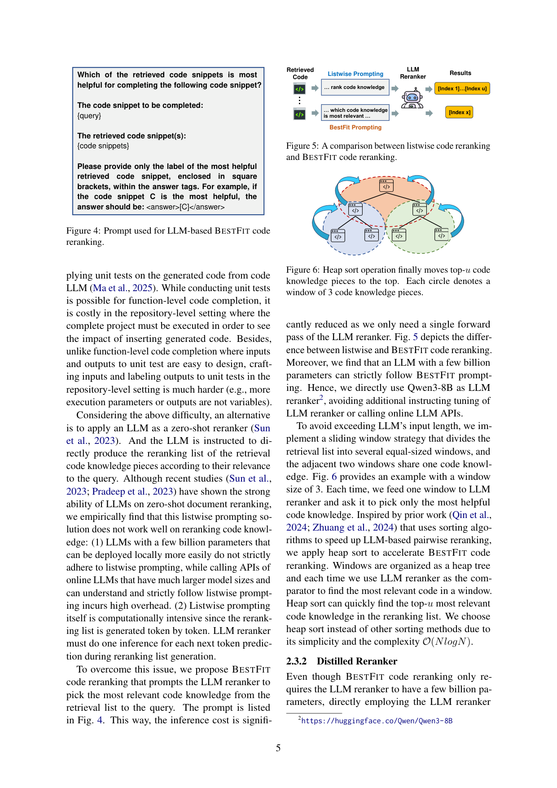

<!-- PDF page 6 -->

## Página PDF 6

Algorithm 2: Construct Distillation Data
Input: r (code retrieval query), L
(initial retrieval list for r), N (sample
numbers)
Output: S (distillation training sample for r)
Function DataConstruction(r, L):
for i in N do
for j = 1 to 3 do
Randomly pick i code knowledge from
L as the retrieved code snippet(s)
{code snippets} in Fig. 4.
C ←[ ]
for z = 1 to 5 do
Use BESTFIT reranking prompt in
Fig. 4 to guide LLM reranker to
select [C] from {code snippets}.
Add [C] to C.
if One code knowledge [C] occurs at
least four times in C then
Add {r, {code snippets} , [C]} to
S.
return S.
may still incur a high computational cost. Hence,
we distill the preference of the LLM reranker into
a much smaller reranker model.
To train the distilled reranker, we first use a data
augmentation strategy (Alg. 2) to construct distil-
lation training data. We use unfinished code in the
training data to formulate code retrieval queries and
conduct multi-path code retrieval to produce initial
retrieval lists. Then, we conduct data augmentation
by generating multiple variations of each initial re-
trieval list L, where each variation contains differ-
ing amounts of code knowledge. After that, we use
LLM reranker with BESTFIT prompting to select
the most helpful code knowledge from each gener-
ated variation, repeating this process five times to
assess selection consistency. When LLM reranker
demonstrates high confidence in its selections (i.e.,
when consistent choices appear in at least four out
of five trials), the generated list, together with the
corresponding code retrieval query and consensus
selection, is treated as a distillation training sam-
ple S. This way, S reflects LLM reranker’s most
reliable decision patterns. We use all curated distil-
lation samples to fine-tune Qwen3-0.6B3, the back-
bone of the distilled reranker, using LoRA (Hu
et al., 2022) and token-level cross-entropy loss.
Finally, the trained distilled reranker is used
in CodeRAG to actually rerank the retrieved
code knowledge and CodeRAG retains top-u code
knowledge in the reranking list (u < n).
3https://huggingface.co/Qwen/Qwen3-0.6B
2.4
Putting All Together
During completion, for an unfinished code file,
CodeRAG firstly constructs the corresponding
code retrieval query r. Then CodeRAG uses r to
conduct multi-path code retrieval over the code
knowledge base and retrieves top-n relevant code
knowledge. After that, CodeRAG leverages the
BESTFIT reranker to rank the n relevant code
knowledge and retains the top-u necessary code
knowledge pieces. Finally, the code context of
the unfinished code file is concatenated with the u
pieces of code knowledge, and the result is fed into
code LLM to generate the completion.
3
Experiment
3.1
Evaluation Settings
Metrics. We use prevalent metrics (Liu et al., 2024;
Cheng et al., 2024; Zhang et al., 2023) to evaluate
whether the generated code matches the ground-
truth code (code match) and whether the identifiers
in the generated code match the ground-truth iden-
tifiers (identifier match):
• Code Match. Exact Match (EM) and Edit Sim-
ilarity (ES)4 are employed to assess code align-
ment. EM is 1 when the generated code is identi-
cal to the ground-truth answer, and 0 otherwise.
ES provides a more nuanced evaluation, calcu-
lated as ES = 1 −Lev(x, y)/max(∥x∥, ∥y∥),
where Lev(·) denotes the Levenshtein distance.
• Identifier Match. We utilize EM and F1 scores
to evaluate the alignment of identifiers in the
generated code and the ground-truth answer.
Baselines. We use the following representative
repository-level code completion baselines:
• Zero-Shot5. Zero-Shot directly feeds the com-
pleted code before the cursor position into code
LLM without utilizing any repository informa-
tion, which can reveal code LLM’s basic ability
to complete the code. Following existing works,
we directly feed the completed code into code
LLM without further using a prompt.
• CCFinder6 (Ding et al., 2024). CCFinder is a
retrieval tool for searching repository contexts
4Note that the paper of DraCo adopts a different way
to measure ES (see https://github.com/nju-websoft/
DraCo?tab=readme-ov-file#evaluation). We follow the
definition of ES used in the paper of RepoCoder.
5https://huggingface.co/Salesforce/
codegen-350M-mono
6https://github.com/amazon-science/cocomic
6

[Vista original de la página 6](../../../../../images/v5/estructura_colecciones/Related/fourth/codeRag/page-06.png)

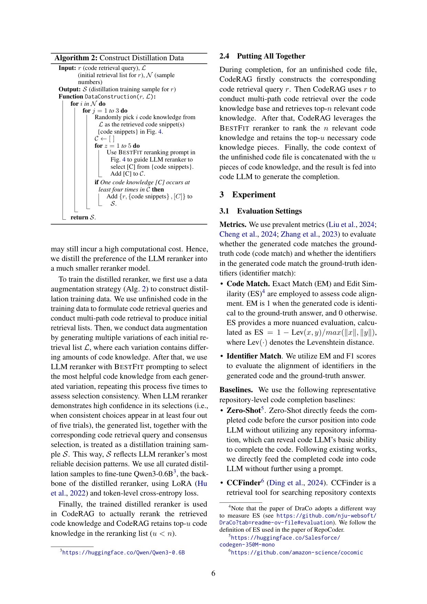

<!-- PDF page 7 -->

## Página PDF 7

for the incomplete file. Based on import state-
ments, it retrieves 2-hop corresponding contexts
to augment completion.
• RG-17 (Zhang et al., 2023). RG-1 is the standard
RAG pipeline, which contains a Bag of Word
retriever (Salton et al., 1975) (sparse retrieval)
to retrieve the code knowledge from the code
knowledge base using the unfinished code as
the query. The code knowledge base consists of
equal-length code chunks.
• RepoCoder7 (Zhang et al., 2023). RepoCoder
generates code iteratively, leveraging the genera-
tion in the previous cycle to retrieve information
from the code knowledge base and enhance the
next generation. The code knowledge base con-
sists of equal-length code chunks.
• DraCo8 (Cheng et al., 2024). DraCo extracts
code entities and their relations through dataflow
analysis, forming a repository-specific context
graph. During completion, it searches the graph
to retrieve code features to enhance generation.
• RepoFuse9 (Liang et al., 2024).
Repo-
Fuse (Liang et al., 2024) fuses analogy con-
text and rationale context (sparse retrieval using
BM25) using a code LM to score and choose the
most similar chunks to the target chunk to con-
struct the code completion prompt. We choose
UniXcoder (Guo et al., 2022) as the scoring mod-
ule as it shows the best result in the paper.
• Repoformer-3B10
(Wu
et
al.,
2024).
Repoformer-3B is a code LLM that can
self-evaluate whether retrieval is necessary. It
acts as both the selective RAG policy and the
generation model. Note that its definition of
code completion differs from other baselines and
CodeRAG since it assumes both the left part and
the right part of cursor position are contexts.
Code LLMs. We use four representative code
LLMs with different parameter numbers ranging
from 350M to 7B as the code generators for all
baselines and CodeRAG: CodeGen-350M5 (Ni-
jkamp et al., 2023), SantaCoder-1.1B11 (Allal et al.,
2023), StarCoder2-3B12 (Lozhkov et al., 2024),
7https://github.com/microsoft/CodeT/tree/main/
RepoCoder
8https://github.com/nju-websoft/DraCo
9https://github.com/codefuse-ai/RepoFuse
10https://huggingface.co/xiaowu0162/
repoformer-3b
11https://huggingface.co/bigcode/santacoder
12https://huggingface.co/bigcode/starcoder2-3b
and Qwen2.5-Coder-7B13 (Hui et al., 2024).
Datasets. We use two benchmarks for evaluation:
• ReccEval14 (Cheng et al., 2024). ReccEval con-
tains 6,461 test cases. It focuses on Python and
contains projects first released on PyPI between
2023-01-01 and 2023-04-28. It is released under
GPL-3.0 license.
• CCEval15 (Ding et al., 2023). CCEval is a multi-
lingual benchmark for repository-level code com-
pletion, where the statement to be completed has
at least one use of cross-file API. CCEval con-
tains 2,665 test cases. We conduct experiments
on the Python subset. CCEval is released under
Apache-2.0 license.
Environment and Hyper-Parameters. We use a
machine with two Intel(R) Xeon(R) Silver 4314
CPU @ 2.40GHz and one NVIDIA A800 GPU for
experiments. The maximum number of generation
tokens is set to 48. The temperature during gen-
eration is set to 0. The maximum input length of
all code LLMs is set to 2,048 by default. We use
the Text Generation Inference16 framework to ac-
celerate LLM inference. By default, we use LLM
reranker in CodeRAG. We set f and g to 3 and 1
in Alg. 1, respectively. We set j to 15 in multi-path
code retrieval and u to 10 in reranking. We use
N = {2, 3, 4, 5, 6, 7} in Alg. 2.
3.2
Evaluation Results17
3.2.1
Overall Performance
We first report the results when using all ReccEval
data for evaluation in Tab. 1 and Tab. 2, as done
in existing works. In this case, LLM reranker (i.e.,
CodeRAGllmr) is used instead of distilled reranker
(i.e., CodeRAGdisr) since distilled reranker requires
training data. The results of splitting ReccEval for
training and evaluating the distilled reranker are
analyzed in Sec. 3.2.3. From Tab. 1 and Tab. 2, we
have the following observations:
• It is clear that Zero-Shot has the worst perfor-
mance across all settings, showing that solely
relying on code LLMs cannot provide satisfying
repository-level code completion.
• CCFinder and RG-1 show significant improve-
ments over Zero-Shot but they are outperformed
13https://huggingface.co/Qwen/Qwen2.5-Coder-7B
14https://github.com/nju-websoft/DraCo
15https://github.com/amazon-science/cceval
16https://huggingface.co/docs/
text-generation-inference/index
17The results for CCEval are reported in Appendix A.
7

[Vista original de la página 7](../../../../../images/v5/estructura_colecciones/Related/fourth/codeRag/page-07.png)

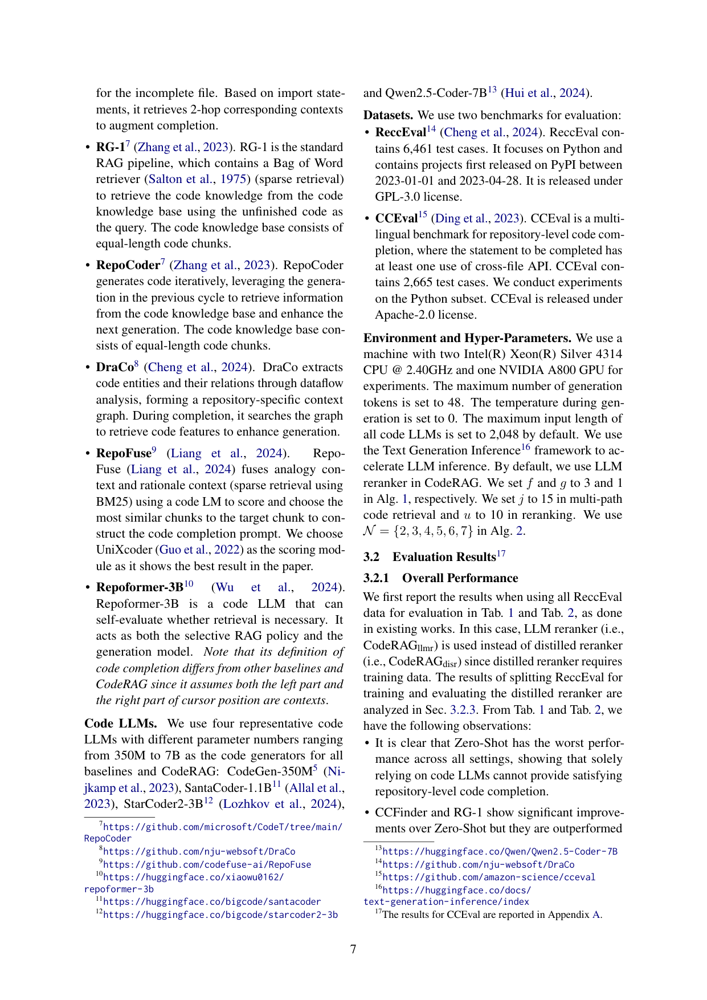

<!-- PDF page 8 -->

## Página PDF 8

Table 1: Performance on ReccEval (Use 100% data for evaluation). Bold and underlined values indicate the best
and the second-best results, respectively.
Methods
CodeGen-350M
SantaCoder-1.1B
StarCoder2-3B
Qwen2.5-Coder-7B
Code Match
Identifier Match
Code Match
Identifier Match
Code Match
Identifier Match
Code Match
Identifier Match
EM
ES
EM
F1
EM
ES
EM
F1
EM
ES
EM
F1
EM
ES
EM
F1
Zero-Shot
4.04
38.36
9.74
26.06
6.27
42.22
12.89
30.08
7.86
45.04
14.44
33.34
11.48
47.72
18.37
36.43
CCFinder
16.50
47.71
23.34
40.12
19.08
50.99
26.67
43.31
28.12
58.93
36.44
53.42
28.43
58.95
36.76
53.09
RG-1
20.04
50.30
26.53
41.35
24.07
54.72
31.26
46.29
29.35
59.43
36.76
52.27
33.01
61.55
40.15
54.68
RepoCoder
23.96
53.27
31.01
45.87
26.78
56.59
34.31
49.07
34.27
63.09
42.30
57.39
34.99
62.71
42.38
56.20
DraCo
21.85
51.44
29.44
45.92
30.27
59.38
38.97
55.50
36.57
64.31
45.61
61.42
39.99
66.26
48.55
63.41
RepoFuse
21.20
51.18
27.81
43.84
28.73
57.89
36.50
51.74
33.88
61.96
41.43
56.52
38.24
65.11
45.88
60.11
CodeRAGllmr
26.81
55.54
34.02
50.13
36.17
63.00
44.17
59.64
42.69
68.07
51.34
65.73
47.48
70.82
55.47
68.68
Table 2: Performance of RepoFormer-3B on ReccEval
(Use 100% data for evaluation). l: only use left context.
Dataset
RepoFormer-3B
Code Match
Identifier Match
EM
ES
EM
F1
ReccEvall
12.88
48.21
19.81
36.93
by more sophisticated approaches. The results
indicate that RAG indeed enhances code com-
pletion but the improvements are limited since
general RAG techniques are not tailored to
repository-level code completion.
• RepoCoder consistently outperforms CCFinder
and RG-1, demonstrating that iterative re-
trieval (Shao et al., 2023) exceeds naive RAG
in code completion.
• DraCo and RepoFuse show competitive perfor-
mance and they show much better results than
other baselines when larger code LLMs are used,
showing that larger code LLMs may better un-
derstand the data dependence features.
• Comparing Tab. 1 and Tab. 2, we can find that
RepoFormer-3B using only left context lags be-
hind other methods except Zero-Shot. The possi-
ble reason is that RepoFormer-3B is optimized
to consider both left and right contexts for code
completion while other baselines and CodeRAG
are designed to consider only the left context. On
ReccEval, where the right context is unavailable,
the performance of RepoFormer-3B significantly
degrades. We provide the results of RepoFormer-
3B on CCEval, where both left and right contexts
are available, in Tab. 10 of Appendix A.
• CodeRAG achieves the best performance across
all settings on ReccEval, showing its effective-
ness. Besides, the performance gains over base-
lines consistently exist as the size of code LLM
increases, showing the robustness of CodeRAG.
3.2.2
Ablation Study
To investigate whether each part in CodeRAG in-
deed contributes to its performance, we compare
CodeRAG with its variations on ReccEval using
100% data for evaluation.
The results are re-
ported in Tab. 3. Subscripts “df”, “s”, “d” and
“lr” indicate using dataflow-guided retrieval, us-
ing sparse retrieval, using dense retrieval and us-
ing LLM reranker, respectively. In other words,
CodeRAGdf+s+d+lr is identical to CodeRAGllmr
shown in Tab. 1.
From the results, we can observe that incorpo-
rating more retrieval paths brings improvements
to code completion in most cases. Besides, using
reranking module can significantly boost perfor-
mance. These findings highlight the effectiveness
of multi-path code retrieval and applying reranking
in improving repository-level code completion.
3.2.3
Comparisons between LLM Reranker
and Distilled Reranker
We further compare the results of using LLM
reranker
(CodeRAGllmr)
and
using
distilled
reranker (CodeRAGdisr) on ReccEval in Tab. 4. As
CodeRAGdisr requires training, we randomly sam-
ple 70% data for training and the remaining 30%
data is used for testing. The results in Tab. 4 are
reported over the test data. From the results, we
can observe that using the distilled reranker affects
the performance compared to using LLM reranker,
but the performance is still competitive.
3.2.4
Comparisons among Different Retrieval
Query Construction Methods.
In Tab. 5, we compare the retrieval query construc-
tion method used in CodeRAG and other retrieval
query construction methods. CodeRAGjacc repre-
sents constructing the retrieval query by selecting
the chunk ci that is most similar to the target block
(Alg. 1) w.r.t. Jaccard similarity when using sparse
8

[Vista original de la página 8](../../../../../images/v5/estructura_colecciones/Related/fourth/codeRag/page-08.png)

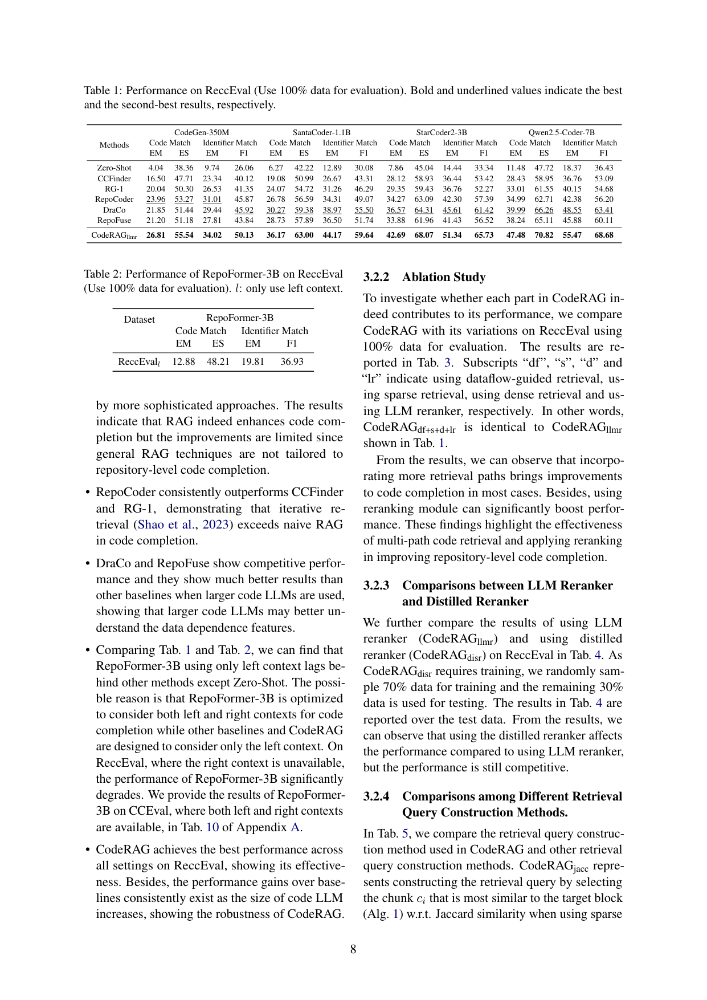

<!-- PDF page 9 -->

## Página PDF 9

Table 3: Comparisons among different variations of CodeRAG on ReccEval (Use 100% data for evaluation). Bold
and underlined values indicate the best and the second-best results, respectively.
Methods
CodeGen-350M
SantaCoder-1.1B
StarCoder2-3B
Qwen2.5-Coder-7B
Code Match
Identifier Match
Code Match
Identifier Match
Code Match
Identifier Match
Code Match
Identifier Match
EM
ES
EM
F1
EM
ES
EM
F1
EM
ES
EM
F1
EM
ES
EM
F1
CodeRAGs
22.07
51.31
29.03
44.80
23.95
56.37
31.36
47.71
33.83
62.03
41.95
57.18
39.89
59.46
36.76
61.24
CodeRAGd
20.49
50.36
27.33
43.41
23.04
55.58
30.52
46.90
32.81
61.53
41.18
56.55
39.66
58.47
36.05
60.90
CodeRAGd+s
22.88
51.95
29.42
45.51
24.90
57.23
32.38
48.58
35.27
63.23
43.80
58.96
41.95
59.59
37.95
62.14
CodeRAGdf
21.28
50.94
28.82
45.20
25.68
57.38
33.98
50.99
35.13
63.25
43.91
60.15
41.86
59.06
37.61
62.79
CodeRAGdf+s
24.21
53.01
31.93
47.94
27.18
59.52
35.47
52.10
39.85
66.35
48.72
64.01
44.21
62.36
52.80
66.62
CodeRAGdf+s+d
23.89
52.86
31.56
47.80
27.70
59.96
36.10
52.72
40.52
66.87
49.65
64.83
44.61
68.81
53.75
66.57
CodeRAGdf+s+d+lr
26.81
55.54
34.02
50.13
36.17
63.00
44.17
59.64
42.69
68.07
51.34
65.73
47.48
70.82
55.47
68.68
Table 4: Performance on ReccEval (Use 30% data for evaluation). Bold and underlined values indicate the best and
the second-best results, respectively.
Methods
CodeGen-350M
SantaCoder-1.1B
StarCoder2-3B
Qwen2.5-Coder-7B
Code Match
Identifier Match
Code Match
Identifier Match
Code Match
Identifier Match
Code Match
Identifier Match
EM
ES
EM
F1
EM
ES
EM
F1
EM
ES
EM
F1
EM
ES
EM
F1
Zero-Shot
4.46
38.09
9.33
26.24
6.87
42.52
13.22
30.28
8.30
44.81
13.99
33.17
12.20
47.55
18.20
36.36
CCFinder
17.68
48.31
23.73
40.82
19.58
50.93
26.76
43.24
28.24
59.22
36.13
53.50
29.52
59.04
37.11
53.36
RG-1
17.63
48.94
24.07
39.54
24.04
54.80
31.06
46.44
29.63
58.96
35.73
51.81
33.52
61.59
39.67
54.93
RepoCoder
20.35
50.84
27.21
42.78
26.86
56.79
34.24
49.22
35.21
63.14
41.82
57.26
34.65
62.19
41.16
55.52
DraCo
22.71
51.83
29.98
46.40
30.19
59.70
39.21
55.66
36.60
64.78
45.41
61.76
39.98
66.23
48.18
62.82
RepoFuse
21.58
51.54
28.81
44.70
29.98
58.60
37.62
52.71
34.03
62.24
41.62
56.94
39.11
65.54
46.03
60.13
CodeRAGllmr
27.73
55.73
34.75
49.97
35.83
63.32
44.08
59.79
43.31
68.54
51.10
65.78
47.57
70.82
54.84
68.38
CodeRAGdisr
23.58
53.31
30.55
47.20
32.65
61.37
41.16
57.06
39.88
66.21
47.62
62.89
44.34
68.42
52.18
64.47
Table 5: Comparisons among different query construc-
tion methods using sparse retrieval on ReccEval (Use
100% data for evaluation).
Methods
Qwen2.5-Coder-7B
Code Match
Identifier Match
EM
ES
EM
F1
CodeRAGjacc
33.54
61.89
40.99
55.33
CodeRAGlast_1
32.08
61.04
39.58
54.91
CodeRAGlast_3
34.84
62.85
42.39
56.97
CodeRAGlast_5
34.21
62.26
41.50
56.04
CodeRAGlast_10
32.95
61.48
40.20
54.93
CodeRAGs
35.01
63.11
42.31
57.24
Table 6: Average cost (second) for a query on ReccEval,
excluding the cost for code generation of code LLM.
RepoCoder
DraCo
RepoFuse
CodeRAG
0.21
0.04
0.15
0.23
retrieval. CodeRAGlast_k means constructing the re-
trieval query with the last k lines when using sparse
retrieval. CodeRAGs indicates using our retrieval
query construction method in sparse retrieval.
From the results in Tab. 5, we can observe that
our retrieval query construction method signifi-
cantly outperforms other simple methods.
3.2.5
Computational Cost
Tab. 6 provides the average cost for a query on Rec-
cEval, excluding the time for code generation of
code LLM. We can see that DraCo is the fastest
Table 7:
Average cost (second) for each step of
CodeRAG on ReccEval.
QueryQuery
Construction
Multi-path Retrieval
Distilled
Reranker
Sparse
Dense
Dataflow
0.14
0.002
0.015
0.03
0.06
since it only uses a single-way, dataflow-guided
retrieval, and no similarity search is needed. Other
methods are slower than DraCo as they all require
similarity search. CodeRAG incurs higher cost
than baselines since it uses more ways of retrieval,
applies log probability guided probing and a dis-
tilled reranker from BESTFIT code reranking. It
indeed involves more steps than baselines. Nev-
ertheless, the cost of CodeRAG is close to Re-
poCoder and RepoFuse even though we do not
implement CodeRAG using advanced acceleration
methods.
Considering the significant improve-
ments of CodeRAG over baselines, we believe the
subtle increase of overhead is acceptable.
Tab. 7 reports the average cost for each step of
CodeRAG on ReccEval. We can see that the largest
cost comes from query construction. Note that, for
multi-path code retrieval, the cost is decided by the
slowest path (i.e., dataflow-guided retrieval).
Since the main goal of this work is not accel-
erating code completion and we do not apply ad-
vanced acceleration techniques, we believe the cost
9

[Vista original de la página 9](../../../../../images/v5/estructura_colecciones/Related/fourth/codeRag/page-09.png)

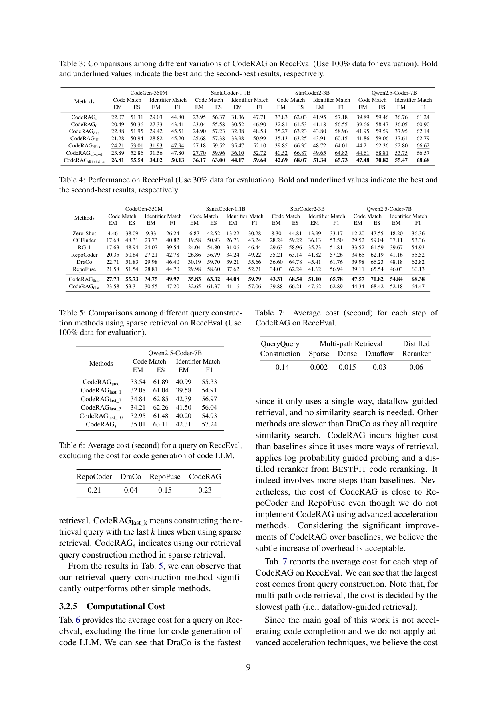

<!-- PDF page 10 -->

## Página PDF 10

1
3
5
10
0
10
20
30
40
EM
21.50
26.31
26.65
26.81
37.27
44.67
46.54
47.48
1
3
5
10
0
10
20
30
40
50
60
70
ES
51.53
55.23
55.45
55.54
64.26
69.04
70.14
70.82
CodeGen-350m
Qwen2.5-Coder-7B
Figure 7: Impacts of numbers of retained reranked code
knowledge on ReccEval (Use 100% data for evaluation).
of CodeRAG can be further reduced and it will not
hinder the practical use of CodeRAG. We suggest
some possible directions, including constructing
retrieval query in batches and parallelization, ac-
celerating log probability guided probing through
applying an inference speedup framework (e.g.,
vLLM18) on the prober LLM, using fast sparse and
dense retrieval libraries (e.g., Faiss19) and distill-
ing LLM reranker into a much smaller distilled
reranker.
3.2.6
Impacts of Numbers of Retained
Reranked Code Knowledge Pieces
The reranking step in CodeRAG only retains top-
u pieces of relevant code knowledge. In Fig. 7,
we report the different results w.r.t. EM and ES
(code match) when setting u to 1, 3, 5 and 10 on
ReccEval (Use 100% data for evaluation). From
the results, we can observe that:
• Regardless of the used code LLM, using a larger
u can enhance the quality of code completion.
• The improvements are noticeable when u is in-
creased from a small value (e.g., increase from
1 to 3), but the enhancement becomes marginal
when u further grows (e.g., increase from 5 to
10). The diminishing improvement suggests that
larger u may potentially introduce less relevant
and necessary code knowledge that does not sig-
nificantly contribute to code completion.
4
Human Evaluation on Ranking Quality
We invite three students in Computer Science major
to manually verify the results of LLM reranking.
On ReccEval, we randomly sample 100 code
completion cases and deploy our LLM reranking
strategy (Sec. 2.3.1) to rerank retrieved code knowl-
edge. We ask three student volunteers who are mas-
ter students in computer science to independently
18https://github.com/vllm-project/vllm
19https://github.com/facebookresearch/faiss
rate the 100 reranking lists using a score between
1 and 5 with 5 indicating the best quality. They
are informed that the results will be used in a re-
search paper. Finally, the average scores given by
the three students are 3.69, 3.76 and 4.03, respec-
tively. From the results of human evaluation, we
can conclude that the LLM reranker indeed has a
positive effect and sorts retrieved code knowledge
towards the right order.
5
Related Work
Recently, there is a surge of works on repository-
level code completion. RepoFusion (Shrivastava
et al., 2023) models the entire repository structure
for context-aware completion. RepoCoder (Zhang
et al., 2023) employs an iterative code retrieval
and generation mechanism. CoCoMIC (Ding et al.,
2024) enhances accuracy by combining cross-file
and intra-file contexts. RepoFormer (Wu et al.,
2024) fine-tunes models to dynamically decide con-
text retrieval needs. GraphCoder (Liu et al., 2024)
models control-flow dependency, data dependency,
and control dependency to construct code knowl-
edge graphs for code completion. ProCC (Tan et al.,
2024) integrates prompt engineering with contex-
tual bandits for multi-perspective code completion.
DraCo (Cheng et al., 2024) and RepoFuse (Liang
et al., 2024) are closely related to CodeRAG.
DraCo retrieves dataflow-guided information to
augment the code completion prompt.
Repo-
Fuse (Liang et al., 2024) fuses analogy context
and rationale context, and uses a code LM like
UniXcoder (Guo et al., 2022) to choose the most
similar chunks to the target chunk to construct code
completion prompt. Despite their accuracy, they
do not fully address problems discussed in Sec. 1.
6
Conclusion
This paper introduces CodeRAG, a novel frame-
work for repository-level code completion. Its core
parts include the log probability guided query con-
struction, a multi-path code retrieval mechanism,
and finding necessary code knowledge through
preference-aligned reranking. Experimental results
demonstrate that CodeRAG significantly and con-
sistently outperforms state-of-the-art methods on
benchmark data.
In the future, we plan to design new strategies
such as joint training of code retriever and code
LLM to further alleviate the misalignment between
retrieval knowledge and necessary knowledge for
10

[Vista original de la página 10](../../../../../images/v5/estructura_colecciones/Related/fourth/codeRag/page-10.png)

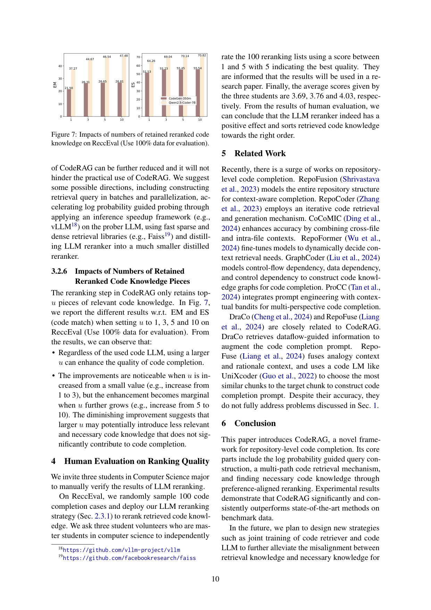

<!-- PDF page 11 -->

## Página PDF 11

better repository-level code completion. We also
plan to construct a new benchmark to evaluate the
generalization of CodeRAG.
Limitations
We address the misalignment between code re-
triever and code LLM from the perspective of de-
signing rerankers and modifying retrieval results
while code LLM is not updated accordingly. This
idea may not fully alleviate the misalignment, and
future work may involve designing new strategies,
such as joint training or more efficient interfacing
mechanisms for both code retrieval and code LLM.
Acknowledgments
This work was supported by National Natural
Science Foundation of China (No.
62572410,
42171456), Natural Science Foundation of Xia-
men, China (No. 3502Z202471028) and Ant Group
through CCF-Ant Research Fund.
References
Loubna Ben Allal, Raymond Li, Denis Kocetkov,
Chenghao Mou, Christopher Akiki, Carlos Muñoz
Ferrandis, Niklas Muennighoff, Mayank Mishra,
Alex Gu, Manan Dey, Logesh Kumar Umapathi,
Carolyn Jane Anderson, Yangtian Zi, Joel Lamy-
Poirier, Hailey Schoelkopf, Sergey Troshin, Dmitry
Abulkhanov, Manuel Romero, Michael Lappert, and
22 others. 2023. Santacoder: don’t reach for the
stars! arXiv Preprint.
Wei Cheng, Yuhan Wu, and Wei Hu. 2024. Dataflow-
guided retrieval augmentation for repository-level
code completion. In ACL, pages 7957–7977.
Yangruibo Ding, Zijian Wang, Wasi Uddin Ahmad, Han-
tian Ding, Ming Tan, Nihal Jain, Murali Krishna Ra-
manathan, Ramesh Nallapati, Parminder Bhatia, Dan
Roth, and Bing Xiang. 2023. Crosscodeeval: A di-
verse and multilingual benchmark for cross-file code
completion. In NeurIPS, pages 46701–46723.
Yangruibo Ding, Zijian Wang, Wasi Uddin Ahmad, Mu-
rali Krishna Ramanathan, Ramesh Nallapati, Parmin-
der Bhatia, Dan Roth, and Bing Xiang. 2024. Co-
comic: Code completion by jointly modeling in-file
and cross-file context.
In LREC/COLING, pages
3433–3445.
Guanting Dong, Yutao Zhu, Chenghao Zhang, Zechen
Wang, Zhicheng Dou, and Ji-Rong Wen. 2024. Un-
derstand what LLM needs: Dual preference align-
ment for retrieval-augmented generation.
arXiv
Preprint.
Yunfan Gao, Yun Xiong, Xinyu Gao, Kangxiang Jia,
Jinliu Pan, Yuxi Bi, Yi Dai, Jiawei Sun, Qianyu Guo,
Meng Wang, and Haofen Wang. 2023. Retrieval-
augmented generation for large language models: A
survey. arXiv Preprint.
Daya Guo, Shuai Lu, Nan Duan, Yanlin Wang, Ming
Zhou, and Jian Yin. 2022. Unixcoder: Unified cross-
modal pre-training for code representation. In ACL,
pages 7212–7225.
Edward J. Hu, Yelong Shen, Phillip Wallis, Zeyuan
Allen-Zhu, Yuanzhi Li, Shean Wang, Lu Wang, and
Weizhu Chen. 2022. Lora: Low-rank adaptation of
large language models. In ICLR.
Binyuan Hui, Jian Yang, Zeyu Cui, Jiaxi Yang, Day-
iheng Liu, Lei Zhang, Tianyu Liu, Jiajun Zhang,
Bowen Yu, Kai Dang, An Yang, Rui Men, Fei Huang,
Xingzhang Ren, Xuancheng Ren, Jingren Zhou, and
Junyang Lin. 2024. Qwen2.5-coder technical report.
arXiv Preprint.
Jiajie Jin, Yutao Zhu, Yujia Zhou, and Zhicheng Dou.
2024. BIDER: bridging knowledge inconsistency for
efficient retrieval-augmented llms via key supporting
evidence. In ACL (Findings), pages 750–761.
Karen Spärck Jones. 2004. A statistical interpretation
of term specificity and its application in retrieval. J.
Documentation, 60(5):493–502.
Jian Li, Yue Wang, Michael R. Lyu, and Irwin King.
2018. Code completion with neural attention and
pointer networks. In IJCAI, pages 4159–4165.
Raymond Li, Loubna Ben Allal, Yangtian Zi, Niklas
Muennighoff, Denis Kocetkov, Chenghao Mou, Marc
Marone, Christopher Akiki, Jia Li, Jenny Chim,
Qian Liu, Evgenii Zheltonozhskii, Terry Yue Zhuo,
Thomas Wang, Olivier Dehaene, Mishig Davaadorj,
Joel Lamy-Poirier, João Monteiro, Oleh Shliazhko,
and 48 others. 2023. Starcoder: may the source be
with you! Trans. Mach. Learn. Res., 2023.
Ming Liang, Xiaoheng Xie, Gehao Zhang, Xunjin
Zheng, Peng Di, Wei Jiang, Hongwei Chen, Cheng-
peng Wang, and Gang Fan. 2024.
REPOFUSE:
repository-level code completion with fused dual con-
text. arXiv Preprint.
Wei Liu, Ailun Yu, Daoguang Zan, Bo Shen, Wei Zhang,
Haiyan Zhao, Zhi Jin, and Qianxiang Wang. 2024.
Graphcoder: Enhancing repository-level code com-
pletion via code context graph-based retrieval and
language model. arXiv Preprint.
Anton Lozhkov, Raymond Li, Loubna Ben Allal, Fed-
erico Cassano, Joel Lamy-Poirier, Nouamane Tazi,
Ao Tang, Dmytro Pykhtar, Jiawei Liu, Yuxiang Wei,
Tianyang Liu, Max Tian, Denis Kocetkov, Arthur
Zucker, Younes Belkada, Zijian Wang, Qian Liu,
Dmitry Abulkhanov, Indraneil Paul, and 38 others.
2024. Starcoder 2 and the stack v2: The next genera-
tion. arXiv Preprint.
11

[Vista original de la página 11](../../../../../images/v5/estructura_colecciones/Related/fourth/codeRag/page-11.png)

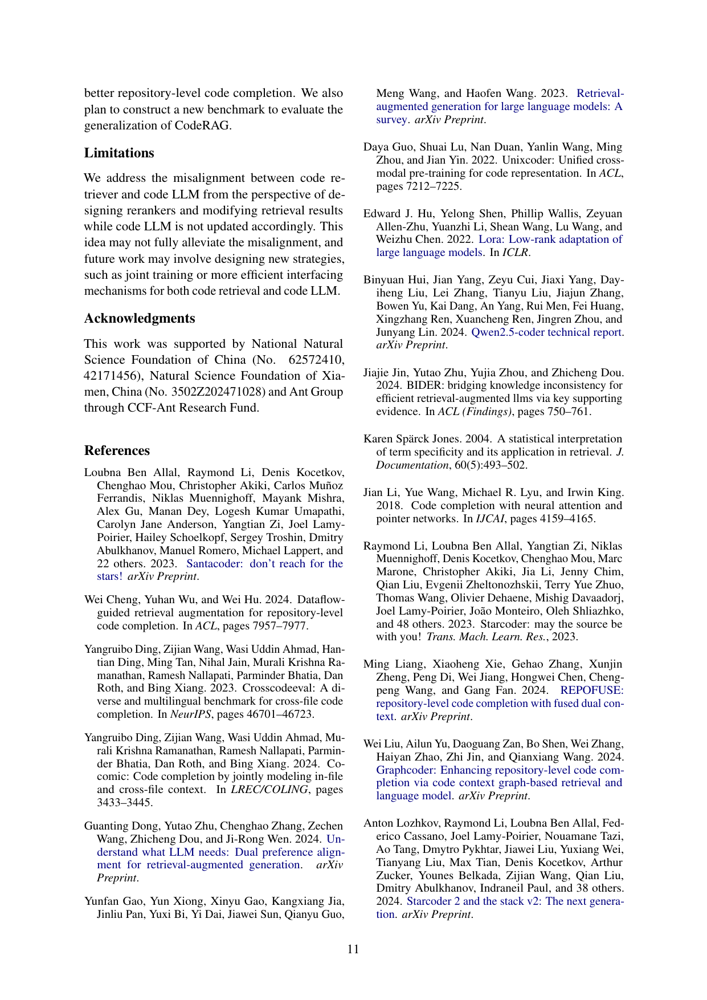

<!-- PDF page 12 -->

## Página PDF 12

Yichuan Ma, Yunfan Shao, Peiji Li, Demin Song,
Qipeng Guo, Linyang Li, Xipeng Qiu, and Kai Chen.
2025. Unitcoder: Scalable iterative code synthesis
with unit test guidance. arXiv Preprint.
Erik Nijkamp, Bo Pang, Hiroaki Hayashi, Lifu Tu, Huan
Wang, Yingbo Zhou, Silvio Savarese, and Caiming
Xiong. 2023. Codegen: An open large language
model for code with multi-turn program synthesis.
In ICLR.
Ronak Pradeep, Sahel Sharifymoghaddam, and Jimmy
Lin. 2023. Rankvicuna: Zero-shot listwise document
reranking with open-source large language models.
arXiv Preprint.
Zhen Qin, Rolf Jagerman, Kai Hui, Honglei Zhuang,
Junru Wu, Le Yan, Jiaming Shen, Tianqi Liu, Jialu
Liu, Donald Metzler, Xuanhui Wang, and Michael
Bendersky. 2024. Large language models are effec-
tive text rankers with pairwise ranking prompting. In
NAACL-HLT (Findings), pages 1504–1518.
Baptiste Rozière, Jonas Gehring, Fabian Gloeckle, Sten
Sootla, Itai Gat, Xiaoqing Ellen Tan, Yossi Adi,
Jingyu Liu, Tal Remez, Jérémy Rapin, Artyom
Kozhevnikov, Ivan Evtimov, Joanna Bitton, Man-
ish Bhatt, Cristian Canton-Ferrer, Aaron Grattafiori,
Wenhan Xiong, Alexandre Défossez, Jade Copet, and
6 others. 2023. Code llama: Open foundation models
for code. arXiv Preprint.
Gerard Salton, Anita Wong, and Chung-Shu Yang. 1975.
A vector space model for automatic indexing. Com-
mun. ACM, 18(11):613–620.
Parth Sarthi, Salman Abdullah, Aditi Tuli, Shubh
Khanna, Anna Goldie, and Christopher D. Manning.
2024. RAPTOR: recursive abstractive processing for
tree-organized retrieval. In ICLR.
Zhihong Shao, Yeyun Gong, Yelong Shen, Minlie
Huang, Nan Duan, and Weizhu Chen. 2023. Enhanc-
ing retrieval-augmented large language models with
iterative retrieval-generation synergy. In EMNLP
(Findings), pages 9248–9274.
Disha Shrivastava, Denis Kocetkov, Harm de Vries,
Dzmitry Bahdanau, and Torsten Scholak. 2023. Re-
pofusion: Training code models to understand your
repository. arXiv Preprint.
Weisong Sun, Chunrong Fang, Yifei Ge, Yuling Hu,
Yuchen Chen, Quanjun Zhang, Xiuting Ge, Yang Liu,
and Zhenyu Chen. 2024. A survey of source code
search: A 3-dimensional perspective. ACM Trans.
Softw. Eng. Methodol., 33(6):166.
Weiwei Sun, Lingyong Yan, Xinyu Ma, Shuaiqiang
Wang, Pengjie Ren, Zhumin Chen, Dawei Yin, and
Zhaochun Ren. 2023. Is chatgpt good at search?
investigating large language models as re-ranking
agents. In EMNLP, pages 14918–14937.
Alexey Svyatkovskiy, Ying Zhao, Shengyu Fu, and Neel
Sundaresan. 2019. Pythia: Ai-assisted code comple-
tion system. In KDD, pages 2727–2735.
Hanzhuo Tan, Qi Luo, Ling Jiang, Zizheng Zhan, Jing
Li, Haotian Zhang, and Yuqun Zhang. 2024. Prompt-
based code completion via multi-retrieval augmented
generation. arXiv Preprint.
Yanlin Wang and Hui Li. 2021. Code completion by
modeling flattened abstract syntax trees as graphs. In
AAAI, pages 14015–14023.
Di Wu, Wasi Uddin Ahmad, Dejiao Zhang, Murali Kr-
ishna Ramanathan, and Xiaofei Ma. 2024. Repo-
former: Selective retrieval for repository-level code
completion. In ICML, pages 53270–53290.
Fengji Zhang, Bei Chen, Yue Zhang, Jacky Keung, Jin
Liu, Daoguang Zan, Yi Mao, Jian-Guang Lou, and
Weizhu Chen. 2023. Repocoder: Repository-level
code completion through iterative retrieval and gen-
eration. In EMNLP, pages 2471–2484.
Lingxi Zhang, Yue Yu, Kuan Wang, and Chao Zhang.
2024. ARL2: aligning retrievers with black-box large
language models via self-guided adaptive relevance
labeling. In ACL, pages 3708–3719.
Wayne Xin Zhao, Kun Zhou, Junyi Li, Tianyi Tang,
Xiaolei Wang, Yupeng Hou, Yingqian Min, Beichen
Zhang, Junjie Zhang, Zican Dong, Yifan Du, Chen
Yang, Yushuo Chen, Zhipeng Chen, Jinhao Jiang,
Ruiyang Ren, Yifan Li, Xinyu Tang, Zikang Liu, and
3 others. 2023. A survey of large language models.
arXiv Preprint.
Shengyao Zhuang, Honglei Zhuang, Bevan Koopman,
and Guido Zuccon. 2024. A setwise approach for
effective and highly efficient zero-shot ranking with
large language models. In SIGIR, pages 38–47.
A
Results on CCEval
In addition to ReccEval, we also conduct experi-
ments on the CCEval benchmark. Tab. 8 reports
the results on CCEval using LLM reranker in
CodeRAG and 100% data for evaluation. Tab. 9
provides the results on CCEval using distilled
reranker in CodeRAG and 30% data for evaluation.
Tab. 10 shows the results using Repoformer-3B
with RG-1 as the retriever on CCEval.
From Tab. 8 and Tab. 9, we can see similar trends
as observed on ReccEval. From Tab. 10, we can
observe that the performance of Repoformer-3B
using both left and right contexts gets significantly
improved compared to Repoformer-3B using only
left context since it is optimized to use left and
right parts of the cursor position. By comparing
CodeRAGllmr with StarCoder2-3B in Tab. 8 and
Repoformer-3B in Tab. 10, we can observe that
CodeRAGllmr which only considers left context
outperforms Repoformer-3B that uses both left and
right contexts, when 3B code LLM is used as code
generator, showing the effectiveness of CodeRAG.
12

[Vista original de la página 12](../../../../../images/v5/estructura_colecciones/Related/fourth/codeRag/page-12.png)

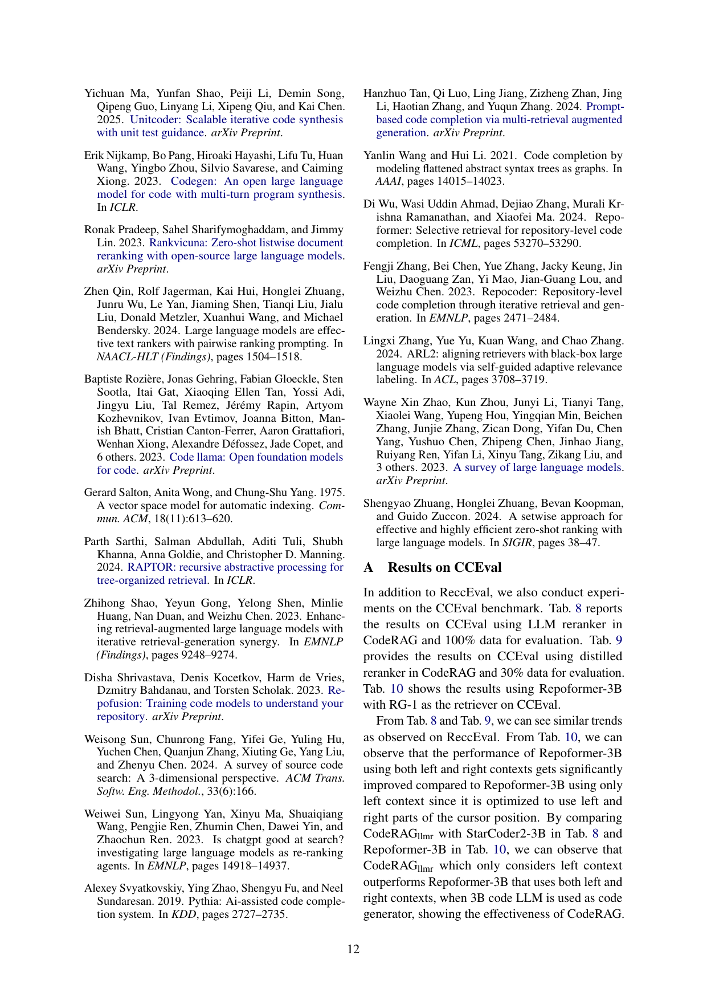

<!-- PDF page 13 -->

## Página PDF 13

Table 8: Performance on CCEval (Use 100% data for evaluation). Bold and underlined values indicate the best and
the second-best results, respectively.
Methods
CodeGen-350M
SantaCoder-1.1B
StarCoder2-3B
Qwen2.5-Coder-7B
Code Match
Identifier Match
Code Match
Identifier Match
Code Match
Identifier Match
Code Match
Identifier Match
EM
ES
EM
F1
EM
ES
EM
F1
EM
ES
EM
F1
EM
ES
EM
F1
Zero-Shot
2.70
43.02
8.26
37.85
4.35
46.52
10.58
41.88
6.53
48.56
12.91
44.52
11.11
52.19
18.09
48.35
CCFinder
10.58
48.65
17.19
45.96
14.63
53.44
23.08
51.90
21.08
58.11
29.42
57.46
24.80
59.52
33.47
62.61
RG-1
8.78
49.54
16.47
46.33
12.83
53.78
21.99
51.76
17.78
57.74
27.35
56.55
22.51
61.84
32.91
60.68
RepoCoder
10.58
51.07
19.06
48.93
15.12
55.66
24.62
53.78
21.24
60.90
31.56
60.00
25.89
63.65
36.21
63.09
DraCo
12.83
50.71
20.33
48.91
19.70
57.17
29.04
56.82
26.68
62.11
36.29
62.75
30.69
65.46
40.64
66.26
RepoFuse
11.22
50.78
19.29
48.77
17.64
56.52
27.02
55.65
23.34
61.28
33.43
61.16
27.73
64.76
38.39
64.82
CodeRAGllmr
14.11
52.44
22.28
51.56
22.89
59.92
32.42
60.24
30.66
65.46
41.13
66.62
35.20
68.93
45.97
70.47
Table 9: Performance on CCEval (Use 30% data for evaluation). Bold and underlined values indicate the best and
the second-best results, respectively.
CodeGen-350M
SantaCoder-1.1B
StarCoder2-3B
Qwen2.5-Coder-7B
Code Match
Identifier Match
Code Match
Identifier Match
Code Match
Identifier Match
Code Match
Identifier Match
EM
ES
EM
F1
EM
ES
EM
F1
EM
ES
EM
F1
EM
ES
EM
F1
Zero-Shot
2.57
41.34
6.77
35.29
3.88
45.72
9.41
40.11
6.88
47.45
11.79
42.26
9.65
50.89
15.29
45.10
CCFinder
9.33
46.20
14.24
42.69
13.41
52.06
21.18
50.08
20.30
56.07
25.90
53.32
23.53
58.82
30.00
59.85
RG-1
8.52
48.11
15.52
43.90
11.76
53.03
20.24
49.37
16.57
54.80
23.80
51.89
21.53
60.49
31.06
57.98
RepoCoder
10.62
49.49
17.39
46.22
14.59
54.87
23.06
51.74
21.24
58.46
28.47
56.28
24.71
62.35
33.88
60.57
DraCo
11.55
47.71
17.04
44.95
19.60
55.62
26.84
53.52
25.67
59.59
32.32
58.68
29.99
63.88
36.17
63.86
RepoFuse
11.41
49.87
18.82
46.40
18.35
56.00
26.59
54.00
23.06
61.27
32.59
59.56
26.71
63.36
35.88
62.08
CodeRAGdisr
11.78
48.39
17.74
45.04
20.07
56.30
27.77
54.75
26.25
60.53
33.49
60.21
28.70
64.56
36.52
63.76
Table 10: Results of RepoFormer-3B on CCEval (Use
100% Data for evaluation). l: only use left context. lr:
use left and right contexts.
Dataset
RepoFormer-3B
Code Match
Identifier Match
EM
ES
EM
F1
CCEvall
8.18
50.19
15.53
46.25
CCEvallr
25.29
63.45
33.77
61.48
13

[Vista original de la página 13](../../../../../images/v5/estructura_colecciones/Related/fourth/codeRag/page-13.png)

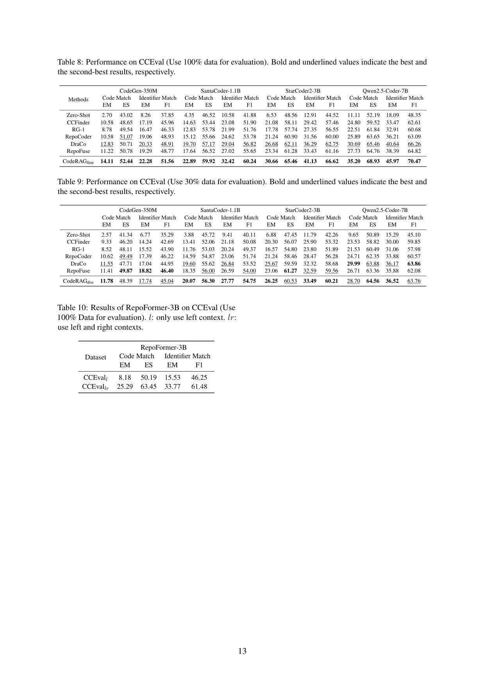
